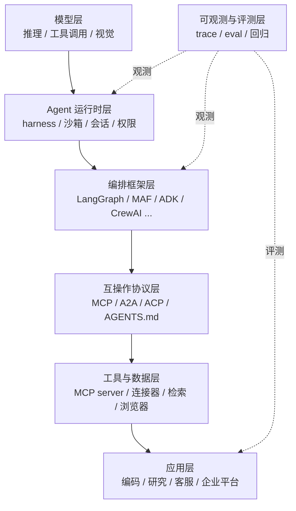

# 2026 年 Agent 技术全景：七层模型与三条主线

## 一句话结论

2026 年的 Agent 技术已经不再按"哪个框架更强"来分层，而是按**能力线（模型）、控制线（runtime/harness）、协作线（协议）**三条主线分工：框架在变薄，runtime 在变厚，协议在收敛。选型的核心问题因此从"用哪个框架"变成"哪几层自己建、哪几层交给标准"。

## 问题与边界

- **解决什么**：给出一张能长期使用的坐标系，让读者把任何一个新框架、新协议、新产品放回正确的位置，判断它替代的是哪一层。
- **不解决什么**：不评厂商商业前景，不预测具体产品生死，不展开单个框架的实现细节（见[卷 2](../02-frameworks/00-selection-matrix.md)）。
- **边界**：本文描述的是"技术栈结构"，不是"市场格局"。市场份额与融资信息只在能解释技术路线时引用。

## 三条主线

理解 2026 年的 Agent 生态，先抓住三条独立演进的线：

| 主线 | 要解决的问题 | 2026 年的状态 | 代表 |
|---|---|---|---|
| 能力线 | 模型能不能可靠地规划、调用工具、操作界面 | 工具调用与 computer use 已成为前沿模型的标配能力 | Claude、GPT、Gemini、开源模型 |
| 控制线 | 谁负责循环、上下文、权限、沙箱、失败恢复 | 从"框架里的 loop"上移为独立 runtime / harness | Claude Agent SDK、Codex、DSH、AgentCore |
| 协作线 | agent 之间、agent 与工具/编辑器之间怎么说话 | 四层协议基本收敛，治理移交基金会 | MCP、A2A、ACP、AGENTS.md |

三条线不是并列的：**能力线决定上限，控制线决定能不能上线，协作线决定能不能规模化**。多数团队的问题不在能力线，而在控制线与协作线。

## 七层模型

| 层 | 职责 | 2026 年的关键变化 |
|---|---|---|
| L1 模型层 | 推理、工具调用、视觉/界面理解、长上下文 | 推理模型与工具调用融合；computer use 从实验走向产品 |
| L2 运行时层 | agent loop、上下文管理、工具执行、权限、沙箱、会话 | 从框架内部抽离为独立产品（Agent SDK / harness / 托管 runtime） |
| L3 编排框架层 | 多步骤/多 agent 的结构化编排、状态管理 | 横向合并（AutoGen + Semantic Kernel），抽象变薄 |
| L4 协议层 | 工具接入、agent 委托、编辑器集成、仓库约定 | MCP 无状态化、A2A 1.0、ACP 注册表、AGENTS.md 收敛 |
| L5 工具与数据层 | 工具实现、连接器、检索、浏览器/代码执行 | MCP server 生态爆发；工具从"函数"扩展到"应用" |
| L6 可观测与评测层 | trace、回放、离线/在线评估、回归 | OTel 语义约定推进；评测从"跑分"转向"轨迹+成本" |
| L7 应用层 | 编码、研究、GUI 操作、企业流程 | 编码与研究最先成熟；企业平台转向"平台+代码"混合 |

### 层间契约：一次任务跨过哪些边界

七层之间不是函数调用，而是六次有损压缩。理解每次压缩丢了什么，比记住层名更有用：

| 边界 | 传过去 | 传不过去 | 典型故障 |
|---|---|---|---|
| 模型 ↔ 运行时 | token、工具调用意图 | 模型的隐式推理 | 工具参数幻觉、循环 |
| 运行时 ↔ 编排框架 | 状态、事件、检查点 | 上下文细节、临时变量 | 恢复后"忘记"为什么这么做 |
| agent ↔ MCP server | 工具名 + 参数 | 完整对话与意图 | 越权、参数语义错配 |
| agent ↔ A2A agent | task、message、artifact | 内部记忆与工具 | 验收标准分歧 |
| 编辑器 ↔ agent（ACP） | 会话、cwd、权限决定 | 运行时环境差异 | 路径与权限不一致 |
| 仓库 ↔ agent（AGENTS.md） | 纯文本约定 | 任何强制力 | 指令冲突、悄悄失效 |

结论只有一句：**agent 系统的故障，绝大多数发生在边界上，而不是发生在某一层内部**。这也解释了为什么"换更强的模型"经常无效——模型变强不会修复边界上的信息损失，只会让层内的判断更准。

### 用七层模型判断一个新概念

遇到新名词时问四个问题，基本能定位：

1. 它替代或补齐的是哪一层？答不上来，多半是包装。
2. 它跨过了哪条边界？在边界上增加了信息，还是又压缩了一次？
3. 它的失败粒度是什么？单次调用、整个任务、一个回合，还是一个会话？
4. 它把状态放在哪里？模型上下文、运行时、外部存储，还是协议里？

四个答案的组合，就是这个东西的适用边界。比如"又一个 agent 框架"若答不出第 2、4 题，通常只是换了 API 形状；"又一个协议"若答不出第 3 题，通常只是序列化格式。

## 2026 年的六个关键变化

### 1. MCP 走向无状态核心与扩展化

2026-07-28 规范把 MCP 从双向有状态协议改为请求/响应模型：取消 `initialize` 握手与 `Mcp-Session-Id`，每个请求自带协议版本与客户端能力；`tools/list` 等列表结果可缓存；`Mcp-Method` / `Mcp-Name` 进入 HTTP 头供网关路由；Tasks 移入 `io.modelcontextprotocol/tasks` 扩展；Roots、Sampling、Logging 进入弃用期。意义是 **MCP server 可以像普通 HTTP 服务一样部署在 serverless 与边缘**，这是"协议进入生产"的标志。

### 2. A2A 完成 1.0 与基金会治理

A2A 从 Google 的提案变成 Linux 基金会项目，2026-03 发布 1.0 并进入生产使用，覆盖 Agent Card、任务生命周期与三种 binding。它补上了 MCP 不管的那一层：**agent 之间如何委托任务**。截至 2026 年 4 月，基金会公告称 150+ 组织支持、三大云平台集成；2026-08 又进一步并入 AAIF，与 MCP、AGENTS.md 收进同一个治理伞下。

### 3. AGENTS.md 收敛为跨工具事实标准

AGENTS.md 由 AAIF 托管，成为仓库级上下文约定；Claude Code 从 2.1.277 起在无 CLAUDE.md 时读取 AGENTS.md。这意味着"给 agent 的项目说明书"不再按工具分裂——**上下文约定先于协议收敛，因为它成本最低**。

### 4. 框架横向合并，抽象变薄

AutoGen 与 Semantic Kernel 合并为 Microsoft Agent Framework，2026-04-02 发布 1.0；随后 Agent Harness 与托管 agent 进入 GA。OpenAI 的 AgentKit 则在 2026-06 宣布 Agent Builder 与 Evals 于 11-30 下线，官方建议转向 Agents SDK。两个信号指向同一结论：**可视化编排层不稳定，SDK + 协议 + runtime 才是沉淀下来的部分**。

### 5. Agent SDK / harness 成为独立交付形态

Claude Agent SDK 把 Claude Code 的 loop、工具、权限、子 agent、hooks 产品化；AWS、Microsoft、Google 各自推出托管 agent runtime。竞争焦点从"谁有更好的图编排 API"转向"谁的 harness 更可靠、沙箱更安全、上下文管理更省 token"。

### 6. 工程化成为分水岭

2026 年的综述开始把约束从"能力"改述为"组合后的可靠性与治理"。具体表现：评测强调轨迹与 cost per success，安全强调间接注入与权限边界，部署强调持久化执行与断点续跑。**能 demo 的团队很多，能说清失败率与单位成本的团队很少。**

## 三个常见误区分层

| 误区 | 实际关系 | 后果 |
|---|---|---|
| "框架 = runtime" | 框架是编排抽象，runtime 负责 loop、沙箱、权限与会话 | 以为选了框架就有了生产能力，上线时才发现要自己补沙箱、重试、观测 |
| "MCP = A2A" | MCP 管 agent↔工具/数据；A2A 管 agent↔agent 委托 | 用 MCP 硬做跨组织协作，缺任务生命周期与审计语义 |
| "多 agent 更先进" | 多 agent 的收益来自上下文隔离与并行，代价是一致性与调试成本 | 简单任务上多 agent，成本翻倍、成功率反降 |
| "benchmark 分数 = 可用性" | 公开 benchmark 多为短任务、单轮、理想工具 | 选型时高估能力，忽略长任务漂移与真实工具噪声 |

## 选型视角：哪几层自己建

| 层 | 建议 | 理由 |
|---|---|---|
| 模型层 | 多供应商可切换 | 单模型锁定是最大的架构风险 |
| 运行时层 | 优先用成熟 harness / 托管 runtime，核心差异再自建 | loop、沙箱、权限、上下文管理的工程量大且易错 |
| 编排框架层 | 按复杂度选，能不用就不用 | 简单任务直接调 API + 自建 loop 往往更可控 |
| 协议层 | 直接采用，不自定义 | 生态红利来自"别人也能接" |
| 工具层 | 自建核心工具，长尾用 MCP 生态 | 核心工具是差异化，长尾工具是成本 |
| 可观测/评测层 | 必须自建数据闭环，工具可采购 | 没有轨迹数据就无法迭代 |
| 应用层 | 自建 | 这是业务本身 |

> 判断：未来两年真正的护城河不在框架，而在"harness + 评测数据集 + 工具权限体系"这三件脏活。框架会被商品化，这三件不会。

## 开放问题

- 协议层收敛后，**身份、计费、审计**仍是空白：agent 代表谁付款、谁授权、出问题谁负责。
- 无状态 MCP 让部署变简单，但把"跨调用状态"推回给应用，**长时任务的语义**还没有统一答案。
- 托管 runtime 降低了运维成本，也提高了迁移成本；**锁定度**缺少可比较的度量。
- 评测仍以短任务为主，**长时任务（小时级）的成功率**没有公认口径。

## 参考来源

- The 2026-07-28 Specification · Model Context Protocol · 2026-07 · https://blog.modelcontextprotocol.io/posts/2026-07-28/
- Linux Foundation Announces the Formation of the Agentic AI Foundation (AAIF) · Linux Foundation · 2025-12 · https://www.linuxfoundation.org/press/linux-foundation-announces-the-formation-of-the-agentic-ai-foundation
- A2A Protocol Surpasses 150 Organizations... · Linux Foundation · 2026-04 · https://www.linuxfoundation.org/press/a2a-protocol-surpasses-150-organizations-lands-in-major-cloud-platforms-and-sees-enterprise-production-use-in-first-year
- Microsoft Agent Framework Harness and Hosted Agents Reach General Availability · InfoQ · 2026-08 · https://www.infoq.com/news/2026/08/agent-framework-harness-ga/
- Introducing AgentKit（含 2026-06-03 停用说明） · OpenAI · 2025-10 · https://openai.com/index/introducing-agentkit/
- The ACP Registry is Live · Zed · 2026-01 · https://zed.dev/blog/acp-registry
- AGENTS.md 词条（治理与采用情况） · 百度百科 · 2026-09 · https://baike.baidu.com/item/AGENTS.md/67757810
- Anthropic adopts OpenAI's standards: AGENTS.md · 36Kr · 2026-09 · https://eu.36kr.com/en/p/3989811919076098
- Top 13 Open-Source Agentic AI Frameworks（框架横评） · AIMultiple · 2026-11 · https://aimultiple.com/agentic-frameworks
- Agent2Agent Joins The Agentic AI Foundation Alongside MCP · Yahoo Tech · 2026-08 · https://tech.yahoo.com/ai/articles/agent2agent-joins-agentic-ai-foundation-130048369.html
