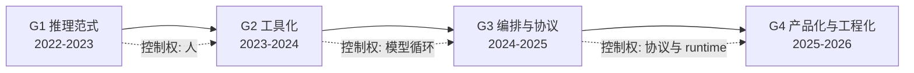

# 从 Prompt 到协议：Agent 技术的四代演进

## 一句话结论

Agent 技术的演进主线不是"模型越来越强"，而是**控制权两次转移**：第一次从人写的 prompt 转移到模型自主的循环（2022–2024），第二次从模型自由发挥转移到协议与工程约束（2024–2026）。2026 年所处的第四代，主题是"把不可靠的自主性装进可运维的壳里"。

## 问题与边界

- **解决什么**：解释今天的技术栈为什么长这样，帮助读者判断一个新概念属于"新能力"还是"旧问题的新包装"。
- **不解决什么**：不做完整的学术编年史，不覆盖所有论文；只保留改变工程实践的分水岭。
- **边界**：时间线以公开可查的发布/论文为准，产品内部迭代不在范围内。

## 四代划分

| 代际 | 时间 | 核心命题 | 代表技术 | 留给下一代的问题 |
|---|---|---|---|---|
| G1 推理范式 | 2022–2023 | 让模型显式地"想" | CoT、ReAct、AutoGPT | 想得对但做不对：没有可靠的工具接口 |
| G2 工具化 | 2023–2024 | 让模型能"做" | function calling、RAG、Assistants API | 单轮工具够用，多步骤流程失控 |
| G3 编排与协议 | 2024–2025 | 让多步骤/多 agent 可组织 | LangGraph、CrewAI、AutoGen、MCP、A2A、computer use | demo 能跑，生产不可运维 |
| G4 产品化与工程化 | 2025–2026 | 让 agent 可上线、可治理 | Agent SDK、harness、托管 runtime、AAIF、A2A 1.0、MCP 无状态 | 可靠性、成本、身份与责任 |

## 关键时间线

| 时间 | 事件 | 为什么重要 |
|---|---|---|
| 2022-01 | Chain-of-Thought 论文 | 证明"显式推理步骤"能提升复杂任务表现，成为后续一切 loop 的认知基础 |
| 2022-10 | ReAct 论文 | 把"推理"与"行动"交替起来，Agent loop 的原型 |
| 2023-02 | Toolformer | 让模型自己决定何时调用工具，工具调用从外挂变内置 |
| 2023-03 | AutoGPT / BabyAGI | 自主 agent 的第一波热潮，也第一次暴露"循环失控" |
| 2023-06 | OpenAI function calling | 工具调用有了标准 schema，生态开始围绕 JSON Schema 生长 |
| 2023-11 | Assistants API（threads / tools / files） | 厂商开始提供"会话 + 工具 + 文件"的托管抽象 |
| 2024-10 | Anthropic computer use | agent 从"调 API"扩展到"操作界面"，权限问题正式浮出水面 |
| 2024-11 | MCP 发布 | 工具接入从 N×M 集成变成 N+M，协议层出现 |
| 2025-03 | OpenAI Agents SDK | Swarm 的工程化后继，轻量 handoff/guardrail 抽象 |
| 2025-04 | Google 发布 A2A、ADK | agent 间互操作被提出；框架与协议开始绑定 |
| 2025 年中 | A2A 移交 Linux 基金会 | 协议中立化，跨厂商采用的前提 |
| 2025-09 | Claude Agent SDK | 把 Claude Code 的 harness 产品化，"runtime 即产品" |
| 2025-10 | OpenAI AgentKit、Microsoft Agent Framework 发布 | 大厂同时押注"可视化编排"与"统一框架"两条路线 |
| 2025-12 | AAIF 成立（MCP、goose、AGENTS.md 捐赠） | 协议治理进入基金会时代 |
| 2026-03 | A2A 1.0 | 互操作协议达到可承诺稳定的版本 |
| 2026-04 | Microsoft Agent Framework 1.0 | 框架横向合并落地，AutoGen/SK 时代结束 |
| 2026-06 | OpenAI 宣布 Agent Builder / Evals 于 11-30 下线 | 可视化编排层不稳定，官方引导回 SDK |
| 2026-07 | MCP 2026-07-28 规范 | 无状态核心 + 扩展框架，协议进入生产形态 |
| 2026-08 | A2A 并入 AAIF | 与 MCP、AGENTS.md 同一治理伞，互操作标准集中化 |
| 2026-09 | Claude Code 支持 AGENTS.md | 上下文约定跨工具收敛 |

## 每一代的驱动力与瓶颈

### G1：证明"想"有用，但"做"不了

CoT 与 ReAct 的共同贡献是把推理过程外显，使模型可以自我检查、可以被提示词干预。AutoGPT 证明了自主循环在 demo 中可行，但失败模式极其固定：目标漂移、无限循环、工具错误无法恢复。**这一代没有解决"行动接口"问题**，模型只能生成文本。

### G2：工具调用解决了接口，但没解决流程

function calling 把"行动"压缩成一个结构化调用，RAG 补上了知识时效性。问题转移到流程层：多步骤任务需要状态、需要分支、需要在失败时重试。Assistants API 提供了会话对象，但没有提供编排语义。

### G3：编排框架爆发，协议开始出现

LangGraph、CrewAI、AutoGen 各自给出不同的编排抽象（图、角色、对话）。同时 MCP 把工具接入标准化，A2A 把 agent 委托标准化。**这一代的遗产是"抽象"，负债是"抽象太多"**：同一件事有五种写法，团队迁移成本极高。

### G4：把自主性装进壳里

三件事同时发生：
1. **harness 产品化**：loop、工具、权限、子 agent、hooks、上下文压缩被封装成 SDK（Claude Agent SDK）或托管 runtime（AgentCore、Foundry Hosted Agents、Vertex Agent Engine）。
2. **框架合并与变薄**：AutoGen + Semantic Kernel → MAF；框架不再试图包办一切，而是回归"编排 + 状态"。
3. **协议治理化**：MCP、A2A、AGENTS.md 进入基金会，版本节奏与弃用策略变得可预期（MCP 承诺 12 个月弃用窗口）。

## 为什么会收敛到"协议 + runtime"

四个约束把行业推到了同一个终点：

| 约束 | 表现 | 结果 |
|---|---|---|
| 集成表面积 | 每个工具 × 每个框架都要写适配 | 协议把 N×M 变成 N+M |
| 可靠性 | demo 成功率 80%，生产要求 99% | 需要 checkpoint、重试、沙箱、HITL，这些属于 runtime |
| 成本 | 多轮 + 长上下文使 token 成本失控 | 需要上下文工程与缓存，属于 runtime |
| 治理 | 企业要求审计、权限、可替换 | 需要协议与标准，不能锁在框架里 |

> 判断：模型能力每提升一次，"厚框架"的价值就下降一分——因为编排的一部分被模型自己吸收了。但**沙箱、权限、可观测、失败恢复不会被模型吸收**，所以 runtime 会越来越厚，框架会越来越薄。

## 每一代留下的技术债

| 代际 | 当时的解法 | 留给今天的技术债 |
|---|---|---|
| G1 | 在 prompt 里写推理步骤 | 把"思考"当成可无限堆叠的文本，导致上下文膨胀 |
| G2 | 每个工具一个 JSON Schema | 工具数量爆炸，选择准确率随定义数量下降 |
| G3 | 每个框架一套编排抽象 | 迁移成本高，图 / 角色 / 对话三套心智模型并存 |
| G4 | 每个厂商一套 harness | 锁定度上升，评测与观测口径不统一 |

技术债的规律是：**每一代都在解决上一代的"能不能"，同时给下一代留下"贵不贵、稳不稳"**。今天最贵的三件事——上下文、评测、权限——分别对应前三代留下的债。

## 补课的推荐顺序

如果团队现在才系统性地建 agent 能力，建议按"债"的顺序补，而不是按技术热度：

1. 先补评测（G3 的债）：没有轨迹数据，后面所有优化都无法验证。
2. 再补上下文工程（G1 的债）：它决定单位成本与长任务成功率。
3. 再补权限与沙箱（G2 的债）：它决定能不能碰真实系统。
4. 最后选框架与 runtime（G4 的债）：前三条不清楚时，选什么框架都是在赌。

这个顺序与厂商的宣传顺序几乎相反——厂商从框架讲起，是因为框架最好卖；而团队应该从数据与边界讲起，因为那才是复利所在。

## 被高估与被低估

| 被高估 | 原因 |
|---|---|
| 全自动通用 agent | 长任务的成功率随步数指数衰减，2026 年仍无通用解法 |
| 多 agent 自组织 | 拓扑越复杂，调试成本越高，收益只在特定任务成立 |
| 可视化编排 | AgentKit 的 Agent Builder 下线是最近的反例 |
| "选对框架" | 框架可替换，评测数据与工具权限不可替换 |

| 被低估 | 原因 |
|---|---|
| 上下文工程 | 同样的模型，上下文组织方式能让成本差 3–5 倍、成功率差 20 个点 |
| 评测与回归 | 没有轨迹数据，所有优化都是盲调 |
| 沙箱与权限 | 一次越权操作的代价高于全年 token 费用 |
| 协议迁移成本 | 无状态化、版本弃用都会带来真实改造量 |
| 持久化执行 | 长时任务的断点续跑是"能不能用"的分水岭 |

## 对读者的启示

1. **学习顺序**：先 loop 与上下文（卷 1），再协议（卷 3），最后框架（卷 2）。框架是变化最快的层，概念是变化最慢的层。
2. **投资顺序**：评测数据集 > 工具权限体系 > harness 可靠性 > 框架选型。
3. **看新技术的提问方式**：它替代的是七层模型里的哪一层？如果答案含糊，大概率是包装。

## 开放问题

- 第四代会不会被"模型原生 agent"终结？即模型厂商把 harness 内置到 API 里，第三方 runtime 失去空间。
- 协议收敛后，**跨组织 agent 的责任边界**仍无法律与技术共识。
- 评测方法没有跟上任务长度：小时级任务的成功率如何统计，仍无公认答案。

## 参考来源

- Chain-of-Thought Prompting Elicits Reasoning in Large Language Models · Wei et al. · 2022-01 · https://arxiv.org/abs/2201.11903
- ReAct: Synergizing Reasoning and Acting in Language Models · Yao et al. · 2022-10 · https://arxiv.org/abs/2210.03629
- Toolformer: Language Models Can Teach Themselves to Use Tools · Meta AI · 2023-02 · https://arxiv.org/abs/2302.04761
- The 2026-07-28 Specification · Model Context Protocol · 2026-07 · https://blog.modelcontextprotocol.io/posts/2026-07-28/
- Linux Foundation Announces the Formation of AAIF · Linux Foundation · 2025-12 · https://www.linuxfoundation.org/press/linux-foundation-announces-the-formation-of-the-agentic-ai-foundation
- A2A Protocol Surpasses 150 Organizations · Linux Foundation · 2026-04 · https://www.linuxfoundation.org/press/a2a-protocol-surpasses-150-organizations-lands-in-major-cloud-platforms-and-sees-enterprise-production-use-in-first-year
- Microsoft Agent Framework Harness and Hosted Agents Reach General Availability · InfoQ · 2026-08 · https://www.infoq.com/news/2026/08/agent-framework-harness-ga/
- Introducing AgentKit（含停用说明） · OpenAI · 2025-10 · https://openai.com/index/introducing-agentkit/
