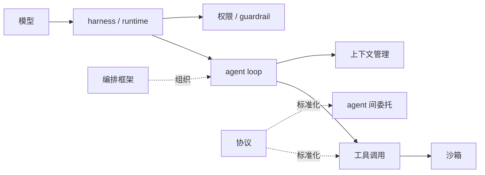

# 术语表：Agent 技术体系的 60 个关键词

## 一句话结论

Agent 领域的术语混乱主要来自三件事：**同一概念被不同层重复命名**（framework / SDK / runtime / harness）、**协议名被当成能力名**（MCP ≠ 工具调用）、**评测词被当成指标**（benchmark ≠ eval）。本表按层分组，先给一句话定义，再标出最容易混淆的地方。

## 问题与边界

- **解决什么**：统一整套文档的用词，减少跨篇阅读的歧义。
- **不解决什么**：不做学术定义考据；定义以工程实践中的共识为准。
- **用法**：其它篇目首次出现英文术语时，默认指向本表。

## 概念关系

## 范式与架构

| 术语 | 英文 | 一句话定义 | 易错点 |
|---|---|---|---|
| 智能体 | agent | 能感知环境、决定下一步、调用工具并循环执行直到达成目标的系统 | 不等于"用了 LLM 的功能" |
| 智能体化 | agentic | 描述系统具备自主决策与多步执行能力 | 常被营销泛化，需看是否有 loop 与工具 |
| 智能体循环 | agent loop | 观察→思考→行动→观察的重复过程 | 与 workflow 的分界是"谁决定下一步" |
| 工作流 | workflow | 步骤与分支预先定义的执行图 | 确定性任务应优先用 workflow |
| 编排 | orchestration | 决定哪个 agent/步骤在何时执行、状态如何流转 | 与 choreography（对等协作）相对 |
| 对等协作 | choreography | 无中心调度者，各方按协议自行响应 | 多见于跨组织场景 |
| 规划-执行 | plan-and-execute | 先出完整计划再逐步执行，执行中可重规划 | 计划过长时容易与实际脱节 |
| 反思 | reflection | 让模型评审自己的输出并修正 | 无外部信号时容易"自我确认" |
| 思维链 | chain-of-thought | 让模型显式输出中间推理步骤 | 推理模型的内部思考不一定是 CoT |
| 思维树 | tree-of-thought | 搜索式地展开多条推理路径并评估 | 成本随分支数爆炸 |
| 交接 | handoff | 把控制权与上下文移交给另一个 agent | 与"调用子 agent 后返回"不同 |
| 主管 | supervisor | 中心化调度多个子 agent 的角色 | 单点瓶颈与错误放大 |
| 子智能体 | subagent | 由主 agent 派生、有独立上下文的执行单元 | 上下文隔离是收益，也是信息丢失源 |
| 多智能体 | multi-agent | 多个 agent 协作完成任务的系统形态 | 不等于更先进，收益依赖任务可分解性 |
| 群体 | swarm | 去中心化、agent 间直接交接的拓扑 | 可预测性低于 supervisor |
| 黑板 | blackboard | 多 agent 通过共享状态区协作 | 状态冲突难排查 |

## 上下文与记忆

| 术语 | 英文 | 一句话定义 | 易错点 |
|---|---|---|---|
| 上下文窗口 | context window | 模型单次可接受的 token 上限 | 大窗口 ≠ 有效利用 |
| 上下文工程 | context engineering | 决定放什么、放多少、按什么顺序放 | 不是"写更长的 prompt" |
| 上下文腐化 | context rot | 上下文变长后模型对关键信息的利用率下降 | 与"窗口不够"是两回事 |
| 压缩 | compaction | 把历史压缩成更短的表示以继续任务 | 压缩会丢约束，需保留关键状态 |
| 摘要 | summarization | 用模型生成历史摘要 | 摘要偏差会累积 |
| 草稿区 | scratchpad | 供模型记录中间结果的临时区域 | 不持久，轮次结束即丢 |
| 提示缓存 | prompt caching | 复用相同前缀的 KV 计算以降低成本 | 前缀一变即失效 |
| 工作记忆 | working memory | 当前任务内的上下文 | 与长期记忆的边界常被混淆 |
| 情节记忆 | episodic memory | 过往任务/交互的具体经历 | 需要检索与过期策略 |
| 语义记忆 | semantic memory | 抽取后的事实性知识 | 与 RAG 的知识库高度重叠 |
| 程序性记忆 | procedural memory | "怎么做"的技能与流程 | 常以 skills / 工具形式落地 |
| 检索增强 | RAG | 检索外部知识注入上下文 | 是"读"，不包含写入与遗忘 |

## 工具与运行时

| 术语 | 英文 | 一句话定义 | 易错点 |
|---|---|---|---|
| 工具调用 | tool calling | 模型输出结构化调用请求，由运行时执行 | 与 function calling 常混用 |
| 函数调用 | function calling | 早期的工具调用形态，基于 JSON Schema | 现在多指同一能力的旧称 |
| 工具描述 | tool schema | 工具名、参数、描述的机器可读定义 | 描述质量直接决定调用准确率 |
| 并行调用 | parallel tool calls | 一轮内并发执行多个互不依赖的工具 | 依赖关系需模型自己判断 |
| 代码解释器 | code interpreter | 在沙箱中执行模型生成的代码 | 与"调用代码工具"不同 |
| 计算机操作 | computer use | 通过截图/坐标或无障碍树操作 GUI | 权限等价于"能操作一切" |
| 沙箱 | sandbox | 限制工具执行的文件、网络、资源边界 | 容器不等于安全边界 |
| 微虚拟机 | microVM | 基于硬件虚拟化的轻量隔离单元（如 Firecracker） | 启动开销高于容器 |
| 出口控制 | egress control | 限制沙箱可访问的网络目标 | 常被忽略的数据外泄通道 |
| 运行壳 | harness | 包裹模型的完整运行时：loop、工具、权限、上下文、子 agent | 与"框架"不是同义词 |
| 脚手架 | scaffold | 为完成特定任务而搭的临时结构 | 常指研究中的评测脚手架 |
| 运行时 | runtime | 执行 agent 的基础设施 | 与 SDK 的边界看是否托管会话与执行 |
| 会话 | session | 跨多轮交互保持的状态容器 | 无状态协议下需应用自己维护 |
| 检查点 | checkpoint | 执行过程中的状态快照，用于恢复 | 快照粒度过粗会丢进度 |
| 持久化执行 | durable execution | 进程崩溃后能从检查点继续 | 需要幂等与补偿配合 |
| 人工介入 | HITL | human-in-the-loop，关键节点由人审批 | 应"人在环上"，不是每步都等人 |
| 护栏 | guardrail | 对输入/输出/动作的约束与校验 | 多为建议性，不等于强制权限 |
| 预算 | budget | 对步数、token、时长、金额的上限 | 没有预算的 agent 等于没有刹车 |
| 轨迹 | trajectory | 一次任务中所有步骤、工具调用与结果的序列 | 评测与调试的核心数据 |

## 协议与标准

| 术语 | 英文 | 一句话定义 | 易错点 |
|---|---|---|---|
| 模型上下文协议 | MCP | 标准化模型/agent 与工具、数据源之间的接入 | 只管工具侧，不管 agent 间 |
| 智能体间协议 | A2A | 标准化 agent 之间的任务委托与协作 | 与 MCP 互补，不是竞争 |
| 智能体客户端协议 | ACP | 标准化编辑器/IDE 与 agent 进程的通信 | 管"编辑器↔agent"，不管工具 |
| 仓库约定 | AGENTS.md | 放在仓库里的 agent 操作说明 | 不是协议，是约定 |
| 智能体卡片 | Agent Card | A2A 中描述 agent 能力、端点、认证的声明 | 需签名防篡改 |
| 扩展 | extension | MCP 中独立版本化的可选能力（Tasks、Apps 等） | 与核心规范分开演进 |
| 多轮往返请求 | MRTR | 无状态 MCP 中服务端向客户端索取输入的模式 | 替代旧的 elicitation 长连接 |
| 征询 | elicitation | 服务端请求用户补充信息 | 2026-07 后归入 MRTR 语义 |
| 采样 | sampling | 服务端请求客户端代为调用模型 | 已进入弃用期 |
| 任务 | task | 长时操作的句柄与状态机 | MCP Tasks 与 A2A Task 不是同一个东西 |

## 评测与观测

| 术语 | 英文 | 一句话定义 | 易错点 |
|---|---|---|---|
| 评测 | eval | 对系统能力的系统性测量 | 与 benchmark 不是同义词 |
| 基准 | benchmark | 公开的标准化测试集与评分 | 分数受脚手架影响极大 |
| 黄金集 | golden set | 团队自建的、有标准答案的任务集 | 比公开榜更能反映真实水平 |
| 模型评审 | LLM-as-judge | 用模型给输出打分 | 需校准，存在位置与长度偏差 |
| pass@k | pass@k | k 次尝试中至少成功一次的概率 | 适合"可重试"场景 |
| pass^k | pass^k | k 次尝试全部成功的概率 | 适合"必须稳定"场景 |
| 轨迹评测 | trajectory eval | 评步骤是否合理，而非只看结果 | 能定位失败原因 |
| 单任务成本 | cost per task | 完成一个任务的平均花费 | 需与成功率一起看 |
| 成功成本 | cost per success | 总成本 / 成功任务数 | 比 token 单价更有决策价值 |

## 安全与治理

| 术语 | 英文 | 一句话定义 | 易错点 |
|---|---|---|---|
| 提示注入 | prompt injection | 通过输入内容劫持模型指令 | 间接注入来自工具结果与网页 |
| 工具投毒 | tool poisoning | 在工具描述或返回值中埋入恶意指令 | 描述本身也是攻击面 |
| 混淆代理 | confused deputy | 借 agent 的权限执行用户无权做的操作 | 权限设计不当的典型后果 |
| 能力 | capability | 授予 agent 的最小操作许可 | 比角色更细粒度 |
| 代表行动 | on-behalf-of | agent 以用户身份调用下游服务 | 需要令牌交换与审计 |
| 过度代理 | excessive agency | agent 拥有的权限超过任务所需 | 最常见的架构级风险 |
| 代理式 AI 基金会 | AAIF | Linux 基金会下托管 MCP、AGENTS.md、goose 的组织 | 不是标准制定机构，是治理托管方 |

## 易混词辨析

| 对比 | 区别 | 判断方法 |
|---|---|---|
| Agent vs Workflow | 下一步由谁决定 | 若分支全部预定义，就是 workflow |
| Framework vs SDK vs Runtime vs Harness | 抽象层次依次降低、控制能力依次增强 | 看它是否托管会话、执行与权限 |
| Protocol vs API | 协议是多方约定的交互规范，API 是单方暴露的接口 | 换一个实现还能不能互通 |
| Orchestration vs Choreography | 有无中心调度者 | 谁决定下一个执行者 |
| Memory vs RAG | 记忆是读写闭环，RAG 是只读检索 | 是否包含写入、更新与遗忘 |
| Tool calling vs MCP | 前者是模型能力，后者是接入标准 | 不用 MCP 也能做工具调用 |
| Guardrail vs Permission | 护栏是校验，权限是准入 | 护栏能被绕过，权限不能 |
| Eval vs Benchmark | 评测是方法，基准是公开数据集 | 能否换成自己的任务集 |

## 参考来源

- The 2026-07-28 Specification · Model Context Protocol · 2026-07 · https://blog.modelcontextprotocol.io/posts/2026-07-28/
- Linux Foundation Announces the Formation of AAIF · Linux Foundation · 2025-12 · https://www.linuxfoundation.org/press/linux-foundation-announces-the-formation-of-the-agentic-ai-foundation
- A2A Protocol Surpasses 150 Organizations · Linux Foundation · 2026-04 · https://www.linuxfoundation.org/press/a2a-protocol-surpasses-150-organizations-lands-in-major-cloud-platforms-and-sees-enterprise-production-use-in-first-year
