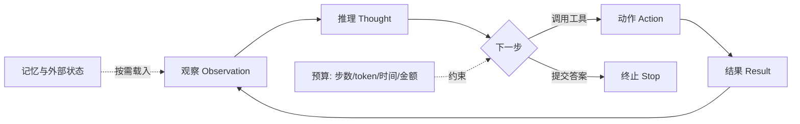
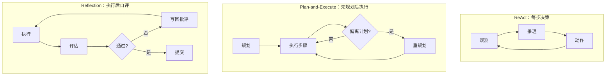

# Agent 的本质：观察—思考—行动循环与控制结构

## 一句话结论

Agent 与 workflow 的分界只有一条：**下一步做什么，是模型在运行时决定，还是代码在编译时决定**；这条分界同时决定了能力上限、可测试性和成本结构，所以"要不要上 agent"多数时候等价于"选哪种控制结构"。

## 先看一句话怎么变成一个循环

用户在终端里说："把 tests 里失败的用例修了。" 这听起来像一条指令，实际是一段要跑很多轮的流程：

1. 先跑一遍测试，拿到失败列表——这是**观测**；
2. 挑一个失败，读报错与相关代码，猜一个原因；改一处，再跑测试——这是**动作**，结果又是一个新观测；
3. 回到第 1 步，直到全绿，或者确认"改不动了"。

没有哪一步能靠一次分类完成：改哪一处，取决于上一步看到了什么；改完的结果，又改变下一次该修哪里。这个"看了再做、做完再看"的结构，就是循环。

| 这一步 | 具体发生了什么 | 对应概念 |
|---|---|---|
| 跑测试 | 拿到十几个失败，按文件分组 | 观测（observation） |
| 挑一个修 | 模型判断先修哪个、怎么改 | 策略（policy） |
| 重跑 | 验证假设，可能引入新失败 | 动作（action） |
| 停下 | 全绿、连续无进展、预算耗尽 | 终止条件（stop condition） |

**循环（loop）是什么？** 人话：看 → 想 → 做 → 再看，重复到有结论。类比：修车师傅打一次火、听声音、拧一颗螺丝、再打火。例子：上面三步通常要重复好几轮，才能修好一个失败用例。

**终止条件（stop condition）是什么？** 人话：什么情况下允许它停。类比：考试的交卷规则——做完、时间到、或放弃。例子：模型说"修好了"不算数，必须"测试全绿"才算；连续两轮动作相同、结果相同，则判定空转并升级给人。

**轨迹（trajectory）是什么？** 人话：这一趟从头到尾走过的完整路径。类比：行车记录仪，而不是终点照片。例子：同一个 bug 修两次，路径可能不同，所以测试要覆盖路径分布，而不只是看最后有没有改对。

下面把这条链路拆开：一步循环里到底发生什么，终止与熔断怎么设，以及四类控制结构怎么选。

## 问题与边界

- **解决什么**：给"agent"一个可判定的定义，把 ReAct、Plan-and-Execute、Reflection、树搜索这几类控制结构放到同一张坐标系里比较，并给出终止条件、预算控制、错误恢复的可实现规则。
- **不解决什么**：不讨论具体框架 API（见 [LangGraph](../02-frameworks/01-langgraph.md) 等框架篇），不讨论工具 schema 怎么写（见 [工具调用与沙箱执行](04-tool-use-and-sandbox.md)），不讨论上下文如何裁剪（见 [上下文工程](02-context-engineering.md)）。
- **与相邻概念的分界**：
  - **agent loop ≠ 编排框架**。loop 是运行时语义，框架只是把 loop 及其周边（状态、持久化、观测）打包。用 50 行 `while` 写出的 loop 和用图编排写出的 loop 是同一个 loop。
  - **agent ≠ 多智能体**。多智能体是 loop 的拓扑问题，不是 loop 的定义问题，见 [多智能体协作](05-multi-agent.md)。
  - **agent ≠ 长上下文**。上下文窗口是 loop 的资源约束，不是 loop 本身；把 1M token 塞进一次调用，仍然是单轮 workflow。
  - **agent ≠ 自主性程度**。自主性是连续量（谁决定下一步、能决定多远），不是二值属性。

Anthropic 在 2024-12 的工程文章里给出了目前最通用的划界：workflow 是"LLM 与工具由预定义代码路径编排"，agent 是"LLM 动态决定自己的流程与工具使用"（[Building effective AI agents](https://www.anthropic.com/engineering/building-effective-agents)）。到 2026 年，业界更常见的简写是"LLM 在循环中自主使用工具"，这个说法把重点从"智能"移到了"循环"。

## 核心概念与架构

形式化地，一个 agent loop 是五元组 `(S, A, O, π, B)`：

- `S`：状态，工程上就是下一次推理能看到的全部 token（system prompt、历史、工具结果、检索内容），而不是某个显式的变量集合。
- `A`：动作空间，由工具集合与一个隐式的 `STOP` 组成。动作的粒度由 schema 决定，不由模型决定。
- `O`：观测空间，工具返回值、错误、文件内容、页面截图。
- `π`：策略，即语言模型本身。它把 `S` 映射到 `A` 上的分布，这是 loop 里唯一不可形式化验证的部分。
- `B`：预算，步数、token、墙钟、金额四者至少约束两个。

一次迭代的语义是：`π` 读取 `S_t`，产出一段推理文本与零到多个动作；宿主执行动作，把结果作为观测追加进 `S_{t+1}`；直到产出 `STOP` 或预算耗尽。三个性质值得单独记住：

1. **单步原子性**：模型的一次输出里可以并行发多个工具调用，但它们属于同一个决策步；失败一个不等于整步失败，需要按调用粒度处理。
2. **观测即事实**：模型对世界的全部了解来自 `S`，所以"工具返回了什么"比"工具真的做了什么"更影响后续行为——这也是工具返回值要按 agent 的可读性设计、而不是按 API 的完整性设计的原因。
3. **轨迹不可复现**：同样的输入可以走出不同路径，因此 agent 的测试对象是轨迹分布而非单次输出（评测方法见 [评测体系与 benchmark](../04-engineering/02-evaluation.md)）。



## 关键机制

### 一步循环到底发生什么

工程上一步是四个阶段的固定序列，任何框架都绕不开：

1. **组装请求**：system prompt + 工具定义 + 历史 + 本轮新增观测。这一步决定了大部分失败，因为模型看到的不是"真实状态"，而是被裁剪过的状态。
2. **推理**：模型输出可能包含"思考文本"与"工具调用请求"。思考文本是否可见、是否进入下一轮上下文，各家实现不同，但它对多步任务的成功率影响很大。
3. **执行**：宿主校验参数、执行、序列化结果。校验失败与执行失败要区分——前者是模型的错，应回灌可读的纠正信息；后者是环境的错，应考虑重试。
4. **收敛**：把结果写回状态，判断是否终止。

一个最小但完整的 loop 语义如下（伪代码，非任何具体 SDK）：

```python
state = init(goal, system, tools)
for step in range(B.max_steps):
    out = model(state)                       # 一次推理
    if out.stop_reason == "end_turn":        # 模型自终止
        return out.text
    results = execute(out.tool_calls,         # 可能并行
                      timeout=B.tool_timeout,
                      idempotency_key=step)
    state = append(state, out, results)       # 观测回灌
    if exceeded(B) or no_progress(state):     # 预算与进度熔断
        return escalate(state, reason="budget")
```

关键细节在 `no_progress`：比较最近若干步的动作指纹（工具名 + 关键参数 + 结果哈希），连续重复即判定空转。这个检测比"最大步数"更早生效，也更能压住成本。

还有两个容易漏掉的工程点：

- **观测要做减法**。工具把 200 条记录全量回灌，模型不会因此更准，只会更难定位关键行。返回"筛过的少量结果 + 如何取更多的提示"，比返回全量更有效。
- **观测要保留来源**。同一个事实来自"用户口述"还是"数据库查询"，可信度完全不同。带来源标记的观测，让模型在冲突时至少有依据选择相信谁。

### 四类控制结构

**ReAct（Reason + Act）**：推理与行动交织，每一步都重新决策。原始论文把它表述为"交错生成推理轨迹与任务动作"，在知识密集与交互式任务上同时降低了幻觉与错误传播（[ReAct](https://arxiv.org/abs/2210.03629)，ICLR 2023）。

ReAct 之所以成为默认结构，是因为它把"不确定性"推到了唯一必须处理的地方——下一步。代价也随之明确：每步都要重读全部历史，token 成本随步数近似线性增长，而有效注意力随上下文长度下降（见 [上下文工程](02-context-engineering.md)）。2025 年后的一个改良是把思考与工具结果交错起来：模型在拿到每个工具结果后重新推理一次，而不是等所有并行结果回齐再想。这对"并行搜索、逐个评估"的任务收益明显，对人机对话类任务则几乎无用。

**Plan-and-Execute**：先由强模型产出一份显式计划，再逐步执行，必要时重规划。LangChain 在 2024-02 给出的三条收益——多步任务更快、可用小模型执行子步骤、计划可被人审阅（[Plan-and-Execute Agents](https://www.langchain.com/blog/planning-agents)）——到 2026 年依然成立。它的弱点在计划质量：计划错了，后面每一步都在错误前提上"正确执行"。学术上的近亲是 Plan-and-Solve prompting（[arXiv:2305.04091](https://arxiv.org/abs/2305.04091)），但工程实现的重点不在 prompt，而在重规划触发条件。

**Reflection / Critic**：行动后引入评估者（同一模型或不同模型），把批评写回上下文再试。Reflexion 的做法是不更新权重，只用语言反馈维护一段反思记忆，在后续试验中改进行为（[Reflexion](https://arxiv.org/abs/2303.11366)，NeurIPS 2023）。它把"试错"变成了上下文里的一次自我修正，代价是每轮多一次推理，风险是自我评估的偏置——模型倾向于认为自己没错。

**树搜索 / ToT 式**：把推理拆成"想法"节点，做展开、评分、回溯。ToT 在 Game of 24 上把 GPT-4 的成功率从思维链的 4% 提到 74%（[Tree of Thoughts](https://arxiv.org/abs/2305.10601)，NeurIPS 2023）。这类结构适合"有明确评估函数、搜索空间可枚举"的问题；放到开放域任务上，评分函数本身就是幻觉来源。



### 终止条件

终止是 loop 里最容易被低估的部分。生产系统至少要同时具备六类，缺一类就会出现某类事故：

| 类别 | 触发信号 | 缺它会怎样 |
|---|---|---|
| 模型自终止 | 无工具调用的正常回复 | —— |
| 显式提交 | 专用 `submit` / `finish` 工具 | 模型用自然语言"宣布完成"，但结果未结构化 |
| 步数上限 | 迭代计数 | 单次事故烧掉整月预算 |
| token 预算 | 累计输入+输出 | 上下文越长越贵，成本随步数平方增长 |
| 墙钟上限 | 单任务超时 | 长尾任务占满 worker，拖垮队列 |
| 无进展检测 | 动作指纹重复 | 两个工具互相"喂"结果，无限循环 |

后四类（步数、token、墙钟、无进展）由宿主判定与执行，是硬约束；前两类是模型的主动行为，宿主只能校验其合法性。软约束应该同时告知模型——模型知道预算存在时，会更早收敛。2026 年平台侧开始原生提供这类能力：Anthropic 的 task budgets（beta）把"整个 agentic loop 的 token 预算"作为建议值传给模型，让模型自我调节，而不是在宿主侧硬截断（[Task budgets](https://platform.claude.com/docs/en/build-with-claude/task-budgets)）。这比硬截断好，但仍是 advisory，宿主侧仍需兜底。

**预算控制表模板**（复制到设计文档里逐项填，右列是建议起点而非事实）：

| 预算项 | 归属 | 超限动作 | 建议起点 |
|---|---|---|---|
| 单任务步数 | 宿主 | 强制总结并返回部分结果 | 简单检索 5–10；多文件改动 30–60 |
| 单步工具调用数 | 宿主 | 截断多余调用并回灌提示 | 3–5（并行读类操作可更多） |
| 单次工具结果 token | 工具层 | 截断 + 提示用过滤/分页重取 | 单条 ≤ 25k（按所用 harness 的默认截断值调整） |
| 累计输入 token | 宿主 + 模型 | 触发压缩/卸载，再超则终止 | 按模型窗口的 60%–70% 设阈值 |
| 单任务墙钟 | 宿主 | 中断并落检查点 | 交互式 2–5 min；后台任务 30–60 min |
| 单任务金额 | 宿主 | 熔断 + 告警 | 按业务毛利倒推，不按"平均成本"设 |
| 无进展窗口 | 宿主 | 升级人工或切策略 | 连续 3 步动作指纹相同 |

### 错误恢复

错误要按"谁的责任"分类，而不是按异常类型分类。责任划分决定了恢复动作由谁执行——宿主自动重试，还是把错误写回让模型改，还是立刻交给人：

| 错误类别 | 典型信号 | 谁负责修 | 恢复动作 |
|---|---|---|---|
| 瞬态 | 限流、超时、5xx | 宿主 | 退避重试，带幂等键，模型无感 |
| 参数 | schema 校验失败、缺必填、枚举越界 | 模型 | 回灌结构化校验错误 + 正确示例 |
| 语义 | 工具成功但结果与预期不符 | 模型（知情）+ 人（定责） | 回灌真实结果并显式指出冲突 |
| 权限 / 资源 | 403、404、审批拒绝 | 人 | 立即终止并升级，不重试 |
| 空转 | 连续重复同一动作 | 宿主 | 注入"换策略"提示，再无效则终止 |

错误恢复的完整设计（重试预算、降级链、补偿事务）见 [可靠性与人工介入](../04-engineering/04-reliability-and-hitl.md)，这里只强调一条：**错误信息是上下文的一部分，它和 prompt 一样需要被设计。**

恢复能力的上限由"状态是否可持久化"决定。没有检查点的 loop 一旦中断只能从头跑，长任务上这是致命的；这也是图编排框架把 checkpoint 当核心卖点的原因。实现层面的取舍见 [可靠性与人工介入](../04-engineering/04-reliability-and-hitl.md)。

## 对比

下表把 Anthropic 总结的五种 workflow 模式与 agent 并列。判断标准不是"哪个更强"，而是"哪种任务结构下，预定义路径的覆盖率足够高"。

| 结构 | 谁决定下一步 | 适用条件 | 代价 | 失败模式 |
|---|---|---|---|---|
| Prompt chaining | 代码 | 任务能干净拆成固定子步骤，每步可校验 | 延迟叠加；错误在链上放大 | 中间步骤的 gate 形同虚设 |
| Routing | 代码 + 一次分类 | 输入类别清晰且可分 | 分类错误直接进错分支 | 长尾输入无分支可去 |
| Parallelization | 代码 | 子任务独立，或需要多视角投票 | token 线性增长 | 聚合逻辑掩盖单路失败 |
| Orchestrator-workers | 代码 + 一次规划 | 子任务数量无法预知，但可分解 | 协调开销；子任务重复 | 分工模糊导致重复劳动 |
| Evaluator-optimizer | 代码 + 评估者 | 有清晰评估标准，迭代确实有增益 | 每轮多一次推理 | 评估者与被评者共享同一偏置 |
| **Agent（loop）** | **模型** | 步骤数不可预测、路径不可硬编码、环境可反馈 | 方差大、成本高、难测试 | 循环、跑偏、预算失控 |

选它的条件可以压缩成三问：**步骤数能不能事先确定？**（不能→agent）**每一步能不能程序化校验？**（能→workflow 更划算）**失败一次的代价是否可接受？**（不可接受→加人审，或退回 workflow）。

三类场景应当直接排除 agent，而不是"再调调 prompt 试试"：

- **确定性流程**：步骤固定、输入可枚举、结果可校验（对账、ETL、单据流转）。agent 在这里的唯一"贡献"是把接近确定性的成功率拉低一截，并让延迟翻倍。
- **强合规场景**：每一步都需要可审计、可复现、可解释（资金划转、医疗建议、合同签署）。loop 的轨迹不可复现，天生与"可复现审计"冲突；即使加了全量日志，也无法解释"为什么这一步选了 A 不选 B"。
- **低延迟场景**：用户等待预算在百毫秒到一两秒（补全、搜索建议、实时风控）。单次 loop 至少两次模型往返，加上工具 RTT，很难压进预算。

这三类的共同点是：**不确定性没有价值**。agent 卖的是"处理不可预知"，当不可预知本身不存在或被禁止时，它只是成本。

生产系统里更常见的是混合结构，而不是表格里的单行：外层是确定性 DAG（保证合规与可审计），内层在某些单元格里嵌入一个受限 loop（处理不可预知的局部）。判断混合点在哪，看"这一段的分支是否多于三个且无法预先枚举"——是，就开 loop；否，就写死。

> 判断：2026 年 agent 的失败，多数不是"模型不够聪明"，而是把一个本质是 DAG 的流程写成了 loop，然后用更多 token 去弥补不确定性。

## 实践建议与常见坑

- **坑 1：确定性流程用 ReAct**。触发条件：步骤固定（如"取数→校验→入库"）、但团队想"顺便上 agent"。后果是同一输入的成功率明显下降、延迟翻倍，且失败原因难以复现。规避：把固定步骤写成代码，只在"异常处置"这一格留一个子 loop。
- **坑 2：把最大步数当成唯一熔断**。触发条件：工具返回稳定但不推进的结果（如搜索无结果、查询为空）。后果：模型换关键词重试到步数上限，单任务成本数倍于正常，且不产生任何新信息。规避：动作指纹去重 + 连续空转计数，比步数更早触发。
- **坑 3：预算只在宿主侧存在，模型不知道**。触发条件：长任务前 30% 步数用于探索性读取。后果：预算硬截断时任务停在半成品状态，前面全白费。规避：把预算写进 system prompt，并在剩余预算低于阈值时注入一条提醒，让模型主动收敛（平台侧 advisory 预算即为此设计）。
- **坑 4：工具错误回灌的是堆栈**。触发条件：工具抛出未捕获异常，宿主把 traceback 塞回上下文。后果：模型模仿堆栈里的内部函数名，编造不存在的参数。规避：工具层做错误翻译，返回"哪个参数错了、期望什么格式、一个正确示例"。
- **坑 5：只评测最终答案**。触发条件：用 LLM-as-judge 只看输出。后果：偶发成功掩盖了大多数轨迹里的重复劳动与越权调用。规避：同时记录轨迹指标——步数分布、工具错误率、无效调用占比，见 [可观测性与 trace](../04-engineering/01-observability.md)。
- **坑 6：把"人在环中"实现成每一步都审批**。触发条件：合规要求全量审批。后果：审批疲劳，人开始无脑点通过，等于没有审批。规避：只在高风险动作（写、删、支付、对外发送）前设闸，其余放行并留痕，见 [可靠性与人工介入](../04-engineering/04-reliability-and-hitl.md)。
- **坑 7：并行工具调用按"批"处理失败**。触发条件：一轮发出 5 个读操作，其中 1 个超时。后果：整批重试，重复执行 4 个已成功的调用，若其中有写操作则产生副作用。规避：按调用粒度记录结果，只重试失败项，并给写操作带上幂等键。

## 开放问题

- **终止判定能否校准**：模型"认为完成了"与"真的完成了"之间的差距，目前只能靠外部验证器补，但验证器本身也是模型。
- **预算感知的决策**：advisory 预算让模型自我调节，但截至 2026-11 没有公开的、跨模型的可靠性数据；模型是否会为了"省预算"而提前放弃，仍是未解问题。
- **长时任务的 loop 边界**：当任务跨越数小时与多次进程重启，"一次循环"的语义已经不够，需要 durable execution 语义进来，这会改变 loop 的定义本身。
- **如何证明必须用 agent**：缺少"预定义路径覆盖率"的量化方法，选型仍靠经验；这也是 [评测体系](../04-engineering/02-evaluation.md) 需要回答的问题。
- **控制结构的自动化选择**：把任务特征映射到控制结构，目前是人的工作；是否存在可学习的路由器，尚在早期。
- **轨迹的可复现性**：同一个任务重跑十次得到十条不同轨迹，回归测试应该断言哪一条？截至 2026-11，业界普遍退化为"断言最终状态 + 关键不变量"，缺标准做法。

## 参考来源

- Building effective AI agents · Anthropic · 2024-12 · https://www.anthropic.com/engineering/building-effective-agents
- ReAct: Synergizing Reasoning and Acting in Language Models · Yao et al. · 2022-10（ICLR 2023）· https://arxiv.org/abs/2210.03629
- Reflexion: Language Agents with Verbal Reinforcement Learning · Shinn et al. · 2023-03（NeurIPS 2023）· https://arxiv.org/abs/2303.11366
- Tree of Thoughts: Deliberate Problem Solving with Large Language Models · Yao et al. · 2023-05（NeurIPS 2023）· https://arxiv.org/abs/2305.10601
- Plan-and-Execute Agents · LangChain · 2024-02 · https://www.langchain.com/blog/planning-agents
- Plan-and-Solve Prompting · Wang et al. · 2023-05 · https://arxiv.org/abs/2305.04091
- Task budgets (beta) · Anthropic · 2026 · https://platform.claude.com/docs/en/build-with-claude/task-budgets
- Writing effective tools for AI agents · Anthropic · 2025 · https://www.anthropic.com/engineering/writing-tools-for-agents
- Beyond the Leaderboard: A Synthesis of Tool-Use, Planning, and Reasoning Failures in LLM Agents · Albayaydh et al. · 2026-07 · https://arxiv.org/abs/2607.05775
