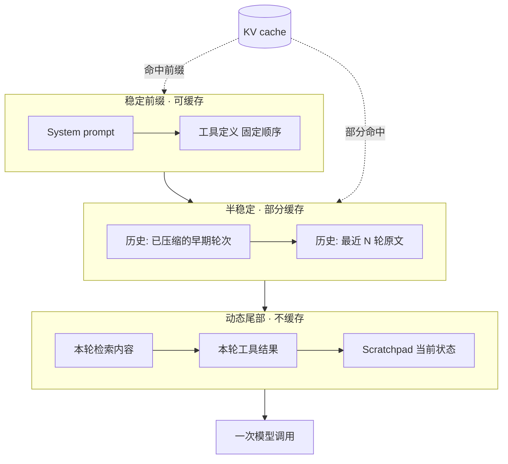

# 上下文工程：预算、压缩与卸载

## 一句话结论

上下文不是"能装多少"，而是"每一轮有多少高信号 token 在争夺有限的注意力"；上下文工程的目标是**在保持前缀稳定的前提下，把每一轮实际进入窗口的 token 压到最小**——省 token 是副作用，提升可靠性才是目的。

## 先看同一任务的三种账单

同一个"修一个 bug"的任务，三组人用三种方式组织上下文：第一组每轮把整个仓库的源码塞进去；第二组只放相关文件，但每轮重排工具定义；第三组固定 system 与工具顺序，历史压缩，检索结果永远放在最后。

一周后对账，第三组的账单大约只有第一组的三分之一，而两次修复的测试结果一样。差别不在模型，在上下文怎么组织：

| 做法 | 每轮进窗口的内容 | 前缀缓存 | 相对成本 | 实际效果 |
|---|---|---|---|---|
| 全塞 | 仓库全文 + 全部工具 + 全部历史 | 被检索结果打断 | 3× | 关键行被淹，改错文件 |
| 精选但抖动 | 相关文件，但工具顺序每轮变 | 基本不命中 | 2× | 质量尚可，账单高 |
| 分区 + 稳前缀 | system 与工具固定，历史压缩，检索后置 | 高命中 | 1× | 同样质量，成本最低 |

**上下文分区（context partition）是什么？** 人话：把窗口当成几个格子，每格只放一类东西。类比：行李箱分衣物、洗漱、证件三区，找东西不用翻整箱。例子：system、工具定义、历史、检索内容、scratchpad 五个格子，各有各的预算上限。

**提示缓存（prompt caching）是什么？** 人话：每次都重复的开头，不必重新计算。类比：开会固定念的那段开场白，录下来直接放。例子：缓存按前缀从第一个 token 起逐字匹配，所以工具定义换个顺序、system 里塞一个时间戳，整段缓存就失效——钱就花在这上面。

**前缀（prefix）是什么？** 人话：一次请求里"最前面那段不会变的内容"。类比：表格的抬头，抬头不改，整本单据都能复用印刷版。例子：把"常驻 system + 固定工具集"放最前、把"本轮检索结果"放最后，前缀才稳定。

下面先给五个分区与预算，再讲压缩、卸载与缓存这三件事。

## 问题与边界

- **解决什么**：给上下文划区并分配预算，判断什么时候该压缩、什么时候该卸载到外部、什么时候该开子 agent；以及这些动作如何影响缓存命中、成本与延迟。
- **不解决什么**：不评测各模型的长上下文能力（那属于模型选型），不讨论检索算法本身（分块、embedding、rerank），不讨论记忆的写入与冲突消解——那是 [记忆体系](03-memory.md) 的主题。
- **与相邻概念的分界**：
  - **上下文工程 ≠ prompt 工程**。prompt 工程优化"一次输入怎么写"；上下文工程优化"每一轮到底放什么进去"，是随轨迹演化的持续决策。
  - **上下文工程 ≠ RAG**。RAG 只是"检索内容"这一个分区的供给侧；上下文工程还要决定这个分区该占多少、什么时候该整块丢掉。
  - **上下文工程 ≠ 记忆**。记忆是跨会话的持久层，上下文是当轮的工作内存；两者的接口是"读什么进来、写什么出去"。

Anthropic 给的定义最接近工程实践：上下文工程是"在 LLM 推理过程中，策展并维护最优 token 集合"的一系列策略，包括 prompt 之外的一切（工具定义、外部数据、消息历史）（[Effective context engineering for AI agents](https://www.anthropic.com/engineering/effective-context-engineering-for-ai-agents)）。这句话的重点是"维护"——它是循环里的动作，不是上线前的一次性工作。

## 核心概念与架构

上下文窗口里有五个分区，它们的变更频率差了两个数量级，这个差异决定了缓存策略：

| 分区 | 内容 | 变更频率 | 是否适合缓存 |
|---|---|---|---|
| System prompt | 角色、约束、输出格式、禁区 | 天/周级 | 强缓存 |
| 工具定义 | 名称、描述、参数 schema | 周级（但常被动态改） | 强缓存，最怕顺序抖动 |
| 历史 | 用户消息、助手推理、工具结果 | 每轮 | 前缀缓存，尾部失效 |
| 检索内容 | 文档片段、搜索结果、数据库行 | 每轮 | 不缓存，且必须后置 |
| Scratchpad | 待办、计划、笔记、中间结论 | 每轮 | 半稳定，可固定在尾部之前 |

Scratchpad 有两种写法，混用会出问题：**结构化待办**（有状态、可勾选、适合驱动执行）与**自由笔记**（适合记录观察与猜想）。前者应该由宿主渲染并根据工具结果自动更新，后者应该由模型自己写。让模型同时维护两者，它通常会把待办写成散文，然后忘记勾掉已完成项。

有三个关于窗口大小的误解值得先破掉：**"窗口大就能装下整个项目"**（装得下不等于用得上，见下文长度效应）、**"用满窗口才划算"**（用满窗口通常意味着信号被稀释）、**"压缩就是省钱"**（压缩的首要收益是可靠性，省钱是附带结果，且压缩本身要花一次推理）。

真正需要理解的是"注意力预算"这个隐喻背后的机制：Transformer 让每个 token 与其余所有 token 建立 pairwise 关系，n 个 token 有 n² 条关系；上下文变长时，这些关系被摊薄，模型对远距离依赖的分辨率下降（[Effective context engineering](https://www.anthropic.com/engineering/effective-context-engineering-for-ai-agents)）。所以性能随长度是**渐变**而不是"超过窗口就崩"，这也意味着"还剩 30% 窗口"不是安全信号。



## 关键机制

### 先判断什么值得进上下文

在分配预算之前，先过一遍准入判断。四条标准，满足任一条才值得常驻：

1. **会改变下一步动作**：如果一段内容读完，模型的动作空间不变，它就不该占用预算。
2. **能证伪当前假设**：报错信息、测试失败、与预期不符的返回值，价值远高于"一切正常"的确认。
3. **不可从环境重新获取**：用户的临时口述、被覆盖的中间结果、已经消失的页面状态，丢了就没了。反之，能随时重读的文件内容不该抄进上下文。
4. **带来源与时间**：同一事实，带出处与日期的版本可被追责，不带的是噪声。

反过来，有三类内容最容易被误当成高信号：**结论性的复述**（"我已经完成了 X"，信息量为零）、**模板化的确认**（"操作成功"）、**可重新生成的摘要**（既然能重新生成，就不必长期占用窗口）。

### 预算分配

预算不是"平均分给五个区"，而是按"这一轮决策需要什么"倒推。一个可用的起点是先定死两块：system + 工具不超过窗口的 15%，历史不超过 40%，剩下的留给检索与 scratchpad，并给输出预留固定额度。

**上下文预算表模板**（右列是可复用的起点值，不是行业标准）：

| 分区 | 预算上限 | 超限动作 | 起点参考 |
|---|---|---|---|
| System prompt | 2k–4k token | 拆分为"常驻约束"+"按需加载的技能文档" | 窗口的 2%–3% |
| 工具定义 | 5k–15k token | 工具检索 / 命名空间裁剪 / 拆分 agent | 窗口的 5%–10% |
| 历史（原文） | 窗口的 30%–40% | 触发 compaction，保留最近 N 轮 | N = 6–10 轮 |
| 历史（摘要） | 2k–4k token | 结构化重写，保留决策与未决项 | 固定块 |
| 检索内容 | 每轮 ≤ 窗口的 20% | 减少 top-k、提高相关性阈值 | top-k 5–8 |
| Scratchpad | 1k–3k token | 卸载到文件，只留指针 | 固定块 |
| 输出预留 | ≥ 8k token | 压缩输入，而不是压输出 | 按任务定 |

表格的价值不在数字，而在"每一格都必须有一个超限动作"。没有超限动作的分区，一定会在某个长任务里悄悄吃掉全部预算。

### 长上下文的真实收益边界

三组证据值得记住：

- **位置效应**：把关键信息放在长文档开头或结尾，模型表现最好；放在中间显著变差（[Lost in the Middle](https://doi.org/10.1162/tacl_a_00638)，TACL 2024）。这是"lost-in-the-middle"，与模型规模无关。
- **长度效应**：Chroma 在 2025-07 用 18 个模型做了受控实验，固定任务难度、只变输入长度，结论是所有模型的表现都随长度下降；干扰项（topically related 但不正确的段落）即使只加一个也会掉分，且加得越多掉得越多；反直觉的是，把 haystack 打乱（破坏行文连贯）反而提升表现（[Context Rot](https://www.trychroma.com/research/context-rot)）。
- **聚焦效应**：LongMemEval 上，只给相关片段的"聚焦输入"（约 300 token）全面优于完整输入（约 113k token），跨 Claude、GPT、Gemini、Qwen 四个家族都成立（同上）。

> 判断：所谓"长上下文边际收益递减"，本质不是模型记不住，而是**检索与推理被压进了同一次前向**。让模型同时做"找出哪几句相关"和"基于这几句推理"，比先检索再推理更难，且错误不可分离。

这条判断的工程含义是：宁可多一次调用做筛选，也不要把筛选责任塞进主调用。

### 压缩与卸载

五种手段，代价完全不同，不能互相替代：

| 手段 | 做什么 | 省什么 | 代价 / 风险 | 适用 |
|---|---|---|---|---|
| Summarization | 把一段历史改写成摘要 | 历史 token | 有损；细节丢失不可逆 | 阶段切换、会话交接 |
| Compaction | 接近窗口上限时整体重写并重启窗口 | 一次性释放大量空间 | 最危险的是丢掉"当时不重要、后来关键"的约束 | 长时任务的主手段 |
| Tool result clearing | 清掉早期工具调用的原始返回 | 通常是最大的一块 | 需要保留"结论"而非"原文" | 几乎总是安全的第一刀 |
| Structured note-taking | 把进展写进 NOTES.md / 待办 | 稳定的少量 token 换大量上下文 | 需要模型自律地读写 | 有清晰里程碑的任务 |
| Sub-agent 隔离 | 子 agent 用自己的窗口探索，只回摘要 | 主 agent 完全看不到探索过程 | 信息在边界处丢失；协调成本 | 并行、可分解的探索 |

Anthropic 的报告里有两个可引用的量化锚点：子 agent 可能消耗数万 token 探索，但只回传 1,000–2,000 token 的蒸馏结果；Claude Code 的 compaction 会保留架构决策、未解决的 bug 与实现细节，同时丢弃冗余的工具输出，并附上最近访问的五个文件（[Effective context engineering](https://www.anthropic.com/engineering/effective-context-engineering-for-ai-agents)）。这两条合起来说明：compaction 的质量取决于"保留清单"是否显式，而不是摘要模型有多强。

### 提前检索还是运行时检索

除了"压缩已有的"，还有"别提前拿进来"。Just-in-time 的做法是：上下文里只放轻量标识符（文件路径、查询语句、URL），真正的内容在需要时用工具取。Claude Code 的混合策略是典型：`CLAUDE.md` 这类稳定约定在启动时直接进上下文，而代码内容靠 glob/grep 在执行中按需检索，从而绕开陈旧索引与语法树解析的开销（[Effective context engineering](https://www.anthropic.com/engineering/effective-context-engineering-for-ai-agents)）。

这种"渐进披露"（progressive disclosure）的收益是双向的：既省 token，也让元数据本身成为信号——文件在 `tests/` 还是 `src/core_logic/`、修改时间是今天还是去年，都在帮助模型判断该不该读。

代价是延迟：运行时检索比预取慢，而且依赖工具质量。判断标准很直接——**信息的形态是否稳定**。稳定（规范文档、术语表、项目约定）就预取；不稳定（代码现状、工单状态、页面内容）就运行时取。

一个容易忽略的顺序问题：**先清工具结果，再摘要历史**。工具结果通常占历史的 60% 以上，清掉它往往就够用了，根本不需要动摘要——而每做一次摘要，就多一次不可逆的信息损失。

压缩 prompt 的结构比压缩模型的选择更影响结果。一个可用的骨架是"四栏 + 两份清单"：

```text
把以下轨迹压缩成结构化摘要，不要写成叙事。
【目标】原始目标，逐字保留，不要改写。
【硬约束】用户明确要求、审批记录、合规限制；逐条列出，不许合并。
【已否决】尝试过且失败/被拒的方案 + 原因（这是防止重蹈覆辙的关键）。
【未决】当前阻塞点、待确认问题、下一步计划。
【状态】变更过的文件/资源清单（路径 + 一句话说明），最近一次验证结果。
【引用】仍然需要的原始材料标识符（路径、URL、查询），不要复制内容。
输出必须保留上述栏目标题；信息不足的栏写"无"。
```

最后两条容易被省略，但它们决定了压缩后 agent 能否继续干活：状态清单避免重复劳动，引用标识符让模型能按需取回细节，而不是要求摘要"什么都知道"。

### 什么时候触发压缩

压缩的触发时机比压缩算法更影响结果。三种触发方式各有明确的适用面：

| 触发方式 | 信号 | 优点 | 缺点 |
|---|---|---|---|
| 阈值触发 | 输入 token 超过窗口的 X% | 实现简单、可预测 | 常在任务中途触发，打断正在进行的分支 |
| 阶段触发 | 子任务完成、计划节点结束 | 摘要质量最高（此时上下文语义完整） | 需要 agent 能识别"阶段边界" |
| 失败触发 | 上下文溢出错误、指令遵循下降 | 不浪费任何一次压缩 | 已经浪费了一轮调用，且错误可能已污染轨迹 |

工程上最稳的是"阶段触发为主、阈值触发兜底"：让模型在完成一个里程碑时主动写摘要并清空窗口，同时用阈值防止它忘记。纯阈值触发的问题在于，它总是在最糟糕的时刻发生——恰好在一段推理的中间。

### 缓存友好性

Prompt caching 按**前缀**匹配：命中要求从第一个 token 起完全一致。这带来三条硬约束：

1. **稳定内容必须在前**。system → 工具 → 早期历史 → 动态内容，这个顺序不能因为"读起来更自然"而调整。
2. **工具定义顺序必须确定**。同一组工具每次以不同顺序序列化，前缀就永远不命中。MCP 2026-07-28 规范要求列表结果具有确定性顺序并携带缓存提示，理由正是让客户端可缓存、让上游 prompt cache 保持稳定（[MCP Key Changes](https://modelcontextprotocol.io/specification/2026-07-28/changelog)）。
3. **任何动态字符串都不能进前缀**。时间戳、会话 ID、随机排序的检索结果、"当前时间：..."这类看似无害的注入，会把缓存命中率打到零。

这里有个容易被忽略的连锁反应：工具定义在前缀里，所以**新增一个工具会让其后所有内容的缓存全部失效**。在多 agent 或动态装配工具的系统里，这意味着"按需加载工具"与"缓存命中"天然冲突。可行的折中是：把工具集分成"常驻核心"（5–10 个，永不变动）与"按需扩展"（通过工具检索动态加载），并接受扩展部分不命中缓存——因为扩展部分通常在尾部。

经济性上，缓存写入有溢价、读取有折扣（Anthropic 长期公开的倍率是写入 1.25×（5 分钟 TTL）/2×（1 小时 TTL）、读取约为输入价的十分之一；具体倍率随厂商与模型不同，落地前必须按官方定价页核算，[Prompt caching](https://platform.claude.com/docs/en/build-with-claude/prompt-caching)）。由此得到一条反直觉的结论：**多轮 agent 的成本主要由"前缀是否稳定"决定，而不是由"上下文是否够短"决定**。把 3k token 的系统提示放进稳定前缀，比把它删到 1k 但每轮变动更省钱。

### 上下文健康度

上下文工程最大的实践障碍是"看不见"。下面六个指标足以支撑日常判断，且都能从 trace 里算出来：

| 指标 | 计算方式 | 异常信号 |
|---|---|---|
| 分区占比 | 每轮各类 token / 总输入 | 工具定义 > 15%，或历史 > 50% |
| 缓存命中率 | 缓存读取 token / 输入 token | 多轮任务里长期低于 60% |
| 工具结果占比 | 工具返回 token / 历史 token | 高于 60%，说明该清结果了 |
| 检索使用率 | 被模型实际引用的片段 / 注入片段 | 低于 30%，说明 top-k 太大或相关性差 |
| 压缩频次 | 每任务 compaction 次数 | 单任务 > 3 次，说明任务该拆 |
| 约束存活率 | 关键约束在压缩后仍出现 / 原始条数 | 低于 100% 即为缺陷 |

最后一项需要人工定义"关键约束清单"（通常就是 system prompt 里那几条禁令），但它是最值得自动化的一个——它直接对应"模型为什么突然不听话了"这类最难查的问题。

## 对比

同样是"上下文太大"，四种处方对应四种不同的病：

| 症状 | 处方 | 不该用的场景 |
|---|---|---|
| 历史太长、但近期细节都要 | Tool result clearing + 最近 N 轮原文 | 需要回溯早期原始证据的审计场景 |
| 任务跨越数十轮、阶段清晰 | Compaction + 结构化笔记 | 单轮问答（没有可压缩的历史） |
| 需要并行探索多个方向 | Sub-agent 隔离 | 强顺序依赖的任务（子 agent 无法共享隐式决策） |
| 工具太多、定义吃掉预算 | 工具检索 / 命名空间分层 | 工具数 < 20（检索开销大于收益） |

选它的条件可以归纳为一句话：**信息还需要被"再读一遍"吗？** 需要，就压缩保留；不需要，就卸载成指针；只有"必须让另一个决策者独立判断"时，才值得开子 agent。

落地时按"损失从小到大"排序执行，不要一上来就 compaction：

1. 清工具结果（几乎无损）；
2. 把中间产物写到文件，上下文里只留路径与一句说明（无损，代价是一次 I/O）；
3. 结构化重写早期历史（有损，但保留决策与约束）；
4. compaction 重启窗口（有损且不可逆）；
5. 开子 agent 隔离（把损失转移到边界上）。

这个顺序也解释了为什么"上下文快满了"不是 compaction 的触发条件，而是前四步没做好的症状。

## 实践建议与常见坑

- **坑 1：工具定义膨胀到吃掉半个窗口**。触发条件：接入多个 MCP server（见 [MCP](../03-protocols/01-mcp.md)）后不做裁剪。后果有厂商文档给出的量化（口径见来源）：五个常见 server（GitHub、Slack、Sentry、Grafana、Splunk）的定义合计约 55k token，模型还没开始干活就先花掉一大截；工具数超过 30–50 个后，选择准确率明显下降（[Tool search tool](https://platform.claude.com/docs/en/agents-and-tools/tool-use/tool-search-tool)）。规避：按任务动态裁剪 + 工具检索，只加载 3–5 个相关工具，同一来源称可减少 85% 以上的定义 token。
- **坑 2：摘要丢掉了关键约束**。触发条件：用通用摘要 prompt 压缩历史，摘要只保留"做了什么"，不保留"不能做什么"。后果：早期的合规约束、用户明确否定的方案、被拒绝的路径全部消失，模型开始重试已被否决的做法。规避：compaction 的 prompt 里固定四栏——目标、已确认的约束、已否决的方案及原因、未决问题；这四栏宁可啰嗦也不许省略。
- **坑 3：检索内容挤掉 system 指令**。触发条件：把 top-k 调大、或把长文档整篇塞进用户消息。后果：system 里的输出格式与禁区被淹没在中间位置，模型开始违反格式；这正是 lost-in-the-middle 的典型表现。规避：检索内容放在动态尾部、system 约束在末尾再复述一次关键项，并给检索分区设硬上限。
- **坑 4：缓存被动态字符串击穿**。触发条件：在 system prompt 里注入"当前时间"或"用户 ID"，或每轮重排工具顺序。后果：命中率归零，成本与首 token 延迟同时上升，而且监控上只看到"账单变贵"，很难定位。规避：所有动态量后置到用户消息；工具定义按名称排序序列化；上线前用缓存命中率做一次 A/B。
- **坑 5：compaction 后立刻"失忆"**。触发条件：压缩时只传消息历史，不传"外部状态"（文件清单、已改动的行、测试结果）。后果：模型重复已完成的工作，或基于旧文件内容继续改。规避：压缩时附一份机器生成的状态快照（变更文件列表 + 最近测试输出），它比自然语言摘要更可靠。
- **坑 6：把大文件整篇读进上下文**。触发条件：工具只有 `read_file`，没有 `grep` / 行范围参数。后果：一次读取吃掉半个窗口，且关键行淹在中间。规避：文件类工具必须支持"搜索 + 行范围 + 摘要视图"三件套，并在描述里明确引导模型先搜后读。
- **坑 7：压缩后忘记重放 system 之外的硬约束**。触发条件：部分约束不在 system prompt 里，而在早期的用户消息或审批记录里。后果：compaction 只保留"做了什么"，约束随原文一起消失。规避：把硬约束提升到 system 分区，或在压缩后由宿主重新注入一段"约束回放"。
- **坑 8：把"最近 N 轮"当成安全区**。触发条件：只保留最近若干轮原文，其余丢弃。后果：跨轮次的隐含约束（用户在第 3 轮说"别动数据库"）在第 12 轮消失，而它恰恰是当前动作的禁区。规避：最近 N 轮之外，必须有一块"长期约束"分区，且不随轮次淘汰。

## 开放问题

- **压缩率与召回的最优点**：Anthropic 建议先最大化 recall 再收紧 precision，但"关键信息"的判定标准仍靠人工调 prompt，缺自动评估方法。
- **缓存与动态性的张力**：越是个性化、越依赖实时状态，前缀越不稳定；2026 年的平台侧缓解手段（自动断点前移）解决了工程复杂度，没有解决根本冲突。
- **注意力预算能否测量**：目前只有"输入长度 vs 准确率"的外部曲线，没有可在线使用的"当前上下文健康度"指标。
- **多模态上下文的预算**：截图与文档图像占的 token 与信息量不成比例，截图密集的 computer use 任务上，预算模型基本沿用文本的，缺专门方法（见 [浏览器与 GUI Agent](../05-products/02-computer-use.md)）。
- **压缩的合规风险**：压缩会不可逆地丢弃原始记录，而审计要求保留原文；两者的边界尚未有行业共识。
- **预取与按需的自动切换**：目前靠人判断"信息形态是否稳定"，没有一个运行时策略能根据命中率自动在两者间切换。

## 参考来源

- Effective context engineering for AI agents · Anthropic · 2025-09 · https://www.anthropic.com/engineering/effective-context-engineering-for-ai-agents
- Context Rot: How Increasing Input Tokens Impacts LLM Performance · Chroma · 2025-07 · https://www.trychroma.com/research/context-rot
- Lost in the Middle: How Language Models Use Long Contexts · Liu et al. · 2024（TACL）· https://doi.org/10.1162/tacl_a_00638
- Building effective AI agents · Anthropic · 2024-12 · https://www.anthropic.com/engineering/building-effective-agents
- Tool search tool · Anthropic · 2026 · https://platform.claude.com/docs/en/agents-and-tools/tool-use/tool-search-tool
- Prompt caching · Anthropic · 2026 · https://platform.claude.com/docs/en/build-with-claude/prompt-caching
- Model Context Protocol Specification 2026-07-28: Key Changes · MCP · 2026-07 · https://modelcontextprotocol.io/specification/2026-07-28/changelog
- Writing effective tools for AI agents · Anthropic · 2025 · https://www.anthropic.com/engineering/writing-tools-for-agents
