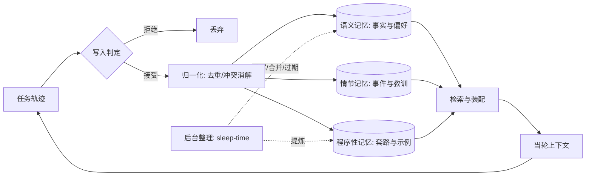

# 记忆体系：分类、实现谱系与写入策略

## 一句话结论

记忆系统的难点不在"存和取"，而在**写什么、什么时候忘**；没有写入策略和过期机制的记忆库，会随着时间变差而不是变好——它积累的不是知识，是历史遗留物。

## 先看一句"别动数据库"

上周评审时，用户对 agent 说："这个库别动，是生产的。" 这周另一个会话里，agent 为了验证一个假设，连上去跑了一条 `UPDATE`——它并没有"不听话"，只是那句话停在上一轮的上下文里，会话一结束就不存在了。

同样一句约束，处理方式不同，结果完全不同：

| 上周那句话的归宿 | 本周会发生什么 | 对应概念 |
|---|---|---|
| 只留在上下文 | 会话结束即丢，本周重犯 | 工作记忆（working memory） |
| 写成"生产库只读"的语义记忆 | 本周能被检索到 | 语义记忆（semantic memory） |
| 记成"某次纠正"的事件 | 能说清谁在何时说的 | 情节记忆（episodic memory） |
| 没有过期机制 | 三个月后环境变了，约束仍生效 | 遗忘（forgetting） |

**写入（write）是什么？** 人话：决定哪句话值得被记住，以及以什么形式记。类比：会议纪要只记决议与责任人，不记每句闲聊。例子：把"别动数据库"写成一条事实——`content=生产库只读`、`source=用户`、`scope=团队`、`created_at=上周`，而不是把整段对话原样存进去。

**冲突消解（conflict resolution）是什么？** 人话：两条记忆打架时信谁。类比：两份文件版本不同，看日期与签发人。例子：上周说"别动"，本周说"可以动，先备份"——按时间与来源取新的，但不删旧的，留作审计。

**遗忘（forgetting）是什么？** 人话：主动让不再成立的信息失效，而不是等它自己变质。类比：冰箱上的便签，到期就撕。例子：给"临时只读"这类约束带上 TTL，30 天后自动降级为"需确认"，否则系统会永久拒绝一件早已允许的事。

下面把记忆拆成四类，再讲写入、冲突与遗忘这三件难事。

## 问题与边界

- **解决什么**：把"记忆"拆成可分别实现的四类，给出每类的技术选型、写入触发条件、去重与冲突消解规则、遗忘与过期机制，以及与 RAG 的边界。
- **不解决什么**：不讨论向量数据库的索引实现与选型，不讨论微调的具体流程（只讨论"参数化记忆"这一档在什么条件下值得），不讨论上下文窗口内的裁剪（那是 [上下文工程](02-context-engineering.md)）。
- **与相邻概念的分界**：
  - **记忆 ≠ 上下文**。上下文是当轮工作内存，会话结束即消失；记忆是跨会话的持久层，通过"读进来 / 写出去"与上下文交互。
  - **记忆 ≠ RAG**。RAG 是只读的外部知识检索；记忆是读写闭环，写入本身就是系统行为，因此要承担"写错了"的责任。
  - **记忆 ≠ 用户画像**。画像是记忆的一个视图（通常是语义记忆中的偏好子集），不是记忆的全部；把记忆等同于画像，会丢掉情节与程序性两类最有价值的部分。

## 核心概念与架构

四类记忆的划分来自认知科学，但落到工程上，区别在于**生命周期**和**是否可被检索**：

| 类型 | 存什么 | 生命周期 | 典型实现 |
|---|---|---|---|
| 工作记忆（working） | 当前任务的中间状态 | 单次任务 | 上下文窗口、scratchpad、todo 列表 |
| 情节记忆（episodic） | 具体发生过的事：某次对话、某次失败、某次决策 | 周/月，可衰减 | 事件日志、轨迹库、会话存储 |
| 语义记忆（semantic） | 抽出来的事实与偏好：用户是谁、系统有哪些约束 | 长期，需版本化 | 结构化 KV、知识图谱、memory.md |
| 程序性记忆（procedural） | 怎么做：某类任务的成功套路、工具使用习惯 | 长期，需验证 | 提示词/技能文档、few-shot 库、参数微调 |

这张表最有用的地方是**排除法**：把"我希望 agent 记住上次的报错"归到情节记忆，就不会去改 system prompt；把"我希望 agent 学会我们团队的发布流程"归到程序性记忆，就不会指望向量检索能解决——流程需要写成可执行的文档或示例，而不是一段可被检索的文本。

闭环的关键是那条虚线：**后台整理**。没有它，写入是单向累积，检索精度随条目数下降；有它，系统才有"消化"能力。

## 关键机制

### 三个延迟

记忆系统的性能要分三个延迟看，混在一起谈会得出错误结论：

- **写入延迟**：从"发生了一件事"到"它进了记忆库"。这段可以做异步，但异步意味着"刚说完就重启会话"可能读不到。
- **检索延迟**：从"需要一条记忆"到"它出现在上下文里"。这是唯一直接进入用户等待时间的部分，通常要求毫秒到百毫秒级。
- **整理延迟**：从"记忆库里有一条过时/重复条目"到"它被合并或标记失效"。这段可以按小时甚至按天算，但必须有明确的 SLA，否则"最终一致"会变成"永远不一致"。

三者的取舍很实际：把写入做成同步可以保证"说完就记得"，代价是把 P95 延迟推高；把整理做成实时可以保证库永远干净，代价是每条写入都要多跑一次模型。多数系统应该选"写入异步 + 检索强一致 + 整理准实时（分钟级）"。

### 写入：什么时候写、写什么

写入是记忆系统唯一不可逆的动作，也是最容易做错的一步。四条触发条件覆盖了绝大多数场景：

1. **显式指令**：用户说"记住这个"。必须支持，但要防止它变成"记住一切"的入口。
2. **任务边界**：任务完成或阶段切换时，写一条"结论 + 决策 + 教训"。这是性价比最高的写入点，因为此时语义最完整。
3. **纠正性反馈**：用户否定了 agent 的做法。这类事件的价值极高——它是唯一能阻止同类错误复发的信号，应该写入情节记忆并附上"哪一步错了"。
4. **后台整理**：不在关键路径上，见下文 sleep-time 部分。

写什么，比什么时候写更重要。可写入的最小集合是**事实、偏好、决策、教训**四类；不该写入的是**对话原文**（应作为情节记忆的引用，而不是塞进语义记忆）、**中间推理**（噪声大、易过时）、**可从环境重新获取的内容**（文件内容、文档正文）。

一个具体判据：**这条信息在半年后还有效吗？** 有效（用户偏好中文、团队用 pnpm、生产库只读）→ 语义记忆；只在特定情境有效（上周排查的那个 bug）→ 情节记忆并带时间戳；本来就是过程（刚才试了三种方案）→ 不写。

### 记忆条目的最小字段

无论选哪种存储，条目必须带齐七个字段，缺一个就会在某个环节出事：

| 字段 | 作用 | 缺了会怎样 |
|---|---|---|
| `content` | 归一化后的一句话事实 | 无法去重、无法展示 |
| `type` | 事实 / 偏好 / 决策 / 教训 | 检索时无法按类型过滤 |
| `source` | 谁说的、从哪来（用户、工具、网页） | 冲突时无法判权重，投毒无法溯源 |
| `created_at` / `updated_at` | 时间戳 | 无法判断新旧，无法 TTL |
| `confidence` | 抽取置信度或来源等级 | 低质条目与高质条目被同等对待 |
| `scope` | 用户 / 团队 / 全局 | 跨租户泄漏 |
| `expires_at` 或 `superseded_by` | 失效条件 | 记忆库只增不减 |

这份 schema 的成本很低，但它决定了三件事能不能做：能不能删（靠 `source` 与 `scope`）、能不能信（靠 `confidence` 与时间）、能不能改（靠 `superseded_by`）。

### 读取：常驻还是检索

写入决定记忆库的质量，读取决定它是否被用上。两种读取方式的边界很清楚：

- **常驻**：条目少（< 50）、几乎每次都相关、且变更少（用户偏好、团队约定）。直接渲染进 system prompt，命中率 100%，代价是固定 token 开销。
- **检索**：条目多、相关性依任务而变。用"结构化过滤 → 向量召回 → 重排 → 阈值截断"四步，只把 top 3–5 注入。

最容易犯的错是"全都检索"：连"用户叫什么是"这种必然需要的信息也走一遍相似度检索，结果在某些问法下检索不到，agent 就开始问"您怎么称呼"。必然需要的信息必须常驻，可选信息才检索。

第三种形态是**指针**：记忆里只存"有这么个东西 + 去哪里取"，例如"上次的排查记录见 `/notes/incident-2026-08.md`"。这在编码类 agent 上效果最好，因为文件系统本身就是可检索、可 diff 的记忆。

### 去重与冲突消解

同一事实被反复写入是常态，处理不当会让检索结果被同一批条目淹没。三层机制按顺序生效：

| 层次 | 判据 | 动作 |
|---|---|---|
| 精确去重 | 归一化后文本哈希相同 | 丢弃，只更新时间戳 |
| 语义去重 | 向量相似度高于阈值且槽位相同 | 合并，保留更具体的一条 |
| 冲突判定 | 同一槽位、不同取值 | 按来源权重与时间决定覆盖或并存 |

冲突消解是这里唯一需要业务判断的地方。三种策略各有代价：**新覆盖旧**（简单，但会丢掉"曾经认为"的信息，审计场景不可接受）、**并存 + 时间戳**（保留历史，但检索时要能取到最新一条）、**显式失效**（写入新条目时把旧条目标记为 superseded，最贵但最可解释）。

> 判断：凡是"用户偏好会随时间变化"的场景，都应该用"并存 + 显式失效"，而不是覆盖。覆盖会让系统在用户改主意之后仍然"记得"旧偏好，而且无法解释为什么。

### 遗忘与过期

没有遗忘的记忆系统等于没有记忆——它只是把所有历史堆在检索池里，让每次检索都带回一堆噪声。四种机制：

- **TTL**：按类型设默认存活期。情节记忆 90 天、偏好类语义记忆不过期但需校验、临时上下文 7 天。
- **衰减**：检索排序时按"最后访问时间 + 访问频次"加权，久未命中的条目自然下沉，而不是删除。
- **容量上限**：每个租户/每个命名空间设条目上限，超限时按"价值分"淘汰（价值分 = 访问频次 × 显式引用次数 × 新鲜度）。
- **显式删除**：用户行使删除权时必须真删，包括向量索引、缓存、备份的下一次轮转。这是合规要求，不是产品选项。

注意"清理"本身的风险：2026 年有研究指出，基于相似度的清理与摘要式整理会丢掉"罕见但对推理关键"的知识，或破坏条目间的逻辑依赖（[DOMR-Mem](https://ieeexplore.ieee.org/document/11716445)，2026-10）。所以淘汰策略必须是"下沉 + 可恢复"，而不是"删除"。

### 实现谱系

五档实现，从"完全外部"到"完全内部"：

| 实现 | 写入成本 | 读取延迟 | 可解释/可删 | 更新难度 | 适用条件 |
|---|---|---|---|---|---|
| 全文 + 向量检索 | 低 | 低 | 强（原始文本在） | 易 | 默认起点，条目数千到数十万 |
| 知识图谱 | 高（需抽取实体关系） | 中 | 强（关系显式） | 中（需模式设计） | 实体关系密集、需要多跳推理 |
| 文件式（memory.md / notepad） | 极低 | 极低（全量读入） | 强 | 易 | 单用户、条目少、需要人可读可改 |
| 后台整理（sleep-time） | 中（离线） | 不影响在线 | 中 | 中 | 有稳定流量、查询可预测 |
| 参数化（微调） | 极高 | 零（在权重里） | 弱（无法定位、无法单条删除） | 极难 | 风格/格式/固定套路，且数据稳定 |

三档要点：

整套"分层 + 按需换入换出"的思路可以追溯到 MemGPT：它把上下文窗口当 RAM、把外部存储当磁盘，用虚拟上下文管理在不同层之间搬运数据，并用中断来管理控制流（[MemGPT](https://arxiv.org/abs/2310.08560)，2023-10）。2026 年的各种实现大多只是把这套机制换了个存储后端。

**向量检索**是默认起点，但只做向量是不够的——纯相似度会带回"语义相近但事实冲突"的条目，所以生产系统普遍采用"向量召回 + 结构化过滤（时间、来源、类型）+ 重排"。

**知识图谱**的价值在多跳与关系查询上：问"上次和我一起评审的那个人现在负责哪个项目"，向量检索几乎必错，图上的两跳遍历则很稳。代价是抽取成本与模式设计——实体类型、关系类型一旦定错，后期迁移比重建还贵。经验上，只有当"关系本身是查询目标"时才值得上图；把图谱当成更好的向量库，是常见的过度设计。

**文件式记忆**在 2025—2026 年重新流行，原因是它同时满足三个需求：人可读、可 diff、可版本化。Anthropic 的 memory tool 就是这个形态：模型通过工具在 `/memories` 目录下创建、读取、更新、删除文件，实际存储由应用实现，且必须在路径上做越界防护（[Memory tool](https://platform.claude.com/docs/en/agents-and-tools/tool-use/memory-tool)）。它的天花板很明显：条目一多，"全量读入"就退化成上下文灾难。

**参数化记忆**（把知识微调进权重）常被高估。它的真实适用面很窄：需要的是"稳定的风格与格式"，而不是"可变的事实"。事实一旦进权重，就无法单独删除、无法标注来源、无法纠错——这与隐私合规直接冲突。

**后台整理**值得单独说。Letta 与 Berkeley 的 sleep-time compute 让模型在空闲时预先把"原始上下文"加工成"学到的上下文"，在 Stateful GSM-Symbolic 与 Stateful AIME 两个改造任务上，把达到同等准确率所需的测试时算力降低约 5 倍；继续扩大后台算力还能把准确率再提升 13%/18%；同一上下文上的多个相关问题可以摊销，平均每题成本降 2.5 倍（[Sleep-time Compute](https://arxiv.org/abs/2504.13171)，2025-04）。这类方法的有效性高度依赖"用户查询的可预测性"——查询越可预测，预加工越划算。

### 与 RAG 的区别

一句话：**RAG 是读，记忆是读写闭环**。展开成四条可操作的差异：

| 维度 | RAG | 记忆 |
|---|---|---|
| 数据来源 | 既有语料，系统外 | 系统自身产生的交互 |
| 写入 | 离线建索引，人工控制 | 在线增量，agent 决定 |
| 错误责任 | 检索不准，答错 | 写入错了，会错很久 |
| 删除 | 重建索引 | 必须支持单条删除与失效 |
| 评测 | 检索召回率 + 答案准确率 | 还要评"写入正确率"与"过时率" |

最后一行是最容易被忽略的：记忆系统的评测必须包含**写入质量**。只评"问答准不准"，会把"写入了错误事实但恰好没被检索到"判为成功。

## 对比

同样是"让 agent 记住"，四种目标对应四套完全不同的方案，混用是常见错误：

| 目标 | 该用 | 不该用 |
|---|---|---|
| 跨会话记住用户偏好 | 结构化语义记忆（键值 + 版本） | 向量检索（相似度不保证取到最新偏好） |
| 记住上次任务的进展 | 情节记忆 + 任务状态快照 | 摘要式长期记忆（细节丢失后无法续做） |
| 学会团队的工作流程 | 程序性记忆：写成技能文档/示例 | 微调（流程会变，权重改不动） |
| 在一次长任务中不迷路 | 工作记忆：scratchpad + 文件 | 任何跨会话记忆（用不上） |

选它的条件可以压缩成两个问题：**这条信息会变吗？**（会变→结构化 + 版本，不要向量）**这条信息需要被推理还是被引用？**（被推理→进上下文；被引用→留指针）。

## 实践建议与常见坑

落地顺序建议按"最小可行记忆"起步，每一步都能独立产生价值，且不需要推翻上一步：

1. **先做工作记忆**：把 todo 与关键结论写进文件，保证单任务内不迷路。零基础设施。
2. **再做显式记忆**：给 agent 一个 `remember` 工具，只在用户明确要求或任务收尾时调用。可观测、可控。
3. **加一条读取路径**：把最高频的 20 条记忆常驻，其余检索。验证"读得到"比"存得多"更重要。
4. **加生命周期**：TTL + 失效标记 + 删除接口。这一步最容易被跳过，也最容易在半年后变成事故。
5. **最后再加后台整理**：有了稳定的读写流量与查询分布，再谈预加工与提炼，否则只是提前浪费算力。

- **坑 1：把整段对话写进记忆库**。触发条件：为了"不丢信息"，把每轮对话原文都写入语义记忆。后果：条目数月内膨胀到十万级，检索带回大量重复与过时片段，回答质量反而下降；同时存储成本与隐私暴露面同步上升。规避：写入前先抽取成"事实/偏好/决策/教训"，原文只作为情节记忆的引用保留。
- **坑 2：没有冲突消解，旧偏好压过新偏好**。触发条件：用户三个月前说"用英文回复"，上周改成中文，两条都在库里。后果：检索按相似度取到旧条目，agent 又切回英文，用户认为"它根本没在听"。规避：槽位化 + 时间戳 + 显式失效，检索时按"最新有效"排序。
- **坑 3：检索噪声被放大成事实**。触发条件：top-k 取 20，其中 18 条弱相关，模型把弱相关条目里的细节当约束。后果：幻觉看起来"有据可查"，比凭空编造更难排查。规避：设相关性阈值而非固定 top-k；注入时保留来源与时间；让模型显式区分"记忆中的事实"与"推断"。
- **坑 4：记忆被投毒**。触发条件：agent 会把网页/邮件内容写入记忆，而其中含指令性文本。后果：一次写入，长期生效——攻击载荷不需要在写入时生效，只要被存下并在未来被检索（[Utility Under Attack](https://arxiv.org/html/2608.21230v1)，2026-08）。规避：写入时做来源标记与内容筛查，读取时按来源可信度加权，二者缺一不可；详见 [安全与权限](../04-engineering/03-security.md)。
- **坑 5：删除只删了主表**。触发条件：用户要求删除数据，实现只删了数据库行。后果：向量索引、摘要缓存、备份里仍有副本，合规审计不通过。规避：把"删除"实现成跨存储的编排动作，并留删除凭证。
- **坑 6：把记忆当成 RAG 的别名**。触发条件：团队直接把现有向量库当记忆系统。后果：没有写入策略、没有过期、没有冲突消解，半年后无人敢清理。规避：先定义写入契约与生命周期，再选存储。
- **坑 7：在短会话高频场景里过度写入**。触发条件：客服类 agent 每轮都写记忆。后果：写入调用把 P95 延迟推高，且大量条目是"用户问了一个问题"这类无价值事件。规避：改在会话结束或议题切换时批量抽取，写入走异步队列。

## 开放问题

- **写入质量的度量**：如何自动判断"这条该写"？截至 2026-11，主流做法仍是规则 + LLM 抽取，缺少公开的、跨领域的写入准确率基准。
- **遗忘的理论边界**：TTL 与衰减都是启发式，没有"该记多久"的可证明答案；而清理与保留的代价不对称（删错不可逆）。
- **多 agent 共享记忆的一致性**：多个 agent 并发写同一记忆库时，版本冲突与语义冲突同时存在，目前多靠命名空间隔离回避，见 [多智能体协作](05-multi-agent.md)。
- **参数化记忆的合规路径**：一旦知识进入权重，"被遗忘权"如何落地没有工程答案；可机器遗忘（machine unlearning）在 agent 场景的可用性未知。
- **记忆的可解释性**：当 agent 依据记忆做出错误决策，如何向用户展示"它当时记得什么"？缺少标准的记忆审计视图。
- **记忆的评测集缺失**：现有基准多测"多会话问答准确率"，缺少对写入正确率、过时率、删除彻底性的系统评测。
- **跨会话的"程序性学习"**：把成功轨迹自动提炼成可复用的技能，目前多靠人工总结或一次性提示词优化，缺少稳定的自动化方法。

## 参考来源

- MemGPT: Towards LLMs as Operating Systems · Packer et al. · 2023-10 · https://arxiv.org/abs/2310.08560
- Sleep-time Compute: Beyond Inference Scaling at Test-time · Lin et al. · 2025-04 · https://arxiv.org/abs/2504.13171
- Mem0: Building Production-Ready AI Agents with Scalable Long-Term Memory · Chhikara et al. · 2025-04 · https://arxiv.org/abs/2504.19413
- Memory tool · Anthropic · 2026 · https://platform.claude.com/docs/en/agents-and-tools/tool-use/memory-tool
- Effective context engineering for AI agents · Anthropic · 2025-09 · https://www.anthropic.com/engineering/effective-context-engineering-for-ai-agents
- Context Rot: How Increasing Input Tokens Impacts LLM Performance · Chroma · 2025-07 · https://www.trychroma.com/research/context-rot
- Utility Under Attack: Agent Memory Poisoning and the Limits of Content Screening and Provenance Ranking · 2026-08 · https://arxiv.org/html/2608.21230v1
- DOMR-Mem: Detecting, Repairing, and Preserving Long-Term LLM Memories · 2026-10 · https://ieeexplore.ieee.org/document/11716445
- Memory Blocks (core memory) · Letta · 2026 · https://docs.letta.com/v1-sdk/memory/memory-blocks
