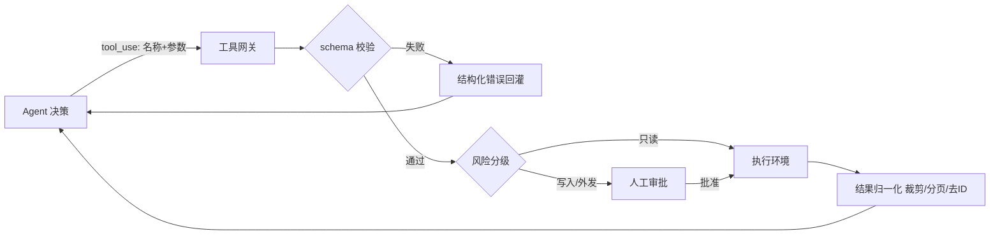

# 工具调用与沙箱执行

## 一句话结论

工具不是 API 的薄包装，而是**确定性系统与概率系统之间的契约**：设计目标是降低模型的决策熵，而不是暴露系统的全部能力；沙箱的第一目标也不是"能跑代码"，而是把模型犯错时的爆炸半径限定在可接受范围内。

## 先看一次参数传错

给 agent 一个查客户的工具，描述只写了一句"获取客户信息"，参数叫 `user`。用户说"查一下张三的订单"，模型于是调了 `get_customer(user="张三")`。网关返回 400；模型看到 400，换 `name="张三"` 再试，又换 `id="张三"`，三次之后放弃，回用户一句"系统故障"。

这不是模型笨，是契约没写清：

| 现象 | 真正的原因 | 对应概念 |
|---|---|---|
| 传 `user="张三"` | 参数名与用户口语同形，模型做了字面映射 | 输入 schema（input schema） |
| 连试三次都错 | 报错只说 invalid request，没说期望什么 | 错误契约（error contract） |
| 最后回"系统故障" | 没有把"先按姓名搜人"这条路径暴露出来 | 工具粒度与返回契约 |
| 事后无法复盘 | 调用没有被网关记录 | 网关审计 |

**schema 是什么？** 人话：工具的"表单格式"，规定每一格填什么类型、什么格式。类比：快递单上手机号那栏只能填 11 位数字，写别的就退单。例子：把参数改成 `customer_id`，并加约束 `pattern: ^cus_[0-9]+$`，模型就不会往里填"张三"；描述里再补一句"只有姓名时先调 `search_customers`"。

**错误契约是什么？** 人话：出错时告诉模型"哪里错、该改什么、给个正确例子"。类比：表单被退回时贴一张便签，写上"邮编应为 6 位，如 100080"，而不是盖个"驳回"章。例子：返回"`customer_id` 必须以 `cus_` 开头；若只有姓名，先调 `search_customers(name=...)"`，模型下一轮就能自己纠正。

**沙箱（sandbox）是什么？** 人话：给工具划一个"最多能弄坏多大"的圈。类比：小孩画画时垫的报纸，颜料再乱也只在报纸上。例子：只读工具发只读凭据、限制网络出口；写操作走审批门，删库这种动作根本不该在工具集里出现。

下面先给工具的六个组成部分，再讲 schema、调用模式与执行环境。

## 问题与边界

- **解决什么**：工具 schema 怎么写、调用模式怎么选、执行环境怎么挑、工具数量爆炸怎么治。四件事合起来决定了一个 agent 是"能用"还是"能上线"。
- **不解决什么**：不讨论工具协议的报文格式与协商细节（见 [MCP](../03-protocols/01-mcp.md)），不讨论威胁模型与权限体系（见 [安全与权限](../04-engineering/03-security.md)），不讨论 tool 调用的 token 预算（见 [上下文工程](02-context-engineering.md)）。
- **与相邻概念的分界**：
  - **工具 ≠ 函数**。函数的调用者是确定性代码，出错就抛异常；工具的调用者是模型，出错可能表现为"换了个参数再试一次"、"编一个不存在的字段"，或者"不再调用"。
  - **工具 ≠ 插件**。插件强调可安装与分发，工具强调可被模型正确选择与正确填充参数。
  - **沙箱 ≠ 容器**。容器提供资源隔离与打包，沙箱关心的是"恶意或错误的代码能造成多大破坏"。容器可以很弱，microVM 可以很强，二者不是同义词。

Anthropic 的说法值得直接引用：工具是"确定性系统与非确定性 agent 之间的契约"，因此要按 agent 的可用性来设计，而不是按 API 的完整性来设计（[Writing effective tools for AI agents](https://www.anthropic.com/engineering/writing-tools-for-agents)）。

## 核心概念与架构

一个工具由六部分组成，缺任何一项都会在某个环节出问题：

| 组成 | 内容 | 常见缺陷 |
|---|---|---|
| 名称 | 动词 + 名词，带命名空间前缀 | `process`、`handle`、`run` 这类无语义名 |
| 描述 | 何时用、何时不用、返回什么、一个例子 | 只写"获取数据"，不写边界 |
| 输入 schema | 类型、必填、枚举、格式约束 | 参数名 `user` 而不是 `user_id` |
| 返回契约 | 结构化、分页、可截断 | 返回全量对象与内部 ID |
| 错误契约 | 哪一步错、期望什么、示例 | 回灌堆栈或错误码 |
| 执行环境 | 进程、权限、网络、资源限额 | 与宿主同权限运行 |



网关这一层不是可选项。它同时承担校验、鉴权、审计、限流、结果裁剪五个职责，少了它，这些逻辑会散落在每个工具实现里。

## 关键机制

### schema 设计

**命名**：`动词_名词`，必要时加服务前缀（`jira_search`、`asana_projects_search`）。Anthropic 的评测发现，前缀式与后缀式命名对工具选择准确率有"非平凡"的影响，且效应因模型而异——所以命名方案要跟着自己的评测走，不能照搬（同上）。

**描述**：写成给新同事的说明，而不是给编译器的注释。必须回答四个问题：什么时候该用、什么时候不该用、返回什么形态、一个真实例子。描述是模型唯一的"使用说明书"，它在上下文里的每一句话都要付 token 成本，所以宁精不多。

**粒度**：粗粒度工具（一个调用完成多步）减少调用次数与中间结果的上下文占用；细粒度工具（一个调用一件事）便于组合与重试。判断标准是**中间结果是否对模型有价值**：有价值→细粒度，让模型看到；无价值→粗粒度，让工具自己消化。

一个具体的正反例（同一个"查客户"需求）：

```text
# 反例：暴露了数据库结构，模型必须自己拼装
get_customer(customer_id)            -> 返回全部字段 + 内部 uuid + 创建时间戳
list_transactions(customer_id)       -> 返回最近 500 条，无分页参数
list_notes(customer_id)              -> 返回全部笔记原文

# 正例：面向任务，返回高信号摘要
get_customer_context(customer_id, response_format="concise" | "detailed")
    -> 返回：姓名、等级、最近 3 笔交易摘要、未结工单数、最近一条备注
    -> 需要更多时：分页游标 + "用 search_transactions 按时间/金额过滤"
```

**参数校验**：能在 schema 层约束的，绝不留到运行时。枚举优于自由字符串，`pattern` 优于口头约定，必填优于"默认空字符串"。校验失败时返回的错误必须包含"哪个字段、期望什么、一个合法示例"三要素——Anthropic 的工程实践表明，把错误响应当成 prompt 来写，可以引导模型改用正确的输入格式（同上）。

**返回值**：三条硬规则——只返回高信号字段（去掉 `uuid`、`mime_type`、`256px_image_url` 这类模型用不上的东西）；支持 `response_format` 之类的详略开关（同一份数据，简洁版常只有详细版的三分之一 token）；任何可能很大的返回都必须分页或可截断，并告诉模型"怎么取更多"（例如 Claude Code 曾把单次工具结果限制在 25,000 token 量级，具体阈值以所用 harness 为准）。

### 调用模式

| 模式 | 适用 | 实现要点 | 失败处理 |
|---|---|---|---|
| 并行 | 多个独立读操作 | 同一轮发出多个 tool_use，宿主并发执行 | 按调用粒度记录，只重试失败项 |
| 串行依赖 | B 的参数来自 A 的结果 | 由模型在下一轮决定，不预先编排 | 上游失败则下游不执行，回灌原因 |
| 流式 | 长输出、需要早停 | 边生成边解析，允许部分结果 | 中断时保留已收部分并标记 |
| 长时任务 | 分钟级以上（构建、爬取） | 返回 task handle，轮询或推送 | 超时、取消、断点续跑 |
| 需人工审批 | 写入、删除、支付、外发 | 审批与执行解耦，异步恢复 | 超时默认拒绝，不默认通过 |

并行调用不是免费的加速，它有三个前提：调用之间无数据依赖、每个调用幂等或可安全重放、失败可独立归因。缺任何一条，并行就会把"一次失败"放大成"一批不一致"——最常见的翻车是并行执行三个写操作，其中一个失败后宿主重试整批。

长时任务的协议侧支持在 2026 年已经标准化：MCP 2026-07-28 把 tasks 移出核心协议、改为官方扩展，用 `tasks/get` 轮询与 `tasks/update` 回填输入，替代原先阻塞式的 `tasks/result`（[MCP Key Changes](https://modelcontextprotocol.io/specification/2026-07-28/changelog)）。这个变化对工具设计有直接影响：长任务工具应该返回句柄而不是等待，否则一次调用会把整个 loop 卡住。

### 执行环境

隔离强度、启动开销、兼容性三者不可兼得，这是选型的唯一实质问题：

| 环境 | 隔离强度 | 启动开销 | 文件系统 | 网络出口 | 资源限额 | 适用 |
|---|---|---|---|---|---|---|
| 本地子进程 | 无（同用户权限） | 毫秒级 | 完整宿主 FS | 完全开放 | 靠 cgroup/ulimit，常缺省 | 开发者本地、可信输入 |
| 容器（runc） | 中（namespace + cgroup，共享内核） | 百毫秒级 | 镜像 + 挂载 | 需显式限制 | 成熟 | 内部服务、多租户但可信镜像 |
| microVM（Firecracker） | 强（硬件虚拟化边界） | < 125 ms | 独立块设备 | 需显式放通 | 成熟，内置限流 | 执行不可信代码、多租户 SaaS |
| gVisor | 强（用户态内核拦截 syscall） | 百毫秒级 | 经 Gofer 代理 | 需显式配置 | 成熟 | syscall 不密集、兼容性可接受 |
| 云沙箱（托管） | 取决于实现 | 秒级（含调度） | 快照/持久卷 | 平台策略 | 平台提供 | 不想自建隔离、需要弹性 |

具体数字与机制值得记住几个锚点：Firecracker 面向 serverless 场景设计，只模拟 5 个设备、启动 < 125 ms、单 VM 开销 < 5 MiB、单机每秒可创建 150 个 microVM，用 KVM 提供硬件隔离，并用 jailer 做第二层防护（[Firecracker](https://firecracker-microvm.github.io/)）。gVisor 走的是第三条路：用 Go 写一个用户态应用内核（Sentry）接管 syscall，文件访问经 Gofer 代理，因此不需要虚拟化硬件，但代价是"更高的单次 syscall 开销"与"部分 syscall 未实现导致兼容性问题"（[What is gVisor?](https://gvisor.dev/docs/)）。

> 判断：执行不可信代码时，容器不是安全边界。容器共享宿主内核，逃逸面等于内核攻击面；真正需要"跑模型写的代码"的产品，应该默认上 microVM 或等价隔离，容器只用于可信镜像。

2026 年的一个变化是托管形态开始提供"有状态沙箱"：实例可以挂起并在后续调用中恢复，文件系统与内存状态跨轮次保留（各平台的保留时长与计费口径不同，落地前按文档确认）。这对 agent 很关键——长任务不再需要每次调用重建环境。

### 工具的版本化

工具一旦被 agent 使用，它就同时是接口和"训练数据"——模型对它的理解来自描述与历史调用，改动会同时破坏两者。三条实践：

- **只增不改**：新增参数优于改参数语义，新增工具优于复用同名工具换行为。真要改语义，就换个名字，让旧工具保留一个版本周期。
- **描述与实现同版本**：描述变了但实现没变（或反之），是"工具描述漂移"的典型来源，应在 CI 里与实现一起评审。
- **弃用要可见**：在描述里标注 deprecated 与替代工具，比直接下架好——模型会照着描述走，人不会。

这套规则在 MCP 生态里更重要：一个 server 的更新会同时影响所有接入它的 agent，而你无法知道对方在用哪个参数。

### 沙箱的五个面

"上了沙箱"是一句需要追问的话。至少要分别确认五个面，缺一面就等于没隔离：

1. **内核面**：是否共享宿主内核。共享则逃逸面等于内核漏洞面；gVisor 用用户态内核缩小这个面，microVM 直接换成虚拟化边界。
2. **文件面**：根文件系统是否只读、可写目录是否限定、是否能读到宿主的凭据与 socket。`/var/run/docker.sock` 和 `~/.ssh` 是最常见的两个漏点。
3. **网络面**：默认拒绝还是默认放通。出网必须走代理白名单，否则数据外泄与内网探测都无法拦。
4. **资源面**：CPU、内存、磁盘、进程数、执行时长。没有时长上限的沙箱会被一个死循环占满。
5. **身份面**：沙箱里的代码以什么身份访问外部系统。用宿主的长效凭据是最常见的错误，应该用短时、最小权限的令牌，见 [安全与权限](../04-engineering/03-security.md)。

> 判断：五面里最容易被写进设计文档、却没真正落到配置上的是资源面。隔离做得再好，没有资源限额的沙箱仍然可以让一台机器停下来，而这类事故在监控上表现为"宿主机负载高"，很难第一时间归因到 agent。

### 一次工具调用的生命周期

把生命周期显式化，能让"审批、重试、审计"这三个横切关注点有地方挂：

1. 模型发出 `tool_use`（名称 + 参数）；
2. 网关按 schema 校验并解析参数；
3. 网关做鉴权与风险分级（只读 / 写入 / 外发）；
4. 高风险调用进入审批队列，挂起并持久化状态；
5. 批准后在沙箱执行，记录开始/结束/资源消耗；
6. 结果归一化（裁剪、分页、去 ID、附来源），再回灌上下文。

第 4 步的挂起是关键设计点：审批可能持续几分钟到几天，所以调用状态必须可持久化、可恢复，否则进程重启就丢失整个任务。这也是长任务工具更适合返回句柄的原因。

### 代码解释器与 computer use 的工具面差异

两者都是"让 agent 操作外部世界"，但工具面的结构完全不同：

| 维度 | 代码解释器 | computer use |
|---|---|---|
| 动作空间 | 任意代码 + 少量运行时 API | 固定小集合：截图、点击、输入、按键、缩放等 |
| 观测 | 结构化输出（stdout、返回值、异常） | 像素截图，需视觉理解 |
| 单步信息密度 | 高（一次执行可完成多步） | 低（一次点击一个动作） |
| 可验证性 | 强（退出码、断言、测试） | 弱（只能靠视觉判断"看起来对了"） |
| 失败恢复 | 重跑脚本、加断言 | 重试点击、等待、换选择器 |
| 主要成本 | 沙箱基础设施 | 每步一张截图的 token 与延迟 |

一个可引用的量化对照：把 MCP 工具以代码 API 的形式暴露给 agent，让它写代码编排，在 Anthropic 的例子中把一次任务的 token 从约 150,000 降到约 2,000（-98.7%），因为中间结果留在执行环境里、只有日志与返回值进入上下文（[Code execution with MCP](https://www.anthropic.com/engineering/code-execution-with-mcp)，2025-11）。同一篇也点明了代价：执行模型生成的代码需要沙箱、资源限额与监控，这些运维复杂度是直接工具调用没有的。

另一端，computer use 的工具面在 2026 年已经产品化为"工具集"而非单一工具：Anthropic 的 computer use 工具集一次挂载即提供十余个成员工具（如 `screenshot`、`left_click`、`type`、`zoom`），模型可以在一个回合里批量发出多个动作；纯网页任务则更适合用 browser use 工具集，因为它直接读写页面结构，不需要完整桌面环境（[Computer use tool](https://platform.claude.com/docs/en/agents-and-tools/tool-use/computer-use-tool)）。

### 工具数量爆炸的治理

四种手段，按"改造成本从低到高"排列：

1. **按任务动态裁剪**：会话开始前，由宿主按意图只挂载相关工具集。成本最低，效果最直接。
2. **命名空间分层**：`service_resource_action` 三段式，让模型先按服务缩小范围，再选具体动作。
3. **工具检索**：不预加载全部定义，让模型先搜工具再调用。厂商文档给出的口径是：五个常见 server 的定义合计约 55k token，检索式加载通常能减少 85% 以上，且只装 3–5 个工具；工具数超过 30–50 个后选择准确率明显下降，这是检索式加载存在的根本理由（[Tool search tool](https://platform.claude.com/docs/en/agents-and-tools/tool-use/tool-search-tool)）。
4. **MCP 网关**：在网关层做聚合、鉴权、限流、审计与版本映射，对上游屏蔽 server 差异，对下游只暴露一个受控工具面（设计要点见 [MCP](../03-protocols/01-mcp.md)）。

> 判断：工具治理的收益不是线性的，而是"过了一个阈值就断崖"。团队常在 20 个工具时觉得"还好"，到 60 个时发现准确率崩了，却以为是模型不行——真正的原因是选择空间已经超过模型的可靠分辨能力。

## 对比

工具粒度是设计里最常争论的一点，可以归结为一张判断表：

| 信号 | 选粗粒度 | 选细粒度 |
|---|---|---|
| 中间结果对模型有决策价值 | 否 | 是 |
| 调用链固定、参数可由工具内部推导 | 是 | 否 |
| 需要单独重试或单独审计某一步 | 否 | 是 |
| 延迟敏感、往返次数是瓶颈 | 是 | 否 |
| 多个上层任务会复用同一原子操作 | 否 | 是 |

实践中更常见的是"两层"：对外暴露少量任务级粗粒度工具，内部用细粒度函数组合，细粒度只在诊断模式下暴露。

## 实践建议与常见坑

- **坑 1：把内部 API 一对一映射成工具**。触发条件：团队按"已有 REST 端点"批量生成工具。后果：工具数暴涨、描述互相重叠，模型在 5 个相似工具间反复横跳；上下文被定义吃掉。规避：按任务而不是按端点设计，优先合并成 `search_x` / `do_y` 这类任务级工具。
- **坑 2：返回全量对象**。触发条件：工具直接 `return json.dumps(record)`。后果：单次调用回灌数万 token，模型抓不住重点，还把真正的约束挤出窗口。规避：显式字段白名单 + 分页 + `response_format` 开关。
- **坑 3：错误信息不可读**。触发条件：异常直接透传。后果：模型看到 `KeyError: 'user_id'` 后开始猜参数名，或干脆重复同一调用。规避：错误翻译成"字段缺失 + 期望类型 + 示例"，并标注是否可重试。
- **坑 4：在宿主进程里跑模型生成的代码**。触发条件：为了省事，用 `exec` / `subprocess` 直接跑。后果：一次提示注入即可读写宿主文件、访问内网、窃取凭据。规避：独立沙箱 + 只读根文件系统 + 网络默认拒绝 + 资源限额，见 [安全与权限](../04-engineering/03-security.md)。
- **坑 5：沙箱有隔离但没有出口控制**。触发条件：为了"能装依赖"，给沙箱开了全量出网。后果：数据外泄通道成立，隔离强度再高也没用。规避：出网走代理白名单，按域名与端口放通，并记录全部外发。
- **坑 6：审批点设在工具内部**。触发条件：工具自己弹审批，宿主不知道。后果：并发调用时审批状态错乱，超时行为不一致，审计缺失。规避：审批上移到网关，作为调用生命周期的一个状态，工具实现保持无状态。
- **坑 7：长任务工具同步阻塞**。触发条件：工具内部 `sleep` 等待构建完成。后果：整个 loop 卡在单次调用上，超时即全丢。规避：返回句柄 + 轮询/推送，把等待移出上下文。
- **坑 8：工具描述与实现漂移**。触发条件：工具改了参数但描述没改，或描述由文档自动生成后无人复核。后果：模型按旧描述调用，参数校验持续失败，而日志里只看得到"参数错误"。规避：把描述纳入版本控制与评测集，改实现必须跑一遍工具评测。

## 开放问题

- **工具 schema 的自动优化**：目前靠人工评测迭代描述与参数；能否用 agent 自动改写工具描述并稳定获得增益，2025—2026 年有正面报告（Anthropic 称工具描述优化让后续任务完成时间下降 40%，属厂商自述），但缺可复现的通用方法。
- **沙箱的启动开销与状态保持**：有状态 microVM 缓解了冷启动，但跨可用区迁移、快照一致性仍无标准做法。
- **工具结果的信任等级**：工具返回值目前被模型当作事实，缺少"这条来自不可信来源"的标准标注机制，注入防御因此主要靠外围。
- **computer use 的评测**：视觉动作序列的正确性判定仍严重依赖人工或 LLM 评委，缺稳定的自动化指标，见 [浏览器与 GUI Agent](../05-products/02-computer-use.md)。
- **协议层的工具发现**：工具检索目前是各家自建，跨厂商的工具目录与能力声明尚未统一。
- **沙箱内依赖安装的可重复性**：允许 agent 自行装包会引入供应链风险，禁止又会让大量任务失败；白名单镜像与私有索引是目前的主要折中。

## 参考来源

- Writing effective tools for AI agents · Anthropic · 2025 · https://www.anthropic.com/engineering/writing-tools-for-agents
- Tool search tool · Anthropic · 2026 · https://platform.claude.com/docs/en/agents-and-tools/tool-use/tool-search-tool
- Code execution with MCP: Building more efficient agents · Anthropic · 2025-11 · https://www.anthropic.com/engineering/code-execution-with-mcp
- Computer use tool · Anthropic · 2026 · https://platform.claude.com/docs/en/agents-and-tools/tool-use/computer-use-tool
- Firecracker: Secure and fast microVMs for serverless computing · AWS · 2026 · https://firecracker-microvm.github.io/
- What is gVisor? · gVisor Project（CNCF）· 2026 · https://gvisor.dev/docs/
- Model Context Protocol Specification 2026-07-28: Key Changes · MCP · 2026-07 · https://modelcontextprotocol.io/specification/2026-07-28/changelog
- Building effective AI agents（Appendix 2: Prompt engineering your tools）· Anthropic · 2024-12 · https://www.anthropic.com/engineering/building-effective-agents
- Beyond the Leaderboard: A Synthesis of Tool-Use, Planning, and Reasoning Failures in LLM Agents · Albayaydh et al. · 2026-07 · https://arxiv.org/abs/2607.05775
