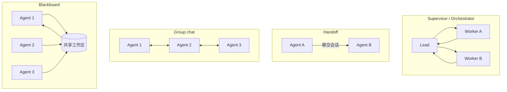

# 多智能体协作：拓扑、通信与失败模式

## 一句话结论

多 agent 的收益只来自两件事——**上下文隔离**与**并行**；代价是协调、一致性与调试成本。因此它是一笔"用协调成本换上下文容量"的交易，只有在并行度真实存在、且子任务之间不需要共享隐含决策时才划算，而不是"越多越好"。

## 问题与边界

- **解决什么**：给多 agent 系统一套拓扑分类与选型判据，说清收益来源与代价来源，给出通信机制、一致性设计，以及"什么时候它真的优于单 agent + 好工具"的清单。
- **不解决什么**：不讨论单个 loop 的控制结构（见 [Agent 的本质](01-agent-loop.md)），不讨论 A2A 的报文与任务状态机细节（见 [Agent2Agent](../03-protocols/02-a2a.md)），不讨论框架 API（见 [Microsoft Agent Framework](../02-frameworks/02-microsoft-agent-framework.md) 等）。
- **与相邻概念的分界**：
  - **多 agent ≠ 多角色 prompt**。在一个上下文里让模型"扮演三个角色"，仍然是单 agent；判据是**是否存在多个独立的决策者与各自的上下文**。
  - **多 agent ≠ 并行工具调用**。同一轮里并行发 5 个工具调用，是一个决策者的 5 个动作，不是 5 个 agent。
  - **多 agent ≠ 微服务**。微服务的边界由团队与部署划分，多 agent 的边界由上下文与决策权划分；两者的拆分标准经常冲突。

## 核心概念与架构

六种拓扑，区别在"谁决定下一个说话者"和"信息如何汇聚"：

| 拓扑 | 结构 | 谁决定流转 | 典型场景 |
|---|---|---|---|
| Supervisor / orchestrator | 一个 lead 拆任务、派给 worker、汇总 | lead | 研究、检索、多文件改造 |
| Handoff | 当前 agent 把会话整体交给下一个 agent | 当前持有者 | 分诊、专业分工（售前→售后） |
| Group chat | 多个 agent 共享一个对话轮转 | 轮转规则或主持人 | 头脑风暴、多方评审 |
| Debate | 多个 agent 就同一问题给出并辩驳 | 轮次协议 + 裁判 | 事实核验、方案取舍 |
| Pipeline | 固定顺序的 stage，每段一个 agent | 代码 | 内容生产、ETL 式加工 |
| Blackboard | 共享工作区，agent 按需读写 | 各 agent 自主（机会式） | 复杂分析、长时协作 |



三种拓扑在工程上差异最大：supervisor 的中心化让调试与预算控制最容易，但也让 lead 成为上下文瓶颈；handoff 简单但会丢失历史（"移交的是会话还是摘要"是个必须回答的设计问题）；blackboard 最灵活，也最难复现——没有任何一处代码能说明"为什么最后是这样"。

## 关键机制

### 收益来源：上下文隔离与并行

Anthropic 公开的多 agent 研究系统是目前最完整的收益证据：以 Claude Opus 4 为 lead、Sonnet 4 为 subagent 的系统，在其内部研究评测上比单 agent 高 90.2%；提速来自并行——lead 同时开 3–5 个 subagent、subagent 内部并行调 3 个以上工具，复杂查询的研究时间最多缩短 90%（[How we built our multi-agent research system](https://www.anthropic.com/engineering/multi-agent-research-system)，2025-06）。

更关键的是它对"为什么有效"的解释：子 agent 在各自窗口里探索、回退、丢弃死路，lead 只看到压缩后的结果，因此 lead 的上下文保持干净。同一篇报告里还有一个常被引用的归因：在 BrowseComp 上，**token 用量单独解释了 80% 的性能方差**，加上工具调用次数与模型选择共解释 95%。

> 判断：这条归因既是多 agent 的最强论据，也是它最尖锐的自我否定——如果收益主要来自"花更多 token"，那么把同样的预算给单 agent，能追回多少？2026 年的对照实验给出的答案是"相当一部分"。

### 反对意见：共享上下文与隐含决策

Cognition 在 2025-06 给出了相反立场，两条原则至今仍是多 agent 设计最有效的检查表：**共享上下文，且共享完整轨迹而不只是单条消息**；**行动携带隐含决策，冲突的隐含决策产生坏结果**（[Don't Build Multi-Agents](https://cognition.ai/blog/dont-build-multi-agents)）。它的例子很具体：把"做一个 Flappy Bird 克隆"拆给两个 subagent，一个把背景做成了马里奥风格，另一个做的鸟不像游戏素材——两者各自都"完成了任务"，合起来不可用。

这个批评的有效范围需要界定清楚：它针对的是**需要共享隐含审美/架构决策**的任务（前端、代码、设计）。研究类任务的子任务之间耦合弱，"找齐标普 500 信息技术公司的董事"这类问题可以完全并行，隐含决策的冲突面很小。所以两个立场并不矛盾，它们划分了适用边界。

同一篇里还有一个值得记住的观察：截至 2025-06，Claude Code 会开子 agent，但**从不与子 agent 并行做事**，且子 agent 通常只负责回答问题、不写代码——因为子 agent 缺少主 agent 的上下文。这是一个"用隔离换上下文容量、但严格限制写入权"的折中设计。

### 交接的契约

只要是"把工作交给另一个决策者"，就必须定义交接契约，否则信息损失不可控。一个够用的契约包含五项：**目标**（为什么做）、**已确认的事实**（带来源）、**已否决的方案**（含原因）、**产物位置**（文件路径或引用）、**未决问题**（需要下一位判断什么）。

这五项对应两类典型失败：缺"已否决"，下一位会把失败方案重试一遍；缺"未决问题"，下一位会以为自己已经完成。handoff 拓扑尤其需要它，因为整段会话被移交，接收方无法从上下文里推断"哪些已经试过了"。

### 通信机制

| 机制 | 形态 | 优点 | 代价 | 适用 |
|---|---|---|---|---|
| 消息 | 点对点或广播的自然语言/结构化消息 | 简单、可观测 | 信息在多次转述中衰减 | handoff、debate、group chat |
| 共享状态 | 共享内存/数据库中的结构化状态 | 一致性强、可回滚 | 并发写冲突、锁与版本管理 | supervisor + 短生命周期 worker |
| 文件/产物 | 子 agent 写文件，只回传路径与摘要 | 避免"传话游戏"，保真度最高 | 需要工作区隔离与清理 | 长任务、代码与报告产出 |
| 协议 | A2A 等跨进程/跨组织协议 | 跨厂商、可发现、可审计 | 重、需要身份与治理 | 跨组织委托、企业内多团队 |

第四条在 2026 年已经从"设想"变成"可用"：A2A 在 v1.0 中把 Agent Card（含 JWS 签名）、Task 生命周期、Artifact、Message 固化为核心对象，并提供 JSON-RPC 2.0、gRPC、HTTP+JSON 三种等价 binding（[A2A Specification](https://a2a-protocol.org/latest/specification/)）。Linux 基金会在 2026-04 的新闻稿中称，A2A 在发布一年内获得 150 多个组织支持，并在 Google、Microsoft、AWS 的平台上进入生产使用（[A2A 一周年公告](https://www.linuxfoundation.org/press/a2a-protocol-surpasses-150-organizations-lands-in-major-cloud-platforms-and-sees-enterprise-production-use-in-first-year)，2026-04）。这类数字属于治理方自述，采用前应按自己的场景验证，而不是当成成熟度保证。

文件作为通信媒介值得单独强调：Anthropic 明确建议让 subagent 把结构化产物写到文件系统、只把轻量引用回传给协调者，理由是这样能避免多阶段处理中的信息损失，也减少把大段输出复制进对话历史的 token 开销（同上一篇）。这条建议对"报告、代码、数据表"这类产物几乎总是成立。

### 一个最小可用的 supervisor 设计

把上面的约束落成一个可实现的骨架，只需要六个组件：

```text
Lead
  ├─ 任务分解：产出 [(objective, output_format, tools, boundaries, budget)]
  ├─ 配额：max_agents（按复杂度三档）、max_rounds、token_budget
  ├─ 派发：并行 N 个 Worker，每个独立上下文 + 独立工作目录
  ├─ 汇总：读 Worker 产物（文件路径），不读其完整轨迹
  ├─ 复核：对关键结论做一次交叉验证（至少两个独立来源）
  └─ 终止：全部完成 / 预算耗尽 / 无新增有效信息
Worker
  ├─ 只写自己的命名空间，不碰共享产物
  └─ 返回：结论 + 证据引用 + 未解决的问题（不返回过程）
```

其中"复核"一步经常被省略，但它是把"责任稀释"补回来的唯一手段：lead 必须对最终结论负责，而负责的前提是它至少独立验证过一次。Anthropic 的系统专门设置了一个 CitationAgent 来处理引用归属，原因也在这里——把"谁说的"和"说的是什么"分开处理（同上）。

### 预算与 agent 数量

agent 数量不是越多越好，它是乘法关系：成本 ≈ agent 数 × 每个 agent 的轮次 × 每轮上下文长度。在 15 倍 token 的基础上再加一个 subagent，等于把成本再乘一档，而边际质量提升通常远小于这个倍数。

一个可用的经验规则是"三档配额"：简单事实查找 1 个 agent、3–10 次工具调用；直接比较 2–4 个 subagent、每个 10–15 次调用；复杂研究 10 个以上 subagent 但职责必须切分清楚。这些数字来自 Anthropic 的实践总结（同上），可以直接作为起点，但必须用自己的评测校准。

### 同步还是异步

多数生产系统仍是同步的：lead 派出一批 subagent，等全部返回再继续。Anthropic 也承认这是当前的瓶颈——lead 无法中途调整 subagent、subagent 之间无法协作、单个慢任务会阻塞全局；异步能带来更多并行，但会引入结果协调、状态一致性与错误传播的新问题（同上）。

一个务实的折中是"分批 + 超时"：把 subagent 分成小批（3–5 个），每批设独立超时，超时的任务降级为"部分结果 + 标注"，而不是让整批失败。这比一步到位做全异步容易得多，也能拿到大部分并行收益。

### 失败模式与证据

2025—2026 年最有价值的进展，是把多 agent 的失败从轶事变成了可分类、可统计的对象。

**MAST 分类**基于 7 个主流框架的 1600 多条标注轨迹，归纳出 14 种失败模式，聚成三类：系统设计问题、agent 间错位、任务验证缺失；标注者间一致性 kappa = 0.88（[Why Do Multi-Agent LLM Systems Fail?](https://arxiv.org/abs/2503.13657)，2025-03，v3 2025-10）。这个分类的实用价值在于：14 种模式里，多数不是"模型能力不足"，而是**接口与验证设计不足**。

**受控实验**方面，2026 年发表在 Nature Machine Intelligence 的研究固定了任务 prompt、工具与算力预算，只改变协调结构，结论写在标题里——"能力足够强的语言模型，会让协作带来的收益变得不再必要"；论文用成功率/开销比、错误放大系数、消息密度与冗余等协调指标做预测，论文摘要报告跨六个 benchmark 的交叉验证 R²≈0.37，能在 87% 的 held-out 配置里选对最优架构（[Capable language models can outgrow the benefits of collaboration](https://doi.org/10.1038/s42256-026-01268-y)，2026-07）。换句话说：**单 agent 越强，多 agent 的相对收益越小**。

**跨领域综述**则给出更悲观的总结：失败随任务长度非线性放大，子任务上的强表现不能可靠地转化为端到端成功，增加脚手架（scaffolding）并不稳定地提升可靠性；同时，单轮工具使用、短程网页导航与窄域编码任务确实在进步（[Beyond the Leaderboard](https://arxiv.org/abs/2607.05775)，2026-07）。

这些结论合起来指向一个反直觉的建议：**先把单 agent 做强，再考虑拆**。因为单 agent 的能力提升会同时降低"需要拆"的概率与"拆错"的代价，而多 agent 的改造是不可逆的——一旦协作拓扑固化，回退成本远高于当初上车的成本。

五种高频失败，按后果排序：

| 失败 | 机制 | 早期信号 |
|---|---|---|
| 错误放大 | 上游错误被下游当作事实继续加工 | 下游结论与上游输入高度相关却无人复核 |
| 循环委托 | A 认为该 B 做、B 认为该 A 做，或互相请求补充信息 | 同一内容在 agent 间往返，步数增长但状态不变 |
| 责任稀释 | 每个 agent 都"完成了自己的部分"，无人对整体负责 | 端到端失败但每个子任务都判成功 |
| 成本爆炸 | agent 数 × 轮次 × 上下文长度的乘积 | 单任务成本呈阶跃式上升，且与质量不相关 |
| 状态不一致 | 并发写共享状态，读到过期值 | 结果在重跑时不可复现，且差异无规律 |

这五种里有四种与"是否有人对整体负责"有关。这也是为什么纯共识型的拓扑（group chat、debate）在生产环境比学术界少见：它们能提升单个判断的质量，却不天然产生一个对结果负责的角色。要在生产里用它们，必须显式补一个"裁判 + 收敛规则"，否则 discussion 会变成无限循环。

一个便于记忆的判据：**多 agent 系统的健康度，取决于交接处的信息保真度。** 每一次 agent 之间的传递都是一次有损压缩，压缩比越高、次数越多，最终结果离原始事实越远。所有工程手段（共享文件、结构化产物、引用而非复制）本质上都在降低这个压缩损失。

## 对比

| 拓扑 | 适用条件 | 代价 | 主要失败模式 |
|---|---|---|---|
| Supervisor | 任务可分解、子任务弱耦合、需要统一预算 | lead 上下文成为瓶颈；同步等待 | 分工模糊导致重复劳动；lead 汇总时丢细节 |
| Handoff | 阶段间专业分工明确、会话可整体移交 | 历史移交有损；回退困难 | 移交后上下文断裂，来回踢皮球 |
| Group chat | 需要多视角、讨论能收敛 | 轮次多、token 爆炸 | 无人负责、跑题、共识幻觉 |
| Debate | 有可判定的裁判、答案可验证 | 成本随轮次线性增长 | 双方互相强化错误；裁判被措辞说服 |
| Pipeline | 阶段固定、每段可校验 | 无并行；错误沿链放大 | 上游错误被下游"合理化" |
| Blackboard | 问题开放、参与方异构、需要长时协作 | 极难复现与调试 | 状态污染、写冲突、无人收尾 |

选它的条件：**并行度 × 耦合度**两个维度就能定位大多数场景。并行度高、耦合度低→supervisor 或 pipeline；并行度低、耦合度高→别用多 agent，回到单 agent + 好工具；并行度高、耦合度也高→只有 blackboard 有希望，但要接受调试成本。

### 判据清单：什么时候多 agent 真的优于单 agent + 好工具

下面八条同时成立，才值得上多 agent；有两条以上不成立，优先加强单 agent：

1. **子任务之间确实可以并行**，且并行带来的时间收益大于协调开销。
2. **子任务需要的上下文互不重叠**（不同代码库、不同数据源、不同检索方向），隔离能省下大量 token。
3. **单个上下文装不下**必要信息，且压缩会损失关键细节。
4. **子任务不需要共享隐含决策**（架构风格、命名约定、审美取向）。
5. **每个子任务的输出可以被独立验证**（测试、引用、结构化字段），而不是靠"看起来对"。
6. **任务价值足够高**，能承担远高于单 agent 的 token 成本（Anthropic 的数据：普通 agent 约为聊天的 4 倍，多 agent 约为 15 倍）。
7. **你能观测到每个 agent 的轨迹**，否则失败无法归因。
8. **有明确的收敛与终止规则**，包括最大轮次、最大 agent 数、预算熔断。

> 判断：第 4 条是最容易被跳过、也最容易致命的。团队往往用"我们拆得很清楚"来自证，但"拆得清楚"是任务描述层面的事实，"隐含决策一致"是执行层面的事实，两者不是一回事。

## 实践建议与常见坑

- **坑 1：把可并行的任务做成了串行流水线**。触发条件：为了"流程清晰"，用 pipeline 串联本可并行的检索。后果：延迟是并行方案的数倍，且没有任何正确性收益。规避：先画出任务的依赖图，只把有依赖的边连起来。
- **坑 2：subagent 的任务描述太短**。触发条件：lead 只给一句"研究一下半导体短缺"。后果：多个 subagent 做重复工作，或集体漏掉关键侧面；Anthropic 的早期系统就出现过分工失败：一个 subagent 去查 2021 年的汽车芯片危机，另外两个在重复调查 2025 年的供应链。规避：任务描述必须包含目标、输出格式、可用工具与来源、明确边界。
- **坑 3：subagent 直接改共享文件**。触发条件：多个 worker 并发写同一目录。后果：互相覆盖，且覆盖顺序不可复现。规避：单一写者（只有 lead 或指定的 integrator 能写），其余只产出到独立命名空间。
- **坑 4：只评测最终答案**。触发条件：端到端通过率作为唯一指标。后果：责任稀释被完全掩盖——每个 agent 都"及格"，系统不及格。规避：按 agent 记录轨迹与交接内容，评测"交接处的信息保真度"，见 [可观测性与 trace](../04-engineering/01-observability.md)。
- **坑 5：没有 agent 数量上限**。触发条件：lead 可自由 spawn。后果：早期系统出现过为简单查询开 50 个 subagent 的情况；成本与延迟双爆。规避：按查询复杂度写死配额（简单 1 个、比较 2–4 个、复杂 10 个以上），并在 prompt 里显式声明。
- **坑 6：跨组织场景直接上协议，没做身份与审计**。触发条件：用 A2A 对接外部 agent，但凭据用长效 token。后果：越权与不可追溯。规避：Agent Card 签名校验 + 短时令牌 + 全量调用审计，见 [安全与权限](../04-engineering/03-security.md)。
- **坑 7：把"多 agent"当成组织架构的映射**。触发条件：按团队划分 agent（检索组、分析组、写作组），每组一个 agent。后果：组织的沟通损耗被复制进系统，agent 之间的接口变成部门墙，且没有任何一处能对结果负责。规避：按上下文与决策权划分，不按汇报关系划分。

## 开放问题

- **收益归因未解**：多 agent 的提升有多少来自"更多 token"、多少来自"结构"，目前只有单篇报告的方差分解，缺独立复现。
- **异步协调的工程范式**：全异步能提升并行度，但结果协调与状态一致性没有成熟模式；2026 年的主流仍是同步 + 分批超时。
- **评测基准缺失**：现有 benchmark 多为单 agent 设计，缺少"必须协作才能完成"的任务集，也缺少对交接质量的度量。
- **责任归属**：跨组织多 agent 协作中，错误由委托方还是受托方承担，法律与技术层面都无共识。
- **拓扑的自动选择**：Nature MI 的研究说明协调指标有预测力，但把它做成运行时调度器仍是开放问题。
- **"共享隐含决策"的工程表达**：Cognition 指出的冲突难以用 prompt 消除，是否有可落地的机制（共享规范文件、统一代码风格检查）能部分替代共享上下文，尚无系统结论。
- **多 agent 的评测成本**：评估一个多 agent 系统需要跑大量轨迹，成本本身就阻碍了严谨评测，这也是该领域证据质量参差的现实原因。

## 参考来源

- How we built our multi-agent research system · Anthropic · 2025-06 · https://www.anthropic.com/engineering/multi-agent-research-system
- Don't Build Multi-Agents · Cognition · 2025-06 · https://cognition.ai/blog/dont-build-multi-agents
- Why Do Multi-Agent LLM Systems Fail? · Cemri et al. · 2025-03（v3 2025-10）· https://arxiv.org/abs/2503.13657
- Capable language models can outgrow the benefits of collaboration · Kim et al. · Nature Machine Intelligence · 2026-07 · https://doi.org/10.1038/s42256-026-01268-y
- Beyond the Leaderboard: A Synthesis of Tool-Use, Planning, and Reasoning Failures in LLM Agents · Albayaydh et al. · 2026-07 · https://arxiv.org/abs/2607.05775
- A2A Protocol Specification（v1.0）· Linux Foundation · 2026 · https://a2a-protocol.org/latest/specification/
- What's New in A2A Protocol v1.0 · Linux Foundation · 2026 · https://a2a-protocol.org/latest/whats-new-v1/
- A2A Protocol Surpasses 150 Organizations... · Linux Foundation · 2026-04 · https://www.linuxfoundation.org/press/a2a-protocol-surpasses-150-organizations-lands-in-major-cloud-platforms-and-sees-enterprise-production-use-in-first-year
- Building effective AI agents（Orchestrator-workers）· Anthropic · 2024-12 · https://www.anthropic.com/engineering/building-effective-agents
- Effective context engineering for AI agents · Anthropic · 2025-09 · https://www.anthropic.com/engineering/effective-context-engineering-for-ai-agents
