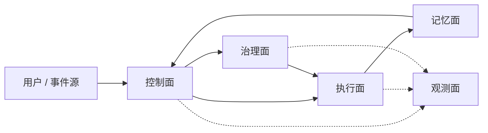
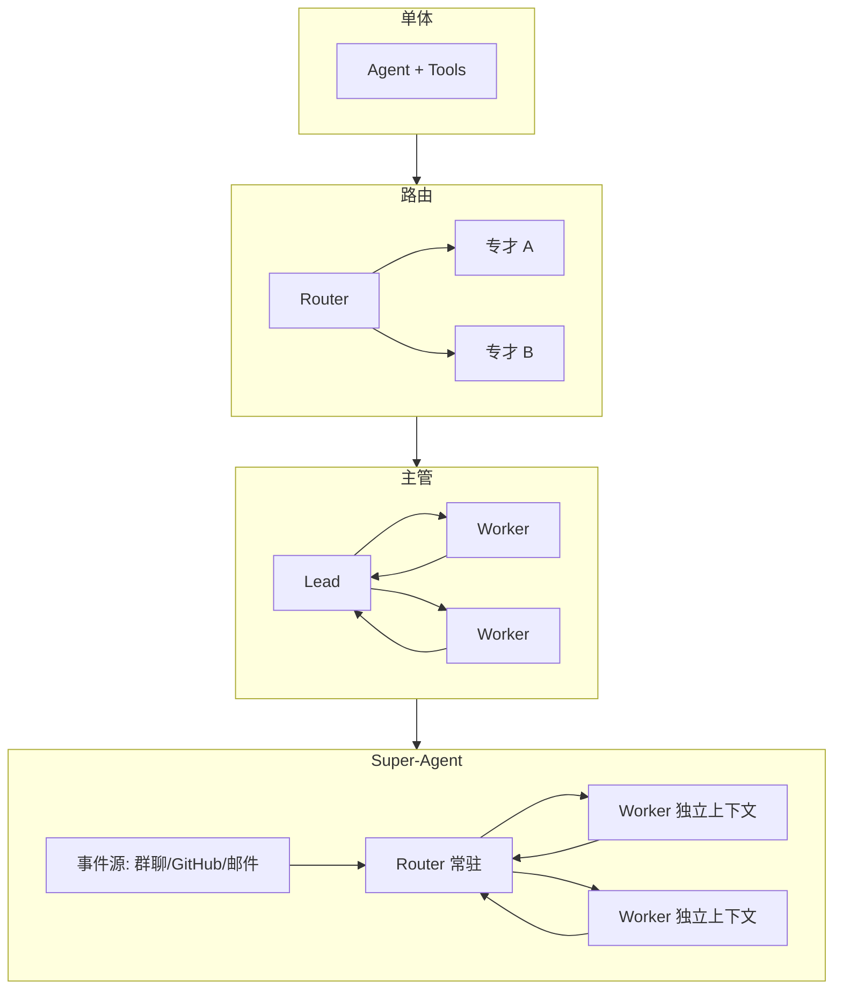
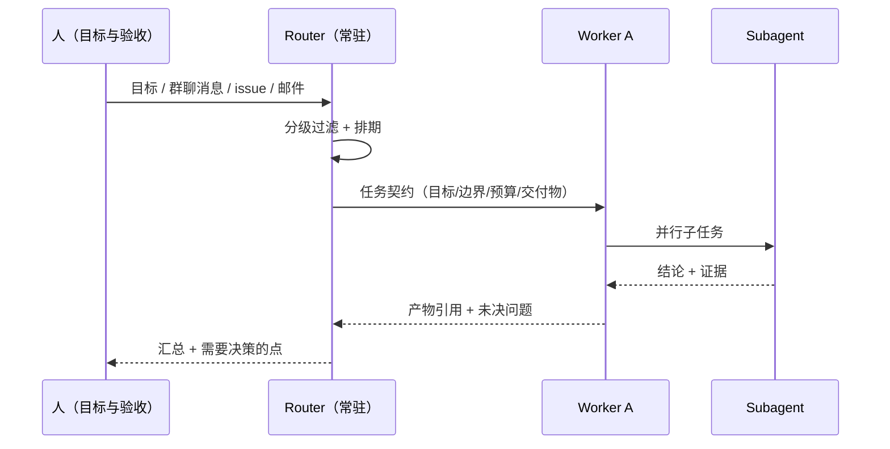

# Agent 架构方案：从单循环到 Super-Agent

## 一句话结论

架构选型不是"单 agent 还是多 agent"，而是三件事的取舍：**谁决定下一步（控制面）、上下文放在哪里（记忆面）、谁对结果负责（治理面）**。Super-Agent 是这三件事的一种特定答案——常驻的 Router 负责调度、隔离的 Worker 负责执行、会话管理由系统而非人承担；它解决的是"任务边界不可预知 + 人的注意力是瓶颈"，代价是成本、噪音与可调试性。

## 问题与边界

- **解决什么**：给出六种端到端架构方案的判据与代价；拆解 Super-Agent 的部件、机制与失败模式；说明它与厂商参考架构的对应关系。
- **不解决什么**：不重复多 agent 的拓扑细节（见[多智能体协作](05-multi-agent.md)），不展开框架 API（见[选型矩阵](../02-frameworks/00-selection-matrix.md)），不展开协议字段（见[协议分层](../03-protocols/00-protocol-stack.md)）。
- **与拓扑篇的分工**：拓扑篇回答"agent 之间怎么连"，本篇回答"一个系统怎么组装、谁对结果负责"。
- **术语说明**："Super-Agent"在 2026 年有两个所指——**产品叙事**（一个通用入口承接开放目标、端到端交付）与**具体架构**（DeepSeek Harness 团队 2026-10-31 提出的 Router/Worker 双层）。本篇以架构义为主，兼论产品义，并在用到时明确区分。

## 核心概念：五面解剖

任何 agent 系统都能拆成五个面。架构方案的差异，本质是这五个面的职责被放在了哪里：

| 面 | 职责 | 关键决策 | 放错位置的症状 |
|---|---|---|---|
| 控制面 | 决定下一步做什么、什么时候停 | loop / plan / router / 图 | 循环、跑偏、无法终止 |
| 执行面 | 工具、沙箱、网络、凭据 | 工具粒度、隔离强度、出口控制 | 越权、数据外泄、副作用重复 |
| 记忆面 | 上下文、会话、长期记忆、产物 | 隔离还是共享、压缩还是检索 | 上下文污染、跨任务串味 |
| 治理面 | 权限、审批、预算、审计 | 谁授权、什么必须人工、花多少 | 审批疲劳、责任不清 |
| 观测面 | trace、回放、评测、告警 | 记录粒度、采样、归因 | 失败无法复盘、优化靠猜 |

> 判断：多数架构事故不是"控制面不够聪明"，而是**记忆面与治理面的边界画错了**——上下文共享给了不该共享的 agent，权限却按"整个系统"授予。

## 六种架构方案

| 方案 | 谁决定下一步 | 上下文 | 适合 | 主要代价 |
|---|---|---|---|---|
| 单体循环 | 一个 agent 的 loop | 单一上下文 | 单域、短任务、工具少 | 上下文膨胀后质量下降 |
| 路由（router） | 分类器决定交给谁 | 每个专才独立 | 意图清晰、域可枚举 | 长尾请求无路可走 |
| 主管（supervisor） | lead 拆解与汇总 | lead 干净、worker 隔离 | 可分解、弱耦合 | lead 成瓶颈、错误放大 |
| 层级（hierarchical） | 多层 lead | 逐层隔离 | 大域、组织复杂 | 层间通信损耗、责任稀释 |
| 群体（swarm/handoff） | 当前持有者移交 | 随会话转移 | 分诊、专业分工 | 无全局视图、来回踢皮球 |
| 流水线（DAG） | 代码 | 段间传递 | 步骤固定、可校验 | 上游错误被下游合理化 |

**单体循环**是默认起点，也是最容易被低估的终点：只要任务不跨越多个域、上下文装得下，单体加好工具就够。**路由**在意图可分类时收益最大，它的隐性成本是分类器本身也会错。**主管**是研究、检索、多文件改造的常见形态，但它把复杂度集中到了 lead 的上下文与预算上。**层级**只在"域大到一个人（或一个上下文）管不过来"时才成立。**群体**适合分诊类流程，不适合需要对结果负责的任务。**流水线**不是 agent 架构，而是把 agent 嵌进确定性流程的方式，生产系统里最常见。

## Super-Agent：定义与边界

### 它到底新在哪

DeepSeek Harness 团队的问题陈述很具体：模型完成单个任务已越来越不需要人干预，但**人管理多任务的注意力没有增长**——一个人通常只能同时跟进 3–5 个活跃会话。于是"多任务的上限"从模型能力转移到了人的注意力，人成了调度员（[Super-agent 设计探索](https://finance.sina.com.cn/roll/2026-11-01/doc-inixeyiz3146996.shtml)，2026-10-31）。

Super-Agent 的回答是三个转移：

1. **会话管理上移**：不再由人新建对话、补背景、切换窗口，而由系统维护任务队列与跨会话上下文。
2. **执行单元隔离**：每个任务一个 Worker，独立上下文与运行环境，互不干扰；Worker 之下还可以再派 Subagent。
3. **触发方式变化**：从"人下指令"变成"事件驱动"——群聊、GitHub、邮件都能成为任务源，AI 可以在无人 @ 的情况下识别潜在缺陷并主动处理。

### Router / Worker 双层

| 角色 | 职责 | 生命周期 | 上下文 | 失败表现 |
|---|---|---|---|---|
| Router | 接收多渠道消息、理解意图、拆解分派、汇总验收、维护任务队列 | 常驻，跨会话 | 全局但轻量（任务摘要 + 状态） | 成为瓶颈；分派错误；丢失任务 |
| Worker | 执行单个任务：复现、审查、开发、调研 | 任务级，可并行 | 独立、可丢弃 | 上下文不全；重复劳动；越权写 |
| Subagent | Worker 内部的进一步并行 | 调用级 | 更窄 | 信息在边界丢失 |

关键设计点不在"双层"这个形状，而在四件事：

- **Router 的上下文必须轻**。它只保留任务摘要、状态与约束，不读 Worker 的完整轨迹；否则它会变成第二个瓶颈。
- **Worker 的契约必须完整**。目标、输出格式、可用工具、边界、预算、回报什么，缺一项就会产生重复劳动或越权。
- **产物走文件，不走消息**。Worker 把结果写到自己的工作区，只回传路径与摘要；Router 汇总时读产物，不读过程。
- **事件要有两级过滤**。第一级是规则（谁发的、是否 @、是否匹配关键词），第二级是模型判断（是否真的需要处理）。没有第一级，成本失控；没有第二级，噪音淹没。

### 与 supervisor 的区别

| 维度 | Supervisor | Super-Agent |
|---|---|---|
| 生命周期 | 随任务创建与销毁 | Router 常驻，跨任务、跨会话 |
| 入口 | 单一对话 | 多渠道（群聊、issue、邮件、API） |
| 职责 | 完成一个任务 | 管理任务队列与优先级 |
| 触发 | 人发起 | 人发起 + 事件驱动 |
| 上下文 | 任务内隔离 | 跨会话记忆 + 任务级隔离 |
| 失败后果 | 单个任务失败 | 任务堆积、误判优先级、主动越权 |

一句话：**Supervisor 是"任务内的编排"，Super-Agent 是"任务间的调度 + 任务内的编排"**。

### 什么时候值得

四条同时成立才值得上常驻调度：

1. 任务来源多且持续（不止一个人、不止一个渠道）。
2. 任务之间并行度高、上下文确实互不重叠。
3. 有稳定的验收标准，能让 Router 判断"做完了没有"。
4. 团队能承担"主动执行"带来的噪音与误判成本。

只满足前两条，用 supervisor 就够了；四条都不满足，单体加好工具更划算。

## 失败模式与反模式

| 失败 | 机制 | 早期信号 | 规避 |
|---|---|---|---|
| 错误放大 | Router 的误判被 Worker 当事实执行 | 下游结论与上游分派高度相关却无人复核 | 关键结论要求独立来源 |
| 责任稀释 | 每个 Worker 都"完成了"，整体不可用 | 子任务全绿、端到端失败 | 明确单一验收人 |
| 成本爆炸 | 任务数 × 轮次 × 上下文，且事件驱动会放大任务数 | 单日成本阶跃，与产出不相关 | 两级过滤 + 硬配额 |
| 上下文串味 | Worker 共用工作区或记忆 | 结果互相污染、重跑不可复现 | 一任务一命名空间 |
| 主动越权 | 无人 @ 时自行执行写操作 | 出现"没人要求"的提交或外发 | 写操作默认需人确认 |
| 任务堆积 | Router 只分派不收敛 | 队列变长、优先级失效 | 队列长度与老化告警 |

反模式尤其要记住两个：**把确定性 DAG 写成 Super-Agent**（用调度器跑固定流程，成本翻倍且更难审计）；**为简单任务开一堆 Worker**（并行的收益抵不过协调与汇总的损耗）。

## 对比

| 方案 | 控制面 | 记忆面 | 治理面 | 适合的团队 |
|---|---|---|---|---|
| 单体 | 模型 loop | 单上下文 + 文件 | 会话级审批 | 单产品、单域 |
| 路由 | 分类器 | 每专才独立 | 按专才授权 | 多意图入口 |
| Supervisor | lead | 任务级隔离 | 任务级审批 | 研究、改造类任务 |
| Super-Agent | 常驻 Router | 跨会话 + 任务隔离 | 全局策略 + 动作分级 | 多任务、多入口、持续运行 |
| 流水线 | 代码 | 段间契约 | 段级校验 | 强合规、确定性流程 |

选型可以压成三个问题：**任务边界能不能事先枚举？**（能→流水线或路由）**并行度是否真实存在？**（否→单体）**是否需要跨会话持续接活？**（是→才考虑 Super-Agent）。

## 选型与演进路径

1. **从单体开始**，把工具、上下文、审批做扎实——这一步的收益最大，且不会被后续架构推翻。
2. **加路由**：当入口出现明显可分类的多种意图，且单体 prompt 开始互相干扰。
3. **加 supervisor**：当单个上下文装不下、任务可分解且并行有真实收益。
4. **加常驻调度**：当任务来源持续、人成为瓶颈、且有稳定验收标准。
5. **每一步都先有评测**：没有轨迹与成功率数据，架构升级只是换一种失败方式。

这条路径的共同点是**可回退**：路由可以退回单体，supervisor 可以退回单体，Super-Agent 的 Worker 也可以缩成普通任务。反过来，一次性上常驻调度再回退，成本最高。

## 开放问题

- **主动执行的边界**：无人 @ 时 agent 可以读什么、可以写什么？目前靠产品策略而非协议约束。
- **跨会话记忆的隔离**：Router 记住多少算"够用"、多少算"串味"，没有度量方法。
- **验收自动化**：Router 判断"做完了没有"仍依赖模型，缺少可验证的验收契约。
- **成本归因**：一个任务的花费分散在 Router、Worker、Subagent 三层，账单难以归到业务单元。
- **评测方法**：常驻系统的"日活任务成功率"与单任务 benchmark 不是一回事，缺公开口径。
- **与人的协作节奏**：什么时候该打断人、什么时候该自己决定，没有可计算的准则。

## 参考来源

- Super-agent 设计探索：迈向更自主的 Agent 系统 · DeepSeek Harness 团队 · 2026-10-31 · https://finance.sina.com.cn/roll/2026-11-01/doc-inixeyiz3146996.shtml
- DeepSeek 发布全新 Agent 架构"Super-agent"（转载与解读） · 环球网 / 网易 · 2026-11 · https://m.163.com/dy/article/LAOBS1SB051481US.html
- How we built our multi-agent research system · Anthropic · 2025-06 · https://www.anthropic.com/engineering/multi-agent-research-system
- Extend Claude Code（扩展层：CLAUDE.md / Skills / Subagents / Hooks / MCP） · Claude Code Docs · 2026-11 · https://code.claude.com/docs/en/features-overview
- Don't Build Multi-Agents · Cognition · 2025-06 · https://cognition.ai/blog/dont-build-multi-agents
- Why Do Multi-Agent LLM Systems Fail? · Cemri et al. · 2025-03 · https://arxiv.org/abs/2503.13657
- Building effective AI agents（workflow 与 agent 的划界） · Anthropic · 2024-12 · https://www.anthropic.com/engineering/building-effective-agents
- Deep Research 技术说明（o3 + 浏览 + Python 的长时单 agent） · OpenAI · 2025-02 · https://openai.com/index/introducing-deep-research/
