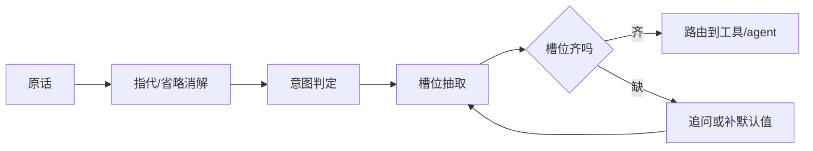

# 意图识别：从分类问题到路由决策

## 一句话结论

意图识别的目标不是"分类准确"，而是**错分可被发现、可回退**；在 agent 里它首先是路由问题（把请求送到正确的处理者），其次才是分类问题。把准确率当目标，会得到一套在长尾上静默失败的分类器。

## 先看一句话里有什么

用户说：**"帮我把昨天那单退了，XL 换成 M。"**

这一句话里有四样东西，缺一样就做不对：

| 要素 | 这句话里的值 | 缺了会怎样 |
|---|---|---|
| 意图 | 退货 + 换货（两个动作） | 不知道调哪个工具 |
| 槽位 | 订单（"昨天那单"）、尺码（XL→M） | 工具缺参数，执行失败 |
| 指代 | "那单" | 不知道退哪一单，可能退错 |
| 约束 | "昨天" | 可能退成今天或上周的单 |

**槽位（slot）是什么？** 可以把它想成表单里的字段：意图决定"该填哪张表"，槽位决定"表里每一格填什么"。退货这张表至少要填"订单号"，换货还要填"新尺码"；没填的格子，要么从上下文推断，要么追问用户。

| 意图 | 必填槽位 | 可选槽位 |
|---|---|---|
| 查物流 | 订单号 | 时间范围 |
| 退款 | 订单号、原因 | 金额、凭证 |
| 改地址 | 订单号、新地址 | 生效时间 |
| 换货 | 订单号、商品、新规格 | 换货原因 |

槽位有三种状态：**已给**（用户明说）、**可推断**（从上下文或默认值得到）、**缺失**（必须追问）。所以意图识别真正要输出的，不是"用户想退货"这一句话，而是"意图=退货，槽位={订单: 待消解, 原因: 缺失}"这样一份结构化结果。

完整的链路因此是五步，而不是一步分类：

这也解释了为什么"意图识别"在 agent 里不是纯分类问题：分类只完成第 3 步，而第 1、4、5 步都在决定"这件事能不能做成"。

## 问题与边界

- **解决什么**：意图的层级怎么定、四种实现怎么选、置信度与拒识怎么做、多意图与上下文依赖怎么处理、以及怎么评测"路由得好不好"。
- **不解决什么**：不讨论"要不要路由"的架构判断（见[Agent 架构方案](06-agent-architectures.md)的路由一节），不讨论工具 schema 怎么写（见[工具调用与沙箱](04-tool-use-and-sandbox.md)），不讨论模型能力选型。
- **与架构篇的分工**：架构篇回答"用不用 router"，本篇回答"router 怎么判、判错怎么办"。

## 意图的层级

对 agent 来说，"意图"不是用户心理活动的描述，而是**"该调用哪组工具、交给哪个 agent"的决策依据**。它通常分三层：

| 层 | 回答的问题 | 例子 | 决定什么 |
|---|---|---|---|
| 域（domain） | 这是哪类事 | 账单 / 代码 / 招聘 | 交给哪个 agent |
| 任务（task） | 要做什么动作 | 查询、修改、取消、比较 | 调用哪组工具 |
| 槽位与约束（slots） | 对什么做、有什么限制 | 订单号、时间范围、语气 | 工具参数与权限 |

三层不必都显式识别。常见做法是只识别域与任务，槽位交给下游工具的参数校验；因为槽位识别错通常能被 schema 挡住，而域识别错会一路错到底。

## 四种实现

| 实现 | 延迟 / 成本 | 准确率 | 可解释 | 漂移风险 | 适用 |
|---|---|---|---|---|---|
| 规则 / 关键词 | 极低 | 低到中 | 强 | 低（但维护重） | 意图少、措辞固定、强合规 |
| 小模型分类器 | 低 | 中到高 | 中 | 中（需重训） | 高流量、意图稳定、延迟敏感 |
| LLM few-shot 分类 | 中 | 高 | 中（可给理由） | 低（改 prompt 即可） | 长尾多、意图常变 |
| 工具选择即路由 | 中（与推理合并） | 高 | 弱 | 低 | 工具/agent 少、无需单独审计 |

最后一种是 2025 年后最常见的形态：**不显式做意图分类**，而是把候选工具或子 agent 的描述交给模型，让它在一次 function call 里选。这等于把"分类"和"决策"合并了，省一次调用，也省掉分类器与 prompt 不同步的问题；代价是路由过程不可单独审计，且候选一多准确率就下降。

> 判断：候选少于 10 个时，隐式路由（工具选择）通常优于显式分类；候选超过 30 个、或需要向审计解释"为什么转到这个 agent"时，显式分类 + 阈值更稳。

## 常见语言问题与处理

意图识别的错误，大半不是模型不够强，而是语言现象没被处理。按三层看：

| 层 | 现象 | 例子 | 典型错法 | 处理方式 |
|---|---|---|---|---|
| 语言层 | 指代 | "那它呢？" | 把代词当独立意图 | 消解到实体 ID，再分类 |
| 语言层 | 省略 | "再来一单" | 槽位为空，新建一单 | 继承上一轮槽位 + 确认 |
| 语言层 | 歧义 | "查一下苹果" | 按高频义硬选 | 上下文消歧或主动澄清 |
| 语言层 | 否定 | "不是退款，是换货" | 关键词命中"退款" | 抽取否定作用域与对比结构 |
| 会话层 | 话题切换 | "算了，看发票" | 沿用上一轮意图 | 检测转移信号，重置上下文 |
| 会话层 | 多意图 | "查订单并改地址" | 只取第一个 | 拆分或交给 supervisor |
| 业务层 | 言外之意 | "这个月怎么又扣钱" | 只识别成"查询" | 主意图 + 次意图（投诉/退款） |
| 业务层 | 越权 | "查我同事的订单" | 识别成查询并执行 | 意图之后加权限判定 |
| 业务层 | 域外 | "帮我写首诗" | 强塞进最接近的类 | 显式 Other + 兜底话术 |

### 指代消解怎么做

指代是 agent 场景里最高频、也最容易被低估的一类。四步：

1. **判定是否存在指代**：代词（它/这个/那个）、指示短语（"上次那个"）、零指代（"再来一单"省略了宾语）。
2. **找候选先行语**：从最近若干轮里找实体，按类型匹配、距离、显著性排序；同一类实体有多个时，置信度会明显下降。
3. **消解成结构化槽位**：把"它"落到 `order_id=...`、`user_id=...`，而不是把"它"替换成一段文本。只做文本替换，下游工具仍然会拿到模糊参数。
4. **多候选或低置信时反问**：宁可问一句"您说的是 3 月那单还是昨天那单"，也不要在两个订单之间猜。

一个常被忽略的细节：**指代消解要和意图分类的顺序解耦**。先分类再消解，分类器看到"那它呢"会直接懵；先消解再分类，输入变成"查订单 A123 的物流"，分类才稳。少数情况下两者可以联合做（一次 LLM 调用同时输出意图与实体），但需要模型显式给出消解结果，便于审计。

### 省略与槽位继承

"再来一单""换成那个地址"依赖上一轮的槽位。策略是**继承 + 显式确认**：能唯一确定的直接继承（同一商品、同一地址），不能唯一确定的先确认再执行。风险在于"继承错了"比"没继承"更糟——用户以为改的是新单，实际改的是旧单。

### 否定与作用域

"不是 A 而是 B"里，A 是否定对象、B 才是意图。关键词与浅层分类器会被 A 带偏，因为它们只看到"退款"这个词。可行做法：让路由模型显式输出"用户要什么 / 不要什么"两个字段，或在预处理阶段剥离否定从句。

### 歧义与澄清

歧义有两条路：**上下文消歧**（对话历史、用户画像、领域先验）和**主动澄清**。判据很直接：错分代价 × 歧义概率 > 澄清成本时，就该问。客服场景里澄清一次的成本，通常远低于办错一次。

### 言外之意

"这个月怎么又扣钱了"表面是查询，实际是投诉，可能还带退款诉求。把意图压成单标签，必然丢信息。可行做法是**主意图 + 次意图 + 情绪**三个字段，主意图决定路由，次意图决定后续动作，情绪决定是否升级人工。

### 越权与安全

意图识别正确不等于可以执行。"查我同事的订单"是一个合法的"查询"意图，但权限不允许。所以意图之后必须有一层权限判定，且默认拒绝、需要人工确认；把权限校验塞进分类器，会让模型同时承担"理解"和"授权"两个职责，两者都会失真。

## 关键机制

### taxonomy 设计

四条硬规则，违背任何一条都会在半年后付出代价：

1. **互斥**：一个请求只应落在一个意图里。做不到互斥，就先合并意图。
2. **可判定**：两个标注者看同一句话能得出同一结论；否则是定义不清，不是模型不行。
3. **有 Other**：必须有一个"以上都不是"的出口，否则长尾会被强行塞进最接近的类。
4. **粒度匹配动作**：意图的粒度应该对应"动作组"，而不是"话题"。按话题分会得到"咨询 / 投诉 / 建议"这类情绪分类，它对选工具没有帮助。

### 置信度与拒识

分类器输出概率、LLM 输出理由，两者都可以转成"要不要接"的决策。可用的策略是**双阈值**：

- 高于高阈值：直接路由；
- 介于两阈值之间：澄清（问一句）或交给通用 agent；
- 低于低阈值：直接转人工或走兜底流程。

阈值不该拍脑袋，而应按**错分成本**定：把"退款"错分成"查询"的代价，远高于把"查询"错分成"退款"。所以每个意图可以有不同阈值，而不是全局一个。

### 多意图与复合请求

"帮我查一下订单，顺便把地址改了"包含两个意图、两种权限。三种处理方式：

- **拆分**：识别出多个意图，分别路由，最后汇总；适合弱耦合。
- **串行**：按依赖顺序执行；适合有前后置关系（先查再改）。
- **交给 supervisor**：不拆，整体交给能编排的 agent；适合意图之间强耦合。

最糟的做法是"只取第一个意图"，用户会以为第二件事也被处理了。

### 上下文依赖的意图

指代、省略、话题切换都会让"这一轮"的意图依赖历史，具体处理见上节。这里只留一个决策：**首轮用分类器、后续轮次带历史交给 LLM**，或干脆把整段会话交给 agent 自行判断。前者可审计，后者更准但更难归因。

### 与 handoff 的区别

路由回答"选谁"，handoff 回答"把会话和上下文交给谁"。路由之后不一定需要移交：如果只是调用一个专才工具，上下文不必搬；如果要换一个 agent 接管对话，才需要 handoff，并要定义交接契约（目标、已确认事实、已否决方案、未决问题，见[多智能体协作](05-multi-agent.md)）。

### 怎么评测

不要只看分类准确率，至少四个指标一起看：

| 指标 | 回答什么 | 怎么算 |
|---|---|---|
| 混淆矩阵 | 错在哪两类之间 | 按意图两两统计 |
| 加权错分率 | 错分的代价有多大 | 按业务代价给每类加权 |
| 拒识率与覆盖率 | 有多少请求没被接住 | 拒识数 / 总数 |
| 路由后成功率 | 分对了之后真的做成了吗 | 端到端任务成功率 |

最后一项才是北极星：**分对但做不成，等于没分对**。线上还要监控意图分布漂移——新意图出现时，分类器不会报错，只会把请求塞进最接近的旧类。

### 一个最小可用的路由流程

不追求一次到位，六步就能跑起来：

1. **归一化输入**：去噪、补上下文（上一轮在聊什么）、识别语言。
2. **生成候选**：从意图表或工具/agent 注册表里取候选，不要一次把全部候选塞给模型。
3. **判定**：规则先兜底（强特征直接命中），其余交给 LLM 或分类器。
4. **阈值决策**：按双阈值决定"直接路由 / 澄清 / 兜底"。
5. **记录**：意图、置信度、理由、最终处理者，四样都进 trace。
6. **回流**：错分与拒识样本每周进入评测集，而不是等季度复盘。

这六步里最容易被省掉的是第 5 步。没有"为什么转到这个 agent"的记录，错分只能靠用户投诉发现。

### 线上漂移监控

三个信号足以触发一次复核：**意图分布突变**（某类占比一周内翻倍）、**拒识率上升**（兜底流量变多）、**路由后成功率下降**（分对了但做不成）。处理方式不是立刻重训，而是先聚类未识别请求，看是否出现了新意图；确认后再决定是扩意图表，还是把新请求交给通用 agent。

## 常见坑

- **坑 1：用准确率掩盖高代价错分**。触发条件：各类样本不均衡，少数类（退款、取消、删号）样本少。后果：总体 95%，但高危意图召回只有 60%。规避：按类看召回，按代价加权。
- **坑 2：没有 Other 出口**。触发条件：意图列表封闭且无兜底。后果：新业务上线后，请求被塞进旧意图，错误静默发生。规避：保留 Other + 定期聚类未识别请求。
- **坑 3：意图膨胀**。触发条件：每次新需求加一个意图。后果：一年后 200 类，互相重叠，标注与维护成本失控。规避：意图对应动作组，新需求优先映射到已有动作，而不是新建类。
- **坑 4：分类器与 prompt / 工具不同步**。触发条件：工具改名、agent 拆分后没更新分类器。后果：分对了类，但下游已经没有这个处理者。规避：把意图表与工具/agent 注册表做一致性检查。
- **坑 5：多意图只取第一个**。触发条件：分类器输出单标签。后果：第二件事被静默丢弃，用户以为完成了。规避：多标签或显式澄清。
- **坑 6：忽略长尾**。触发条件：训练/示例集只覆盖高频意图。后果：长尾请求要么被错分，要么触发兜底，体验断崖。规避：用线上未识别样本做周期性补充，而不是等下一次大改版。
- **坑 7：让同一个模型既路由又执行**。触发条件：为省一次调用，把"选哪个 agent"和"执行任务"塞进同一次生成。后果：模型会倾向选自己擅长的路径，路由失去独立性，错分也无法归因。规避：高价值场景把路由与执行分开，至少保留可审计的路由理由。
- **坑 8：把闲聊与空输入当异常**。触发条件：只处理业务意图，未定义"打招呼/追问/无意义输入"。后果：这类请求被强行分到业务意图，触发无意义的工具调用。规避：显式定义 chitchat 与 clarify 两类，并给它们独立的处理路径。

## 对比：显式分类还是隐式路由

| 条件 | 选显式分类 | 选隐式路由（工具选择） |
|---|---|---|
| 候选数量 | 多（>30） | 少（<10） |
| 可解释/审计要求 | 高 | 低 |
| 延迟预算 | 紧（可用小模型） | 宽松（与推理合并） |
| 意图稳定性 | 稳定、可枚举 | 长尾多、常变 |
| 需要拒识 | 是 | 弱（模型会硬选一个） |

## 开放问题

- **意图漂移的自动发现**：新意图出现时没有标签，如何在不全量标注的前提下发现？
- **分类器与 LLM 路由的一致性**：两套并存时，冲突以谁为准？
- **多意图的评测**：现有指标基本假设单标签，多标签场景缺公认口径。
- **跨语言与跨渠道**：同一意图在聊天、邮件、工单里的表达差异，是否需要不同的分类器？
- **意图与权限的耦合**：路由结果直接决定能用哪些工具，那么"分错"就等价于"越权"，权限该在路由前还是路由后校验？
- **标注一致性阈值**：多人标注时 kappa 低于多少，就该判定"意图定义有问题"而不是"标注员不认真"？
- **级联是否更省**：小模型先分、低置信度再交给大模型，在什么分布下总成本真的更低？
- **冷启动数据**：没有线上流量时，合成数据能否代表真实的意图分布？

## 参考来源

- Building effective AI agents（routing 作为 workflow 模式） · Anthropic · 2024-12 · https://www.anthropic.com/engineering/building-effective-agents
- Function calling 指南（工具选择即路由） · OpenAI · 2026 · https://platform.openai.com/docs/guides/function-calling
- Tool use 概览（模型如何在候选工具中选择） · Anthropic · 2026 · https://platform.claude.com/docs/en/agents-and-tools/tool-use/overview
- Super-agent 设计探索（Router 的分派与多通道接入） · DeepSeek Harness 团队 · 2026-10-31 · https://finance.sina.com.cn/roll/2026-11-01/doc-inixeyiz3146996.shtml
