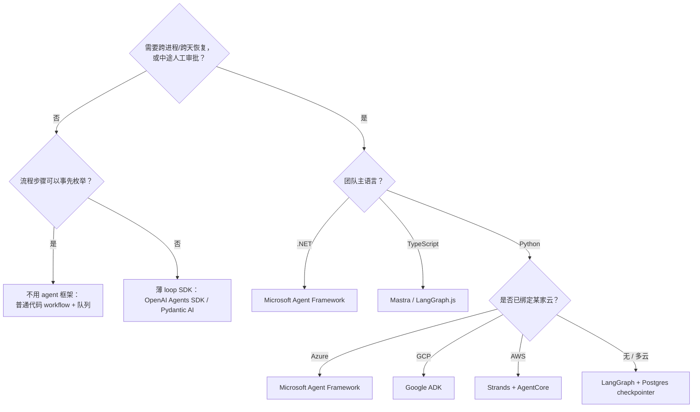

# 框架选型矩阵（2026-11 基线）

## 一句话结论

先回答"控制流由谁决定、状态存在哪、谁来审计"，再看框架名；2026-11 的 11 个候选已收敛为三种形态——图/工作流编排、轻量 agent loop SDK、平台化 runtime，跨形态比"功能多少"没有意义，比"谁承担恢复与审计"才有。

## 问题与边界

**解决什么**：给定团队语言、持久化需求、人工介入强度、云绑定约束，在 11 个主流框架中缩小到 1–2 个候选，或得出"不用框架"的结论。

**不解决什么**：模型选型、prompt 与上下文设计、评测集构建（分别见[上下文工程](../01-foundations/02-context-engineering.md)、[评测体系](../04-engineering/02-evaluation.md)）。框架不提升模型能力上限，只决定工程约束怎么落地。

**三个必须先分清的概念**：

- **框架 ≠ 协议**。MCP 是工具接入协议（[MCP](../03-protocols/01-mcp.md)），几乎所有框架都支持；它不决定编排能力。
- **框架 ≠ runtime**。同一个 LangGraph 图既能跑在本地进程，也能跑在 LangSmith Agent Server；"能不能恢复"取决于 runtime 有没有持久化后端，不取决于 import 了哪个包。
- **SDK ≠ 平台**。OpenAI Agents SDK 是库；AgentKit 里的 Agent Builder 是平台侧产品，且已进入关停流程（见下文"常见坑"）。

**基线声明**：所有版本号取 2026-11-20 当日 PyPI / npm 的 latest，许可证取仓库 LICENSE 与包元数据，能力描述取官方文档；矩阵只记录可核对的机制与版本，营销形容词（"企业级""生产就绪"）一律不入表。

## 十维矩阵

### 表 A：抽象层次、执行模型、状态与持久化

| 框架 | 抽象层次 | 执行模型 | 状态与持久化 |
|---|---|---|---|
| [LangGraph](01-langgraph.md) | 低层图编排（StateGraph），非开箱 agent | Pregel 超步：节点并行、条件边、`Command`/`Send` 路由 | checkpointer 每超步落盘；`interrupt()` + `Command(resume=)`；time travel 一等能力 |
| [Microsoft Agent Framework](02-microsoft-agent-framework.md) | Agent + Workflow 双轨，企业件齐全 | agent 自动多轮工具循环；workflow 按边路由数据、按超步推进 | `AgentSession`；workflow checkpoint 落在超步边界；`ctx.request_info()` 做 HITL |
| [OpenAI Agents SDK](03-openai-agents-sdk.md) | 最薄 loop SDK：agent/handoff/guardrail | Runner 对话循环，handoff 切换 current agent，直到产出最终输出 | Sessions（SQLite/SQLAlchemy/Redis/Mongo/Dapr/加密）；`RunState` 可序列化续跑 |
| [Google ADK](04-google-adk.md) | code-first + Workflow Runtime（图） | workflow agents（顺序/并行/循环）+ 图运行时；Task API 做委派 | Session/State/Memory/Artifact 四类服务；会话 schema 在 2.0 有破坏性变更 |
| [Claude Agent SDK](05-claude-agent-sdk.md) | 产品化 harness（loop + 内置工具 + 权限） | 驱动子进程 CLI，消息流式返回；permission mode 决定工具是否放行 | session 续接 + 工作目录即状态；无常驻服务端状态 |
| [CrewAI](06-crewai.md) | 角色协作（role/goal/backstory）+ Flows | Crew 的 sequential/hierarchical 流程；Flows 用 `@start`/`@listen` 事件驱动 | Flow state 显式、可持久化、可 fork；Crew 内部状态基本不落盘；1.15 起 memory 统一为 `Memory` |
| [LlamaIndex](07-llamaindex.md) | 数据层优先（官方叙事已转向 LlamaParse），AgentWorkflow 作上层 | Function/ReAct/CodeAct agent 组合，handoff 切换 | memory/context 持久化；检索索引本身是主要状态 |
| [Pydantic AI](08-pydantic-ai.md) | 类型安全 code-first（`Agent[deps, out]`） | 单 agent loop；复杂控制流交给 pydantic-graph | 消息历史由调用方持有；`StepPersistence` 做步骤快照，崩溃恢复靠外部 durable execution 引擎 |
| [Strands Agents](09-strands-agents.md) | model-driven 轻量 SDK + Harness 分层 | 模型决定工具调用；多 agent 用 Swarm/Graph/Workflow | session manager（文件/S3）+ AgentCore 侧记忆 |
| [Agno](10-agno-and-lightweight.md)（含 smolagents/CAMEL） | 平台化：Agent/Team/Workflow + AgentOS | agent loop + workflow 路由/并行；AgentOS 提供 durable queue | 内置 session/memory，落 Postgres；任务不丢、HITL 可续（PAUSED），崩溃 run 不自动重放 |
| [Mastra / Vercel AI SDK](11-typescript-stack.md) | Mastra 是 TS 全栈框架；AI SDK 是模型与流式 UI 层 | Mastra workflow 用 `.then/.branch/.parallel`；AI SDK 只负责调用与流式 | Mastra 用 storage 做 suspend/resume；AI SDK 不管状态 |

### 表 B：多 agent、工具与 MCP、可观测、评测集成

| 框架 | 多 agent 支持 | 工具与 MCP | 可观测 | 评测集成 |
|---|---|---|---|---|
| LangGraph | 子图 + 手写 supervisor；无角色协作抽象 | 节点内自行调用；MCP 经 `langchain.mcp`（1.4 起内置，beta） | LangSmith 一等公民（trace 与 eval 同平台） | LangSmith datasets/experiments，无框架内 eval DSL |
| Microsoft Agent Framework | 内置 Sequential/Concurrent/Handoff/Group Chat/Magentic | `@tool`、hosted tools（code interpreter/web search）、`MCPStdioTool`/`MCPStreamableHTTPTool`；A2A | OpenTelemetry 内置；DevUI 仍为 beta（PyPI 预发布号 `1.0.0b…`） | 本体不带 eval API，集成目录里有 evaluation 服务对接 |
| OpenAI Agents SDK | handoff + agents-as-tools 两种范式 | `@function_tool`、hosted tools、MCP servers、Sandbox 文件/Shell | 内置 tracing，可插自定义 processor | Evals 面板 2026-11-30 转只读，官方建议迁 Promptfoo |
| Google ADK | 层级组合 + A2A + Task API 委派 | functions/OpenAPI/MCP + tool confirmation | 内置 telemetry，接 Cloud Trace | `adk eval` 与 eval sets |
| Claude Agent SDK | subagents（Task）+ skills | Claude Code 工具集 + MCP + hooks；`allowed_tools` 只是允许名单 | 消息流 + hooks，trace 需自行接入 | 无内置评测 |
| CrewAI | Crew 是一等公民，支持委派 | crewai-tools + MCP 适配 | 内置 tracing（AMP 侧） | 无开源 eval，评测在 AMP 商业侧 |
| LlamaIndex | AgentWorkflow 的 handoff | 大量 connector + QueryEngineTool + MCP | instrumentation/callback | 内置 evaluation（faithfulness/relevancy 一类指标） |
| Pydantic AI | 工具委派 + pydantic-graph | `@agent.tool`、toolsets、MCP | Logfire 一等公民，OTel 原生 | pydantic-evals（独立包，同版本号） |
| Strands Agents | Swarm/Graph/Workflow 三种 | `@tool` + MCP + A2A | OTel traces | 独立 evals 包（strands-agents/evals） |
| Agno（含 smolagents/CAMEL） | Team/Workflow；smolagents 走层级式 multi-agent（agent 管理 agent），CAMEL 是角色扮演 | 自带工具库 + MCP；AgentOS 同时暴露 MCP server | AgentOS tracing + UI | 内置 accuracy/performance evals，非完整评测平台 |
| Mastra / Vercel AI SDK | Mastra 用 workflow 编排多 agent | Mastra 可写 MCP server；AI SDK 只做 tool calling | Mastra observability + Studio | Mastra 有 evals；AI SDK 无 |

### 表 C：部署形态、语言、许可证与治理

| 框架 | 部署形态 | 语言与生态 | 许可证与治理 | 版本（2026-11-20） |
|---|---|---|---|---|
| LangGraph | 库 + 自建；托管走 LangSmith Agent Server（BYOC/Cloud） | Python / TypeScript | MIT；LangChain Inc. 主导，商业面是 LangSmith | 1.2.24（JS 1.7.5） |
| Microsoft Agent Framework | 自建服务（单进程组合，分布式 runtime 仍在路线图）；Foundry 托管 agent | Python / .NET / Go（public preview，需 Go 1.26+） | MIT；Microsoft，Azure 生态强绑定 | 1.26.0 |
| OpenAI Agents SDK | 库 + 自建；长任务托管走向 Responses API 背景模式 | Python 先行，TypeScript 滞后 | MIT；OpenAI，平台能力强绑定 | 0.25.0（TS 0.22.0） |
| Google ADK | Cloud Run / Agent Runtime（原 Vertex AI Agent Engine） | Python / Java / Go / TypeScript（Kotlin 部分特性实验） | Apache-2.0；Google，Gemini 优先但模型无关 | 2.15.0 |
| Claude Agent SDK | 本地或容器内跑 CLI；模型侧可走 Anthropic API 或云厂商托管 | Python / TypeScript | Python 仓代码 MIT；使用受 Anthropic Commercial Terms 约束，TS 仓非 MIT | 0.2.186（TS 0.3.329） |
| CrewAI | 自建；CrewAI AMP/Enterprise 托管 | Python | MIT；开源核心 + 商业平台 | 1.15.44 |
| LlamaIndex | 库 + LlamaCloud | Python / TypeScript | MIT；LlamaIndex Inc. | 0.14.26（core） |
| Pydantic AI | 库，无自带 runtime | Python | MIT；Pydantic 团队 | 2.71.0（V2 自 2026-06-23） |
| Strands Agents | Bedrock AgentCore 或自建 | Python / TypeScript | Apache-2.0；AWS | 1.65.0 |
| Agno（含 smolagents/CAMEL） | AgentOS 自托管（Docker/K8s/云模板） | Python | Apache-2.0；smolagents 与 CAMEL 亦 Apache-2.0 | 3.2.1 / 1.26.0 / 0.2.90 |
| Mastra / Vercel AI SDK | Node/Edge/serverless；Mastra platform（Observability / Studio / Server） | TypeScript | Mastra Apache-2.0（`ee/` 另授权，open-core）；AI SDK Apache-2.0 | @mastra/core 1.85.0；ai 7.0.177 |

**读表方法**：先看表 A 的"状态与持久化"，它决定你能不能做长任务与 HITL；再看表 C 的"许可证与治理"，它决定法务能不能过；表 B 只在前两步筛完后用来做最后取舍。三张表都按同一行序排列，方便横向追同一家的不同维度。

## 决策树

四个问题按顺序问，前两个决定"要不要框架"，后两个决定"选哪个"。

四个补充判断：

- **审批点少于 3 个、恢复窗口小于 1 小时**：不必上图编排，`RunState`/session 级续跑够用，选薄 SDK 省一半代码。
- **需要"回到第 3 步改一个参数重跑"**：只有带 checkpoint 历史（LangGraph time travel、MAF checkpoint 列表）的框架做得到，SDK 级方案要自己写事件日志。
- **团队没有专职维护者**：抽象越薄越好。图编排框架的升级成本主要落在状态 schema 迁移，而不是 API 变更。
- **"云绑定"与"模型绑定"要分开算**：ADK 绑定的是部署链路（Cloud Run/Agent Runtime），MAF 绑定的是身份与托管（Foundry + Entra），OpenAI SDK 绑定的是模型接口（Responses API）；三者中只有最后一个会直接限制你换模型。

### 每个候选的"选它的条件"

这一节回答"什么条件下选它"，不是特性罗列；右边一列是反向信号。

| 框架 | 选它的条件 | 出现这些信号就别选 |
|---|---|---|
| LangGraph | 流程有明确阶段、需要断点续跑与 time travel、团队愿意自己写控制流 | 想要开箱角色协作；没人愿意维护图与状态 schema |
| Microsoft Agent Framework | 团队有 .NET、已用 Azure/Foundry、需要 OTel 与审批原语、要 A2A | 纯 TS 团队；需要跨机分布式 actor runtime；不想被 Azure 样例牵着走 |
| OpenAI Agents SDK | 以 OpenAI 模型为主、要最快上线、需要 handoff 与内置 tracing | 需要确定性长流程编排；模型必须多云混用；要"强制"而非"建议"型护栏 |
| Google ADK | 已用 Gemini/Vertex、需要 A2A 与 eval 开箱、要多语言实现 | 主力模型非 Gemini；不想引入 Google Cloud 部署链路 |
| Claude Agent SDK | 要复用 Claude Code 的 harness（内置工具、权限、子 agent、skills） | 需要库级可嵌入、进程内可控；法务不接受商业条款许可 |
| CrewAI | 任务能拆成角色分工、要快速给出可读的协作叙事 | 流程需要细粒度分支与恢复；要长期维护复杂状态机 |
| LlamaIndex | 核心难点在数据接入与检索质量，agent 只是外壳 | 数据层已自建；需要强编排与 HITL |
| Pydantic AI | 团队强类型偏好、要结构化输出与依赖注入、已有 Logfire | 需要内置持久化与审批；要 TS 实现 |
| Strands Agents | 已用 Bedrock/AgentCore、要 model-driven 的薄抽象、要 A2A/MCP | 多云中立要求高；需要成熟的多 agent 调试工具链 |
| Agno（含 smolagents/CAMEL） | 想直接用带 API/调度/审批的 AgentOS，或做 CodeAgent 式原型 | 只需要库；不想引入平台层与 Postgres 依赖 |
| Mastra / Vercel AI SDK | 全栈 TS、前端要流式 UI、要一个进程内同时做 RAG 与 workflow | 后端是 Python/.NET；需要跨语言共享编排逻辑 |

### 三步核实一个框架的真实能力

文档里的形容词不可验证，三个动作可以：

1. **查 checkpoint 落在哪**：是每一步落盘，还是只在会话结束时存？前者才能做 HITL 与断点续跑。看持久化后端是内存、文件还是数据库实现。
2. **查 HITL 是"暂停"还是"重跑"**：暂停后恢复时，被中断的节点是从头执行还是从断点继续？从头执行意味着副作用要幂等，这是最常见的上线事故来源。
3. **查评测是否与 trace 同源**：trace 里的轨迹能否直接变成评测样本？不能的话，评测会退化成另一套手工脚本。

## 反选建议：什么情况下不要用框架

1. **单轮或 2–3 轮、工具不超过 5 个**：直接调 Responses API / chat completions，手写 30 行 while 循环。引入框架换来的是依赖、升级与调试成本，换不到可靠性。
2. **流程完全确定**：用普通代码 + 队列（或 Temporal 一类持久执行引擎）。agent 的价值在"模型决定下一步"，确定流程里它只会增加不确定性。
3. **只需要 RAG 问答**：用 LlamaIndex 的检索层或直接向量库 + 一次生成，不必上 AgentWorkflow。
4. **合规要求"每步可审计、可重放"而团队不打算维护状态机**：先解决审计日志（不可变事件表），再谈框架；否则任何框架的 checkpoint 都只是内部实现细节，不能当审计凭证。
5. **模型必须私有化部署且不能出网**：优先选模型无关、无托管依赖的薄 SDK（Pydantic AI、Strands、LangGraph 自建），避开把 tracing 默认上报到厂商的默认配置。
6. **想用"多 agent"解决上下文太长**：先试子 agent 隔离或 compaction；多 agent 的调试成本通常在两周后才发现，见[多智能体](../01-foundations/05-multi-agent.md)。
7. **团队不足 3 人却要同时维护两条产品线**：选最薄的 SDK，并接受"没有断点续跑"；两个框架的维护成本不是相加而是相乘。
8. **指望框架顺带解决前端**：自带管理/调试界面的是少数（Mastra Studio、Agno 的 AgentOS UI、MAF 的 DevUI），面向终端用户的聊天 UI 基本要自己写或用 ChatKit 一类外部件；把 UI 当框架能力评估会得出错误结论。

## 迁移与退出成本

选型时很少有人算这一栏，但它决定两年后能不能换。

| 迁移方向 | 主要工作量 | 可自动化的部分 |
|---|---|---|
| 薄 SDK → 图编排 | 把隐式控制流重画成节点与边，补状态 schema | 工具定义可复用，prompt 可复用 |
| 图编排 → 薄 SDK | 删掉状态机，把阶段约束降级为 prompt 与工具 | 基本无，属于重写 |
| 同类框架之间（LangGraph ↔ MAF） | 状态模型、checkpoint 格式、HITL 语义全部重做 | 工具层与模型层可复用 |
| 框架 → 直接调 API | 自建循环、重试、观测、会话表 | 业务逻辑与工具实现可保留 |
| 云厂商 runtime → 自建 | 会话存储、身份、扩缩容、审计全部补齐 | 镜像与部署脚本可复用 |

结论：**迁移成本主要由"状态与审批语义"决定，不由代码量决定**。想保留退出能力，就把状态存成自己能读的格式（业务表或事件日志），把框架的 checkpoint 只当缓存。

## 三种最小可行技术栈

| 档位 | 编排 | 状态/持久化 | 观测与评测 | 部署 | 代价与边界 |
|---|---|---|---|---|---|
| 原型（1–2 周） | OpenAI Agents SDK 或 Pydantic AI | 进程内 session（SQLite 即可） | 平台自带 tracing + 20 条手写黄金样例 | 单容器 / 本地 | 无审批、无断点续跑；换模型要重测行为 |
| 生产（3–6 月） | LangGraph（.NET 团队用 MAF） | Postgres checkpointer，按 thread 归档与 TTL | LangSmith 或 Langfuse + CI 轨迹回归 | 容器 + 队列 + 独立状态库 | 图设计与 checkpoint 治理要专人；状态 schema 需版本化 |
| 强合规（金融/医疗） | MAF（Azure 栈）或 LangGraph + 自建审计层 | 不可变事件日志 + 每次工具调用审计；checkpoint 只作恢复用 | OTel → 自建 Collector → SIEM；评测集进变更评审 | 私有云 / BYOC，egress 白名单 | 交付慢一倍；需要为"模型/prompt/工具"三层分别做版本与回滚 |

> 判断：三种栈的差别不在编排库，而在"状态归谁管"。原型把状态交给进程内存，生产交给数据库，强合规交给审计日志——选框架其实是选状态的归属。

## 常见坑

- **把厂商的"多 agent"当需求**：触发条件是先看 demo 后写需求。后果是 4 个 agent 互相等待、成本翻 3 倍、失败定位不到层。规避：先用单 agent + 好工具跑通基线，只有上下文隔离或权限隔离带来明确收益时才拆。
- **用 demo 版本判断生产可用性**：MAF 的 DevUI 仍是 beta 预发布，OpenAI 的 Sandbox agents 是 beta 面；把 beta 面写进架构图的"核心链路"，升级时会被迫跟着改。
- **许可证看包字段而不是仓库**：npm/PyPI 的 license 字段可能为空或写 `SEE LICENSE IN README`；Claude Agent SDK 就是 Python 仓 MIT、TS 仓非 MIT、且两者使用都受 Anthropic 商业条款约束的分裂结构。法务评审必须看仓库根 LICENSE 与 README 的 terms 段。
- **把"支持 MCP"当成能力等价**：传输支持（stdio/Streamable HTTP）、是否支持 elicitation、是否支持 MCP Tasks，各家差异很大。MAF 文档明确写了 WebSocket 传输与 MCP Tasks 不支持。
- **忽略基线漂移**：本矩阵的版本号只对 2026-11-20 有效；`Agent Builder` 这类平台产品会在数月内从"主推"变成"关停"（2026-11-30 关停），选型时要把"厂商产品生命周期"当成一个维度看。
- **把可观测当可审计**：trace 能回答"agent 做了什么"，不能回答"谁批准了这一步"。触发条件是把 trace 直接交给合规评审；后果是审计时拿不出授权链。规避：审批事件单独落一张不可变表，带上操作者身份与时间戳。
- **把框架的默认观测当合规证据**：默认 trace 上报到厂商，数据出境与留存期都不由你控制。规避：初始化时改造导出目标，或选默认本地导出的组合。
- **用 star 数或融资额做技术判断**：11 个框架的 star 数差距在 2 万到 6 万之间，和"能否支撑你的长流程"没有相关性。可比的指标是 issue 响应时间、破坏性变更频率、是否有迁移指南。

## 基线与更新方式

- **版本口径**：Python 取 PyPI `info.version`，TypeScript 取 npm `dist-tags.latest`，均于 2026-11-20 读取；不引用二手博客的版本号。
- **许可证口径**：优先仓库根 LICENSE 与 README 的 terms 段，PyPI/npm 的 license 字段只作交叉验证（存在空值与 `SEE LICENSE IN README` 的情况）。
- **更新触发条件**：任一框架出现主版本变更、许可证变更、或平台产品关停公告时，重跑本矩阵并更新 baseline 日期。

## 开放问题

1. **框架层会不会被 runtime 吞掉**：LangSmith Agent Server、AgentCore、Foundry 都在往上做编排，"框架 + 托管 runtime"的边界在 2027 年前大概率重画。
2. **状态 schema 的标准缺失**：每家 checkpoint 格式私有，跨框架迁移只能重放事件，没有可移植的会话/工作流状态格式。
3. **评测与编排脱节**：框架普遍不自带 eval，评测漂移到 Promptfoo、LangSmith、Braintrust，导致"编排里改一行、评测里改一套"。
4. **许可证碎片化**：同一产品的不同语言 SDK 采用不同许可（MIT vs 商业条款），对多语言团队是新增的合规工作量。
5. **"不用框架"会不会变成新的技术债**：自建 loop 在上量后同样需要重试、幂等、观测，只是把这些工作从框架作者转移给了自己；这条边界目前没有公认答案。

## 参考来源

- LangGraph v1.2.24 / 仓库与变更日志 · LangChain · 2026-11 · https://docs.langchain.com/oss/python/releases/changelog
- LangGraph 持久化与 checkpoint 语义 · LangChain · 2026-11 · https://docs.langchain.com/oss/python/langgraph/checkpointers
- Microsoft Agent Framework 概览（含 Go 预览与 Harness Agent）· Microsoft Learn · 2026-10-28 · https://learn.microsoft.com/en-us/agent-framework/overview/
- Microsoft Agent Framework 1.0 发布公告（2026-04-02 GA）· Microsoft DevBlogs · 2026-04 · https://devblogs.microsoft.com/agent-framework/microsoft-agent-framework-version-1-0/
- OpenAI Agents SDK 文档首页（原语、Sandbox agents、Sessions）· OpenAI · 2026-11 · https://openai.github.io/openai-agents-python/
- OpenAI Agents SDK v0.25.0 发布说明 · GitHub · 2026-11-17 · https://github.com/openai/openai-agents-python/releases/tag/v0.25.0
- Agent Builder 弃用时间线（2026-11-30 关停，ChatKit 保留）· OpenAI · 2026-06-03 · https://developers.openai.com/api/docs/deprecations
- ADK 2.0 README（Workflow Runtime、Task API、部署目标）· Google · 2026-11 · https://github.com/google/adk-python
- Claude Agent SDK Python README（query/权限/内置 CLI）· Anthropic · 2026-11 · https://github.com/anthropics/claude-agent-sdk-python
- Claude Agent SDK TypeScript 许可说明 · Anthropic · 2026-11 · https://github.com/anthropics/claude-agent-sdk-typescript
- CrewAI Crews 与 Flows 概念文档 · CrewAI · 2026-11 · https://docs.crewai.com/en/concepts/crews
- Pydantic AI V2 升级指南（V2.0 于 2026-06-23 发布）· Pydantic · 2026-10 · https://pydantic.dev/docs/ai/project/changelog/
- Agno README（AgentOS / durable execution / HITL）· Agno · 2026-11 · https://github.com/agno-agi/agno
