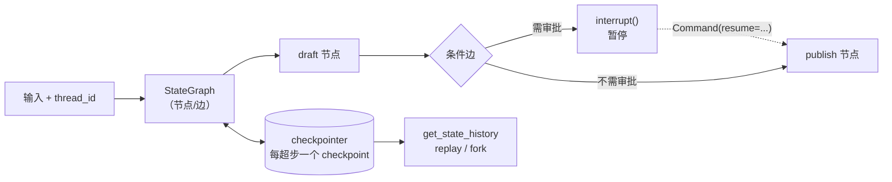
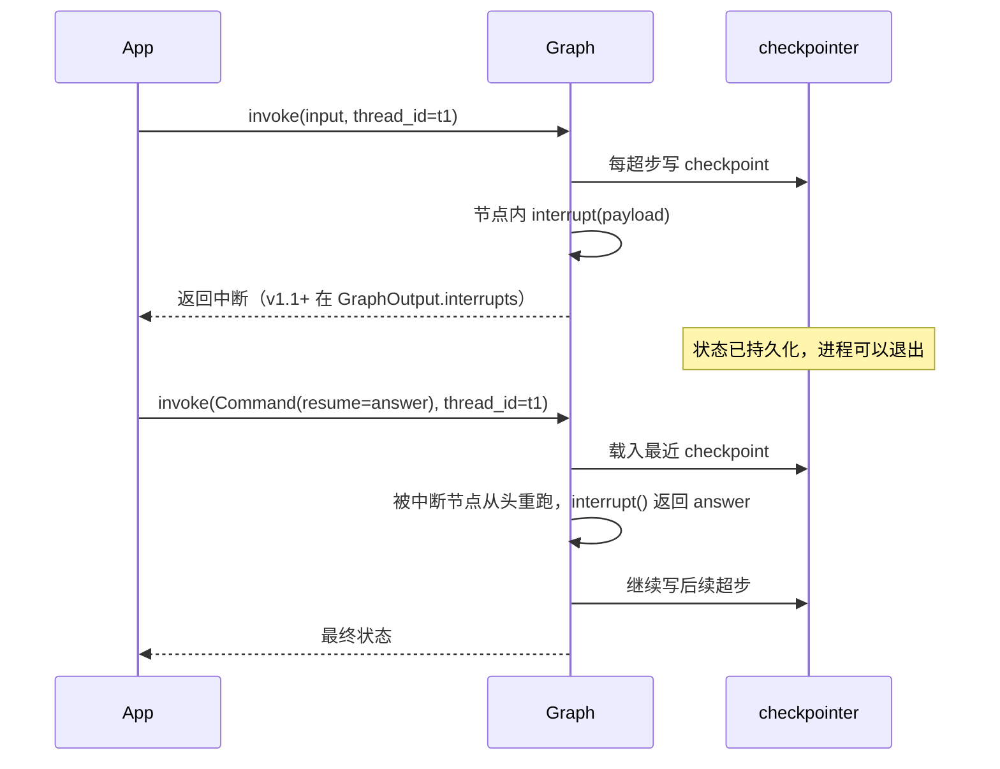

# LangGraph

## 一句话结论

LangGraph 是"带 checkpoint 的确定性编排运行时"，不是多 agent 框架；它的价值不在"图"这个画法，而在每个超步落盘带来的可恢复性、可审批与可回放。需要精确控制长流程、且团队愿意自己写控制流时选它（与其余 10 个候选的横向对比见[选型矩阵](00-selection-matrix.md)）；想要开箱的角色协作或不想维护状态 schema 时不要选。

> 判断：LangGraph 的真正价值不在"图"，而在 checkpoint 带来的可恢复性；一旦接受这一点，很多"要不要用图"的争论会变成"要不要可恢复"，答案清楚得多。

## 先看一个退款流程

电商售后：客服在工单里提交退款，系统校验订单、风控扫一遍，再等人工审批——审批人可能三天后才看。难点不在"判得准不准"，而在三件事：进程不能挂着等三天；重启后要从"等审批"接着走，且不能重复打款；审批人改了金额还要能重跑。这条流程在 LangGraph 里被拆成四个阶段，每个阶段落到一个对象上：

| 业务步骤 | 图里的对象 | 谁负责 |
|---|---|---|
| 申请与订单号 | `State` + `thread_id` | 调用方 |
| 校验、风控 | 两个 node，读状态、返回增量 | 你写的函数 |
| 等审批三天 | `interrupt()`，落盘后进程可退出 | checkpointer |
| 审批后继续、改金额重跑 | `Command(resume=...)` / 在历史 checkpoint 上 fork | 调用方 |

**StateGraph** 是一张写死的流程图：节点是函数，边是"下一步去哪"。类比地铁线路图——模型只在站内做判断，站序由你定。**checkpointer** 是每个超步给整份状态拍的照片，按 `thread_id` 归档；`interrupt()` 相当于"存档退出"，三天后 `Command(resume=...)` 从这张存档继续。恢复时被中断的节点会从头重跑，所以打款不能放在审批节点里。

```python
graph = StateGraph(State).compile(checkpointer=PostgresSaver.from_conn_string(DSN))
graph.invoke({"order": "A-42"}, {"configurable": {"thread_id": "refund-A-42"}})
```

理解了"图其实是为存档服务的"，再看定位与谱系就顺了。

## 定位与谱系

- **出品方 / 首次发布 / 当前版本**：LangChain Inc.；2024 年开源，2025-10 发布 1.0（与 LangChain 1.0 同日）；截至 2026-11-20，PyPI `langgraph` 为 **1.2.24**，npm `@langchain/langgraph` 为 **1.7.5**。
- **前身与合并关系**：LangChain 1.0 起把 `create_agent` 建在 LangGraph 运行时之上，形成"上层用 LangChain 快速起步、下层用 LangGraph 精确控制"的分工；`langgraph.prebuilt.create_react_agent` 在 1.0 被标记弃用，等价能力上移到 LangChain 的 `create_agent`。
- **在七层模型中的位置**：编排层（图/状态机）+ 运行时（持久化、任务调度、流式）。它不提供模型接入（交给 LangChain 的 chat model 抽象），也不提供沙箱与身份。

版本节奏值得记住，因为升级风险集中在运行时而非 API：

| 版本 | 日期 | 与"可恢复性"相关的变更 |
|---|---|---|
| 1.0 | 2025-10 | 图 API 与执行模型冻结；持久化、HITL、流式作为核心承诺 |
| 1.1 | 2026-03-10 | 类型安全 `invoke`/`stream`（`version="v2"`，返回 `GraphOutput` 带 `.value`/`.interrupts`）；修复 interrupt + 子图的 time travel |
| 1.2 | 2026-05-12 | `DeltaChannel`（beta）降低 checkpoint 体积；节点级 `timeout=`/`error_handler=`；优雅停机（`RunControl.request_drain()`）；事件流 `version="v3"` |

### 与 LangChain 的三层分工

- **LangChain 负责"快"**：模型抽象、工具绑定、`create_agent` 预置循环，适合把常规 agent 直接跑起来。
- **LangGraph 负责"准"**：需要自定义阶段、持久化粒度、审批点、回放时，才下降到这一层。
- **Deep Agents 是第三层**：面向长任务的成品 harness（规划、文件系统、子 agent），可定制点比 LangGraph 少。
- **三者共享运行时**：`create_agent` 产出的就是一个 LangGraph 图，可以在同一服务里混用，不必二选一。

### 与相邻方案的划界

- **对 Temporal / Restate 这类持久执行引擎**：它们保证"代码重放得到同一结果"，适合纯确定性业务流程；LangGraph 保证"图状态可恢复"，把 LLM 的不确定性当成一等公民（重放会重新调用模型，结果可能不同）。需要"严格重放"的审计场景，持久执行引擎更合适。
- **对自建队列 + 数据库**：LangGraph 相当于把"状态表 + 任务表 + 恢复逻辑"打包，代价是你必须接受它的状态表示与超步语义。
- **对 CrewAI / MAF 的内置协作编排**：那两者提供角色或 orchestration 模板，LangGraph 只给原语。用 LangGraph 做多 agent，等价于自己设计一套协作协议。

## 核心概念

**StateGraph 是状态机，checkpointer 是它的日志。** 节点只做两件事：读状态、返回增量；边决定下一个超步执行谁；checkpointer 在每个超步边界把整个状态序列化成一个 checkpoint，挂在 `thread_id` 下。



| 概念 | 职责 | 容易误解的点 |
|---|---|---|
| `StateGraph` / `State` | 声明状态结构与节点拓扑；`State` 通常是 `TypedDict`，字段可带 reducer | reducer 决定"写"是覆盖还是累加；改 reducer 等于改历史语义 |
| node / edge | 节点是一个函数或 Runnable；普通边固定、条件边按返回值选路 | 节点内还可以有任意长循环，图上看不出来 |
| `Command` / `Send` | 一次调用里同时更新状态并决定去向；`Send` 用于 map-reduce 式扇出 | `Command(goto=...)` 会绕过静态边，图可视化不再完整 |
| `interrupt()` | 在节点内任意位置暂停，把 payload 抛给调用方 | 恢复时**整个节点从头重跑**，不是从 `interrupt()` 那一行继续 |
| checkpointer | 每超步持久化状态 + 未完成任务的 pending writes | 它同时是"记忆"和"恢复点"，两件事共用一个机制 |
| subgraph | 把一张图当一个节点用，状态可共享或隔离 | 父子图状态字段同名时会互相覆盖，需显式映射 |

### 三种典型拓扑

| 拓扑 | 怎么画 | 何时用 |
|---|---|---|
| 线性流水线 + 分支 | 节点串联，条件边做分流 | 阶段清晰、有审批点（起草→审核→发布） |
| supervisor | 一个路由节点读状态，用 `Command(goto=...)` 选下一个专家节点 | 专家集合固定、路由规则可写成代码或一次分类调用 |
| map-reduce 扇出 | `Send` 按列表动态派发 N 个同构节点，再汇到一个聚合节点 | 批处理、多文档并行分析、多候选并行生成 |

## 执行模型

**Pregel / BSP 超步模型**：一次 `invoke` 被切成若干超步，每个超步分三个阶段——Plan（选出本轮要跑的 actor）、Execution（并行执行，channel 的写入对本轮不可见）、Update（把写入合并进 channel）。没有 actor 可跑或到达最大步数时结束。

这个模型直接决定了三件事：

1. **并行是超步内的并行**。同一超步里的多个节点同时跑，彼此看不到对方的写入；跨超步才能看到。调试时日志交错、顺序不稳定，都源于此。
2. **checkpoint 落在超步边界**。这也是 time travel 只能从超步边界回放的原因。除了整超步快照，LangGraph 还按任务持久化 writes，所以同超步内某个节点失败后重跑，不会重算已成功的兄弟节点。
3. **`thread_id` 是游标，不是会话 ID**。复用它就是续跑同一份状态；换一个就是全新线程。生产上最常见的串状态事故，就是把 `user_id` 当 `thread_id`。

HITL 与恢复共用同一条路径：



time travel 有两种用法，语义不同：**replay** 用历史 checkpoint 的 config 重新 `invoke`，之后的节点会真的重跑（LLM 调用、外部请求都会再发一次）；**fork** 先从历史 checkpoint 拿到 `StateSnapshot`，用 `update_state` 改状态再跑，等于在历史上开分支。文档明确提醒：replay 不是读缓存。

**流式与中断如何并存**：1.2 起推荐用 `stream_events(..., version="v3")` 驱动一次可能中断的运行——`run.values`/`run.messages` 给内容块级投影，`stream.interrupted` 表示本轮停在等待输入，`stream.interrupts` 带中断 payload；1.1 的 `version="v2"` 仍可用（`GraphOutput.value`/`.interrupts`）。选版本时注意：v3 是 beta，客户端与事件消费方要一起升。

**checkpointer 选型**：

| 实现 | 适用 | 注意 |
|---|---|---|
| `InMemorySaver` | 单测、notebook | 进程退出即丢，不能用于任何需要恢复的场景 |
| SQLite 实现 | 单机部署、CLI 工具 | 并发写入弱，多副本会争锁 |
| Postgres 实现（独立包 `langgraph-checkpoint-postgres`） | 生产默认 | 需要自己管连接池、表增长与归档 |

选择标准只有一条：**"进程被杀之后，这次任务还要不要继续"**。答案是要，就必须用数据库实现，并接受它带来的运维面。

**节点失败时发生什么**：同一超步里，已完成的兄弟节点把结果写进 pending writes，失败的节点按重试策略重试；重试耗尽后，1.2 的 `error_handler` 会收到一个 `NodeError`，可以返回 `Command` 改状态并跳到补偿节点（Saga 模式）。整个超步没有提交完整状态，所以恢复时不会把已成功的节点再算一遍——这是"超步 + 任务级写入"两层持久化带来的直接收益。

### checkpoint 里到底有什么

- **状态快照**：`State` 的全部字段，按 channel 序列化；大字段（消息列表、文件引用）是膨胀主因。
- **下一步计划**：`next` 节点列表，恢复时据此知道从哪继续；这也是"只能从超步边界回放"的原因。
- **任务级写入**：同超步内已完成节点的输出，单独存成 task，用于失败恢复时不重算。
- **元数据**：`thread_id`、`checkpoint_id`、父 checkpoint、创建时间、来源（`loop`/`update`/`fork` 等），time travel 与审计都靠它。

理解这四层的实际价值：出问题时能判断"是状态错了、还是调度错了"——前者查状态快照，后者查 `next` 与 pending writes。

### 成本与延迟结构

- **主要成本不是图本身**：一次运行的 token 由节点内的模型调用决定，图只增加可忽略的调度开销。
- **延迟由串行超步数决定**：同一超步内并行不增加时延，跨超步必须等上一轮 Update 完成，所以"把可并行的步骤拆到同层"是最有效的优化。
- **恢复成本随 checkpoint 体积增长**：载入 500 MB 与 5 MB 的恢复耗时差一个数量级，直接体现为 HITL 的等待体验。

## 十维对比

| 维度 | 说明 |
|---|---|
| 抽象层次 | 低层图编排。提供状态、节点、边、持久化四件套，不提供"agent 应该怎么想"的任何约定；比它高一层的是 LangChain 的 `create_agent`，再高一层是 Deep Agents。 |
| 执行模型 | Pregel 超步（Plan/Execution/Update），节点在超步内并行，条件边/`Command` 决定路由；支持同步与异步节点，异步节点才支持 1.2 的节点级超时。 |
| 状态与持久化 | 每超步一个 checkpoint，按 `thread_id` 组织；`InMemorySaver` 仅测试用，生产用 Postgres/SQLite 等 checkpointer 实现；另有 Store 做跨线程的长期记忆。1.2 起 `DeltaChannel`（beta）只存增量，缓解长线程的 checkpoint 膨胀。 |
| 多 agent 支持 | 没有角色/团队抽象。多 agent 靠子图、supervisor 节点或"把 agent 包成节点"手写；好处是拓扑完全可控，代价是通信协议要自己定。 |
| 工具与 MCP | 工具在节点内自行调用；MCP（[协议细节](../03-protocols/01-mcp.md)）从 LangChain 1.4（2026-09）起以 `langchain.mcp` 内置（beta），基于 FastMCP，取代独立的 `langchain-mcp-adapters`；MCP 的 elicitation 会映射成 LangGraph 的 `interrupt()`。 |
| 可观测 | LangSmith 是一等公民：trace 与 graph 结构对应，可按超步查看状态差异；也可接 OTel/Langfuse，但状态级调试能力只有前者完整。 |
| 评测集成 | 不自带 eval DSL，靠 LangSmith 的 datasets/experiments 对 trace 做回归；好处是评测样本可直接取自线上轨迹，坏处是绑定 LangSmith。 |
| 部署形态 | 库 + 自建服务均可；托管走 LangSmith Agent Server（原 LangSmith Deployment），提供 assistants/threads/runs 与任务队列，且框架无关（也能部署 ADK、Strands、CrewAI 的 agent）。 |
| 语言与生态 | Python 与 TypeScript 双实现，版本号不同步（1.2.x vs 1.7.x）；生态优势来自 LangChain 的模型/工具适配层，劣势是依赖树较大。 |
| 许可证与治理 | MIT；由 LangChain Inc. 主导，商业面是 LangSmith。治理上属于"单一厂商主导 + 开放核心"，路线图受其平台产品影响。 |

## 最小示例

只展示骨架：状态、两个节点、一个审批中断、一个 checkpointer。不追求可运行。

```python
from langgraph.graph import StateGraph, START
from langgraph.checkpoint.postgres import PostgresSaver
from langgraph.types import interrupt, Command

def review(state):                      # 审批节点：暂停点
    ok = interrupt({"draft": state["draft"]})
    return {"approved": ok}

g = StateGraph(State)                   # State 为 TypedDict
g.add_node("draft", draft); g.add_node("review", review)
g.add_edge(START, "draft"); g.add_edge("draft", "review")
g.add_conditional_edges("review", lambda s: "publish" if s["approved"] else "draft")
graph = g.compile(checkpointer=PostgresSaver.from_conn_string(DSN))

cfg = {"configurable": {"thread_id": "t-1"}}
graph.invoke({"brief": "..."}, cfg)                        # 跑到 interrupt 停下
graph.invoke(Command(resume=True), cfg)                    # 人工批准后继续
```

## 适用与不适用

- **适合**：流程阶段可命名（起草→审核→发布）、需要在阶段之间落盘、需要人工审批或"回到第 N 步改参数重跑"的场景；以及把已有确定性逻辑（规则、检索、外部 API）和 LLM 步骤混编在一条流水线里的场景。
- **适合**：团队已经有 LangSmith 或愿意接受它，因为状态级调试与评测的收益在 1.2 之后明显大于自建。
- **适合**：审计要求"每次状态变更可查"。checkpoint 天然是状态变更日志，但要额外补审批人身份，才能变成合规凭证。
- **不适合**：想要 `role/goal/backstory` 式协作叙事——那类抽象在 CrewAI；用 LangGraph 手写会得到一张没人看得懂的图。
- **不适合**：两三轮问答、状态只在内存里就够的轻应用。此时框架带来的只有依赖与概念负担，替代方案是[OpenAI Agents SDK](03-openai-agents-sdk.md) 或直连模型 API。
- **不适合**：需要"框架替我决定下一步"的自适应 agent。LangGraph 把决策权交回给开发者，模型只在你写的节点里被调用。

## 常见坑

- **状态 schema 演进打穿历史**：给 `TypedDict` 加一个必填字段，旧 checkpoint 反序列化时缺 key，恢复直接抛错；把某个字段的 reducer 从覆盖改成 `add`，重放会让计数翻倍。规避：新增字段一律 Optional + 给默认值，reducer 变更视为破坏性变更并写迁移脚本，线程表加 `schema_version`。
- **checkpoint 无界膨胀**：消息列表每个超步全量重写一次，一个跑几天、上百超步的线程会把状态库撑到 GB 级，恢复延迟从毫秒级涨到秒级。规避：1.2 起对高频大字段用 `DeltaChannel`（beta，配 `snapshot_frequency` 定期落全量），并给 thread 设保留策略。注意 delta 与非 delta 表示不能来回切换，否则历史 checkpoint 读不出来。
- **图复杂度失控**：节点数上到 20 个以后，条件边的组合开始无法在评审里讲清；典型症状是"改一条边，三处行为变化"。规避：把内部循环收进单个节点或子图，图只表达阶段边界；经验阈值是一张图不超过 15 个节点。
- **把副作用放在会被重跑的节点里**：`interrupt()` 恢复时节点从头执行，节点里若已发过邮件/下过单，恢复后会再发一次。规避：副作用放独立节点并做幂等键，审批节点只做纯计算；通用的持久化执行取舍见[可靠性与 HITL](../04-engineering/04-reliability-and-hitl.md)。
- **thread_id 语义错用**：用 `user_id` 当 `thread_id`，同一用户的两个会话共享状态，表现为"agent 记得不该记得的事"。规避：`thread_id = uuid7()`，用户维度用 Store 的 namespace 表达。
- **跨语言行为不一致**：1.2 的节点级 `timeout=` 与 `error_handler=` 明确只支持 Python，TypeScript 侧仍只有重试策略。多语言团队会把"Python 有超时保护、TS 没有"带进生产。
- **子图状态互相覆盖**：父子图状态里存在同名字段时，子图写回会覆盖父图的值，且不报错。规避：子图用独立前缀或显式输入/输出映射，并在评审时画出状态字段的所有权。
- **用 checkpointer 当长期记忆**：checkpoint 按 thread 存，跨会话的用户偏好放进去就取不出来。规避：长期记忆放 Store（按 namespace 组织），checkpoint 只承担恢复。
- **把大对象塞进状态**：文件内容、原始 HTML、图片 base64 写进 `State`，会让每个超步都复制一遍，checkpoint 体积指数级上升。规避：状态里只放引用（对象存储 key / 摘要），原文放外部。
- **没有给图写测试**：图的行为由边与 reducer 共同决定，改一处可能影响多条路径。规避：对每个条件边写单测（给定状态→期望下一节点），并对整图跑固定输入的轨迹快照。
- **流式 API 版本混用**：v1/v2/v3 三套输出格式并存，1.2 的 v3 仍是 beta；服务端升到 v3、客户端还按 v2 解析，表现为"消息只出半截"。规避：服务端与消费端同版本升级，并在网关处按 `version` 字段做灰度。

## 开放问题

1. **`DeltaChannel` 何时转正**：beta 期间换表示会破坏历史 checkpoint，生产采用需要想清楚回滚路径。
2. **状态 schema 没有标准**：checkpoint 是私有格式，跨框架迁移只能重放事件，没有可移植的工作流状态描述。
3. **图与函数式 API 的边界**：`@entrypoint`/`@task` 的函数式写法更贴近代码，但持久化粒度与图不同，团队容易两套混用。
4. **Agent Server 与开源运行时的能力差**：托管侧的任务队列、扩缩容、assistants 版本管理在开源自建里要自己补，长期会不会形成"开源只是 SDK"的格局仍未定。
5. **checkpoint 里的隐私数据怎么删**：状态快照可能含用户原文与工具返回，删除权请求目前只能按 thread 整条删；没有字段级擦除方案。

## 参考来源

- LangGraph 1.0 发布与 `create_react_agent` 弃用说明 · LangChain · 2025-10 · https://www.langchain.com/blog/langchain-langgraph-1dot
- LangGraph 变更日志（1.1 于 2026-03-10、1.2 于 2026-05-12）· LangChain · 2026-11 · https://docs.langchain.com/oss/python/releases/changelog
- Checkpointers：超步、pending writes、thread 语义 · LangChain · 2026-11 · https://docs.langchain.com/oss/python/langgraph/checkpointers
- LangGraph runtime（Pregel / BSP、channel 类型、`DeltaChannel`）· LangChain · 2026-11 · https://docs.langchain.com/oss/python/langgraph/pregel
- Interrupts：暂停、`Command(resume=)` 与节点重跑语义 · LangChain · 2026-11 · https://docs.langchain.com/oss/python/langgraph/interrupts
- Time travel：replay 与 fork 的差异 · LangChain · 2026-11 · https://docs.langchain.com/oss/python/langgraph/use-time-travel
- LangSmith Agent Server：assistants/threads/runs 与任务队列 · LangChain · 2026-11 · https://docs.langchain.com/langsmith/agent-server
- PyPI `langgraph` 1.2.24（2026-11-20 读取）· PyPI · 2026-11 · https://pypi.org/project/langgraph/
