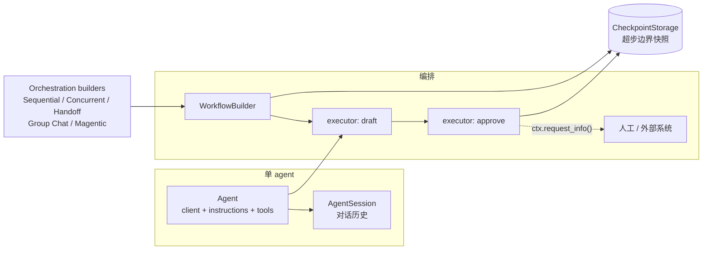

# Microsoft Agent Framework

## 一句话结论

Microsoft Agent Framework（下称 MAF）是 AutoGen 的 agent 抽象与 Semantic Kernel 的企业件合并后的统一 SDK，核心是"Agent + Workflow"双轨：单 agent 用 `Agent` 管会话，多 agent 用 `Workflow` 显式编排。它真正的吸引力是 .NET 一等公民、Azure/Foundry 一体化、内置 OpenTelemetry 与审批原语；如果你不在 .NET 或 Azure 生态里，它相对[LangGraph](01-langgraph.md) 没有明显优势。

> 判断：MAF 的壁垒不在编排能力，而在"企业件 + .NET + 合规链路"的组合；离开 Azure 这个组合价值会掉一半，剩下的部分与 LangGraph 高度重叠。

## 定位与谱系

- **出品方 / 关键时间点**：Microsoft；2025-10 公布，2026-02 进入 RC，**2026-04-02 发布 1.0**（.NET 与 Python 同日），官方定位是"production-ready、稳定 API、长期支持"。
- **当前版本**：截至 2026-11-20，PyPI `agent-framework` 为 **1.26.0**（2026-11-12 上传，要求 Python ≥3.11）；.NET 侧为 NuGet 包 `Microsoft.Agents.AI`（具体版本以 nuget.org 为准）。Go 为 **public preview**，需 Go 1.26+，仓库为 `microsoft/agent-framework-go`。
- **前身与合并关系**：直接继承 Semantic Kernel（企业件：会话状态、类型安全、middleware、telemetry、模型接入）与 AutoGen（agent 抽象与 GroupChat 一类编排）。官方称其为两者的 "direct successor"，并为两条迁移路径各写了指南。
- **在七层模型中的位置**：编排层 + 部分运行时能力（会话状态、checkpoint、审批），不含沙箱、不含托管 runtime（托管形态交给 Foundry）。

版本节奏对选型的影响比版本号本身更大：1.0（2026-04）到 1.26（2026-11）只隔 7 个月，迭代密度高；核心 API 稳定，但周边（DevUI、Go、声明式 agent）成熟度参差。

## 核心概念

**两个入口，一套运行时。** `Agent` 负责"一次任务内的模型-工具循环 + 会话状态"；`Workflow` 负责"多个 agent/函数之间的显式数据流"。两者可以互相嵌套：workflow 能包成 agent（`.as_agent()`），agent 也能当 workflow 的一个 executor。



| 概念 | 职责 | 容易误解的点 |
|---|---|---|
| `Agent` | 绑定 chat client、instructions、tools，自动执行多轮工具调用 | **默认无状态**：不在调用间保留历史，必须显式传 `session` |
| `AgentSession` | 承载一次对话的历史，可换外部存储（如 Redis） | 它与 workflow 的 checkpoint 是两套状态，不要混用 |
| `Harness Agent` | 官方"带电池"的 agent：规划与 todo、上下文压缩、文件与记忆、免重复审批、观测 | 这是 1.x 新增的一层，和裸 `Agent` 不是同一个抽象 |
| `Workflow` / `Executor` | 类型化的数据流图：executor 收消息、发消息、产出输出 | 边表达**数据流向**，不是控制流跳转；join 语义在接收端 |
| `ctx.request_info()` | executor 内发起"请求-响应"，暂停等外部输入 | 恢复后 pending 请求会重新抛出，客户端要能幂等处理 |
| Middleware | 拦截 agent 动作（工具调用前后、模型调用前后） | Python 与 .NET 的注册方式不同，跨语言样例不能照抄 |

## 执行模型

**单 agent：自动工具循环。** `agent.run(...)` 会一直"调模型→执行工具→再调模型"，直到模型给出最终回答；工具调用次数由框架内建的安全机制约束。这一点与 AutoGen 的 `AssistantAgent` 不同——后者默认单轮，需要显式设置 `max_tool_iterations`，迁移时最容易在这里踩到成本与延迟的坑。

**多 agent：数据流图 + 超步。** workflow 按边把消息路由给 executor，一个超步内可并行扇出，join 的语义（等全部/等任一）写在接收侧 executor 或编排 builder 里。checkpoint 落在**超步边界**，因此恢复粒度是"上一个完整超步"，不是任意一行代码。

**HITL 有两条路径**：

1. **工具审批**：把工具标记为需要审批，workflow 在调用前暂停，适合"危险动作前拦一下"。
2. **`request_info` / `@response_handler`**：任意 executor 主动发起结构化请求，适合"等人填表单/等外部系统回调"。

两条路径都能与 checkpoint 组合：从带 pending 请求的 checkpoint 恢复时，未回答的请求会作为事件重新发出，客户端拿到 `request_id` 后再提交答案。

**内置编排模板**（不用自己画图时）：

| 模板 | 语义 | 适合 |
|---|---|---|
| Sequential | 依次执行，后一个看到前一个的输出 | 起草→评审→定稿 |
| Concurrent | 并行执行后聚合 | 多视角分析、投票 |
| Handoff | 按上下文把控制权交给另一个 agent | 分诊/路由型客服 |
| Group Chat | 共享一段对话，多 agent 轮流发言 | 头脑风暴、代码评审 |
| Magentic | manager agent 动态规划并调度专家 | 开放式研究任务，可设轮次/停滞/重置上限 |

一次 Magentic 运行的典型路径（用于理解"谁在决定下一步"）：

1. manager agent 先产出任务清单与分工（plan）；
2. 按分工把子任务投给对应专家 agent，专家执行后可请求更多信息；
3. manager 根据进展更新计划，检测"停滞"与"重复"；
4. 达到 `max_round_count`、连续 `max_stall_count` 次无进展、或超过 `max_reset_count` 次重规划时终止；
5. 可开启 plan review，让人在开始前改计划，并在停滞时介入。

这套机制本质是"用一个 agent 当调度器"，可靠性取决于 manager 的规划质量，而不是框架；成本上限由上面三个计数器决定，必须显式设置。

### 与 AutoGen 的关键差异

| 方面 | AutoGen（0.4 后的 AgentChat） | MAF |
|---|---|---|
| 多 agent 表达 | `Team` + 终止条件，消息广播 | `Workflow` 数据流图，边决定数据去哪 |
| 工具定义 | `FunctionTool` 手工包装 | `@tool` 自动推断 schema，另有 hosted tools |
| 默认轮次 | `AssistantAgent` 默认单轮 | `Agent` 默认多轮直到完成 |
| 状态 | `Team` 无内置 checkpoint | workflow checkpoint + `AgentSession` |
| 运行时 | 内嵌 + 实验性分布式 runtime | 单进程组合，分布式在路线图 |

## 十维对比

| 维度 | 说明 |
|---|---|
| 抽象层次 | 双轨：`Agent` 是代码优先的高层封装，`Workflow` 是显式的图/函数式编排。比 LangGraph 高半层（内置 agent 循环与编排模板），比 CrewAI 低半层（不强制角色叙事）。 |
| 执行模型 | agent 侧是自动多轮工具循环；workflow 侧是数据流图 + 超步并行。Python 另有实验性的函数式 workflow API（`@workflow`/`@step`），.NET 与 Go 只有图 API。 |
| 状态与持久化 | `AgentSession` 管对话；workflow 用 `checkpoint_storage`（如 `FileCheckpointStorage`）在超步边界落盘，可列出、检查、从指定 `checkpoint_id` 恢复；executor 本地状态与跨 executor 共享状态分开存。 |
| 多 agent 支持 | 最强项之一：五种编排模板开箱即用，且可与自定义 executor 混编；Group Chat 直接继承 AutoGen 的血缘。 |
| 工具与 MCP | （协议本身见 [MCP](../03-protocols/01-mcp.md)）`@tool` 自动推断 schema；hosted tools（code interpreter、web search）由 client 提供；MCP 有 `MCPStdioTool` 与 `MCPStreamableHTTPTool`，走 MCP SDK 2.x，**不支持 WebSocket 传输与 MCP Tasks**。 |
| 可观测 | OpenTelemetry 内置（agent 调用、工具执行都有 span，语义约定见[可观测性](../04-engineering/01-observability.md)），无需付费服务即可导出；DevUI 用于本地调试，仍是 beta（PyPI 上是 `1.0.0b…` 预发布号）。 |
| 评测集成 | 框架本体不带 eval DSL；官方集成目录里有 evaluation 服务对接，评测实际落在 Foundry 或第三方。 |
| 部署形态 | 自建服务为主（形态取舍见[部署](../04-engineering/06-deployment.md)），官方明确当前聚焦**单进程组合**，分布式执行在路线图上；托管形态是 Foundry 的 hosted agent。 |
| 语言与生态 | Python 与 .NET 功能对齐度最高；Go 预览缺声明式 agent、CodeAct、函数式 workflow；TypeScript 不在官方支持列表内。 |
| 许可证与治理 | MIT；Microsoft 主导，与 Azure/Foundry 的路线强耦合。治理上属于"单一厂商 + 开放核心"，迁移承诺以官方公告为准。 |

## 最小示例

展示最能体现其特点的骨架：agent 产出一段文本，workflow 在审批 executor 处暂停等人工。不追求可运行。

```python
from agent_framework import Agent, WorkflowBuilder, executor, WorkflowContext, FileCheckpointStorage

agent = Agent(client=client, name="writer", instructions="写一句发布文案")
store = FileCheckpointStorage("./ckpt")

@executor(id="draft")
async def draft(topic: str, ctx: WorkflowContext[str]) -> None:
    await ctx.send_message((await agent.run(topic)).text)

@executor(id="approve")
async def approve(text: str, ctx: WorkflowContext[Never, str]) -> None:
    ok = await ctx.request_info({"draft": text}, response_type=str)   # 暂停等人工
    await ctx.yield_output(f"{text} | {ok}")

wf = (WorkflowBuilder(start_executor=draft, checkpoint_storage=store)
      .add_edge(draft, approve).build())
```

## .NET 与 Azure 落地要点

### .NET 场景的落地要点

- **包结构**：核心抽象在 `Microsoft.Agents.AI`，模型接入按 provider 分包（如 `.OpenAI`、`.Foundry`）；`AIAgent` 是统一接口，`AsAIAgent()` 把各家的 client 适配成 agent。
- **依赖注入**：agent 与 workflow 通常是长生命周期对象，配 `AddSingleton`/`AddKeyedSingleton`，session 按请求创建；把 client 注册成 `HttpClient` 工厂托管，避免 socket 耗尽。
- **可观测**：OTel 的 `ActivitySource` 已内建，接入现有 `OpenTelemetry` 管线即可；注意采样率，agent 的 span 数量是普通请求的数倍。
- **与既有后台任务共存**：把 workflow 跑在 `BackgroundService` 里，checkpoint 存储接数据库，进程重启后从最近超步恢复。

### 与 Azure 的耦合点（选型时逐条确认）

| 耦合点 | 表现 | 可替换性 |
|---|---|---|
| 模型接入 | 样例默认 `FoundryChatClient` + `AzureCliCredential` | 可换 OpenAI 兼容 client，但 hosted tools 会失去 |
| 身份 | 依赖 Entra/Azure CLI 凭据链 | 可换 API key，企业 SSO 需自己接 |
| 托管 | hosted agent 跑在 Foundry | 不可替换，自建即放弃该形态 |
| 评测 | 集成 Foundry 的 evaluation | 可换第三方，但要多写适配层 |
| 观测 | OTel，可导出到任意后端 | 完全可替换 |

## 迁移路径（Semantic Kernel / AutoGen → MAF）

| 来源 | 主要映射 | 必须先处理的事 |
|---|---|---|
| Semantic Kernel（Python/.NET） | Kernel/Plugin → `Agent` + `tools`；filter → middleware；chat history → `AgentSession` | SK 的 plugin 调用约定与 MAF 的 tool schema 不同，先跑通一个最小 agent 再批量改 |
| AutoGen 0.4（`autogen-agentchat`） | `AssistantAgent` → `Agent`；`Team` → orchestration builder 或 workflow；`FunctionTool` → `@tool` | 默认轮次行为反转，先补预算与超时 |
| AutoGen 0.2（`ConversableAgent`） | 无直接映射，需先升到 0.4 再迁 | 0.2 的 hook 式扩展点在新体系里没有对应物，属于重写 |

迁移的验收标准建议写成三条：同一输入下工具调用序列与原实现等价、单次任务成本不高于原实现的 1.2 倍、中断恢复后不重复执行副作用。

## 适用与不适用

- **适合**：.NET 团队。这是目前唯一由大厂维护、.NET 与 Python 双实现、且带 checkpoint/HITL/OTel 的 agent 框架，其他候选要么只有 Python，要么 .NET 侧是社区绑定。
- **适合**：已经在 Azure 上、身份用 Entra、模型走 Foundry/Azure OpenAI 的组织。`FoundryChatClient` + `AzureCliCredential` 的链路能把认证、配额、审计接进既有体系。
- **适合**：需要 Group Chat / Magentic 这类"动态调度专家"的模板化编排，且不想自己实现 manager 逻辑。
- **适合**：合规要求 trace 必须落在自己的 OTel 后端。MAF 的 telemetry 不依赖付费服务，导出目标由你决定。
- **适合**：需要把 agent 接进既有 .NET 后台任务、依赖注入与配置体系，而不是另起一个 Python 服务。
- **不适合**：TypeScript 团队。官方不支持 TS，Go 预览的功能缺口也说明它不是"多语言齐头并进"的策略。
- **不适合**：需要跨机分布式 actor 运行时。AutoGen 曾有 gRPC distributed runtime，MAF 当前是单进程组合；要跨机得自己上队列或拆服务。
- **不适合**：依赖大量长尾连接器。MAF 的 integrations 由微软维护，生态广度不及 LangChain/LlamaIndex 那种社区插件池。
- **不适合**：需要框架本身提供评测闭环。MAF 不带 eval，评测要接 Foundry 或第三方，端到端方案比 LangSmith 那条链路多一次集成。
- **不适合**：想要最薄抽象、单文件跑起来的小工具。此时 `Agent` 之上的 harness、middleware、workflow 都是负担，用[OpenAI Agents SDK](03-openai-agents-sdk.md) 或 Pydantic AI 更直接。

## 常见坑

- **版本陷阱：三代 API 混着搜**。AutoGen 0.2 的 `ConversableAgent`/`GroupChat`、AutoGen 0.4 重写后的 `autogen-agentchat`/`autogen-core`、以及 MAF 的 `Agent`/`Workflow` 是三套互不兼容的 API。触发条件：直接搜索"autogen 教程"；后果是复制来的代码连 import 都过不了。规避：只以 `learn.microsoft.com/agent-framework` 的当前文档与迁移指南为准，博客一律先看日期。
- **默认行为反转**：AutoGen 的 `AssistantAgent` 默认单轮（需设 `max_tool_iterations`），MAF 的 `Agent` 默认持续调工具直到完成。迁移后如果不设预算，表现为"一次请求打了 20 次模型"，成本与延迟同时翻倍。规避：迁移时先加 `max_tool_iterations` 等价的预算与超时，再对齐效果。
- **官方文档自相矛盾**：概览页写支持 Foundry、Anthropic、Azure OpenAI、OpenAI、Ollama 等；AutoGen 迁移指南的模型客户端对照表里 Anthropic/Ollama 仍标 "Planned"。触发条件：按概览选型、按迁移指南写代码；后果是装完包发现没有对应 client。规避：以 integrations 目录与 `agent-framework-<provider>` 实际包是否存在为准。
- **Azure 绑定度被低估**：所有入门样例默认 `FoundryChatClient` + `az login`，本地没有 Azure 订阅时第一步就卡住；hosted tools（code interpreter/web search）只在支持它的 provider 与账号上可用。规避：先用 OpenAI 兼容 client 或 Ollama 打通逻辑，再切 Foundry；把 hosted tool 当"可选增强"而非基线能力。
- **把 DevUI 写进生产链路**：`agent-framework-devui` 在 PyPI 上仍是 `1.0.0b…` 预发布。触发条件：拿 DevUI 当内部调试平台的长期方案；后果是每次升级都可能改接口。规避：DevUI 只装在开发机，生产观测走 OTel。
- **误判"有 checkpoint 就能长跑"**：checkpoint 只在超步边界生成，跑在单个 executor 内部的长时间操作（一次 20 分钟的工具调用）无法中途恢复。规避：把长操作拆成多个 executor，或让它自身可重入。
- **Go 与主线的功能差**：Go 预览不支持声明式 agent、CodeAct、函数式 workflow；同一份架构图在 Go 里画不出来。
- **middleware 写成了业务逻辑**：middleware 适合做横切（脱敏、审计、注入防护），一旦在里面改工具参数或跳过工具，行为会随框架升级漂移。规避：middleware 只做只读观测与拒绝，改参数放在工具实现里。
- **把 `AgentSession` 当审计日志**：session 存的是对话历史，可以压缩、可以被替换为外部存储。触发条件：合规要求"每次工具调用可追溯"；后果是换了 session 后端就丢证据。规避：审计事件单独落不可变存储，session 只用于推理连续性。
- **checkpoint 存储选型被忽略**：内置的文件实现适合单机与测试，多副本部署时多个实例写同一目录会出现状态互相覆盖。规避：生产换数据库/对象存储实现，并按 workflow 名 + 实例做隔离。
- **hosted tools 绑死模型能力**：code interpreter 与 web search 由 provider 提供，换模型或换区域就可能消失。规避：在架构上把 hosted tool 当"可选增强"，核心链路用自建工具或 MCP。
- **并行 executor 抢共享状态**：`ctx.set_state()` 写的是跨 executor 的共享状态，并发扇出时后写覆盖先写。规避：并行分支只写各自 executor 局部状态，聚合放到 join 之后的单点。
- **workflow 里塞进长事务**：一个 executor 内做 10 分钟的外部批处理，期间无法 checkpoint，进程被杀就全丢。规避：把长操作拆成"提交任务/轮询结果"两个 executor，中间状态落 checkpoint。
- **把 `Agent` 当有状态对象缓存**：`Agent` 默认无状态，缓存它没问题；但把 `AgentSession` 一起缓存并跨用户复用，会串对话。规避：session 的生命周期与请求/会话绑定，用 key 隔离。
- **升级节奏快带来的行为漂移**：GA 后 7 个月出了 20 多个 minor 版本，默认模型参数、工具循环上限这类"非 API"行为会变。规避：锁定版本区间 + 每次升级跑同一套轨迹回归。

## 开放问题

1. **三条产品线何时收敛**：Semantic Kernel、AutoGen、MAF 并存，官方给了迁移指南但没给"停止维护"的确切日期，企业的技术债评估缺少硬约束。
2. **分布式执行**：官方说"计划中"，但没有时间表；在它落地前，"多 agent 跨机扩展"仍要自建。
3. **声明式 agent 与 CodeAct 的定位**：Python 有、Go 没有、.NET 情况需逐版本核对，跨语言团队的架构一致性难保证。
4. **与 Foundry 的耦合边界**：托管 agent、hosted tools、evaluation 都在 Foundry 侧，开源部分会不会长期停留在"SDK"角色，是选型时的隐性风险。
5. **TypeScript 缺位**：官方没有 TS 实现，前端全栈团队只能用社区绑定或换框架；这是长期的生态缺口而非临时状态。
6. **checkpoint 格式的兼容承诺**：1.x 期间 checkpoint 结构变更时的迁移工具尚未见公开说明，跨版本恢复需要实测。
7. **Go 预览转正的时间表**：官方只说 public preview，没有 GA 日期；Go 团队做年度规划时无法承诺。
8. **与 A2A 的深度**：1.0 宣称支持 A2A 跨运行时互操作，但 agent card 的生成、鉴权与任务生命周期细节在文档里仍分散。

## 参考来源

- Microsoft Agent Framework 概览（Agent/Harness Agent/Workflows、Go 预览要求 Go 1.26+）· Microsoft Learn · 2026-10-28 · https://learn.microsoft.com/en-us/agent-framework/overview/
- Microsoft Agent Framework 1.0 发布公告（2026-04-02 GA，.NET 与 Python）· Microsoft DevBlogs · 2026-04 · https://devblogs.microsoft.com/agent-framework/microsoft-agent-framework-version-1-0/
- Workflow 概念（图/函数式两套 API、各语言支持差异）· Microsoft Learn · 2026-10-28 · https://learn.microsoft.com/en-us/agent-framework/concepts/workflows/
- Workflow 编排模板（Sequential/Concurrent/Handoff/Group Chat/Magentic）· Microsoft Learn · 2026-08 · https://learn.microsoft.com/en-us/agent-framework/workflows/orchestrations/
- Workflow 检查点（超步边界、恢复、HITL 重放）· Microsoft Learn · 2026-09 · https://learn.microsoft.com/en-us/agent-framework/workflows/checkpoints
- AutoGen 迁移指南（默认行为差异、MCP 传输限制、分布式 runtime 现状）· Microsoft Learn · 2026 · https://learn.microsoft.com/en-us/agent-framework/migration-guide/from-autogen/
- PyPI `agent-framework` 1.26.0（2026-11-12，MIT，Python ≥3.11）· PyPI · 2026-11 · https://pypi.org/project/agent-framework/
- `microsoft/agent-framework-go` 仓库（Go 预览）· GitHub · 2026-11 · https://github.com/microsoft/agent-framework-go
