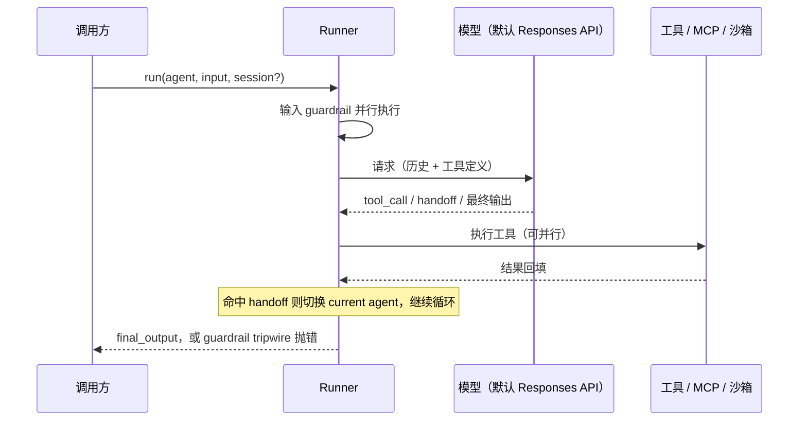

# OpenAI Agents SDK

## 一句话结论

OpenAI Agents SDK 是五个原语（agent、handoff、guardrail、session、tracing）加一个 Runner 循环的薄封装，本质是"把 Swarm 的实验代码生产化"。它适合以 OpenAI 模型为主、要在几周内把单/多 agent 上线的团队；需要确定性长流程编排、或模型必须多云混用时，它给不了你要的控制力。

> 判断：它的竞争力来自"默认路径足够好"——默认模型、默认循环、默认 tracing 三件套让两周内能上线；代价是这套默认值同时是锁定点，换模型或换可观测后端都要额外做功。

## 先看一个分诊入口

假设客服系统只留一个入口：用户说"上周那单还没到，顺便把会员退了"，一句话里有两个意图。如果只做一个大 agent，把退款、物流两套工具和两份 instructions 全塞进去，工具一多模型就选错，指令之间还会互相打架；自己写 if/else 分流，又退回了硬编码规则。SDK 的做法是"入口只分诊，专才各管一段"：

| 环节 | SDK 里的对象 | 谁来决定 |
|---|---|---|
| 接话、判断意图 | `triage` agent 的 instructions | 模型 |
| 把会话交给退款 / 物流 | `handoff`（在工具列表里就是一个特殊工具） | 模型调用它 |
| 专才干活 | 目标 agent 自己的 `tools` | 目标 agent |
| 历史与轮次上限 | `session` / `max_turns` | Runner 自动处理 / 你设 |

**handoff 不是"调用一个子函数"**，而是把当前这段对话连同历史交给另一个 agent，从此由它接着说。类比医院分诊台：护士不自己看病，而是把你和病历一起交给对应科室；交接后，护士那套挂号工具也不再可用。**Runner** 才是唯一在跑循环的东西，`Agent` 只是配置容器——像发动机与方向盘的关系。

```python
triage = Agent(name="triage", instructions="先分诊", handoffs=[handoff(refund_agent), handoff(logistics_agent)])
Runner.run_sync(triage, "上周那单还没到，顺便退会员", max_turns=8)
```

注意 handoff 默认连历史一起带过去，上一个 agent 的指令也会跟过去——这正是后面"常见坑"的第一条。带着"没有步骤、只有循环"这个前提往下读，十维对比会更容易看出它的边界。

## 定位与谱系

- **出品方 / 首次发布**：OpenAI；2025-03 开源，官方称其为此前实验项目 Swarm 的 "production-ready upgrade"。
- **当前版本**：截至 2026-11-20，PyPI `openai-agents` 为 **0.25.0**（2026-11-17 发布，要求 Python ≥3.10）；npm `@openai/agents` 为 **0.22.0**，版本号落后于 Python。
- **2026-04-15 的架构调整**：官方把"harness（控制面：agent 循环、模型调用、工具路由、审批、追踪、错误恢复）"与"sandbox（计算面：文件、命令、依赖、快照）"拆开，新增 Sandbox agents（beta），并允许接入第三方沙箱 provider。这是它从"轻量库"往"可跑长任务的 runtime"走的转折点。
- **在七层模型中的位置**：编排层（很薄）+ 部分运行时（session、sandbox、tracing）。它不提供托管执行环境，也不提供工作流 DSL。

与 AgentKit 的关系需要说清，因为这是 2026 年最容易被误判的一层：

| 组件 | 是什么 | 2026-11 状态 |
|---|---|---|
| Agents SDK | 开源库，本篇文章的主角 | 活跃，0.25.0 |
| Agent Builder | 可视化工作流画布，可导出 SDK 代码 | 已弃用（2026-06-03 起），**2026-11-30 关停**，官方建议迁 Agents SDK 或 Workspace Agents |
| ChatKit | 嵌入式聊天 UI，可挂工作流 ID | 保留可用 |
| Evals（面板/API/graders） | 评测产品 | 2026-11-30 起只读，官方建议迁 Promptfoo |

> 判断：把 Agent Builder 当"OpenAI 官方低代码平台"写进架构图，是本季度最容易过期的技术决策；SDK 才是长期面。

## 核心概念

### 与相邻方案的划界

- **对 Responses API**：官方口径是"不必二选一"。要自己掌控循环、工具分发与状态时直连 API；要 SDK 管轮次、工具、护栏、会话时才用它。两者可以在一个应用里并存。
- **对 [Claude Agent SDK](05-claude-agent-sdk.md)**：后者卖的是产品化 harness（内置文件/命令工具、权限模型、子 agent），OpenAI 这边对应的是 Sandbox agents + harness，但仍是 beta 面。
- **对 [LangGraph](01-langgraph.md)**：LangGraph 给你图和检查点，OpenAI 给你循环和交接。判断标准是"你能不能事先画出阶段"。
- **对 [MAF](02-microsoft-agent-framework.md)**：MAF 有内置编排模板与 .NET；OpenAI SDK 只有两种多 agent 范式，但更薄、更快。

**控制流是"对话循环 + 交接"，不是图。** `Runner` 反复调模型、执行工具，直到模型产出最终输出；`handoff` 改变"当前是哪个 agent 在说话"，但不改变循环本身。



| 概念 | 职责 | 容易误解的点 |
|---|---|---|
| `Agent` | instructions + tools + handoffs + guardrails 的容器 | 它本身不执行，执行的是 `Runner` |
| `Runner` | 驱动循环、调模型、跑工具、处理 handoff、落 session | `max_turns` 是唯一的硬性循环上限，不显式设置就等于把上限交给模型 |
| handoff | 把当前对话连同历史交给另一个 agent | 默认传**全部**历史，且不会清理上一个 agent 的指令 |
| guardrail | 输入/输出校验，失败触发 tripwire | 属于 SDK 内的软约束，不是网关级强制策略 |
| session | 每轮自动注入/回写历史（SQLite/Redis/Mongo 等） | 它只管"对话内容"，不管运行状态 |
| Sandbox agent | 给 agent 一个隔离工作区（文件、shell、快照） | beta；provider 之间不可迁移 |

## 执行模型

一次 `Runner.run` 的生命周期：

1. 载入 session 历史，拼装 instructions + tools，跑输入 guardrail（与模型调用并行，先失败先返回）。
2. 调模型。返回三选一：最终输出、工具调用、handoff。
3. 工具调用则执行（支持并行），把结果作为新消息回填，回到第 2 步。
4. handoff 则切换 `current_agent`，历史按 `input_filter` 决定裁剪方式，继续第 2 步。
5. 达到最终输出、或 `max_turns` 用尽、或 tripwire 触发时结束；`RunResult` 带 `final_output` 与完整 items。

三个工程含义：

- **没有"步骤"概念**。你无法声明"第 3 步必须是审批"，只能把审批做成一个工具或 handoff 目标，由模型决定何时调用。
- **可恢复性靠 `RunState`**。运行中可以把状态序列化，之后从同一状态继续；但这是"运行快照"，不是 LangGraph 那种每超步的检查点历史，没有 time travel。
- **Sandbox 是另一条路径**。Sandbox agent 把文件与命令放进隔离工作区，用 manifest 描述工作区内容，支持快照与 session 恢复；0.25.0 移除了 Runloop provider，且不同 provider 的 session/snapshot 不能互相恢复。

### 会话后端怎么选

| 后端 | 适用 | 注意 |
|---|---|---|
| SQLite（含 async / advanced 变体） | 单机、开发、小规模 | 并发写弱，多副本会争锁 |
| SQLAlchemy | 已有 Postgres/MySQL | 表结构与迁移要自己管 |
| Redis | 多副本、低延迟 | 必须配持久化，否则重启丢历史 |
| MongoDB | 已有文档库、历史很长 | 查询模式要提前设计 |
| Dapr | 边车/多运行时架构 | 引入 Dapr 控制面，运维面变大 |
| 加密 session | 合规要求静态加密 | 密钥轮换与丢失恢复自己负责 |

共同点：session 只解决"对话内容跨轮传递"，不解决"运行中断后继续"——后者要用 `RunState`。

### Sandbox agent 与普通 agent 的差别

| 方面 | 普通 agent | Sandbox agent（beta） |
|---|---|---|
| 工具面 | 你提供的函数与 hosted tools | 文件系统、shell、包安装等工作区能力 |
| 状态 | 对话项 + `RunState` | 额外有 workspace 内容与快照 |
| 隔离 | 无，跑在你的进程里 | 隔离环境，provider 提供（容器/云沙箱） |
| 可移植 | 高 | 低，provider 之间 session/snapshot 不通用 |
| 适用 | 问答、工单、轻工具 | 编码、文档批处理、需要跑命令的长任务 |

判断标准很简单：**任务需不需要"文件"和"命令"**。需要就上 sandbox，不需要就别为一个 beta 面付出不可迁移的代价。

### 一次 handoff 里实际发生了什么

1. 模型决定调用某个 handoff（它在工具列表里的表现就是一个特殊工具）；
2. SDK 按 `input_filter` 裁剪历史（默认不裁剪），把 `current_agent` 换成目标 agent；
3. 循环继续，但后续工具调用受目标 agent 的工具集约束——上一个 agent 的工具不会自动可用；
4. trace 里这次交接是一个独立 span，能看出"谁在什么时候把活交给了谁"。

这解释了为什么"交接后行为突变"很常见：指令、工具集、历史三样里，只有指令会立刻切换，历史默认全量带过去。

## 十维对比

| 维度 | 说明 |
|---|---|
| 抽象层次 | 最薄的一档：五个原语 + 一个循环。没有图、没有角色、没有 workflow DSL；复杂控制流要么塞进工具，要么用 `agents as tools` 做层级。 |
| 执行模型 | 对话循环（模型驱动），handoff 切换 agent，`max_turns` 兜底；工具可并行执行，guardrail 与模型调用并行。 |
| 状态与持久化 | Sessions 覆盖 SQLite/SQLAlchemy/Redis/MongoDB/Dapr/加密几种实现；`RunState` 支持中断后继续；Sandbox 另有 workspace 快照。无多版本 checkpoint 历史。 |
| 多 agent 支持 | 两种范式：handoff（去中心，agent 之间平级转交）与 agents-as-tools（中心调度，把子 agent 包成工具）。够表达常见拓扑，但没有内置的 group chat / debate 模板。 |
| 工具与 MCP | （协议见 [MCP](../03-protocols/01-mcp.md)）`@function_tool` 自动生成 schema 并用 Pydantic 校验；hosted tools 由平台提供；MCP 有 stdio 与 Streamable HTTP 两种 server 接入；Sandbox 提供文件/shell 能力。 |
| 可观测 | 内置 tracing（trace/span 结构，语义见[可观测性](../04-engineering/01-observability.md)），processor 可替换导出目标；默认会向 OpenAI 侧上报，合规场景必须显式改配置。 |
| 评测集成 | SDK 层不含 eval。原先的产品化 Evals 面板 2026-11-30 起只读，官方迁移建议是 Promptfoo——这是当前生态里最明显的一块空缺。 |
| 部署形态 | 纯库，自建服务；长任务靠 sandbox + 快照 + `RunState`；没有官方托管 runtime，托管侧对应的是 Responses API 的背景模式。 |
| 语言与生态 | Python 先行，TypeScript 滞后（0.22 vs 0.25）；第三方模型走 LiteLLM / any-llm 适配层，行为与原生路径不完全一致。 |
| 许可证与治理 | MIT；OpenAI 主导。治理风险不在许可证，而在"默认路径绑定 OpenAI 平台能力"。 |

## 最小示例

只保留最能体现抽象的部分：一个带交接与输出护栏的 agent。不追求可运行。

```python
from agents import Agent, Runner, function_tool, handoff

@function_tool
def refund(order_id: str) -> str:            # schema 由类型注解生成
    return do_refund(order_id)

billing = Agent(name="billing", instructions="处理退款", tools=[refund])
triage = Agent(
    name="triage", instructions="先分诊，退款类交给 billing",
    handoffs=[handoff(billing)],             # 默认携带全部历史
    output_guardrails=[no_pii_guardrail],    # 触发即 tripwire
)
print(Runner.run_sync(triage, "我要退第 42 号订单", max_turns=8).final_output)
```

## 适用与不适用

- **适合**：以 OpenAI 模型为主、要在几周内上线一个能调工具、能转交、有基本护栏的 agent。它的学习成本是本文 11 个候选里最低的。
- **适合**：需要"每个租户一段对话历史"的 SaaS。Sessions 的多种后端实现可以直接落到既有数据库，不必自己设计会话表。
- **适合**：coding / 文档处理这类需要在隔离工作区读写文件的 agent，Sandbox agents 把文件、shell、快照打包好了（beta，需接受 provider 变动）。
- **适合**：把 agent 能力嵌进已有产品（客服工单、IDE 插件），且团队已经有 OpenAI 平台账号与配额体系。
- **不适合**：流程有明确阶段、需要"回到第 3 步改参数重跑"。SDK 没有 checkpoint 历史，替代方案是 [LangGraph](01-langgraph.md)。
- **不适合**：模型必须多云混用且要求行为一致。默认路径围绕 Responses API 设计，第三方模型经适配层后，工具调用格式、reasoning items、用量统计都会有差异。
- **不适合**：需要强制护栏（网络层拦截、网关级策略）。SDK 的 guardrail 只在 SDK 内生效，绕过 SDK 直连 API 即失效；强制策略要放在网关，见[安全与权限](../04-engineering/03-security.md)。
- **不适合**：需要把编排逻辑与业务代码严格分离的团队。控制流藏在 agent 的 instructions 与工具里，评审时看不到"流程图"，对强治理组织是负担。
- **不适合**：TypeScript 团队且需要 sandbox/harness 新能力。TS SDK 版本与功能都落后 Python。

## 版本节奏与升级风险

- **0.x 语义**：0.25 仍在 0.x，minor 版本会移除功能面（0.25.0 直接删掉 Runloop provider），升级前必须读 release notes 的 readiness 部分。
- **Python 与 TS 不同步**：新能力（sandbox、harness、session 适配器）先落 Python；TS 团队要按"功能可用时间"而不是"文档发布时间"做计划。
- **默认值会变**：0.25.0 调整了默认模型与 TS SDK 对齐，这类"非 API 变更"会悄悄改变成本与行为。规避：显式指定模型与参数，不依赖默认值。

## 常见坑

- **模型锁定被低估**：默认走 Responses API，非 OpenAI 模型要经 LiteLLM/any-llm 适配或退回 Chat Completions 路径。触发条件：先在 OpenAI 上跑通、后换模型；后果是工具调用格式与历史项 ID 对不上，轨迹回归大面积失败。规避：从第一天就只在适配层后面调模型，并把"换模型"纳入回归清单。
- **handoff 把上下文一起搬过去**：默认传完整历史，上一个 agent 的指令、工具输出、失败重试都跟着走。表现为接手 agent 被前序内容带偏、token 翻倍。规避：用 `input_filter` 只传必要片段，并在 handoff 目标里重述任务边界。
- **guardrail 被当成强制策略**：tripwire 只在 SDK 内部抛错；此时已执行的工具副作用不会回滚，输出护栏又是在生成后才检查（token 已花）。规避：危险动作前放输入侧校验 + 工具级审批，别把输出 guardrail 当最后一道闸。
- **Sandbox provider 锁定**：0.25.0 直接移除了 Runloop provider，且不同 provider 的 session ID 与 snapshot 不能互相恢复。触发条件：把 sandbox 当持久化存储；后果是升级即丢工作区。规避：workspace 内容自己导出到对象存储，sandbox 只当临时计算面。
- **tracing 默认上报**：有 `OPENAI_API_KEY` 就会把 trace 发到 OpenAI 侧，包含 prompt 与工具参数。合规场景必须在初始化时替换 processor 或关闭默认导出。
- **把 Agent Builder 当长期方案**：2026-11-30 关停，导出代码是唯一退路；若团队已在其上堆了业务流程，迁移窗口只剩几周。
- **把 session 当"记忆"**：session 存的是对话项，不是提炼后的长期记忆；塞满历史后每轮都在重复付费。规避：历史压缩/摘要单独做一层，session 只保留最近窗口。
- **并行工具调用打爆下游**：SDK 会并行执行同轮工具，下游没有限流时表现为第三方接口 429 连片。规避：在工具实现内做信号量与退避，而不是指望 SDK 串行。
- **handoff 回环**：A 交给 B、B 又交回 A，语义上"更专业的人来处理"，实际是死循环，只有 `max_turns` 能兜住。规避：给每个 agent 的 handoffs 做有向约束（只允许单向），并在 trace 里监控交接次数分布。
- **session 与 `RunState` 混用**：前者存对话、后者存运行位置；从 `RunState` 恢复时若 session 已被另一条请求写脏，会出现"接着一个不存在的上下文继续跑"。规避：恢复期间对该 session 加锁（或按对话分片），并把恢复路径做成幂等操作。
- **结构化输出与流式混用**：`output_type` 要求最终输出符合 schema，但流式消费时中间帧不是最终结构，前端容易把半截 JSON 当结果渲染。规避：流式只渲染文本增量，结构化结果以最终 `RunResult` 为准。
- **忽略 token 计费口径**：SDK 的 usage 汇总在 `RunResult` 里，多 agent + 并行工具下容易漏算子调用。规避：以 trace 的 span 级 usage 为准，做每任务成本核算。
- **把 trace 当评测集**：trace 有全量输入输出，但没有标签与判定标准，直接当回归集会得到一堆无法比较的样本。规避：从 trace 采样后人工标注成数据集，再挂到外部 eval 工具。
- **guardrail 里放 LLM 判官**：它和主调用并行执行，等于每次请求双倍 token；判官不稳时还会随机 tripwire。规避：guardrail 优先用规则/小模型，LLM 判官只做离线抽检。
- **`max_turns` 默认值不设**：循环上限是唯一兜底，不设等于把成本交给模型的自我终止能力。规避：按任务复杂度设 6–12，并在命中上限时返回可诊断的错误而非空结果。

## 开放问题

1. **SDK 与 Responses API 的边界会往哪移**：官方文档明确"两者不是二选一"，但 sandbox/harness 的加入让 SDK 越来越像 runtime，边界还会重画。
2. **handoff 没有标准语义**：OpenAI 的 handoff、A2A 的 task 委派、MAF 的 handoff orchestration 三者语义不同，跨框架编排时需要一个映射层。
3. **评测真空**：Evals 转只读后，官方把评测推给 Promptfoo，SDK 自身只有 tracing。轨迹到评测集的闭环要自己搭。
4. **sandbox 抽象是否收敛**：provider 之间不可迁移说明抽象还没稳定；长期看要么标准化 workspace 格式，要么退化成"一家 provider"。
5. **多 agent 的责任边界**：handoff 之后，最终输出的责任属于接手 agent 还是发起 agent，trace 里没有明确归属，事故复盘时容易扯皮。
6. **是否会出现官方 runtime**：sandbox + RunState + sessions 已经具备 runtime 的雏形，若 OpenAI 推出托管执行，自建服务的形态会被动调整。
7. **护栏的可组合性**：输入/输出护栏能叠加，但工具级护栏（`tool_guardrails`）与 handoff 的组合语义在文档里仍不完整，复杂拓扑下难以预测。

## 参考来源

- OpenAI Agents SDK 文档首页（原语、Sandbox agents、Sessions、与 Responses API 的分工）· OpenAI · 2026-11 · https://openai.github.io/openai-agents-python/
- Sandbox agents 概念（manifest、provider、快照与恢复）· OpenAI · 2026-11 · https://openai.github.io/openai-agents-python/sandbox/guide/
- The next evolution of the Agents SDK（2026-04-15：harness 与 sandbox 拆分、Sandbox agents beta）· OpenAI · 2026-04 · https://openai.com/index/the-next-evolution-of-the-agents-sdk/
- openai-agents v0.25.0 发布说明（2026-11-17，移除 Runloop provider、session 适配器）· GitHub · 2026-11 · https://github.com/openai/openai-agents-python/releases/tag/v0.25.0
- Agent Builder 文档（弃用通知、ChatKit 保留、导出 SDK 代码）· OpenAI · 2026-11 · https://platform.openai.com/docs/guides/agent-builder
- 弃用时间线（Agent Builder 与 Evals 均于 2026-11-30 变更）· OpenAI · 2026-06 · https://developers.openai.com/api/docs/deprecations
- PyPI `openai-agents` 0.25.0（2026-11-18，MIT，Python ≥3.10）· PyPI · 2026-11 · https://pypi.org/project/openai-agents/
- AgentKit 发布报道（Agent Builder / ChatKit / Evals / Connector Registry）· The Week · 2025-10-06 · https://www.theweek.in/news/sci-tech/2025/10/07/openai-s-agentkit-launched-at-devday-2025-why-it-matters.html
- Agents SDK 追踪文档（trace/span、processor 与导出）· OpenAI · 2026-11 · https://openai.github.io/openai-agents-python/tracing/
