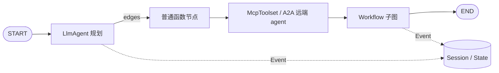
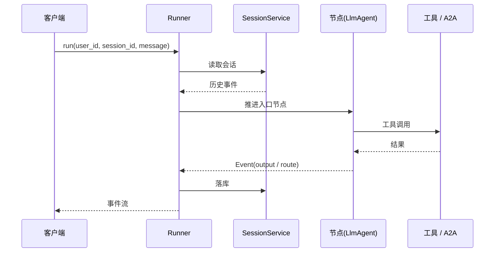

# Google ADK（Agent Development Kit）

## 一句话结论

ADK 是 Google 官方维护的代码优先 agent 套件：抽象层次高于 LangGraph 的节点—边原语，又不像 CrewAI 那样用角色叙事把流程包起来；2.0 起把 agent、tool、普通函数统一成工作流图上的节点。它适合已经确定在 Gemini / Google Cloud 上跑生产 agent、并且愿意接受官方 runtime 与部署链路的团队；不适合要求多云同构、或要把 runtime 完全自建的场景。

## 先看一次订票

假设你给出行 App 做一个订票入口，用户说"下周三去杭州，先看天气，合适就订高铁票"。这里面有两件互不依赖的查证（天气、车次）、一次依赖两者的判断、一次必须用户确认金额的订票。全交给一个 agent 让它自己排顺序，它可能先订票再查天气；全写成代码，又处理不了"天气不好就改期"这种判断。ADK 的做法是把确定的部分写成图或预置组合，把判断留给模型：

| 步骤 | ADK 里的对象 | 说明 |
|---|---|---|
| 并行查天气、查车次 | `ParallelAgent` 或图上的并行分支 | 两件事互不依赖 |
| 汇总后判断去不去 | `LlmAgent` | 模型读两份结果 |
| 订票前确认金额 | 工具审批（tool confirmation） | 不确认不执行 |
| 整体顺序与会话状态 | `SequentialAgent` / `Workflow` 的 `edges`；`Session`/`State` | 谁先谁后写在结构里 |

**workflow agent** 是几块预置积木：`SequentialAgent` 顺序跑子 agent，`ParallelAgent` 并行跑再汇总，`LoopAgent` 循环到条件满足。类比：不是让一个全能员工自己安排，而是给班组一张工序卡——两个人分头查，一个人汇总，签字后才下单。层级树则是它的组织方式：父 agent 通过 `sub_agents` 把任务委派下去，子 agent 只看得到父给的那部分上下文，像部门树而不是全员群聊。

```python
# 2.0 里 agent 只是图上的节点，顺序写在 edges 而不是 prompt 里
root_agent = Workflow(name="trip", edges=[("START", weather, trains, decide, booker)])
```

记住"agent 只是节点"这一点，后面看 ADK 2.0 为什么废掉 `_run_async_impl` 重写就顺了。

## 定位与谱系

- 出品方与许可：Google，仓库 `google/adk-python`，Apache-2.0（GitHub 仓库元数据，2026-11-20 核对）。
- 当前版本：`google-adk` 2.15.0，2026-11-20 发布，要求 Python ≥ 3.11（PyPI，2026-11-20 核对）。
- 主版本切换：2.0 的 Python GA 为 2026-05-19、Go 为 2026-06-30、TypeScript 为 2026-08-21；1.x 仍可用 `pip install "google-adk~=1.0"` 并行维护（ADK 2.0 迁移页）。
- 前身与合并关系：没有前身，是 Google 自研；但产品上与会话/内存托管的 Agent Runtime（即原 Vertex AI Agent Engine）和 A2A 协议属同一族，三者常被一起讲，实际是三样东西。
- 在七层模型中的位置：**运行时 + 编排**。它自带 runner、session/memory 服务、CLI、评测命令和部署命令，因此比"纯编排库"更靠下；上层的应用协议（A2A）和工具协议（MCP）它都直接接。

Google 这条线的三层结构值得先记住：Gemini 模型与 API 是最底层；ADK 是写 agent 的那一层；Agent Runtime 是把它托管跑起来的那一层。很多"ADK 能力"的讨论其实在说后两层，评估时要拆开。

放在同类里看，ADK 的坐标很清楚：它比 LangGraph 高一层（自带 session、CLI、部署、评测），比 OpenAI Agents SDK 重（多了图与多语言），比 CrewAI 更"工程"（不靠角色叙事，靠显式流）。换句话说，它是"框架 + 半个平台"的混合体，代价是与 Google Cloud 的耦合比纯库深。

> 判断：ADK 的真正差异化不在 agent 抽象（那部分各家趋同），而在"agent 图 + A2A 暴露 + 托管 runtime"这条完整链路；如果你的部署最终不在 Google Cloud，这条链路的价值会掉一半。

### 它解决什么、不解决什么

- 解决：把"多 agent + 工具 + 会话状态 + 评测集 + 部署"做成一条官方铺好的路，减少自己拼装的部分。
- 不解决：跨云一致性和框架中立。会话存储、memory、部署都优先指向 Google Cloud；非 Gemini 模型可以接，但一等公民的路径明显是 Gemini。
- 划界：ADK ≠ A2A（协议，见 [A2A 协议](../03-protocols/02-a2a.md)）；ADK ≠ Agent Runtime（托管服务）；ADK ≠ Gemini API（模型接口）。

## 核心概念

ADK 2.0 的关键变化是"万物皆节点"：`BaseAgent` 继承 `BaseNode`，agent 不再是一个独立执行器，而是图上的一个节点（ADK 2.0 迁移页）。类型上，`Agent` 与 `LlmAgent` 在文档里基本同义。



| 概念 | 职责 | 容易误解的点 |
|---|---|---|
| `Agent` / `LlmAgent` | 一个模型 + 指令 + 工具的执行单元 | 2.0 里它只是节点，不再自己驱动整个流程 |
| `Workflow` | 用 `edges` 声明节点顺序与分叉的图 | `edges` 写的是节点顺序，不等于"每一步都调模型" |
| `Event` | 状态变更与路由的唯一载体，2.0 新增 `node_info`、`output` | 不能绕过框架手动 append，会破坏图引擎的路由确定性 |
| `Session` / `State` | 单次会话的事件序列与会话内数据 | 内存实现重启即丢，只适合本地开发 |
| `Memory` | 跨会话可检索的长期知识 | 与 State 不是一层：State 属于当前会话 |
| `McpToolset` | MCP 客户端，把外部 server 的工具导入 agent | 构造时不连接，首次使用时才开会话；生产环境必须同步定义 |
| Callback | `before/after_agent`、`before/after_model`、`before/after_tool` 生命周期钩子 | 2.0 之后，定制执行逻辑只能走 callback，不能重写 `run` |

**1.x 与 2.0 的心智模型差异**：

| 维度 | 1.x | 2.0 |
|---|---|---|
| 执行单元 | agent 是独立执行器，`sub_agents` 组成层级树 | agent 是图节点，由 Workflow Runtime 推进 |
| 事件结构 | `Event` 只描述会话内容 | 追加 `node_info`、`output`（TS 还有 `route`、`isolationScope`）用于路由与隔离 |
| 定制入口 | 可重写 `_run_async_impl()` 等抽象方法 | 只能走 Before/After 回调，旧重写被绕过且不报错 |
| 错误处理 | 无内建重试，开发者自己 try/except | 框架捕获异常做重试与 HITL 暂停，靠 `RetryConfig` 配置 |
| 组合方式 | `SequentialAgent` / `ParallelAgent` / `LoopAgent` | 图工作流、动态工作流、预置 workflow agent 三种并存 |

三个容易混淆的边界：

- **State vs Memory**：State 是当前会话的草稿纸，随会话消失；Memory 是可检索的长期库，需要显式 ingest。把用户偏好写进 State 却在下一个会话找它，是最常见的误用。
- **Artifact vs State**：Artifact 存的是文件、代码、文档这类"超出对话生命周期"的产物，走 `ArtifactService`；State 只适合小结构数据。把大文本塞 State 会把每轮 prompt 撑爆。
- **Callback vs Plugin vs Skill**：Callback 是代码级钩子，Plugin 是可打包的行为集合（日志、全局拦截等），Skill 是给模型看的可复用能力说明。三者解决的不是同一层问题，别用 Skill 去做审计。

## 执行模型

**事件驱动 + 图推进**。一次调用从入口节点开始，节点返回 `Event`；runner 负责持久化事件、按 `route` 选择出边、并把事件流式吐给客户端。控制权在 Workflow Runtime，不在 agent 自己。

一次请求的典型时序：

1. 客户端调用 runner，带上 `user_id` / `session_id`；
2. runner 从 `SessionService` 取出会话，把历史事件拼进模型请求；
3. 入口节点若是 agent，调用模型，模型可能返回工具调用；
4. 工具（本地函数、`McpToolset`、远端 A2A agent）执行，结果作为事件回到图上；
5. 节点返回的 `Event` 带 `route` 时，runner 据此选下一条边；不带的按 `edges` 顺序推进；
6. 到达 END 或抛出 `NodeInterruptedError` 暂停（等人工输入），事件序列落库。



注意第 6 步的落库不是"顺便存一下"：2.0 的路由依赖事件里的 `route`，所以持久化失败会直接导致下一次请求走错分支。这也是它敢做 HITL 暂停的前提——暂停期间状态必须已经落盘。

ADK 官方给出三种组合方式，选型上不是替代关系（Graph-based workflows 文档）：

1. **图工作流**：显式 `edges` + 路由键，适合确定性强的审批、流水线；
2. **动态工作流**：控制流写在 Python 里（循环、递归、复杂分支），适合静态图表达不了的情况；
3. **预置 workflow agent**：`SequentialAgent` / `ParallelAgent` / `LoopAgent` 这类开箱组合，适合"先跑起来"。注意 TypeScript 2.0 已对这三者打 deprecation 警告并建议改写为图，Python 侧仍作为更高层积木保留。

多 agent 有两条路：同一进程内的**协作式工作流**（协调者 agent + 子 agent，2.0 的 collaborative workflows），以及跨进程的 **A2A**。A2A 是一等公民：既能把 ADK agent 暴露成 A2A server，也能消费远端 A2A agent；Go/Java 侧 A2A 仍标实验。

> 判断：ADK 2.0 的"图化"本质是把 1.x 里靠 prompt 约定和隐式顺序维持的多 agent 流程，换成显式边。这不只是 API 变化，而是把"可预测性"从模型手里收回框架手里。

## 十维对比

| 维度 | 说明 |
|---|---|
| 抽象层次 | 代码优先；2.0 是声明式图 + 代码节点混用，介于低层图编排与高层 agent 套件之间 |
| 执行模型 | 事件驱动、图推进；同步/流式皆可，支持动态工作流的代码内循环 |
| 状态与持久化 | `Session`/`State`/`Memory` 三件套；内存实现仅限本地，生产接数据库或 Vertex 服务；2.0 事件 schema 变更需同步改库表 |
| 多 agent 支持 | 一层：`sub_agents` 协作式工作流（协调者 + 子 agent）；另一层：跨进程 A2A |
| 工具与 MCP | 原生 `FunctionTool`、MCP 客户端 `McpToolset`、也能把 ADK agent 暴露成 MCP server（协议细节见 [MCP](../03-protocols/01-mcp.md)）；A2A 同理 |
| 可观测 | 内建 logging / metrics / traces，可导出到 OpenTelemetry；本地有 `adk web` 调试面板 |
| 评测集成 | 内建 eval：`.test.json` 评测集、轨迹与最终回答两类指标；三种入口（`adk eval` CLI、`adk web` Web UI、pytest） |
| 部署形态 | Agent Runtime（原 Vertex AI Agent Engine，全托管）、Cloud Run、GKE、任意容器 |
| 语言与生态 | Python 主线（2.x）、TypeScript 与 Go 已到 2.0 GA，Java 有独立发行线，Kotlin/Android 部分特性标实验 |
| 许可证与治理 | Apache-2.0；Google 主导，无独立基金会治理，路线图随 Google Cloud 产品节奏 |

## 最小示例

```python
from google.adk import Agent, Workflow

researcher = Agent(name="researcher", model="gemini-flash-latest",
                   instruction="检索并给出三条要点，只输出要点。")

def lookup(node_input: str):
    return {"facts": node_input, "checked_at": "2026-11-20"}

writer = Agent(name="writer", model="gemini-flash-latest",
               instruction="把输入整理成一段结论。")

root_agent = Workflow(name="root_agent",
                      edges=[("START", researcher, lookup, writer)])
```

`edges` 里一行就是一条链路，节点间靠返回值传递数据，不需要手写 state 写入 —— 这是 2.0 与 1.x 最直观的差异。普通函数节点（`lookup`）完全不调模型，这正是"确定性代码 + 非确定性推理"混排的价值。

配套的评测集长这样（一个文件一个 session，官方只认 `.test.json` 后缀）：

```json
{
  "eval_set_id": "researcher_smoke",
  "eval_cases": [{
    "eval_id": "case_1",
    "conversation": [{
      "user_content": {"role": "user", "parts": [{"text": "总结 ADK 2.0 的变化"}]},
      "intermediate_data": {"tool_uses": [{"name": "lookup", "args": {}}]},
      "final_response": {"role": "model", "parts": [{"text": "……"}]}
    }]
  }]
}
```

评测同时比对两样东西：工具调用轨迹（`tool_uses`）和最终回答。只比最终回答，会漏掉"答对了但绕了十步"的情况。

## 适用与不适用

- **适合**：已经押注 Gemini / Google Cloud，需要官方支持的会话、memory、评测、部署一条龙；需要对外暴露 A2A 或对内接 MCP 的企业 agent；多语言团队（Python 做原型、Go/Java 做服务）。
- **适合**：流程里有明确的"代码步骤 + 模型步骤"交替，且希望代码步骤不消耗 token —— 图节点让这替换变得直接。
- **不适合**：要求同一份 agent 代码在 AWS/Azure 上等价运行 —— 换掉 Agent Runtime 就要自己补 session、memory、部署。
- **不适合**：只需要单轮 RAG 问答 —— 引入整套 graph + session 是负担，直接用模型 API 或轻量 SDK 更省。
- **不适合**：需要极度定制的调度语义（自定义中断点、时间旅行、任意状态快照）—— 图编排的可控点不如 LangGraph 细，见 [选型矩阵](00-selection-matrix.md)。

## 常见坑

- **1.x 数据落库直接升 2.0 会炸**：2.0 的 `Event` 多了 `node_info`、`output` 字段，自定义 `BaseSessionService` 若用固定列存事件，插入或 ORM 反序列化会失败；存 JSON blob 的没事。触发条件：自建 session 表 + 直接升级。规避：先改 schema 再写 2.0 会话，读写两端一起改。
- **重写 `_run_async_impl()` 的自定义逻辑静默失效**：2.0 的 Workflow Runtime 完全绕过这些 1.x 抽象方法，你注入的遥测、状态管理不再被调用，而且不报错。规避：迁到 `BeforeAgentCallback` / `AfterAgentCallback`。
- **工具里的 `except Exception` 会关掉重试**：2.0 靠异常传播触发重试与 HITL，宽泛捕获把失败变成"正常返回"，重试机制对该步骤永久失效；捕获 `BaseException` 还会吞掉 `NodeInterruptedError`，导致人工审批永远等不到。规避：让异常冒出去，交给 `RetryConfig`。
- **手动 append event**：`context.session.events.append(...)` 或 `enqueue_event` 会绕过图引擎，路由和流式输出错乱，表现为"偶发跳步"。规避：在节点内 `yield` 事件。
- **MCP 工具在本地异步初始化，上线即挂**：官方明确要求生产环境在 `agent.py` 里同步定义 `McpToolset`，异步动态初始化只支持本地调试或自定义 runner。规避：把 toolset 定义移到模块顶层。
- **Agent Runtime 的部署边界被低估**：上传的是 agent 代码与依赖，不含 ADK API server 与 Web UI（由服务端提供），且需要已开通计费的 Cloud 项目；会话/内存通常落到 Agent Runtime 提供的托管实现（Vertex 侧），跨云迁移等于重写这一层。规避：在架构评审阶段就把"runtime 是否可替换"写成明确假设。
- **本地 `adk web` 跑通 ≠ 生产跑通**：本地是内存 session + 单进程，多副本部署后状态不共享。规避：上线前用真实 `SessionService` 实现做一次多副本压测。

## 开放问题

- 2.0 之后 Python 侧的预置 workflow agent 会不会也像 TypeScript 一样被标废弃？官方目前只说"图更可控"，未给时间表。
- Event schema 已经改过一次，会话存储的向前兼容策略是否会形成稳定的迁移契约，尚未见到正式承诺。
- 评测集格式（`.test.json`，一个文件一个 session）与生产会话的重放之间缺少官方桥接，团队往往要自己写一层导出。
- Agent Runtime 与 A2A 组合在跨组织场景下的身份、计费、审计边界，官方文档仍偏部署视角。

## 参考来源

- ADK 2.0 迁移与版本说明 · adk.dev · 2026-11 · https://adk.dev/2.0/index.md
- google-adk 2.15.0 · PyPI · 2026-11-20 · https://pypi.org/project/google-adk/2.15.0/
- google/adk-python 仓库（Apache-2.0）· GitHub · 2026-11-20 · https://github.com/google/adk-python
- Graph-based agent workflows · adk.dev · 2026-11 · https://adk.dev/graphs/index.md
- Agents 概览（Agent 与 workflow 的关系）· adk.dev · 2026-11 · https://adk.dev/agents/index.md
- Session、State 与 Memory · adk.dev · 2026-11 · https://adk.dev/sessions/index.md
- MCP Tools（`McpToolset` 与生产同步定义要求）· adk.dev · 2026-11 · https://adk.dev/tools-custom/mcp-tools/index.md
- Agent2Agent (A2A) for ADK · adk.dev · 2026-11 · https://adk.dev/a2a/index.md
- 部署到 Agent Runtime（原 Vertex AI Agent Engine）· adk.dev · 2026-11 · https://adk.dev/deploy/agent-runtime/index.md
- Agent evaluation（`.test.json` 与 `adk eval`）· adk.dev · 2026-11 · https://adk.dev/evaluate/index.md
- Callbacks（before/after 钩子语义）· adk.dev · 2026-11 · https://adk.dev/callbacks/index.md
- Observability for agents（logging / metrics / traces 与 OpenTelemetry）· adk.dev · 2026-11 · https://adk.dev/observability/index.md
