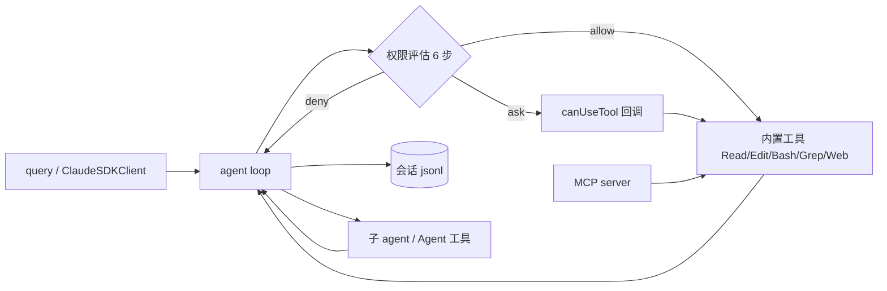

# Claude Agent SDK

## 一句话结论

Claude Agent SDK 不是编排库，而是把 Claude Code 的整套 harness 以库的形式交付：agent loop、内置工具、权限系统、子 agent、hooks、skills、MCP 全部打包，进程内起一个 Claude Code 二进制来跑。适合"要一个能干活的编码/操作型 agent，而不是自己拼装 agent 骨架"的团队；不适合需要跨模型、或要把控制流精确握在手里的编排场景。

## 先看一次改代码

假设你让 agent 在仓库里修一个失败的测试，规则只有一条：**删文件之前必须问人**。它要自己读代码、改实现、跑测试；可能想 `rm` 掉一个旧 fixture，也可能想装依赖。卡点不在"会不会改"，而在三件事：危险动作要拦住、每次工具调用要留审计、跑长了上下文要能压缩续接。SDK 把这些做成了一套现成的工作台：

| 环节 | SDK 里的对象 | 说明 |
|---|---|---|
| 收任务、跑循环 | `query()` / `ClaudeSDKClient` | 一次性调用 vs 长连接多轮 |
| 读文件、改代码、跑测试 | 内置 `Read` / `Edit` / `Bash` / `Grep` | 不用自己写工具 schema |
| 删文件前问人 | 权限模式 + `canUseTool` 回调 | 不在白名单的工具才会走到回调 |
| 审计与上下文存档 | Hooks（如 `PreToolUse`）、`PreCompact` | hook 对所有调用都跑 |

**harness** 不是"一个 agent 框架"，而是一套已经装好的工作台：循环、工具、权限、压缩、子 agent 都在里面，你拿到的是成品，不是空 loop。类比：不是给你零件造车，而是给你一辆能开的车，你能改的是"谁能上车、走哪条路、在哪设检查站"。

```python
opts = ClaudeAgentOptions(allowed_tools=["Read", "Grep", "Edit"],  # Bash 不在白名单
                          permission_mode="acceptEdits")           # 删文件仍会问你
```

控制点固定是它的代价，也是它的边界：后面的执行模型一节会说明，这套 harness 能改的是权限与钩子，改不了循环本身。

## 定位与谱系

- 出品方与许可：Anthropic。代码仓库 `anthropics/claude-agent-sdk-python` 为 MIT；但官方文档明确，使用受 Anthropic Commercial Terms 约束，包括用它给自己的客户提供产品（Agent SDK overview）。
- 当前版本：Python `claude-agent-sdk` 0.2.186（2026-11-19，PyPI）；TypeScript `@anthropic-ai/claude-agent-sdk` 0.3.329（2026-11-19，npm）。两条线都在 0.x，迭代频繁。
- 前身：Claude Code SDK，后改名 Agent SDK 并扩到通用 agent 场景，官方提供了 migration guide。
- 在七层模型中的位置：**运行时（harness）**，且是"自带工具与权限"的厚运行时。它不含图编排，也不试图做通用工作流引擎。
- 家族关系：同一份能力有四种交付形态——Agent SDK（库，你托管进程）、Claude Code CLI（终端）、Client SDK（裸 API + 自己写 loop）、Managed Agents（Anthropic 托管 harness）。选型时先在这四者之间选，再谈细节。

| 形态 | 谁运行 agent | 自带什么 | 什么时候选 |
|---|---|---|---|
| Agent SDK | 你的进程 | Claude Code 的工具、权限、会话、hooks | 要嵌入自己的服务，且接受 Claude 语义 |
| Claude Code CLI | 终端 | 同上，交互式 | 日常开发、一次性任务、CI 里 `-p` 跑批 |
| Client SDK | 你的进程 | 只有 API 访问 | 要完全自定义 loop，或非编码类 agent |
| Managed Agents | Anthropic | 托管 harness + sandbox | 不想运维执行环境，接受把会话放到 Anthropic 侧 |

### 它解决什么、不解决什么

- 解决：文件读写、命令执行、grep、代码编辑、上下文压缩、权限审批、子 agent 隔离、会话恢复——这些"每个 agent 项目都要重写一遍"的东西，它已经写好了。
- 不解决：多 agent 的显式拓扑（没有图、没有条件边、没有 checkpoint 语义）；非 Claude 模型；脱离 Claude Code 语义的自定义工具协议。
- 划界：它和"自建 loop + 原生 Messages API"不是同一层的东西——后者给你完全控制权但什么都没有，前者给你一切但控制点固定。

> 判断：判断要不要用它，只看一个问题——"我的 agent 主要工作是操作文件系统和跑命令吗？"是，就用它；不是（比如纯对话、纯检索、纯结构化抽取），它的内置工具和权限系统就是负担。

## 核心概念



| 概念 | 职责 | 容易误解的点 |
|---|---|---|
| `query()` | 一次性调用，返回异步消息流；每次默认新会话 | 传 `resume` / `continue` 才接上文，不是自动连续 |
| `ClaudeSDKClient` | 长连接客户端，多轮对话、可中断、可切权限模式 | 它内部仍是起 Claude Code 进程，不是纯 HTTP 客户端 |
| `ClaudeAgentOptions` | 全部配置入口：工具白名单、权限模式、子 agent、MCP、预算 | 白名单不等于"只能用这些工具"，见坑一节 |
| `AgentDefinition` | 子 agent 定义：`description` / `prompt` / `tools` / `model` | 子 agent 上下文是全新的，只有 prompt 字符串过去 |
| Hooks | 生命周期回调，可 allow / deny / 改输入 / 注入上下文 | hook 的 allow 不能跳过 deny 规则 |
| Session | 落盘的对话记录，支持 resume / fork | 只持久化对话，不持久化文件改动 |
| Skills / Plugins | 从 `.claude/` 自动加载的能力包 | 会自动进入上下文，影响 token 与行为，需显式控制 `setting_sources` |

`query()` 与 `ClaudeSDKClient` 的区别值得单独记：前者像"发一个任务、等一串消息"，每次调用默认开新会话；后者像"开一个会话，反复问"。需要多轮、需要中途 interrupt、需要动态切权限模式时用后者（`set_permission_mode`）。很多"上下文丢了"的问题，根因是把有状态的对话写成了连续两次 `query()`。

hooks 的返回值决定了它在链路里的角色：`allow` / `deny` 是审批，改 `updatedInput` 是改写工具入参，往对话里注入内容则相当于"替模型补一条观察"。三者混在一个回调里会让排障非常困难，建议按目的拆开注册。

还有三组容易混的边界：

- **权限模式 ≠ 工具可用性**：模式决定"要不要问"，`disallowed_tools` 才真正把工具定义从请求里移除。想让模型根本看不见某个工具，用后者。
- **会话恢复 ≠ 环境恢复**：resume 只恢复对话；文件已经被改坏就回不去了。需要回滚时用 file checkpointing 一类的机制。
- **子 agent ≠ 并行任务队列**：它解决的是上下文隔离，顺带能并行；不要拿它当无状态 worker 池用，调度语义不在这一层。

## 执行模型

**单进程内的固定循环**：收 prompt → 模型评估 → 工具调用 → 结果回灌 → 再评估，直到模型给出无工具调用的回答（Agent loop 文档把这称为一个 turn 的循环）。

几个决定工程行为的细节：

- **turn 与预算**：`max_turns` 统计的是"有工具调用的轮次 + 最后一次纯文本回答"，所以设成 2 会在编辑前就被截断，并以 `error_max_turns` 结束且没有最终回答；`max_budget_usd` 按花费封顶。生产上两个都该设。
- **消息类型**：`SystemMessage`（`init` / `compact_boundary` 等）、`AssistantMessage`（每个 content block 一条）、`UserMessage`（工具结果）、`StreamEvent`（开 `include_partial_messages` 才有）、`ResultMessage`（终结，带 usage、cost、session_id）。
- **上下文管理**：到阈值自动压缩，压缩发生时发 `compact_boundary`，`PreCompact` hook 可以在压缩前存档完整记录。
- **子 agent**：主 agent 通过 `Agent` 工具调用，默认后台异步启动（结果 `status: "async_launched"`），其上下文从零开始，父 agent 只收到最终消息。这是控制上下文膨胀的主要手段，也是"子 agent 为什么不知道我刚才说的"的根因。
- **中断**：`ClaudeSDKClient` 支持 interrupt；会话可以 `fork` 出分支，原会话不变。

一次典型的"修一个失败测试"会话（官方文档的例子）大致是四轮：第 1 轮 `Bash` 跑测试拿到三段失败输出；第 2 轮并行 `Read` 两个文件；第 3 轮 `Edit` 改实现再跑测试；第 4 轮纯文本收尾。这意味着 `max_turns=3` 会正好卡在改完没验证的位置——预算参数必须按这种真实轮次来估。

上下文在这里有三个必须记住的事实：

1. 工具输出全额进上下文。一次 `Bash` 的完整 stdout 可能几千 token，"只看错误行"要靠 `Bash(... | tail)` 这类命令自己收敛，框架不会替你裁剪。
2. 子 agent 是唯一的结构化隔离手段。它从零上下文开始，只有最终消息回到父会话，所以"探索型"工作应尽量下沉到子 agent。
3. 压缩不可避免。长任务的第 N 轮和第 1 轮看到的不是同一份历史，调试时要按"压缩边界"分段看轨迹，而不是当成一条连续对话。

### 它和"自建 loop + 原生 Messages API"的取舍

这是选型时真正要回答的问题。两者不是新旧关系，是控制权与工作量的交换：

| 维度 | Claude Agent SDK | 自建 loop + 原生 API |
|---|---|---|
| 工具实现 | 内置文件/命令/搜索工具，开箱可用 | 每个工具自己写 schema、执行、错误处理 |
| 权限 | 六步评估 + 多档权限模式 + 回调，已实现 | 自己设计，通常只有"白名单 + 人工确认" |
| 上下文管理 | 自动压缩、子 agent 隔离 | 自己写 summarization / 截断策略，见 [上下文工程](../01-foundations/02-context-engineering.md) |
| 会话 | 磁盘 jsonl + resume/fork | 自己建表、自己迁移 |
| 控制粒度 | 只能通过 hooks 介入 | 每一步都是你的代码 |
| 模型 | 仅 Claude | 任意供应商 |
| 迁移成本 | 换框架等于重写，工具语义绑 Claude Code | 换模型只改适配层 |

> 判断：如果你的 agent 有 60% 以上的工作量是"读文件、改文件、跑命令"，SDK 省下的工程量远大于它带来的锁定成本；如果 agent 的核心价值在自定义工具与状态机，那 SDK 的内置能力基本用不上，锁定却是全额。

代价要说清楚：它交付的是 runtime，不是编排库。你能决定的只有"给什么工具、什么时候要审批、跑多少轮"，不能决定"第 3 步失败后回到第 1 步重试"。需要后者时，正确做法是外层用自己的编排器调度多次 SDK 调用，而不是在 hooks 里硬拼状态机。

## 十维对比

| 维度 | 说明 |
|---|---|
| 抽象层次 | 运行时/框架，不是编排库；给的是"一个已经会干活的 agent"，不是"搭 agent 的积木" |
| 执行模型 | 固定 agent loop，单线程推进；并发靠子 agent，不靠图 |
| 状态与持久化 | 会话落 `~/.claude/projects/<encoded-cwd>/*.jsonl`；支持 continue/resume/fork；不持久化文件系统 |
| 多 agent 支持 | 主子式：`AgentDefinition` + `Agent` 工具，上下文隔离、可并行；无跨 agent 状态共享原语 |
| 工具与 MCP | 内置 Read/Write/Edit/Bash/Grep/Glob/Web 等；MCP 客户端 + `create_sdk_mcp_server()` 进程内 server |
| 可观测 | 消息流自带 usage/cost；hooks 可做审计；OpenTelemetry 需自行接入（截至 2026-11 未见官方原生 exporter 说明） |
| 评测集成 | 无内建评测器；靠轨迹回放 + 外部 eval（见 [评测体系](../04-engineering/02-evaluation.md)） |
| 部署形态 | 自托管进程（容器/VM/CI），或 Anthropic 的 Managed Agents（托管 harness + 托管或自托管 sandbox） |
| 语言与生态 | Python 与 TypeScript 双主线；能力面与 Claude Code 强绑定，skills/plugins/CLAUDE.md 可直接复用 |
| 许可证与治理 | 代码 MIT，使用受 Anthropic Commercial Terms；品牌使用有单独规范（不得自称 Claude Code） |

## 最小示例

```python
import asyncio
from claude_agent_sdk import query, ClaudeAgentOptions

async def main():
    async for msg in query(
        prompt="找出 auth 模块的空指针风险并给出补丁",
        options=ClaudeAgentOptions(
            allowed_tools=["Read", "Grep", "Edit"],
            permission_mode="acceptEdits",
            max_turns=12,
            max_budget_usd=0.5,
        ),
    ):
        print(msg)

asyncio.run(main())
```

十几行就有一个带工具、带预算、带权限的 agent——这是它最大的卖点，也是它最大的问题：你几乎没有机会介入 loop 内部（除了 hooks）。

## 适用与不适用

- **适合**：编码 agent、运维 agent、需要大量文件与命令操作的自动化；已有 Claude Code 使用习惯、想把 `.claude/` 里的 skills 与 hooks 直接产品化的团队。
- **适合**：需要在"沙箱里跑、有审批、可恢复"三者上快速达标，而不想自己实现权限引擎。
- **适合**：任务形态是"在某个环境里反复操作、观察、再操作"——数据清洗、批量改配置、跑合规检查都能复用内置工具。它的边界是"环境内操作"，不只是"写代码"。
- **不适合**：需要精确拓扑的多 agent 系统（谁在什么条件下转给谁、失败重试到哪个节点）——它没有图，控制流由模型决定，见 [多智能体协作](../01-foundations/05-multi-agent.md)。
- **不适合**：必须支持多模型供应商。SDK 没有模型适配层，`AgentDefinition.model` 只接受 Claude 系列别名（`opus` / `sonnet` / `haiku` / `inherit` 等）。
- **不适合**：需要审计每一轮模型请求的内容。loop 内部由 Claude Code 控制，可观测点只有消息流与 hooks，拿不到完整的请求体。
- **不适合**：纯 RAG 或纯结构化抽取。内置工具用不上，反而多背一层进程与权限配置。

## 常见坑

- **`allowed_tools` 写裸工具名会绕过你的审批回调**：`allowed_tools=["Read"]` 会在 allow 规则阶段直接放行，`canUseTool` 根本不会被调用，你写在回调里的审计逻辑对该工具静默失效。触发条件：白名单 + 依赖回调做检查。规避：要么用带作用域的规则（如 `Bash(npm test *)`），要么把检查放进 `PreToolUse` hook——hook 对所有调用都跑。
- **hook 的 allow 不等于放行**：deny 规则与 ask 规则在 hook 之后仍会评估，hook 返回 allow 也可能被后面的 deny 拦掉；反之 hook 的 deny 在任何模式下都生效，包括 `bypassPermissions`。排障时先看 hook，再看规则。
- **子 agent 的权限模式按继承规则生效，不是按你写的值生效**：子 agent 有自己的 `permissionMode` 字段，但实际是否采用由继承规则决定（父会话是 `bypassPermissions` 时尤其如此）。想让"只读子 agent"真的只读，要在 `AgentDefinition.tools` 里限制工具，而不是指望权限模式。
- **`max_turns` 差一 turn**：设太小会在最后一步前中断，返回 `error_max_turns` 且没有最终文本；很多"agent 什么都没干"的工单是这个原因。规避：按"工具轮次 + 1"估算，并读 `ResultMessage.subtype` 区分失败类型。
- **会话在磁盘上，不在数据库里**：多副本部署时 resume 找不到上一台的 jsonl，表现为"随机丢上下文"。规避：会话粘性路由，或自己接管会话存储；Python 侧可用 `CLAUDE_CODE_SKIP_PROMPT_HISTORY` 关掉落盘做无状态服务。
- **压缩是有损的**：长任务跑到 compaction 后，早期细节消失，模型开始重复劳动。规避：`PreCompact` hook 落一份完整轨迹，关键结论写进项目内的持久文件（它本来就会读）。
- **成本不可见直到结果返回**：token 与费用在 `ResultMessage` 才齐；中途只能靠 hooks 记账。规避：外层再包一层预算控制，别只依赖单次 `max_budget_usd`。
- **MCP 工具的权限名写不对就不生效**：白名单要写成 `mcp__<server>__<tool>`（如 `mcp__calc__add`），且 allow 规则里的通配只能出现在 `mcp__<server>__` 前缀之后，`mcp__*` 这类不锚定的写法会被忽略。触发条件：接了 MCP server 却发现"工具被拒"。规避：先打印实际工具名，再写规则。
- **子 agent 默认后台跑**：`Agent` 调用返回 `async_launched`，结果要等后续 turn 才回到主 agent。把它当同步 RPC 用，会得到"任务已提交但没有结果"的假象。规避：需要同步语义时显式配前台执行，或在 prompt 里要求主 agent 等待并汇总。
- **不能把 claude.ai 的登录与额度转给第三方产品**：官方明确，未经批准不得用自己的产品提供 claude.ai 登录或速率限制，必须走 API key 认证。做商业化封装时这是合规项，不只是技术项。

## 开放问题

- 0.x 版本 + 一周数个小版本的节奏（0.2.181 至 0.2.186 六个版本集中在 2026-11-12 至 11-19），生产上如何锁定？目前只能钉版本并自建回归集。
- 权限模型的六步评估已经相当复杂，"策略即代码"的声明式配置是否会成为官方形态，尚未见到。
- 与 Managed Agents 的边界会怎么演化：如果托管形态覆盖更多场景，自托管 SDK 的定位可能收窄到"私有环境执行器"。
- 会话格式（jsonl + Claude Code 语义）事实上是私有格式，跨工具迁移没有标准路径。
- 权限模型与 hooks、settings 文件、plugins 叠加后，实际生效策略需要"读源码级"的理解，这是否会被收敛成可静态分析的一份配置，尚无迹象。
- 与 Anthropic 的模型版本节奏强绑定：模型下线或默认模型变更会直接改变 agent 行为，SDK 侧缺少"行为回归"的官方工具。

## 参考来源

- Agent SDK overview（四种交付形态、许可与品牌规范）· code.claude.com · 2026-11-17 · https://code.claude.com/docs/en/agent-sdk/overview
- How the agent loop works（turn、预算、消息类型、压缩）· code.claude.com · 2026-11 · https://code.claude.com/docs/en/agent-sdk/agent-loop
- Configure permissions（六步评估、权限模式、白名单语义）· code.claude.com · 2026-11 · https://code.claude.com/docs/en/agent-sdk/permissions
- Subagents in the SDK（`AgentDefinition`、继承规则）· code.claude.com · 2026-11 · https://code.claude.com/docs/en/agent-sdk/subagents
- Sessions（continue / resume / fork 与落盘位置）· code.claude.com · 2026-11 · https://code.claude.com/docs/en/agent-sdk/sessions
- Hooks（事件清单与决策语义）· code.claude.com · 2026-11 · https://code.claude.com/docs/en/agent-sdk/hooks
- Python SDK reference（`query`、`ClaudeSDKClient`、`ClaudeAgentOptions`）· code.claude.com · 2026-11 · https://code.claude.com/docs/en/agent-sdk/python
- MCP in the Agent SDK · code.claude.com · 2026-11 · https://code.claude.com/docs/en/agent-sdk/mcp
- claude-agent-sdk 0.2.186 · PyPI · 2026-11-19 · https://pypi.org/project/claude-agent-sdk/
- anthropics/claude-agent-sdk-python（MIT）· GitHub · 2026-11-20 · https://github.com/anthropics/claude-agent-sdk-python
- @anthropic-ai/claude-agent-sdk 0.3.329 · npm · 2026-11-19 · https://www.npmjs.com/package/@anthropic-ai/claude-agent-sdk
