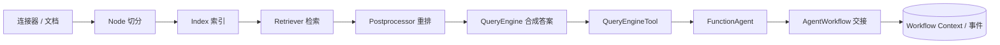

# LlamaIndex

## 一句话结论

LlamaIndex 的护城河在数据层，不在 agent loop。它用连接器、索引、检索器、查询引擎把"非结构化数据变成可检索上下文"这件事做深，`AgentWorkflow` 只是架在这层之上的编排壳。适合文档密集、检索质量决定成败的场景；如果任务本身不依赖自有语料，用它的 agent 部分属于绕远路。

## 定位与谱系

- 出品方与许可：LlamaIndex（run-llama），MIT（仓库 LICENSE，2026-11-20 核对）。
- 当前版本：`llama-index` / `llama-index-core` 0.14.26，2026-11-13 发布；要求 Python ≥ 3.11 且 < 4.0（PyPI，2026-11-20 核对）。
- 前身与合并：从 GPT Index 改名而来，早期定位是"给 LLM 做索引"；RAG 成为主流后扩展出 query engine、agent、workflow 三层。
- 在七层模型中的位置：**工具与数据（主）+ 编排（次）**。它的重资产是 `llama-index-*` 这一整套数据管线包；编排层是后来补上的。
- 产品重心：官方文档站现在以 LlamaParse（文档解析平台）为主入口，框架被描述为"我们最早的开源 Python 工具包"；`llama-cloud` 时代的 Index 相关页面已挂在 deprecated 路径下。这条信息对选型很关键——框架仍在维护（0.14.26），但公司叙事已经偏向解析与抽取服务。

与相邻框架对照：LangChain 也做数据连接，但它的重心是"集成数量 + 链式组合"；LlamaIndex 的重心是"索引与检索策略"，同一份语料可以用不同 index 结构、不同 postprocessor 组合出完全不同的召回质量。LangGraph 做的是显式状态图，LlamaIndex 的 `Workflow` 是事件驱动而非图。三者经常被混着用：LlamaIndex 做数据层，LangGraph 做编排。

包装方式也值得注意：它不是一个包，而是 `llama-index-core` 加几十个 `llama-index-*` 集成包（每个向量库、每个模型供应商、每个 reader 各一个）。好处是按需安装，坏处是版本对齐成本。

数据层为什么难被替代：模型会换、框架会换，但"把 PDF 里的表格正确抽出来、按标题层级切、保留页码以便溯源"这套活儿没有捷径。它积累的是适配器与解析经验，不是 API 设计——这也是为什么它能在 agent 框架泛滥的两年里保持独立生态。

### 它解决什么、不解决什么

- 解决：异构文档的加载与切分、索引与检索策略、检索结果重排、引用与溯源、检索质量的量化评估。
- 不解决：通用 agent 运行时。没有沙箱、没有命令执行、没有权限模型、没有托管部署；这些要自己接（沙箱与工具执行见 [工具调用与沙箱](../01-foundations/04-tool-use-and-sandbox.md)）。
- 划界：`QueryEngine` 是"一次问答"，`Agent` 是"多轮决策"，`Workflow` 是"事件驱动流程"。三者是不同层，混用是新手最常见的错误。

## 核心概念



索引策略的选择比模型选择更影响结果：切分粒度决定"能不能召回"，索引结构决定"召回得准不准"，重排决定"进不进上下文"。这三件事都可以在小样本上量化，但都需要一个评估集。官方把它拆成"响应评估"与"检索评估"两套模块，正是承认了它们不该混在一起看。

| 概念 | 职责 | 容易误解的点 |
|---|---|---|
| Connector / Reader | 把外部数据源读成 `Document` | 数量多不等于质量好，解析错的内容后面全错 |
| Node / Ingestion Pipeline | 切分、元数据、向量化 | 切分策略对召回的影响大于换模型 |
| Index / Retriever | 建索引与召回 | 换 embedding 模型要重建索引，不是改个参数 |
| QueryEngine | 检索 + 合成一条龙 | 它是"一次问答"，没有多轮决策能力 |
| `FunctionAgent` | 基于模型 function calling 的 agent（另有 `ReActAgent`、`CodeActAgent`） | 它跑的是固定 agent loop，不是 Workflow |
| `AgentWorkflow` | 多 agent 交接（handoff）的 `Workflow` 子类 | 交接靠 prompt 与工具，不是图上的边 |
| `Workflow` / `@step` | 事件驱动编排：step 收到事件、返回新事件 | 异步一等公民，同步脚本里要自己 `asyncio.run` |

## 执行模型

**Agent 层是"循环"，编排层是"事件"**，两层可以叠加但机制不同。

`FunctionAgent.run()` 的循环很标准：取消息与历史 → 把工具 schema 发给模型 → 模型要么直接答、要么给工具调用 → 执行工具、结果入历史 → 再问模型。另外两个变体是策略差异：`ReActAgent` 用 ReAct 提示而非原生 function calling，`CodeActAgent` 让模型写代码来调工具。

| Agent 类型 | 工具调用方式 | 适合 | 代价 |
|---|---|---|---|
| `FunctionAgent` | 模型原生 function calling | 主流模型、工具少而清晰 | 依赖模型的工具调用质量 |
| `ReActAgent` | 文本推理 + 解析动作 | 模型不支持原生工具调用时 | 解析脆弱、多耗 token |
| `CodeActAgent` | 生成代码执行 | 需要组合计算、批处理 | 要沙箱，安全面变大 |

数据层的执行路径则是另一条线：读入 → 切分成 Node（可带 metadata 与关系）→ 建索引（向量、关键词或混合）→ 检索 top-k → postprocessor 重排/过滤/压缩 → response synthesizer 组织答案与引用。这条链上任何一环换掉，最终答案都会变；所以"换个模型试试"通常不是第一步该做的事。

一次查询的完整生命周期大致是：

1. 查询改写（可选）：把用户口语化的问题改成检索友好的形式；
2. 召回：从索引里取 top-k 个 Node；
3. 重排/过滤：按相关性、时间、权限等条件筛掉噪声；
4. 合成：把选中的 Node 塞进上下文，让模型组织答案；
5. 溯源：返回引用的 Node 与元数据，供人工核对；
6. 评估：把这次查询纳入评估集，观察召回率与答案质量是否退化。

第 2、3 步决定上限，第 4 步只决定"能不能用好已有的上下文"。绝大多数"RAG 效果差"的工单，改的都是第 4 步。

`Workflow` 是另一套：你定义若干 `@step`，每个 step 声明它接受哪种事件，返回的事件类型决定下一个 step 是谁。分支就是普通 `if` 返回不同事件，循环就是返回一个上游能接的事件，并发就是返回事件列表。这套模型比 DAG 灵活，代价是流程结构不在图上、要靠读代码。

`AgentWorkflow` 站在两者之上：它本身是 `Workflow`，内部维护"当前是哪个 agent、能交接给谁"的状态，交接动作由模型通过 handoff 工具发起。所以它到底会不会转交、转给谁，仍然是模型决定的——这一点和 CrewAI 的委托是同一类问题。

它的交接依赖三段 prompt：`handoff_prompt`（告诉模型有哪些 agent 可转）、`handoff_output_prompt`（要求模型给出转给谁与理由）、`state_prompt`（把共享状态注入当前 agent）。三者都可改，也都可以改坏——最常见的故障是 agent 描述写得含糊，模型在两个 agent 之间反复横跳。

> 判断：LlamaIndex 的 agent 能力是"够用"，不是"领先"。它的 `Workflow` 设计得比多数框架干净，但真正难以替代的是前面那条 `连接器 → 切分 → 索引 → 重排 → 评估` 的链路。

## 十维对比

| 维度 | 说明 |
|---|---|
| 抽象层次 | 数据层（索引/检索）+ 编排层（agent/workflow）；agent 抽象偏中层 |
| 执行模型 | Agent 内是 function calling 循环；外层是事件驱动 step，async 优先 |
| 状态与持久化 | `Context` 存 step 间状态并支持序列化；agent 默认 `ChatMemoryBuffer` 按 token 限流；无内建 checkpoint 服务 |
| 多 agent 支持 | `AgentWorkflow` 的 handoff 模型：有 root agent、可限制交接关系，拓扑由模型在运行时选择 |
| 工具与 MCP | `FunctionTool`、`QueryEngineTool`、Tool Specs；有 MCP 集成指南 |
| 可观测 | 回调体系 + 第三方集成（Arize Phoenix 等）；无自有控制平面 |
| 评测集成 | 强项：响应评估（Faithfulness、Relevancy、Correctness 等）+ 检索评估（MRR、hit-rate、precision）+ 问题生成，与 [评测体系](../04-engineering/02-evaluation.md) 的通用方法可对接 |
| 部署形态 | 自托管（库/服务自建）；解析与抽取可走 LlamaParse 托管服务 |
| 语言与生态 | Python 主线，包按功能拆成大量 `llama-index-*`；TypeScript 侧有独立实现的 LlamaIndex.TS |
| 许可证与治理 | MIT；公司主导，开源框架与商业解析服务的边界随产品调整 |

## 最小示例

```python
from llama_index.core.agent.workflow import AgentWorkflow, FunctionAgent
from llama_index.core.tools import QueryEngineTool

search = QueryEngineTool.from_defaults(
    query_engine=index.as_query_engine(),
    name="search_docs", description="检索内部文档并给出带引用的答案")

analyst = FunctionAgent(name="analyst", description="负责检索与核对事实",
                        tools=[search], llm=llm, system_prompt="先检索再回答。")

workflow = AgentWorkflow(agents=[analyst], root_agent="analyst")
resp = await workflow.run(user_msg="这份合同里违约金怎么算？")
```

注意 `description`：`AgentWorkflow` 在多 agent 场景下要求每个 agent 都有 name 与 description，否则构造时直接报错——交接靠这段文字，不是靠代码。

如果流程本身是确定的，跳过 agent 直接用 `Workflow` 更省：

```python
from llama_index.core.workflow import Workflow, step, StartEvent, StopEvent, Event

class Retrieved(Event):
    text: str

class AskFlow(Workflow):
    @step
    async def retrieve(self, ev: StartEvent) -> Retrieved:
        return Retrieved(text=str(index.as_query_engine().query(ev.question)))

    @step
    async def answer(self, ev: Retrieved) -> StopEvent:
        return StopEvent(result=llm.complete(f"精简为三条：{ev.text}"))
```

同一份数据、同一个索引，`Workflow` 版本没有 agent loop，也就没有"模型决定下一步"的不确定性。

## 适用与不适用

- **适合**：企业文档问答、合同/报告/工单这类长文本的检索与溯源；需要量化"检索到底行不行"的团队（内建检索评估在同类框架里最完整）。
- **适合**：需要在同一套数据管线上既做 RAG 又做 agent 工具调用——`QueryEngineTool` 把查询引擎直接暴露成工具，省掉一层适配。
- **适合**：解析质量是瓶颈的场景（扫描件、复杂表格、多栏排版）——这是它商业产品与开源框架结合的强项，别自己写 PDF 解析。
- **适合**：需要"引用可回溯"的合规场景——返回带元数据的 Node，而不是一段无出处的生成文本。
- **适合**：需要混合检索（向量 + 关键词 + 元数据过滤）的场景，它的 postprocessor 层比多数框架完整。
- **适合**：已经有一套自研编排、只缺检索能力的团队——把它当库用，不必让它接管 agent 生命周期；检索能力也可以经 [MCP](../03-protocols/01-mcp.md) 暴露给别的 agent。
- **不适合**：任务不依赖自有语料（纯工具调用、纯编码、纯对话）——数据层再强也用不上，反而多背几十个包的依赖。
- **适合**：把"检索质量"当成可运营指标来做的团队——每次改切分、改 top-k 都能用同一套指标回归。
- **不适合**：需要托管运行时、沙箱执行、权限系统。这些它没有，得配别的框架或平台。
- **不适合**：追求最少抽象层的小团队。它的层数比同类多，见下节。
- **不适合**：数据已经在成熟数仓里、检索由数据库负责的团队——中间再加一层索引只会增加不一致。
- **不适合**：需要原生多 agent 协议（A2A）或托管部署的一体化方案，这些要另找。

## 常见坑

- **把检索问题当 agent 问题**：召回不到就加工具、加循环、加 agent，成本涨了准确率没动。触发条件：答案错误但 agent 轨迹看起来"很努力"。规避：先跑检索评估（hit-rate / MRR），确认是召回问题还是生成问题，再决定改哪层。
- **抽象层太多，调参找不到瓶颈**：`Retriever → Postprocessor → Synthesizer → QueryEngine → Tool → Agent`，同一个坏答案可能来自任意一层。规避：逐层固定输入输出做单点验证，别在 agent 层反复改 prompt。
- **0.13 的破坏性迁移没跟上**：旧的 `AgentRunner` / `AgentWorker` 路线已被 workflow 版 agent 取代（`FunctionAgent` / `ReActAgent` / `CodeActAgent` / `AgentWorkflow`），照抄 0.12 时代的教程会直接跑不起来。规避：以当前版本文档为准，升级前先看 release notes。
- **子包版本不对齐**：`llama-index-core` 与几十个 `llama-index-*` 集成包各自发版，混装容易出现接口不匹配。规避：用 `llama-index` 伞包统一约束，或锁死整组版本。
- **在同步代码里用 Workflow**：Workflow 是 async 一等公民，在已有事件循环里再 `asyncio.run` 会报 "event loop is already running"。规避：整个调用链统一 async，或在入口处用一次性 runner。
- **`AgentWorkflow` 不支持 per-agent 初始状态**：源码里对 `agent.initial_state` 直接抛错，想给不同 agent 不同初始上下文只能靠 prompt 或外层 state。规避：把共享状态放 workflow 层，别指望 agent 自带。
- **默认 memory 是 token 限流的缓冲**：`ChatMemoryBuffer` 到上限就截断，早期约定会悄悄消失。规避：关键约束写进 system prompt 或外部存储，不依赖对话记忆（记忆分层见 [记忆体系](../01-foundations/03-memory.md)）。
- **切分参数照抄示例**：默认 chunk size 与 overlap 是按通用语料定的，换到合同、代码、财报上会切断语义单元。触发条件：检索命中但答案缺上下文。规避：按文档结构切（标题层级、表格边界），并用检索评估验证。
- **换 embedding 模型没重建索引**：向量维度或语义空间变了，旧索引要么报错要么静默降质。规避：把索引版本与模型版本绑定，写进部署清单。
- **没有评估集就调参**：改切分、改 top-k、改重排全靠感觉，改完不知道是变好还是变坏。触发条件：上线后凭个案反馈迭代。规避：先攒 50–100 条带标注的问答对，每次改动跑一遍检索指标与答案指标。
- **把 `QueryEngine` 直接塞给 agent 当万能工具**：一个描述含糊的查询工具会被模型滥用（什么问题都去查一次），既慢又贵。规避：按语料拆成多个有明确边界的工具，描述里写清"什么问题该用我"。
- **多 agent 只在一个 `AgentWorkflow` 里堆**：agent 越多，交接的 prompt 越长，模型越容易选错。规避：超过三个 agent 就考虑用 `Workflow` 显式编排，把手写路由放在模型之前。
- **把 `Workflow` 当 DAG 用**：它没有拓扑校验，事件类型写错只会在运行时表现为"流程卡住不动"。规避：给每个事件类写清语义，用测试覆盖主分支与回退分支。

## 开放问题

- 公司重心转向 LlamaParse 之后，开源框架的投入强度能否维持？0.14.x 仍在发版，但路线图未见公开承诺。
- `AgentWorkflow` 的交接仍是模型驱动，缺少"导出为可评审拓扑"的能力，与 LangGraph 的显式图形成鲜明对比。
- 检索评估很强，但 agent 层缺少对应的轨迹评估，两层评估体系尚未打通。
- LlamaCloud Index 相关能力迁到 deprecated 路径后，原先"开源 + 托管索引"的组合方案需要重新设计。
- `Workflow` 的事件模型很好用，但与 agent 层的记忆、评估尚未统一抽象，跨层复用要自己写胶水。
- 检索评估与 agent 评估是两套指标，如何合成一个"端到端质量分"仍无官方口径。
- 开源框架与 LlamaParse 商业服务的耦合会不会加深（例如某些解析能力只在云端可用），直接影响自托管方案的完整性。

## 参考来源

- llama-index 0.14.26 · PyPI · 2026-11-13 · https://pypi.org/project/llama-index/
- run-llama/llama_index（MIT）· GitHub · 2026-11-20 · https://github.com/run-llama/llama_index
- LlamaIndex 文档索引与产品定位（框架为"最早的 Python 工具包"）· developers.llamaindex.ai · 2026-11 · https://developers.llamaindex.ai/llms.txt
- Agents（`FunctionAgent` 循环与工具、memory）· developers.llamaindex.ai · 2026-11 · https://developers.llamaindex.ai/python/framework/module_guides/deploying/agents/
- Workflows 导论（事件驱动、`@step`、异步）· developers.llamaindex.ai · 2026-11 · https://developers.llamaindex.ai/python/llamaagents/workflows/
- Evaluating（响应评估与检索评估指标）· developers.llamaindex.ai · 2026-11 · https://developers.llamaindex.ai/python/framework/module_guides/evaluating/
- MCP 集成指南 · developers.llamaindex.ai · 2026-11 · https://developers.llamaindex.ai/python/framework/module_guides/mcp/
- `AgentWorkflow` 源码（v0.14.26，构造约束与 `initial_state` 限制）· GitHub · 2026-11 · https://github.com/run-llama/llama_index/blob/v0.14.26/llama-index-core/llama_index/core/agent/workflow/multi_agent_workflow.py
- llama_index 发布记录（0.13 起 agent 迁到 workflow 路线）· GitHub · 2026-11 · https://github.com/run-llama/llama_index/releases
