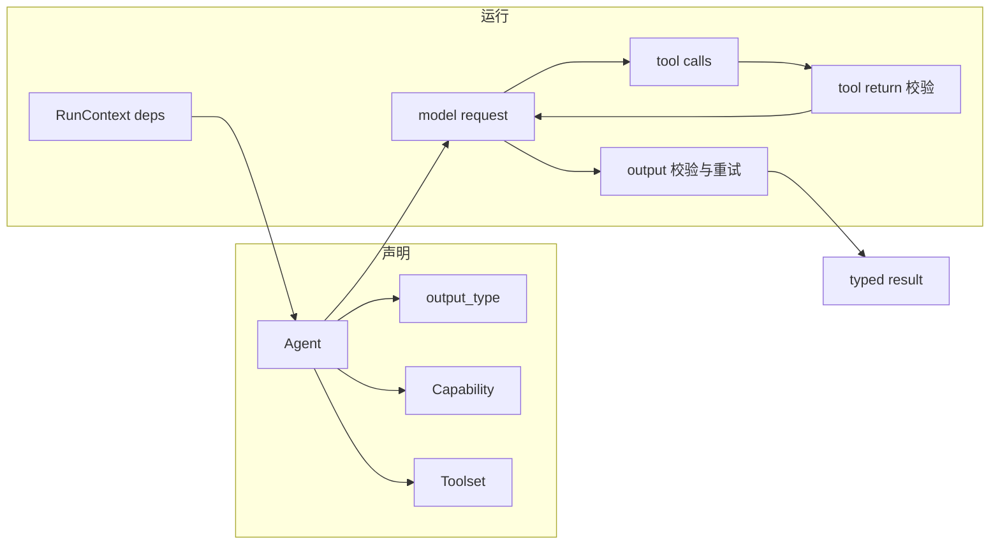

# Pydantic AI

## 一句话结论

Pydantic AI 是唯一把"输出契约"放在一等位置的 Python agent 框架：`output_type` 决定返回值类型、工具参数在执行前校验、失败按预算重试，因此它适合 schema 由后端说了算的强类型团队；不适合想要开箱即用图编排或"角色团队"叙事的团队。

## 先看一个任务

某金融后端的对账服务要接一个 agent：从客户经理的一段自由文本里抽出交易日期、金额、对手方与"是否可疑"，然后**直接写进风控库**。卡点很具体——模型回一段漂亮的中文没有用，库表要的是四个字段，金额要能精确到分，日期不能是"上个月"，而且抽错时要能定位到是哪一格错。

在这个框架里，这件事被拆成"契约 + 依赖 + 校验"三段：

| 步骤 | 对应对象 | 这个任务里做什么 |
|---|---|---|
| 定契约 | `output_type` | 声明 `TradeRecord`，run 结束要么是它，要么抛错 |
| 给上下文 | `deps_type` + `RunContext` | 把数据库连接、当前用户、汇率客户端注入工具，而不是读全局变量 |
| 取数 | `@agent.tool` | 函数签名即 schema，参数在函数执行前被校验 |
| 收尾 | 输出校验与重试预算 | 校验不过按预算重试，耗尽抛框架异常，trace 里留下最后一次校验错误 |

两个抽象值得先讲透：**`output_type` 是"函数的返回类型注解"**，不是提示词里的一句"请返回 JSON"——前者失败会变成异常，后者失败只会变成一段需要正则去捞的文本；**`deps_type` 是依赖注入**，测试时把真 DB 换成假实现即可，不必启动整个应用。骨架一行：`Agent(..., deps_type=Deps, output_type=TradeRecord)`，工具拿 `ctx.deps`，出口拿 `.output`。

读后面的十维时，可以把每一维都换算成一句话：它让"入库前发现错误"这件事变容易了，还是变难了？

## 定位与谱系

- 出品方：Pydantic Services Inc.（Pydantic Validation、FastAPI 生态的同一批人）；许可证 **MIT**。
- 时间线：V1 于 2025-09 发布；V2.0 稳定版 **2026-06-23**；当前 **2.71.0**（2026-11-19 发布，2026-11-20 核实）。
- 运行时：Python **≥ 3.11**（PyPI 元数据）。
- 在七层模型中的位置：编排层，形态是"库"而非 runtime——不提供托管执行环境，向上可挂 Web/CLI/语音等接口，向下用标准 OpenTelemetry 接可观测层。
- 谱系关系：`pydantic-graph` 是**独立包**（不依赖 pydantic-ai）；Pydantic Evals、Logfire、AI Gateway 是同厂商并列产品，可单独采用。

它解决什么：让"模型返回什么"从运行期惊喜变成写期契约。`Agent` 声明 `output_type=Sentiment` 后，一次 run 要么返回校验通过的 `Sentiment`，要么抛错，不存在"字段名对了但类型错了"的中间态。工具侧同理：函数签名与 docstring 生成 schema，参数在你的代码执行**之前**被校验。

它不解决什么：不提供 checkpoint 式图编排（要显式状态机得用 `pydantic-graph` 或外接 Temporal 一类引擎）；不提供托管 runtime；多 agent 只有 delegation 模式与模式指导，没有 LangGraph 那类拓扑原语。需要长时间可恢复流程时，它的答案是"把 run 跑在 durable execution 引擎里"，而不是自己实现 checkpointer。

边界还要和两个邻近概念划清：**它不是协议层**——MCP 的接入方式是 `MCPToolset`，协议演进由 MCP 规范决定，Pydantic AI 只是客户端；**它不是 harness**——虽然官方提供了 `pydantic-ai-harness` 这个能力包（含 `Coder`、`Researcher`、`SubAgents`、`Planning`、`Compaction`、`StepPersistence`），但它仍是可拆的库，不是带内置工具与权限模型的整套运行时。真正对标 harness 的是 [Claude Agent SDK](05-claude-agent-sdk.md) 那一类产品。

## 核心概念与架构



| 概念 | 职责 | 容易误解的点 |
|---|---|---|
| `Agent` | 声明模型、instructions、输出类型、能力与工具；是可复用对象，不是一次运行 | 它本身无状态；状态在 `RunContext` 与消息历史里，不在 Agent 上 |
| `deps_type` + `RunContext` | 类型化依赖注入：DB 连接、当前用户、HTTP 客户端 | deps 里的对象要能跨恢复边界重建，否则上 durable execution 会炸 |
| `output_type` | 返回值契约；支持 `BaseModel`、union、函数式 output function | 默认走 **ToolOutput**（把输出做成一次工具调用），不是"让模型直接吐 JSON" |
| `Capability`（V2） | 把 tools + instructions + hooks + model settings 打成一个可复用、可组合的单元 | 它是组合而非继承；`Coder()` 这类"成品 agent"本身就是 cap 的组合 |
| `Toolset` | 工具集合抽象；MCP 通过 `MCPToolset` / `MCP` capability 接入 | MCP 不是特殊通道，它就是一个 toolset |
| `pydantic-graph` | 类型化状态机：节点后继由类型标注决定 | 与 pydantic-ai 无依赖关系；官方文档明确劝退"非必要不上图" |
| Pydantic Evals | Dataset → Case → Evaluator，可对最终输出与工具轨迹打分 | 它是独立包，不装也能用 Agent；轨迹评测是对齐线上质量的关键 |

一次 run 的生命周期可以拆成六步，理解这六步就理解了整套约束：

1. 组消息：instructions、历史、本轮输入、当前可见工具集（`defer_loading` 的 cap 只给摘要）。
2. 请求模型：model 字符串解析到 provider，`model_settings` 与 provider 特性协商。
3. 收动作：模型要么调工具，要么调输出工具，要么吐纯文本（取决于 output mode）。
4. 执行工具：参数校验 → 你的函数 → 返回值校验；失败进入该工具的重试计数。
5. 回灌：工具结果作为 message part 追加，回到第 2 步。
6. 收尾：输出校验通过则返回 typed result；预算耗尽则抛框架异常，trace 里保留最后一次校验错误。

这套循环没有"规划阶段"——没有 plan 对象、没有 DAG、没有显式的反思节点。计划就是模型在 messages 里写下的自然语言，反思就是下一轮请求。这不是缺陷，而是取舍：循环越薄，模型能做的事越多，但你对"它现在走到哪一步"的可见性也越依赖 trace。想要可检查的计划，就要么用 `Planning` capability 把计划外化成工具调用，要么上 `pydantic-graph` 把状态显式化。

## 执行模型与关键机制

一次 `agent.run()` 是单循环：组装消息 → 请求模型 → 有 tool call 就执行并校验 → 结果回灌 → 继续，直到模型调用输出工具或输出函数。同步 `run_sync` 只是 async 的包装，不改变控制流。

### 输出契约的四种实现

`ToolOutput`（默认）把 schema 变成一个工具，兼容性最好但吃 tool-calling 质量；`NativeOutput` 用厂商原生 structured output，最省 token 但受模型支持面限制；`PromptedOutput` 退化为在提示词里描述 schema，只适合没有工具能力的模型；`TextOutput` 让 output function 消费纯文本。选错模式的典型症状是"小模型上输出校验反复失败"——这不是框架 bug，是模式与模型能力不匹配。

重试是**预算**而不是无限重来。输出工具有独立的 retry 计数，与工具重试分开计（`Agent(retries={'output': N})`，或单工具 `ToolOutput(..., max_retries=...)`）。预算打满后抛的是框架异常而不是模型原始输出，所以排障第一步永远是看 trace 里的校验错误，而不是重跑。

### 依赖注入与可测试性

`RunContext[Deps]` 让工具拿到真实依赖而不是全局变量：测试时换成假 DB 即可，不需要 monkeypatch 模块。这套设计与 FastAPI 的 `Depends` 同源，迁移成本几乎为零——这也是它在这类后端团队里落地最快的原因。代价是 deps 的生命周期由调用方管理，框架不会替你关连接。

### Capability 组合与按需加载

一个 capability 自带 `id`、`description`（模型可见）、可选 instructions 函数与工具。`defer_loading=True` 时它像"技能"一样按需加载：模型先只看到摘要，判断需要时再拉全量工具。这把"几十个工具塞爆上下文"从架构问题降级为配置问题，但也引入新失败模式——模型不知道自己有某项能力。

### 持久化的两条路

`StepPersistence` 把每个已结算步骤快照到你选的存储，实现保存、恢复、分叉，不需要外部引擎；真正的崩溃恢复（卡在某一步中间）才需要 durable execution。官方列出九个引擎：Temporal、DBOS、Prefect、Restate、AWS Lambda、Airflow、Absurd、pgtask、Azure Durable Task，其中前五个与厂商团队共同维护。这个分工很关键：多数团队只需要前者，一上来就上引擎是过度设计。

判断要不要引入 `pydantic-graph`，三个信号足够：分支条件需要被代码而不是模型决定；某一步必须在重启后从断点继续；流程需要被非工程师读懂并评审。三个都不成立时，用提示词与工具描述表达流程，维护成本更低。

### 接口面：一个 Agent，多个前端

同一个 `Agent` 可以跑成 CLI（`to_cli_sync`）、内置 Web Chat、实时语音会话，也可以通过 AG-UI 或 Vercel AI 的 UI 事件流接自建前端，或经 ACP 作为编辑器 agent。这条设计线的判断是：**agent 逻辑不应与传输形态耦合**。反过来说，如果你的产品只有一个形态，这层抽象暂时是成本。

### 可观测

`logfire.instrument_pydantic_ai()` 只是把 span 接上，任何 OTLP 后端都能收；Logfire 是"更好看的那个后端"，不是唯一后端。成本折算依赖同厂商的 `genai-prices` 价格表。

### 流式、取消与事件

流式不是"把结果切开"那么简单：文本增量、工具调用开始/参数增量、工具结果、最终输出是不同事件类型，前端要按类型渲染，否则会出现"参数还没拼完就渲染成 JSON"的经典事故。取消同理——取消一次 run 要能中断正在跑的工具，而不只是停止读流；否则后台仍在烧 token。

这两个点决定了它在前端项目里的落地成本：UI 事件流（AG-UI / Vercel AI）已经把事件类型标准化，但这层约定属于 [可观测](../04-engineering/01-observability.md) 与前端之间，不属于 agent 逻辑本身。

## 十维对比

| 维度 | 说明 |
|---|---|
| 抽象层次 | 代码优先：`Agent` 对象 + 函数即工具；图是可选外挂（`pydantic-graph`） |
| 执行模型 | 单 agent 异步循环；tool call 可并行；同步 API 为 async 包装 |
| 状态与持久化 | 消息历史由调用方持有；`StepPersistence` 做步骤快照；崩溃恢复交给九个 durable execution 引擎之一 |
| 多 agent 支持 | 以 delegation（agent-as-tool）为主，官方给模式指导而非拓扑原语；子 agent 由 Harness 的 `SubAgents` 提供 |
| 工具与 MCP | 函数工具 + toolset；`MCPToolset` 基于 FastMCP 4，支持 stdio / Streamable HTTP / SSE，兼容 MCP 2026-07-28 协议 |
| 可观测 | OpenTelemetry 原生，Logfire 为一等公民后端；`genai-prices` 提供成本折算 |
| 评测集成 | Pydantic Evals 独立包：Dataset → Case → Evaluator，支持最终输出与**工具调用轨迹**评分、线上抽样评测 |
| 部署形态 | 无托管 runtime；作为库嵌进 FastAPI/队列/CLI；durable execution 与 GitHub Actions 是官方推荐的长任务出口 |
| 语言与生态 | 纯 Python（≥3.11）；模型 provider 覆盖广，第三方工具生态相对小 |
| 许可证与治理 | MIT；minor 不故意破坏，deprecated 保留到下一个 major，V1 安全修复承诺至少 6 个月 |

### 什么条件下选它

| 你的处境 | 结论 | 换谁 |
|---|---|---|
| 后端已有 Pydantic 模型，agent 只是接口的一种实现 | 选它，schema 直接复用 | — |
| 任务以结构化抽取为主，失败要能定位到字段 | 选它，校验错误进 trace | — |
| 要精确图控制、时间旅行、per-node checkpoint | 不够用 | [LangGraph](01-langgraph.md) |
| 要"角色/团队"叙事与低代码感 | 过度抽象不匹配 | [CrewAI](06-crewai.md) |
| 要托管 runtime、少运维 | 没有对应产品 | [Google ADK](04-google-adk.md)、[Claude Agent SDK](05-claude-agent-sdk.md) |
| 单一 LLM 调用、无工具、无多轮 | 不要用框架 | 直接调 provider SDK |
| 团队以 TypeScript 为主 | 语言不对 | [TypeScript 栈](11-typescript-stack.md) |
| 关键约束是"每个模型调用都要能重放" | 需要引擎而非库 | 看 [可靠性](../04-engineering/04-reliability-and-hitl.md) 的持久化执行部分 |

## 最小示例

```python
from pydantic import BaseModel
from pydantic_ai import Agent, RunContext

class Answer(BaseModel):              # 输出契约：run 结束必然通过校验
    text: str
    confidence: float

agent = Agent("openai:<model>", deps_type=dict, output_type=Answer)

@agent.tool
def orders(ctx: RunContext[dict], limit: int = 5) -> list[str]:
    """List the current user's recent orders."""
    return db.orders(ctx.deps["user_id"], limit)

print(agent.run_sync("My orders?", deps={"user_id": "u1"}).output.confidence)
```

骨架要点：`output_type` 定契约、`deps_type` 定注入（此处用 dict，实际项目换成 dataclass 即可）、`@agent.tool` 的函数签名即 schema。`.output` 已被校验为 `Answer`，不是 dict。

读这段骨架时注意三点，它们是全文判断的最小可验证形式：

- 输出类型写在 `Agent` 构造里，而不是写在提示词里——所以"字段缺失"是异常，不是要靠正则去捞的文本。
- 工具的函数签名即 schema——所以工具签名就是接口文档，改名等于改协议。
- `deps` 是显式参数——所以测试可以注入假实现，不需要启动整个应用。

## 适用与不适用

- **适合**：已有 FastAPI/Pydantic 后端的团队——schema 复用、依赖注入对接现有 DI、接口返回类型与 agent 返回类型是同一套类型，评审时不需要解释两套类型系统。
- **适合**：结构化抽取类任务（票据、工单、报表字段）——失败可重试、错误可定位到具体字段，回归测试可以只断言类型与取值域。
- **适合**：已经有评测流水线的团队——Evals 的 Dataset/Case 结构可以直接映射到现有 pytest 用例，不必另建一套数据格式。
- **适合**：需要"工具调用轨迹"评测的场景——Pydantic Evals 的 agentic evaluator 直接吃 trajectory，不必自己写 diff 工具。
- **适合**：长任务但不想自建编排的团队——用 `StepPersistence` 起步，超过崩溃恢复需求再上 Temporal，迁移面比换框架小得多。
- **不适合**：需要逐节点 checkpoint、时间旅行、条件边调度的流程，见 [LangGraph](01-langgraph.md)。
- **不适合**：想要"派一个团队去研究"这类叙事化抽象的团队，CrewAI 的心智负担更低。
- **不适合**：只想调一次模型、没有工具与多轮的场景，框架只增加依赖。

一个常被忽略的选型因素是**迁移出口**。Pydantic AI 的抽象足够薄，把 `Agent` 换回裸 provider SDK 通常只涉及"手写循环 + 自己校验"两件事，反向迁移也不难；这类薄框架的沉没成本低。相对地，图编排框架的迁移成本随流程复杂度线性上升——这也是为什么"先用薄的、需要时再上厚的"在这类项目上通常是对的。

> 判断：Pydantic AI 的护城河不是 agent loop——那个循环两百行就能写完——而是"Pydantic 已经在你的代码里"。选型时真正要比的是输出的可验证性与类型复用度，不是工具数量。

## 常见坑

- **坑**：默认 `ToolOutput` 遇上 tool-calling 弱的模型 → 输出工具参数反复校验失败 → retry 预算打满，抛框架异常而不是可读的模型错误。规避：换 `NativeOutput`，或给模型配正确的 profile 声明能力，别靠调大 retries 掩盖。
- **坑**：`deps` 里塞了不可重建的对象（DB session、已认证的 httpx client）→ 上 durable execution 后恢复失败。规避：deps 只放 ID 与可重建句柄，连接在 workflow 体内重建。
- **坑**：跟着 V1 教程写 V2 代码。V1→V2 有系统性重命名（`mcp_servers` → `toolsets`、`DeferredToolCalls` → `DeferredToolRequests`、`request_tokens` → `input_tokens`）。规避：以 upgrade guide 为准，先 `pip show pydantic-ai` 对版本。
- **坑**：在 async 视图里调 `run_sync` → 阻塞事件循环，P99 直接翻倍。规避：路由里 `await agent.run()`。
- **坑**：给 `defer_loading` 的能力写了很短的 description → 模型永远不加载它，症状是"明明有能力却总说做不到"。规避：description 写"何时用"，并在 instructions 里点出能力存在。
- **坑**：把 span 属性当稳定契约写进告警。官方版本策略明确把"OpenTelemetry span 属性变更"和"默认 semconv 版本变更"列为 minor 允许的变更。规避：告警建在业务事件上，trace 只做排障。
- **坑**：在工具函数里直接 `print` 或写文件做"调试"。工具返回值会被校验并回灌给模型，副作用与日志混在一起后，线上排障分不清"模型看到的"与"人看到的"。规避：诊断信息走 OTel span attribute，返回值只留模型需要的内容。
- **坑**：把 `output_type` 写成深度嵌套的联合类型，指望模型一次填对。层数越深，schema 越长，模型在第 3 层开始编字段名。规避：拆成两次 run（先分类再抽取），或把嵌套降级为"先出扁平结构，再由代码组装"。
- **坑**：在 capability 的 instructions 里写大段业务规则。instructions 每轮都进上下文，规则一多就挤掉历史与工具结果，表现为"模型忘了刚才的工具输出"。规避：长规则放检索或文件工具，instructions 只留"何时查哪里"。
- **坑**：把 `Agent` 定义在模块顶层并用环境变量在 import 时读模型名。测试与多环境切换时无法覆盖，且 import 顺序会决定行为。规避：Agent 构造放进工厂函数，模型名从配置注入。

## 开放问题

- **Capability 的粒度收敛了吗？** V2 把"工具集合"升级成"能力包"，但什么该是一个 capability（`Coder` 那种大包 vs `WebSearch` 那种小包）还没有社区共识；粒度选错会让 `defer_loading` 失效或让 instructions 膨胀。
- **评测与线上的一致性**：Evals 支持线上抽样，但样本脱敏、标注回流、与离线数据集的分布对齐仍要自建，这块没有标准答案。
- **与 [MCP](../03-protocols/01-mcp.md) 2026-07-28 的采样/引出语义**：无状态核心之后，server 侧 sampling/elicitation 的多轮往返如何在客户端工具集里正确重放，细节还会变，生产必须 pin 版本。
- **类型安全能推到多远**：工具返回值目前做的是 schema 级校验，跨工具的语义约束（"这个 ID 必须来自上一个工具"）仍写在提示词里，属于 [上下文工程](../01-foundations/02-context-engineering.md) 的开放问题。
- **多 agent 的最小原语缺失**：delegation 之外，社区还没有共识该不该有 supervisor/handoff 的一等 API。当前做法是"用 agent-as-tool 自己拼"，结果是每个项目的多 agent 结构都长得不一样，难以复用评测与可观测约定。

## 参考来源

- Pydantic AI 官方文档（Agents / Output / Dependencies / Capabilities）· Pydantic · 2026-11 · https://pydantic.dev/docs/ai/core-concepts/output/
- Pydantic AI README（V2 特性、九个 durable execution 引擎、Harness、接口面）· GitHub · 2026-11 · https://github.com/pydantic/pydantic-ai
- Pydantic AI 版本策略（V1 2025-09、V2.0 2026-06-23、minor 不破坏、span 属性可变）· Pydantic · 2026 · https://pydantic.dev/docs/ai/project/version-policy/
- Pydantic AI PyPI 元数据（2.71.0 / 2026-11-19 / Python ≥3.11 / MIT）· PyPI · 2026-11-20 核实 · https://pypi.org/project/pydantic-ai/
- Pydantic AI 升级指南与 changelog（V1→V2 重命名清单）· GitHub · 2026 · https://github.com/pydantic/pydantic-ai/blob/main/docs/changelog.md
- pydantic-graph 文档（独立包、GraphRunContext、End、类型标注决定后继）· Pydantic · 2026-11 · https://pydantic.dev/docs/ai/graph/graph/
- Pydantic AI MCP Client 文档（MCPToolset、FastMCP 4、2026-07-28 协议）· Pydantic · 2026-11 · https://pydantic.dev/docs/ai/mcp/client/
