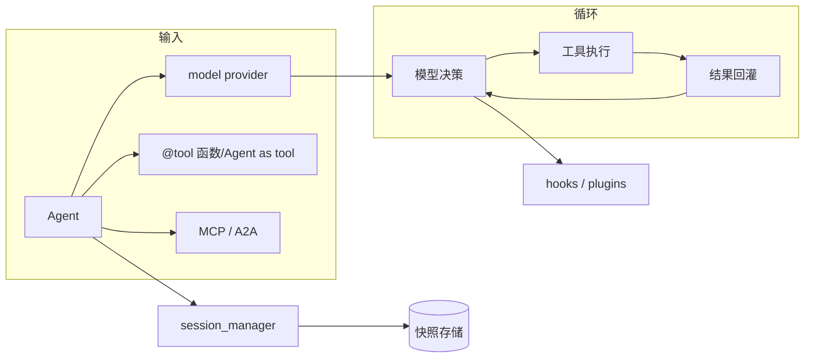

# Strands Agents

## 一句话结论

Strands Agents 是 AWS 的 model-driven agent SDK：控制流交给模型，开发者只提供工具、生命周期约束与可选的编排外壳（Graph/Swarm/A2A），跑在你自己的进程里、没有托管控制面；它适合已经在 AWS 上、愿意让模型决定调什么工具的团队，不适合要求跨云零改动或需要逐节点 checkpoint 的流程。

## 先看一个任务

一个已经在用 Bedrock 的运维团队想加个值班助手：能查订单状态、看服务健康度、必要时重启一台实例。要求很土但很硬——**代码尽量少、不引入新平台、由模型自己决定调哪个工具**，因为没人说得清值班时会遇到多少种组合。

在这个框架里，这个任务就是"一个循环 + 一组工具 + 几条约束"：

1. 把三个动作写成 `@tool` 函数，docstring 写清"什么时候用我"；
2. 构造 `Agent`，模型走 Bedrock，`tools` 里放这三个函数；
3. 模型每轮自己决定调不调、调哪个、调几次，代码不画流程图；
4. 轮次上限、token 预算、取消与 `stop reason` 由框架保证，不靠提示词；
5. 要会话续接就挂 `session_manager`；要隔离与托管，再上 AgentCore。

两个抽象先立住：**model-driven 是"给约束、不给路线"**——像给一个熟练工一张工牌和一份权限清单，而不是一本逐步操作手册；**`@tool` 的 docstring 是路牌**，不是注释，模型就看这段文字决定走哪条路。骨架一行：`Agent(model=..., tools=[...], system_prompt=...)`，剩下的交给循环。AgentCore 则是"把这个人放进独立隔间"的托管运行时，锁定的起点是托管能力，不是 SDK。

带着这个分工往下读：后面每一维，基本都在回答"约束该写在哪"。

## 定位与谱系

- 出品方：Amazon Web Services；许可证 **Apache-2.0**。
- 时间线：2025-05 预览发布 → 2025-07 发布 1.0（加入多 agent 原语与 A2A）→ 当前 Python SDK `strands-agents` **1.65.0**（2026-11-13）、TypeScript SDK `@strands-agents/sdk` **1.26.0**（2026-11-19），均于 2026-11-20 核实。
- 运行时：Python **≥ 3.10**；TypeScript 要求 **Node ≥ 22** 且为 ESM 工程。
- 仓库形态：已整合为 `strands-agents/harness-sdk` monorepo，同时容纳 SDK（`strands-py`/`strands-ts`）、harness（`harness-py` 0.4.0 / `harness-ts` 0.5.0）、CLI、MCP server 与文档站；evals 是独立仓库 `strands-agents/evals`。
- 在七层模型中的位置：编排层 + 轻量运行支撑；不提供托管 runtime，部署交给 Bedrock AgentCore、Lambda、ECS/EKS、Fargate、App Runner 等既有形态。

"model-driven" 是它与其他框架最本质的分歧。LangGraph 让你写边，CrewAI 让你写角色，Strands 让你写**约束**：工具做什么、最多几轮、token 预算多少、什么情况下必须停下来问人。路径由模型在每一轮决定，代码负责不变量。官方文档把这句话写得很直白：当你本来打算手写一个 agent loop 时，选它。

它不解决什么：没有图编辑器的可视化，没有托管控制面替你管 session 与扩缩容，没有"开箱即用的角色团队"。需要显式状态机时它提供 Graph，但 Graph 是可选外壳，不是框架的地基——这和 [LangGraph](01-langgraph.md) 的世界观正好相反。

## 核心概念与架构



| 概念 | 职责 | 容易误解的点 |
|---|---|---|
| `Agent` | 模型、system prompt、工具、session、hook 的容器；`agent("...")` 即一次调用 | 它不是"一次任务"，可跨多轮复用；会话状态靠 session manager 落盘 |
| `@tool` 装饰器 | 用 docstring + 类型标注生成工具 schema，`context=True` 时注入 `ToolContext` | 不做参数校验的"宽松模式"会静默吞掉错误参数，调试时极难定位 |
| `structured_output_model` | 要求最终输出符合某个 schema，结果在 `result.structured_output` | 与"输出一个 JSON 字符串"不同，它会触发重试与校验 |
| `Swarm` / `Graph` | 多 agent 的两种编排外壳：自主交接 / 开发者定义边 | 二者都不是默认路径；单 agent 加工具通常是更优解 |
| `session_manager` | 会话与状态的持久化抽象（快照式或仓库式，配 Local/S3 存储） | 它保存的是消息历史 + state 全量，不是"摘要"，长会话会变大 |
| plugin / hook | 在循环各阶段拦截：注入上下文、卸载上下文、限流、审计 | hook 抛异常会改变 stop reason，错误处理逻辑要按此设计 |
| vended tools | 官方预置工具：shell、文件读写、http、subagent、swarm、graph 等 | 它们与自建工具同权，没有额外沙箱；`shell` 的权限就是进程的权限 |
| guardrail | 输入/输出侧的检查点，可在执行前拦截 | 它是策略层，不替代工具内部鉴权 |

## 执行模型与关键机制

一次调用的控制流是标准 agent loop，但每一环都留了钩子：模型请求 → 解析 tool use → 执行（可并行、可流式）→ 结果回灌 → 直到模型不再调工具或触发停止条件。停止条件是一等公民：轮次上限、token 预算、取消、显式 stop reason，都由框架而非提示词保证。

把一次任务摊开看，五个位置决定了系统的真实行为：

1. **入口**：`agent("...")` 是否带 `session_manager`，决定这轮是"新会话"还是"续会话"。
2. **可见性**：模型看到的工具列表（含 MCP / A2A 远端工具）与 system prompt，决定它会不会走对路。
3. **执行**：工具是否并行、是否有超时、是否落到沙箱，决定尾部延迟与安全边界。
4. **回灌**：工具结果是否被截断/摘要（工具结果限额与上下文管理策略），决定上下文会不会被一个大 JSON 撑爆。
5. **收尾**：stop reason 是"自然结束"还是"预算耗尽"，前者可交付、后者必须告警——把两者混为一谈是最常见的线上事故来源。

### 模型驱动意味着什么

模型决定"调不调、调几次、调哪个"。好处是没有预置流程要走，坏处是**不确定性被推到工具路由上**：工具越多、描述越模糊，路由越不稳，而失败表现为"它就是不调那个工具"，不是报错。可落地的对策有三条：控制可见工具数量（按场景裁剪而非全量暴露）；把工具描述写成"何时用"而非"做什么"；对关键分支用 `structured_output_model` 或 Graph 把决策外化，而不是继续加提示词。

### 多 agent 的三层选择

官方给的不是"四种拓扑"，而是一条**渐进升级**路径，这点比多数框架诚实：

1. **agent as tool**：把一个 Agent 直接放进另一个 Agent 的 `tools` 数组。没有新原语，路由由上层模型读 description 决定。多数"需要多 agent"的场景到这里就够了。
2. **自己写 workflow**：按顺序调用多个 agent、传递结果，失败处理用你熟悉的语言机制。可控、可测、可加日志。
3. **`Swarm` 或 `Graph`**：`Swarm` 由 agent 自主交接（共享上下文，无固定路径）；`Graph` 由开发者定义节点与边，支持固定链、并行分支、条件边与环。

Graph 与 Swarm 的差异值得单独记一笔：**错误不会沿边路由**。Python 里节点抛异常会从 graph 调用处抛出并结束整轮；TypeScript 里失败节点记 `FAILED`，下游不执行但并行分支继续；超时在两端都会终止运行。这意味着"用条件边做错误兜底"是行不通的，校验失败必须以**返回值**的形式表达，而不是抛异常。

### 会话与状态

`SnapshotSessionManager` 把消息、agent state、conversation manager 状态整体快照，配 `LocalFileStorage` 或 S3；仓库式 manager 则按条目增量存储。多人多机的部署必须用远端存储，否则同一 session 落到不同实例就丢上下文。这套设计与 [上下文工程](../01-foundations/02-context-engineering.md) 的分层是对应的：session 管"存什么"，conversation manager 管"这一轮给模型看什么"。

### 协议：MCP 与 A2A 都是一等公民

MCP 走 `MCPClient`，stdio 与 Streamable HTTP 都支持；A2A 双向支持——既能把远端 agent 当工具调用，也能把自己暴露成 A2A server（`pip install 'strands-agents[a2a]'`）。这两点让它在"多框架共存"的组织里摩擦较小：协议边界清楚，替换成本不在协议层。

### 可观测与 hooks

trace 默认开着，agent loop 的每一次模型调用、工具调用、停止原因都在 span 里，这点比"要自己埋点"的框架省事，也意味着**上线即产生可观数据量**：高频短任务要在 collector 侧采样，否则 OTel 后端成本会超过模型成本。

hooks 的价值在于能在不改工具代码的前提下插入横切逻辑：审计每次工具调用、对特定工具加限流、对工具输出做脱敏、在上下文将满时卸载历史。但要记住 hook 与主循环共享失败域——hook 抛异常会让本轮以非预期 stop reason 结束，因此 hook 内部必须自己 try/except，把"策略失败"降级为"放行并记录"。

### 沙箱与执行边界

SDK 本身不提供安全边界。`shell`、文件读写这类 vended tool 的权限就是你进程的权限；要隔离必须自己接容器、microVM 或云沙箱（思路同 [工具调用与沙箱](../01-foundations/04-tool-use-and-sandbox.md)）。AgentCore Runtime 用 per-session microVM 解决隔离，这也是它相对"自己部署到 Lambda"的主要增值之一——Lambda 的隔离单位是函数实例，不是会话。

### 与 Bedrock AgentCore 的关系

AgentCore Runtime 是 AWS 的 serverless agent 运行时，官方描述是"任意框架、任意模型、任意协议"，每个用户会话独占一个 microVM，通过 AgentCore Identity 对接 Cognito、Entra ID、Okta、Google/GitHub OAuth。Strands 是它的"第一等乘客"而非绑定对象：同一份代码可以部署到 Lambda、ECS、EKS、Fargate、App Runner、Docker、Kubernetes，也可以上 AgentCore。真正的锁定发生在你开始使用 AgentCore 的托管能力（Memory、Identity、Gateway 等）之后。

## 十维对比

| 维度 | 说明 |
|---|---|
| 抽象层次 | 代码优先 + 模型驱动：一个 `Agent` 循环，编排是可选外壳 |
| 执行模型 | 单线程对话循环，工具可并行/流式；停止条件（轮次、预算、取消）为一等公民 |
| 状态与持久化 | `session_manager` 快照或仓库式，配 Local/S3；无内建 durable execution，长任务靠外部队列或 AgentCore |
| 多 agent 支持 | 四层：agent-as-tool / 自写 workflow / `Graph` / `Swarm`，另有 A2A 跨进程 |
| 工具与 MCP | `@tool` 装饰器 + 内置 vended tools（shell、file、http、subagent 等）；MCP stdio / Streamable HTTP；A2A 双向 |
| 可观测 | OTel trace 默认开启（agent loop 每一步可追踪），另有 metrics/logs 文档；hooks 可拦截任意阶段 |
| 评测集成 | 独立仓库的 Evals SDK（`strands-agents/evals`）；文档含 AgentCore evaluations 看板集成 |
| 部署形态 | 无托管 runtime；Lambda / ECS / EKS / Fargate / App Runner / Docker / K8s / AgentCore Runtime |
| 语言与生态 | Python（≥3.10）与 TypeScript（Node ≥22、ESM）双实现，功能对齐但存在语义差异 |
| 许可证与治理 | Apache-2.0；SemVer 2.0.0；`experimental` 模块不受 semver 保护；OTel/MCP/A2A 相关建议 pin minor |

十维里最容易被低估的是"语言与生态"那一行：Python 与 TS 双实现听起来是加分项，但官方文档已经明写两端在 Graph 的错误传播、多入边解析上语义不同。跨语言团队真正要投入的不是"学两套 API"，而是"维护一份两端都认的编排语义文档"。

### 什么条件下选它

| 你的处境 | 结论 | 换谁 |
|---|---|---|
| 已在 AWS，模型走 Bedrock，部署要在同一账号体系内 | 选它，路径最短 | — |
| 任务开放、工具集稳定，不想写流程 | 选它，模型驱动省维护 | — |
| 需要 Python 与 TS 两套实现且行为对齐 | 可接受，但要对齐语义差异 | — |
| 需要逐节点 checkpoint、时间旅行、可视化图 | 不够用 | [LangGraph](01-langgraph.md) |
| 需要从别家云零改动迁移 | 谨慎，锁定点在托管能力而非 SDK | — |
| 团队要"角色团队"叙事、低代码上手 | 抽象不匹配 | [CrewAI](06-crewai.md) |
| 只要一个浏览器/终端里能跑的轻量原型 | 过重 | [轻量阵营](10-agno-and-lightweight.md) |
| 需要 OpenAI 平台的 handoff/guardrail/tracing 开箱 | 生态不对 | [OpenAI Agents SDK](03-openai-agents-sdk.md) |

## 最小示例

```python
from strands import Agent, tool
from strands.multiagent import Swarm

@tool
def lookup_order(order_id: str) -> dict:
    """Look up one order by id. Use when the user gives an order number."""
    return db.get(order_id)

researcher = Agent(name="researcher", system_prompt="Gather facts.", tools=[lookup_order])
orchestrator = Agent(tools=[researcher])           # 第一层：agent as tool
swarm = Swarm([researcher, Agent(name="writer")])  # 第三层：自主交接
result = orchestrator("Where is order 123?", structured_output_model=OrderStatus)
print(result.structured_output)
```

骨架要点：`@tool` 的 docstring 是路由依据，不是注释；多 agent 从"把 Agent 放进 tools"开始，不要一上来就 Swarm。

两点补充：`structured_output_model` 是"最后一道校验"，它不改变中间轮的开放性；`Swarm` 与 `Graph` 都不在默认路径上，只有当"把 Agent 放进 tools"证明确实不够时才引入。

## 适用与不适用

- **适合**：已深度使用 AWS 的团队——默认模型走 Bedrock，部署路径与 IAM、CloudWatch、AgentCore 天然衔接，合规评审时链路清楚。
- **适合**：工具集稳定、任务开放度高的 agent（运维排障、资料汇总、内部助手）——模型驱动省掉大量"流程写死"的维护成本。
- **适合**：需要同时提供 Python 与 TS 实现的团队——两套 SDK 由同一 monorepo 维护，能力面基本对齐。
- **适合**：把 agent 当"内部工具编排层"的组织——MCP 接内部系统、A2A 接他团队的 agent，协议边界比框架边界更稳定。
- **适合**：要在终端里快速验证想法的人——`strands` CLI 与 `create_harness()` 能在几行内跑起一个带工具与记忆的 agent。
- **不适合**：要求每个节点可 checkpoint、可时间旅行的流程，见 [LangGraph](01-langgraph.md)。
- **不适合**：对跨云零改动有硬要求、且已打算用托管 runtime 的项目——AgentCore 的托管能力一旦用上，迁移成本不在代码而在身份与存储。
- **不适合**：需要严格确定性、审计粒度到"第几步调了哪个工具"的强监管流程；模型驱动的路径本身不保证顺序。
- **不适合**：小团队想先验证需求——`create_harness()` 能帮你起步，但真正上线仍要处理 session 存储、权限与部署，前期投入不低于轻量框架。

> 判断：Strands 的取舍是"把不确定性显式地放到模型那一侧，再用生命周期控制兜底"。它换来的代码量下降是真的，代价是失败模式的不可枚举——你必须接受"用 trace 排障"而不是"用日志断点排障"。

## 常见坑

- **坑**：把 30 个工具全量暴露给一个 agent → 路由准确率断崖下跌，症状是"它总用错工具"而不是报错。规避：按场景裁剪工具集，用 agent-as-tool 做工具分组，或上工具检索。
- **坑**：快照式 session 存全量历史 → 长会话在 S3 上对象越来越大，每轮读写放大延迟，成本随轮次超线性。规避：配 conversation manager 做窗口/摘要，或换仓库式增量存储。
- **坑**：把 Graph 的节点异常当作可路由的信号 → Python 里整轮直接结束，TypeScript 里下游静默不执行，两种表现都不是"走错误分支"。规避：校验结果用返回值表达，条件边读返回值。
- **坑**：用 `strands.experimental` 里的能力上生产。官方明确该命名空间不受 SemVer 保护，minor 升级即可能破坏。规避：生产 pin 到具体 minor（如 `strands-agents==1.65.0`）。
- **坑**：假设 Python 与 TS 行为一致。官方文档已标注 Graph 在多入边节点解析、错误传播上两端不同。规避：跨语言团队把编排语义写进设计文档，不要靠"应该一样"。
- **坑**：在 AgentCore 的 microVM 里假设本地磁盘持久。会话隔离靠 per-session microVM，落盘要显式接 S3 或 AgentCore Memory。规避：把"进程内状态"当缓存，不当存储。
- **坑**：把 `callback_handler=None` 与"关闭日志"划等号。它关的是终端打印回调，不等于关闭 OTel trace；以为关了就省成本，结果账单来自 collector。规避：成本控制放在 exporter 采样率，而不是 handler 开关。
- **坑**：把工具返回值当"给人看的字符串"。返回值会原样进模型上下文，500 行 JSON 会挤掉历史；框架的截断策略只是兜底，不是设计。规避：工具内部就做摘要与分页，让模型按需再取。
- **坑**：在同一次调用里既要求 `structured_output_model` 又期望模型写完长文。结构化输出会挤压正文长度，表现为"内容被裁掉一半"。规避：长文走工具写文件，最终输出只留结论与引用。
- **坑**：用 `Swarm` 处理需要确定顺序的审批链。Swarm 的卖点是路径涌现，交接顺序由 agent 决定，把"必须 A→B→C"的需求放进去等于放弃保证。规避：审批链用 Graph 或无框架的 workflow。

## 开放问题

- **model-driven 的可测试性**：路径不确定，回归测试只能断言"最终结果"与"是否调用了某工具"，很难断言顺序。评测体系如何覆盖这类系统，见 [评测体系](../04-engineering/02-evaluation.md)，目前没有行业共识。
- **harness 与 SDK 的边界**：`create_harness()` 提供"开箱即用的完整 agent"，SDK 提供"自己组装"。默认值越强，团队对提示词与工具的实际控制越弱，这条边界会随版本移动。
- **AgentCore 的能力边界**：托管 Memory / Identity / Gateway 的抽象与 SDK 内建 session 有重叠，两者长期是互补还是替代，截至 2026-11 官方未给出收敛路线。
- **A2A 的运维成本**：跨组织 agent 调用涉及身份、计费、审计，协议只解决通信，见 [A2A](../03-protocols/02-a2a.md)。
- **"无托管控制面"能撑多久**：SDK 目前的效果是"你负责扩缩容与会话路由"，AgentCore 又提供托管版本。两种形态并存时，官方示例与最佳实践会向哪边倾斜，是选型时值得盯的信号。
- **evals 是否会长进核心**：评测当前是独立包，如果上游把它做成默认开启的 gate，会显著改变"用 Strands 就得配套建评测"的成本结构。

## 参考来源

- Strands Agents 官方文档（Agent、tools、multi-agent patterns、session management、A2A、AgentCore 部署）· AWS · 2026-11 · https://strandsagents.com/docs/user-guide/sdk/
- Strands harness-sdk monorepo README（定位、无托管控制面、Python 3.10+/Node 22+、Apache-2.0）· GitHub · 2026-11 · https://github.com/strands-agents/harness-sdk
- Multi-Agent Patterns 决策指南（agents-as-tools / workflow / Graph / Swarm 对比与选型）· AWS · 2026-11-13 更新 · https://strandsagents.com/docs/user-guide/sdk/multi-agent/multi-agent-patterns/
- Session Management 文档（快照式与仓库式、Local/S3 存储）· AWS · 2026-11-18 更新 · https://strandsagents.com/docs/user-guide/sdk/agents/session-management/
- Versioning and Support（SemVer 2.0.0、experimental 不受保护、pin minor 建议）· AWS · 2026-10-22 更新 · https://strandsagents.com/docs/user-guide/sdk/versioning-and-support/
- Deploy to Bedrock AgentCore（per-session microVM、Identity 集成）· AWS · 2026-10-26 更新 · https://strandsagents.com/docs/user-guide/sdk/deploy/deploy_to_bedrock_agentcore/
- PyPI `strands-agents` 1.65.0（2026-11-13）与 npm `@strands-agents/sdk` 1.26.0（2026-11-19）元数据 · 2026-11-20 核实 · https://pypi.org/project/strands-agents/
- Strands Agents 1.0 发布说明（多 agent 原语、A2A 支持、session 抽象）· AWS Open Source Blog · 2025-07 · https://strandsagents.com/blog/strands-agents-1-0/
