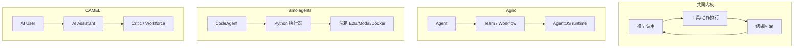

# Agno / smolagents / CAMEL：轻量阵营

## 一句话结论

这三个项目被归为一类，不是因为它们都"小"，而是因为它们在**同一个地方做减法**：把 agent 循环里最贵的那层抽象拿掉——Agno 拿掉运行时开销与对象图，smolagents 拿掉"动作表示"的中间层，CAMEL 拿掉显式流程定义；代价是持久化、权限、评测与治理都要自己补，所以它们的正确位置是**原型、评测与研究**，而不是多租户生产平台。

## 先看一个任务

一个两人小队要在一天内给老板演示"AI 竞品调研"：抓三个竞品页面、对比定价、出一张表。**没有预算买平台，也没时间配数据库与权限**，唯一的目标是当天能跑通、第二天能改。

三家都能完成，只是减法位置不同，代码形状也不同：

| 路线 | 一行核心代码 | 一天内能到哪 |
|---|---|---|
| Agno | `Agent(model=..., tools=[...])` 直接 `run` | 单 agent、可选 `Team`，内建 memory/knowledge |
| smolagents | `CodeAgent(tools=[...])` | 模型写一小段 Python，一次动作里抓取+对比+聚合 |
| CAMEL | `RolePlaying(assistant_role_name=..., user_role_name=...)` | 两个角色对话产出对比稿，适合造样本而非交付 |

三个概念先立住：**"轻量"不是代码少，而是从 `import` 到第一次模型调用之间，框架替你做的决定少**——厚的框架此时已经定了状态机、检查点格式与持久化后端（下一节把这条判据展开成三条）；**`CodeAgent` 把动作换成代码**，一次动作里能写循环与聚合，所以步数少，但执行环境必须自己隔离。骨架一行：`CodeAgent(tools=[...], model=...)`。**CAMEL 的角色协议约束的是"说什么"，不是"做完没有"**——它产出对话，不产出可验收的任务状态，所以它离数据生成近、离生产调度远。

一天的原型可以这么选；但请记住这条分界线——它决定了后面为什么把这三者归到"原型、评测与研究"，而不是多租户生产平台。

## 问题与边界

"轻量"常被当成营销词，这里给一个可操作的判据：**从 `import` 到第一次模型调用之间，框架替你做了多少决定**。厚的框架在此时就决定了状态机、检查点格式、消息协议、持久化后端；薄的框架只决定"怎么把消息发给模型、怎么把工具结果塞回去"。

这条判据下，三者的减法位置不同，也决定了它们各自能走多远：

- **Agno** 减的是运行时：Agent 是普通 Python 对象，构造便宜，Team/Workflow 是按需叠加的层。它保留了"内置 memory/knowledge/storage"这些便利，所以减法发生在**执行开销**而非能力面。
- **smolagents** 减的是动作表示：不生成 JSON 工具调用，直接生成可执行代码。这是一次**表示层**的替换，收益是步数变少、组合能力变强，代价是安全边界必须外置。
- **CAMEL** 减的是流程：不定义 DAG，用"角色 + 轮次协议"让协作从对话里涌现。减法发生在**编排层**，因此它天然靠近数据生成与社会科学模拟，而不是靠近生产调度。

三者共同的边界也清楚：SDK 层都没有步骤级 durable execution，没有一等的权限模型，没有开箱的评测闭环（Agno 有 evals 模块但覆盖有限）。这里要区分两件事——Agno 的 AgentOS 提供的是**持久化队列**（job 表 + 租约 + 心跳），解决"任务不丢"；但崩溃的 run 默认是"可见地失败"而不是从断点重放，这与 durable execution 不是一回事。一旦需求变成"多租户 + 审计 + 断点恢复"，抽象会以自研 runtime 的形式重新长回来——那时不如直接选厚的，见 [选型矩阵](00-selection-matrix.md)。

判断"该用薄的还是厚的"，三条判据足够，且都不涉及功能表：

1. **失败一次要付出多少**：可重跑的分析任务，薄框架足够；跑一次要花钱调外部 API、失败要人工补的，先解决恢复点。
2. **谁来决定下一步**：如果流程必须可评审、可断言顺序，薄框架把决定权交给了模型，这不匹配。
3. **会不会有第二个租户**：一旦要隔离数据与配额，权限模型就必须是一等公民，而三者都没有。

三条里只要有两条落在"厚"的一侧，选轻量框架的收益就会被后续自建成本吃掉。

## 核心概念与架构



| 概念 | 归属 | 职责 | 容易误解的点 |
|---|---|---|---|
| `Agent` | Agno | 模型 + 工具 + instructions，返回 `RunOutput` | 它默认无状态；memory 要显式挂 `db` 与 `user_id` |
| `Team` | Agno | 协调多个 Agent 或嵌套 Team，模式有 coordinate / route / broadcast / tasks | leader 与成员各自调用模型，成本是叠加的 |
| `CodeAgent` | smolagents | 把动作写成 Python 代码片段，工具即函数 | 代码执行不是沙箱，`LocalPythonExecutor` 只做尽力而为的限制 |
| `ToolCallingAgent` | smolagents | 传统 JSON 工具调用路径，与 CodeAgent 并存 | 两者可混用，但提示词与解析器约定不同 |
| `RolePlaying` | CAMEL | AI User / AI Assistant 严格轮次对话，可选 critic 与 task planner | 它产出的是对话，不是任务状态；没有成功判定 |
| `Workforce` | CAMEL | 任务分解 + 角色分工的执行层 | 与 RolePlaying 不是同一层，别混着讲 |

## 关键机制

下面三节分别拆"减法发生在哪"，以及这个减法为什么在对应场景里是收益、出了场景就变成本。

### Agno：把"便宜"当设计目标

Agno 的 API 形状是刻意的：`Agent(model=..., tools=[...], instructions=...)` 之后直接 `print_response` 或 `run`，没有编译、没有图构建、没有 schema 注册。它的 evals 模块里专门有一类 **performance evals**，测的是 agent 实例化的耗时与内存占用——一个框架把"构造一个 agent 要多久"当指标，说明它的目标用户是"要在一个进程里跑很多 agent"的场景（批量评测、请求级隔离）。

代价随之而来：`Team` 的默认 coordinate 模式下，leader 与每个成员各有一次模型调用，成员越多越慢越贵；memory 要跨会话生效，必须挂 `db` 存储并带上 `user_id`（记忆归属），`session_id` 只负责会话隔离——漏掉 `user_id` 就变成"每次都是新用户"。它后来长出了 AgentOS（FastAPI runtime + 控制面）来补部署与治理，但那已经是"平台"而不是"轻量库"了——选它时要区分你用的是 SDK 还是 AgentOS。

### smolagents：为什么"代码即动作"更省步

标准 tool calling 把动作压成 `{name, arguments}` 的 JSON，一次只能表达一个调用，循环与聚合必须由外层驱动。代码动作把动作换成一小段 Python：循环、条件、并行、聚合都在**一次动作**里完成。官方引用的两条证据是：代码动作比 JSON 工具调用**少约 30% 的步数**（对应更少的模型调用），且在困难基准上表现更好；机制上这很直观——一次生成 `for` 循环，等价于 JSON 路径下多次往返。

这条路线有三个前提，缺一不可：模型代码能力足够（否则语法错误会消耗轮次）、执行环境可隔离（否则等于把 shell 交给模型）、以及 `final_answer` 之类的终止约定（否则 agent 不知道该停）。三者任一不满足，CodeAgent 的收益会反转——这也是为什么它在弱模型上常常不如 ToolCallingAgent。

### CAMEL：角色协议替代流程定义

CAMEL 的 `RolePlaying` 用一套强约束的提示词协议让两个角色不跑偏：AI User 提需求、AI Assistant 给方案，答案必须以 `Solution:` 开头、以 `Next request.` 结尾，且禁止交换角色或反过来指挥用户。可选的 critic 与 task planner 串在中间做质量闸门。
这套设计的价值在**可批量生成结构化对话**：角色稳定、格式一致、可控可复现，适合造指令数据、跑社会模拟（OASIS 一类的世界模拟）、做研究对照实验。它的局限也来自同一处——协议约束的是"说什么"，不是"做完没有"：没有工具结果闭环，没有任务成功判定，一条看起来很专业的轨迹可能什么也没完成。

### 三条减法的共同代价

把三者放在一起看，缺失的东西高度重合，这不是巧合而是"薄"的必然：

1. **没有步骤级恢复点**：进程挂了，这一轮就没了。Agno 的队列能让别的 worker 接管任务，但不会替你重放已完成的步骤；真要重放得外接工作流引擎。
2. **没有权限模型**：工具能不能调，取决于它是否在列表里；行级权限、租户隔离、人工审批都要自建。
3. **没有成本闸门**：token 预算、轮次上限最多是参数，不是策略；多 agent 场景下成本会静默翻倍。
4. **观测靠外挂**：三者都能接 OTel 或第三方平台，但 span 里有哪些字段、怎么关联一次业务请求，要自己定规范。
5. **评测要自建**：除了 Agno 的内建 evals，其余两个都需要自己搭数据集与打分器。

这五条恰好是生产化的五个门槛，也就是 [选型矩阵](00-selection-matrix.md) 里"从原型走向生产"那一节的核心内容。轻量框架不是不能上生产，而是**上生产的过程等于把框架缺的部分补成你自己的框架**——这件事要么认，要么就别选。

### 三者能组合吗

常见的组合方式有三种，都成立但各有前提：

- **smolagents 当评测执行器**：用它跑"同一任务、不同 prompt/模型"的对照，因为它步数少、循环透明，轨迹好读；被测对象可以是任何框架的 agent。
- **Agno 当服务壳、CAMEL 当数据源**：用 CAMEL 批量生成对话样本，再用 Agno 的内建 evals 做回归，链路短。
- **三者都不要当生产 runtime**：把它们当作"研究/评测工具链"，生产侧另选带持久化与权限的框架，边界最清楚。

反过来最危险的组合是"用薄框架做生产 runtime + 用提示词补治理"，这种组合会把风险藏进提示词里，评审时看不见。

## 十维对比（三方合并）

| 维度 | Agno | smolagents | CAMEL |
|---|---|---|---|
| 抽象层次 | 对象优先：`Agent` → `Team` → `Workflow` | 表示优先：动作即代码 | 协议优先：角色 + 轮次 |
| 执行模型 | 同步/异步循环；Team 为多模型协作循环 | ReAct 循环 + 代码解释器 | 轮次对话循环（可串 critic/planner） |
| 状态与持久化 | 内建 `db` + session/memory；AgentOS 另有持久化队列（非步骤级重放） | 消息历史在内存，可存可读；无持久化层 | Memory/Storage 模块，偏研究用途 |
| 多 agent | `Team`（4 种模式，可嵌套）+ `Workflow` | 层级（agent 管理 agent） | `RolePlaying` / `Workforce` / Societies |
| 工具与 MCP | 内置 toolkit 数量多；`Toolkit as MCP`、MCP 客户端 | `ToolCollection.from_mcp`、LangChain 工具、Hub Space | Toolkit + MCP client/server + MCPHub |
| 可观测 | 接 Logfire/Langfuse/Arize/LangWatch 等第三方 | 有 OTel 入门教程（`inspect_runs`） | 以 tracing 与 agent 跟踪为主 |
| 评测集成 | 内建 evals（含延迟/内存的 performance evals） | 无内建；靠外部 benchmark 脚本 | 以 datagen 与 benchmark（CRAB）为主 |
| 部署形态 | SDK 嵌入；AgentOS 提供 API/控制面 | 库 + CLI（`smolagent` / `webagent`） | 库 + 研究环境 |
| 语言与生态 | Python（≥3.9）；PyPI 3.2.1（2026-11-17） | Python（≥3.10）；1.26.0（2026-05-29） | Python（≥3.10,<3.15）；0.2.90（2026-03-22） |
| 许可证与治理 | Apache-2.0 | Apache-2.0 | Apache-2.0；仍为 0.x，API 稳定性无承诺 |

三者的许可证完全一致（Apache-2.0），所以治理差异不在法律层而在**版本成熟度**：Agno 已到 3.x 并演化为平台，smolagents 停在 1.x 但接口稳定，CAMEL 仍在 0.x 且明确以研究产出为导向。这个差异比任何特性表都更能预测"两年后它还长这样吗"。

按目标反查，结论更直接：

| 你要做的事 | 选谁 | 理由 |
|---|---|---|
| 一进程内大量短命 agent（评测、按请求构造） | Agno | 构造便宜，内建 memory/knowledge 省拼装 |
| 数据清洗、批量文件、需要循环聚合 | smolagents | 一次动作表达循环，步数显著更少 |
| 造指令数据、跑角色模拟、做实验对照 | CAMEL | 轮次协议保证格式与角色稳定 |
| 需要"任务确实完成"的线上流程 | 都不是 | 缺成功判定与恢复点，见 [LangGraph](01-langgraph.md) |
| 需要多租户、审计、配额 | 都不是 | 缺权限与成本闸门 |

## 最小示例

三段骨架各自只暴露一件它认为重要的事，读的时候注意"什么被框架决定了"：

```python
# Agno：对象 + 可选 Team
from agno.agent import Agent
from agno.team import Team
from agno.tools.duckduckgo import DuckDuckGoTools
agent = Agent(model=..., tools=[DuckDuckGoTools()], instructions="Answer with sources.")
team = Team(members=[agent, Agent(name="writer")])

# smolagents：动作即代码
from smolagents import CodeAgent, WebSearchTool
agent = CodeAgent(tools=[WebSearchTool()], model=model)  # 代码在沙箱里跑
agent.run("Compare the two specs and return a table.")

# CAMEL：角色协议
from camel.societies import RolePlaying
session = RolePlaying(assistant_role_name="Python Programmer", user_role_name="Stock Trader", task_prompt="...")
```

对照着看：Agno 把"组合"写在类型里，smolagents 把"动作形态"交给框架（你只给工具），CAMEL 把"协作"压成角色名与任务描述——三种减法各削掉了一层需要你写的代码。

## 适用与不适用

- **Agno 适合**：要在一个进程里创建大量短生命周期 agent 的场景（批量评测、按请求构造）；需要内置 memory/knowledge 又不想自己拼 RAG 的原型；已决定后续上 AgentOS 做 API 与多框架接入的团队。
- **Agno 不适合**：需要步骤级可恢复的长流程（AgentOS 队列只保证任务被接管，不重放已完成的步骤）；需要精细权限与租户隔离（要靠 AgentOS 或外层网关）；团队无法接受"库 + 平台"两套心智模型并存。
- **smolagents 适合**：数据处理、批量文件操作、需要"一次动作里做循环聚合"的任务；模型代码能力强（Claude/GPT 级）且已有沙箱基础设施的团队；教学与论文复现（源码约千行，可通读）。
- **smolagents 适合**：需要 agent 自己写"小脚本"探索数据的一次性分析任务——比让模型反复调同一批工具更自然。
- **smolagents 不适合**：没有沙箱却要跑不可信输入；模型代码能力弱（语法错误会吃掉轮次）；需要多轮人工审批的流程。
- **smolagents 不适合**：多租户 SaaS——每次执行都要独立隔离，而托管沙箱的冷启动与计费会成为产品体验的一部分。
- **CAMEL 适合**：合成指令/对话数据、角色扮演类研究、社会模拟、需要可复现实验对照的研究项目。
- **CAMEL 适合**：需要"按角色批量生成同类对话"的数据流水线——协议保证格式一致，省掉大量后处理。
- **CAMEL 不适合**：任何要求"任务确实完成了"的生产流程；需要稳定 API 承诺的产品（0.x）；需要审计留痕的合规场景（对话日志不等于执行记录）。

> 判断：轻量框架的真正价值不是"快"，而是**可解释**——你读得完源码，就能预测它在边界情况下的行为。这个属性在评测与研究里比在生产里值钱得多，因为生产最终会用工程手段（队列、网关、审计）把缺失的抽象补回来。

## 常见坑

- **坑**：把 smolagents 的 `LocalPythonExecutor` 当沙箱。官方 README 明确写了它**不是安全边界**，可被绕过。规避：E2B / Blaxel / Modal / Docker 任选其一，且默认拒绝无沙箱执行。
- **坑**：把 CAMEL 的 RolePlaying 输出当"已完成的任务"入库。没有工具闭环与成功判定，轨迹看起来专业但可能什么都没做。规避：把它定位为数据生成器，产出必须经人工或程序校验。
- **坑**：Agno 的 memory 只在单次会话生效——漏传 `user_id`（或没挂 `db`），表现是"它又忘了我是谁"，且不报错。规避：把 user/session 作为中间件强制注入，写进接口签名。
- **坑**：Agno `Team` 成员数随手加到 6 个。每成员一次模型调用，延迟与成本线性叠加，且 leader 的上下文被成员输出填满。规避：先证明单 agent 不够，再上 Team，成员控制在 2–3 个。
- **坑**：在 CodeAgent 上直接套"不许执行代码"的合规要求，然后用提示词禁止——提示词不是沙箱。规避：合规要求落到执行环境（无网络、只读挂载、资源限额），见 [工具调用与沙箱](../01-foundations/04-tool-use-and-sandbox.md)。
- **坑**：把三者当"同一档"做横向 benchmark。它们的动作表示与停止条件不同，同一提示词下的步数与 token 不可比。规避：比"同一任务的成功率与总成本"，并公开评测脚本。
- **坑**：用 Agno 的 `Workflow` 表达需要人工审批的流程。审批要的是可暂停/可恢复的执行态，而轻量框架的暂停等价于"把状态存下来再手动重放"。规避：审批走 [可靠性](../04-engineering/04-reliability-and-hitl.md) 里的持久化执行方案。
- **坑**：把 smolagents 的 `imports` 白名单当安全配置。它限制的是可导入模块，不是能力边界（文件系统、网络仍在进程权限内）。规避：白名单只是纵深防御的一层，不能替代沙箱。
- **坑**：在 CAMEL 里用 4 个以上角色跑一次任务，然后抱怨"对话发散"。轮次协议是为双角色设计的，角色越多，角色翻转与指令互相覆盖越难防。规避：超过两个角色改用 Workforce 或拆多次 RolePlaying。

## 开放问题

- **代码动作会不会成为主流？** smolagents 的证据支持"代码优于 JSON"，但主流厂商仍在强化 JSON tool calling。真正的分水岭可能是"沙箱是否成为默认基础设施"——沙箱普及之日，代码动作的采用曲线会变陡。
- **轻量框架的平台化陷阱**：Agno 从库长成 AgentOS，说明"轻"很难长期维持——用户总要部署、鉴权、观测。什么样的分层能让内核保持薄而不被平台需求拖厚，没有好答案。
- **研究框架的可复现性**：CAMEL 一类项目产出大量轨迹数据，但模型版本、提示词模板、随机种子往往没有一并归档，导致"复现"退化为"重跑"。
- **评测口径**：轻量框架适合做评测载体（依赖少、循环短），但评测结果如何与厚框架对齐，见 [评测体系](../04-engineering/02-evaluation.md)。
- **"够用"的边界会不会移动**：今天算"厚"的能力（持久化、权限、观测）正被云厂商做成基础设施；如果这些变成平台默认能力，薄框架的相对优势会扩大——这是选型时值得持续观察的变量。
- **内存与进程模型**：Agno 把"实例化开销"当指标，暗示了多 agent 单进程的用法；当 agent 数量到千级，提示词缓存与连接池的共享策略会变成新瓶颈，目前文档覆盖不足。

## 参考来源

- Agno 文档（Agents / Teams 四种模式 / Memory / Knowledge / AgentOS）· Agno · 2026-11 · https://docs.agno.com/agents/overview
- Agno PyPI 元数据（3.2.1 / 2026-11-17 / Python ≥3.9 / Apache-2.0）· PyPI · 2026-11-20 核实 · https://pypi.org/project/agno/
- Agno performance evals 文档（实例化耗时与内存、Team 性能）· Agno · 2026-11 · https://docs.agno.com/evals/performance/overview
- smolagents README（CodeAgent 与 ToolCallingAgent、约 1000 行、30% 更少步数、沙箱选项与 LocalPythonExecutor 警告）· Hugging Face · 2026-05 · https://github.com/huggingface/smolagents
- smolagents PyPI 元数据（1.26.0 / 2026-05-29 / Python ≥3.10）· PyPI · 2026-11-20 核实 · https://pypi.org/project/smolagents/
- 论文《Executable Code Actions Elicit Better LLM Agents》（代码动作的步数与效果证据）· arXiv 2402.01030 · https://arxiv.org/abs/2402.01030
- CAMEL 文档（Introduction / Societies / RolePlaying 协议与 Workforce）· CAMEL-AI · 2026-11 · https://docs.camel-ai.org/key_modules/societies
- CAMEL PyPI 元数据（0.2.90 / 2026-03-22 / Python ≥3.10,<3.15 / Apache-2.0）· PyPI · 2026-11-20 核实 · https://pypi.org/project/camel-ai/
