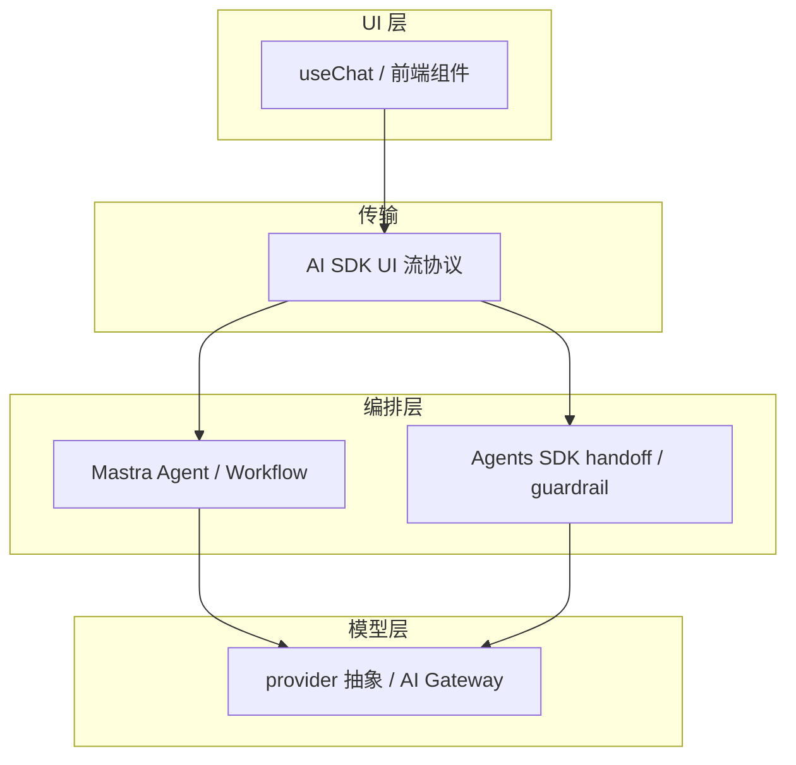

# TypeScript 栈：Mastra / Vercel AI SDK / Agents SDK (JS)

## 一句话结论

在 TS 生态里，选型通常不由 agent 能力决定，而由**你在前端的栈位**决定：Vercel AI SDK 是模型调用与流式 UI 的标准件（v7 的 `ToolLoopAgent` 只是一个单 agent 循环，不构成编排层），Mastra 是 TS 原生的编排与持久化层，OpenAI Agents SDK 的 JS 版是"轻编排 + OpenAI 平台能力"的组合；前端团队的最小可用组合是"AI SDK 负责流式渲染 + 一个编排层负责状态与工具"，而不是三个都上。

## 问题与边界

先纠正一个常见错位：把这三个包当成"三个 agent 框架"来横评。它们的层级本就不同：

- **Vercel AI SDK**：解决"模型调用如何统一、流式结果如何渲染到 UI"。它的核心是 provider 抽象 + `streamText`/`generateText` 的流式协议 + React/Vue/Svelte 侧的 hooks。v7 起它也有了 `ToolLoopAgent` 与 harness 抽象（可以把 Claude Code、Codex 这类既有 harness 当 agent 跑），但这层编排是"单 agent 循环 + 步骤钩子"，不含持久化后端、多 agent 拓扑与评测体系。
- **Mastra**：解决"agent 与 workflow 如何在 Node 里跑起来、状态存哪、怎么评测与部署"。它有 `Agent`、`createWorkflow`/`createStep`、memory、scorer 评测、tracing、MCP/A2A/ACP 接入与多种部署形态。
- **OpenAI Agents SDK (JS)**：解决"用 OpenAI 的能力栈快速搭多 agent 流程"，卖点是 handoff、guardrail、session、tracing 这套开箱组合，以及 `SandboxAgent`、`RealtimeAgent` 这类与平台强绑定的形态。

所以问题不是"哪个更强"，而是"你的产品里，agent 逻辑放在哪一层"。纯 Web 产品里，agent 逻辑往往只是"一个 API 路由 + 一个流"，此时 AI SDK 就够；一旦出现"多步流程要恢复""要按用户存记忆""要跑回归评测"，就必须引入编排层，而那层的候选在 TS 里主要就是 Mastra。

边界也要说清：三者都不托管 agent 的执行语义——Mastra 有平台化产品（Observability / Studio / Server 部署目标），但托管的是"部署与观测"，不替你决定 session 与恢复语义；AI SDK 与 Agents SDK 完全不提供 runtime。它们也都不是协议实现——MCP/A2A 在它们里面都是客户端或适配器，协议本身见 [MCP](../03-protocols/01-mcp.md) 与 [A2A](../03-protocols/02-a2a.md)。

## 核心概念与架构



| 概念 | 归属 | 职责 | 容易误解的点 |
|---|---|---|---|
| `ToolLoopAgent` / `stopWhen` | AI SDK | 带工具的单 agent 循环与停止条件 | 它没有持久化，进程结束即丢；不是 workflow 引擎 |
| `useChat` | AI SDK | 前端消费流式消息与工具调用状态 | 消息存在客户端；刷新即丢，服务端 session 要另做 |
| `Agent` + `createTool` | Mastra | agent 定义；工具必须用 `createTool` + zod schema | 直接传普通对象定义的工具会**静默不执行** |
| `createWorkflow` / `createStep` | Mastra | 类型化步骤、分支、并行、挂起与恢复 | 状态与快照是它的核心卖点，别只用它跑单 agent |
| `run` / `handoff` | Agents SDK JS | 运行 agent、把控制权交给另一个 agent | handoff 是"换执行者"，不是"并行分工" |
| `SandboxAgent` | Agents SDK JS | 带文件系统与沙箱工作区的长任务 agent | 与 OpenAI 平台能力绑定较深，迁移成本高 |
| scorer | Mastra | 规则 / 模型 / 程序化打分器，可挂 agent 与 workflow step | 默认服务线上打分，不等于离线数据集回归 |
| `HarnessAgent` | AI SDK | 把既有 harness（Claude Code、Codex 等）包成统一 agent 接口 | 抽象的是"入口"，不改变被包装 harness 的行为与权限 |

## 关键机制

### AI SDK：流式协议才是它的资产

AI SDK 的真正价值不是"支持很多模型"——那件事谁都能做——而是**一套前后端都认的流式消息协议**：文本增量、工具调用开始/参数增量/结果、推理片段、结束原因，都有约定的事件类型，前端 hooks 直接消费。自己手写 SSE 时最容易踩的坑（参数 JSON 拼到一半就渲染、流断了没有重连语义、工具结果与文本顺序错乱）它都处理了。

v7 之后它往上游走了一步：`ToolLoopAgent` 提供带工具循环与 `stopWhen` 停止条件的 agent 抽象，`prepareStep` 允许在每一步之前改上下文；harness 抽象则把"外部 harness（Claude Code、Codex 等）"包装成统一的 agent 接口。判断没变：**它的强项仍在"传输与渲染"，编排能力是够用级**。

### Mastra：把"状态"当一等公民

Mastra 的骨架是三层：`createTool`（zod schema + execute）、`Agent`（instructions + model + tools）、`createWorkflow`（step 组合，`.then()` 串联，`.commit()` 收尾）。工作流支持分支、并行、挂起/恢复与状态快照，这让它成为 TS 里少数能做"可恢复流程"的选择。

它的模型寻址是一个 `provider/model` 字符串，配 model router，因此换模型不改代码；代价是多一层间接，排查时要确认 router 选到了哪个 provider。评测侧是 scorer：规则类、模型类、程序化类，可以挂在 agent 或 workflow step 上做**线上**打分，也有 CI 集成——这是"在线质量信号"，与离线数据集回归是两件事，别混为一谈。

### Agents SDK (JS)：平台能力换移植性

它的 API 面很干净：`Agent`（instructions + tools + guardrails + handoffs）+ `run()`。handoff 是"把控制权交给另一个 agent"，与"并行派活"是不同语义；guardrail 分输入/输出两侧，可中断运行；session 是一个 `Session` 接口，官方给 `OpenAIConversationsSession`（走 Conversations API）与 `MemorySession`（进程内，仅本地开发）。

tracing 默认在服务端运行时开启，导出到 OpenAI 的 Traces 面板，可用环境变量或 `RunConfig.tracingDisabled` 关闭；官方明确说明：使用 OpenAI API 且受零数据保留（ZDR）约束的组织，tracing 不可用。这条限制在合规评审里是硬约束，必须在选型早期确认。

### 为什么"栈位"决定选型

前端团队的技术债结构与后端不同：构建链、部署目标、状态管理、鉴权都已经有既定答案。引入 agent 时，最贵的不是模型调用，而是**把 agent 塞进现有请求生命周期**。

三个栈位对应三种答案：

- **纯前端/边缘**：agent 逻辑放在 API 路由里，一次请求一次流。AI SDK 直接对上这套模型，不需要额外运行时。
- **BFF/全栈服务**：需要有状态的东西（会话、审批、定时任务），此时 Express/Next 的请求模型不够用，要一个能挂起与恢复的编排层，Mastra 属于这一档。
- **平台能力优先**：产品本身就是"OpenAI 之上的应用"（语音、沙箱工作区、Conversations），用 Agents SDK JS 能少写大量胶水，代价是绑定。

这条判断比"框架功能对比"更能预测落地速度——因为功能都能补，生命周期模型改起来要重写。

### 三层如何拼

一个可落地的分工是：**AI SDK 管"怎么把流送到浏览器"，Mastra 管"agent 与流程怎么跑、状态存哪"，Agents SDK 只在"需要 OpenAI 平台专有能力"时作为某个节点的实现**。三者并非互斥，但每多一层，就要多维护一套消息格式转换——这是 TS 栈最主要的隐性成本。

### 版本与锁

TS 生态的版本风险集中在两处：核心包与 provider 子包的耦合（`ai` 与 `@ai-sdk/*`），以及框架与运行时的兼容矩阵（Node 22+、ESM、edge runtime）。前者表现为"升级核心后类型全红"，后者表现为"本地能跑、部署到 edge 后 `node:` 模块不可用"。

可操作的规则是：核心与 provider 同批升级并锁 minor；把 agent 依赖集中在服务端入口，别让前端 bundle 间接引入；edge 部署前用构建产物验证，而不是只看 dev server。

### 部署与运行时

TS 栈的部署约束比 Python 栈更硬：serverless 有执行时长上限，edge 没有 `node:` 内置模块，流式响应需要平台支持增量输出。这三条共同决定了"agent 能不能跑在同一个进程里"。

现实做法是分层：UI 与轻量单轮调用放边缘函数，长 agent 循环与 workflow 放到常驻 Node 服务（容器或平台的长任务产品），两者用流协议或可恢复流衔接。Mastra 的多种部署形态与 AI SDK 的流协议正好覆盖这条分工线；把它当成"部署架构问题"而不是"框架选型问题"，决策会清楚很多。详见 [部署形态](../04-engineering/06-deployment.md)。

## 十维对比（合并为表）

| 维度 | Mastra | Vercel AI SDK | OpenAI Agents SDK (JS) |
|---|---|---|---|
| 抽象层次 | 编排框架：agent + workflow + memory + evals | 传输/模型层：单 agent 循环 + 流式 UI | 轻编排 + 平台能力：agent/handoff/guardrail |
| 执行模型 | Node 进程内；workflow 可挂起/恢复 | 请求内流式循环；步骤钩子可改上下文 | 进程内运行，session 管历史 |
| 状态与持久化 | 内建 memory、workflow 快照、可恢复流 | 无内建持久化（消息在客户端/你自己） | `Session` 接口；官方实现走 Conversations API 或进程内 |
| 多 agent | supervisor/subagents、workflow 组合 | 无拓扑原语（自己写循环） | handoff（交接）+ agents-as-tools |
| 工具与 MCP | `createTool` + MCP 客户端/服务端、A2A、ACP | `tool()` + zod；MCP 客户端 | 函数工具、MCP、hosted tools |
| 可观测 | 分层 span（agent/workflow/tool/model） | 无内建 tracing（接 OTel 自行埋点） | 内置 tracing，默认导出到 OpenAI Traces |
| 评测集成 | scorer（规则/模型/程序化）+ CI | 无 | 无（靠外部） |
| 部署形态 | Hono server、Vercel/Netlify/Cloudflare deployer、Mastra 平台（Observability/Studio/Server）、也可部署到 Bedrock AgentCore | 跟随宿主（Next.js/Vercel 等） | 跟随宿主；Node 22+/Deno/Bun |
| 语言与生态 | TypeScript 原生，`@mastra/core` 1.85.0 | TypeScript/JS，`ai` 7.0.177 + 多框架 hooks | TS/JS，`@openai/agents` 0.22.0 |
| 许可证与治理 | Apache-2.0（`ee/` 目录另授权，open-core） | Apache-2.0 | MIT |

版本号与许可证均于 2026-11-20 核实。三者都在 1.0 之前或刚过 1.0 的阶段（Agents SDK JS 仍是 0.x），锁版本是常态而非保守。Mastra 的 `@mastra/core` 已到 1.x，但生态包（CLI、deployer、各集成）各自有版本节奏，升级时按包看 changelog，不要假设"整栈同步发版"。

### 前端团队的最小组合

| 你的产品形态 | 最小组合 | 为什么 |
|---|---|---|
| 单一对话界面、单 agent、Vercel 部署 | AI SDK only（`ToolLoopAgent` + `useChat`） | 少一层就少一套消息转换；够用就别加 |
| 多步流程、要按用户存记忆、要跑回归 | Mastra 编排 + AI SDK 渲染 | Mastra 补状态与评测，AI SDK 补流式体验 |
| 已深度使用 OpenAI（Responses/Conversations/Realtime） | Agents SDK JS（+ AI SDK 做 UI） | handoff/guardrail/tracing 开箱，平台能力直接可用 |
| 需要 workflow 可视化编辑与运维面板 | Mastra（Studio/平台） | TS 里少有的"带面板"选项 |
| 只做 RAG 问答、流程固定 | 不用 agent 框架 | 检索 + 一次生成即可，见 [上下文工程](../01-foundations/02-context-engineering.md) |
| 只需要多 provider 兜底、不要编排 | AI SDK + 自己的重试 | 模型层抽象已经够用 |
| 需要长任务（分钟级以上）不掉线 | Mastra + 后台队列 | 请求内流撑不住，要有可恢复执行 |
| 要与他团队的 agent 跨进程互通 | Mastra（A2A/ACP 适配）或直接实现协议 | 协议层的事别让 UI 层承担，见 [A2A](../03-protocols/02-a2a.md) |

一条经验规则：**先定"状态存在哪"，再定框架**。状态在客户端 → AI SDK 够；状态在服务端数据库 → Mastra；状态在 OpenAI 的 Conversations → Agents SDK。

还有两个常被忽略的维度：

- **团队维护能力**：TS 团队通常没有专职 agent 基础设施工程师。每引入一层，就要有人能读懂它的消息格式与错误栈——Mastra 的学习成本集中在 workflow 语义，Agents SDK 集中在 handoff 语义，AI SDK 最低。
- **退出成本**：AI SDK 最容易换掉（只依赖流协议），Mastra 次之（workflow 需要重写），Agents SDK 最难（session 与 tracing 落在平台侧）。选型时把这条写进架构决策记录，比列功能表有用。
- **谁来值班**：agent 出问题时的第一现场是流断了、还是工具没被调用、还是 workflow 卡在某步——这三类症状分别落在三层。值班同学要能定位到层，否则只能整体重跑。

## 最小示例

```ts
// AI SDK：流式 + 单 agent 循环
const result = streamText({ model, messages, tools, stopWhen: isStepCount(8) })

// Mastra：工具必须走 createTool，agent 注册进 Mastra 实例
export const agent = new Agent({ id: 'a', model: 'provider/model', tools: { weather } })

// Agents SDK (JS)：handoff 把控制权交给另一个 agent
const triage = new Agent({ name: 'triage', handoffs: [billingAgent, techAgent] })
await run(triage, 'My invoice is wrong')
```

三段代码体现三种职责：AI SDK 给流、Mastra 给可恢复的编排、Agents SDK 给交接语义。

## 适用与不适用

- **Mastra 适合**：TS 全栈团队要把 agent 做成产品功能（不是 demo），需要 workflow 恢复、memory、评测与部署路径；已经在 Next.js 里，想把 agent 与 API 放同一个进程。
- **Mastra 不适合**：只需要流式聊天；团队不愿意接受 open-core 的许可边界（`ee/` 目录另授权，商用前要读）。
- **Mastra 不适合**：团队里没有人愿意长期维护 workflow 语义——可恢复流程的调试成本高于普通请求，缺人维护会退化成"每次重跑"。
- **AI SDK 适合**：任何要"把模型输出流式渲染到 Web UI"的项目，无论后端是什么框架；也适合作为多 provider 的统一入口。
- **AI SDK 不适合**：把它当编排层——没有持久化、没有拓扑原语、没有评测；长任务在 serverless 里会被超时截断。
- **AI SDK 适合**：多 provider 切换与成本对比——统一的调用面让"换模型"从改造降级为改配置。
- **Agents SDK (JS) 适合**：已经在 OpenAI 平台上、需要 handoff/guardrail/tracing 开箱即用；需要 Realtime 语音或 Sandbox 工作区这类平台专有能力。
- **Agents SDK (JS) 适合**：早期的多 agent 验证——handoff 与 guardrail 的语义清楚，比自研路由更快得出结论。
- **Agents SDK (JS) 不适合**：多云或自建模型的团队（平台绑定深）；受 ZDR 约束的组织（tracing 不可用）。

> 判断：TS 栈的竞争不在"谁的 agent 更聪明"，而在"谁离你的产品代码更近"。前端团队选 Mastra 还是 AI SDK，本质是选"把复杂度放在服务端编排"还是"放在请求内的流"。

## 常见坑

- **坑**：在 Next.js route handler 里跑长 agent 循环 → 平台超时或流被截断，用户看到半句话。规避：用可恢复流，或把长任务移到后台队列，前端只订阅结果。
- **坑**：把 `useChat` 当会话状态管理。消息在客户端，刷新即丢，多标签页不同步。规避：服务端落 session，前端只做投影。
- **坑**：Mastra 里用普通对象定义工具（不调 `createTool`）→ 工具**静默不执行**，没有报错，模型以为调过了。规避：统一走 `createTool` + zod，CI 里加一条"工具必须有 inputSchema"的检查。
- **坑**：Agents SDK 在服务端运行时**默认开启** tracing（浏览器与 `NODE_ENV=test` 除外），预发环境的真实客户数据会进 OpenAI 面板。规避：按环境显式设置 `OPENAI_AGENTS_DISABLE_TRACING` 或 `RunConfig.tracingDisabled`，并写进上线检查单。
- **坑**：同时用三层却没有统一的消息格式 → 同一条对话在 AI SDK、Mastra、Agents SDK 里各有一份表示，工具调用 ID 对不上，回放时断链。规避：定一个内部消息模型，边界处只做一次转换。
- **坑**：锁 `ai` 主版本却放开 provider 子包。provider 包与核心版本耦合，`npm update` 后类型不兼容。规避：核心与 provider 同批升级，锁 minor。
- **坑**：在 edge runtime 里用依赖 `node:` 内置模块的 agent 包。表现是构建通过、运行时 500。规避：把 agent 执行放到 Node runtime，edge 只做流式转发。
- **坑**：把 Mastra 的 scorer 当离线回归。它默认服务线上请求打分，跑离线数据集要另接数据集与实验流程。规避：明确"在线质量信号"与"离线回归"两套口径，见 [评测体系](../04-engineering/02-evaluation.md)。
- **坑**：把 `HarnessAgent` 当成"给外部 harness 加沙箱"。它只统一入口与流式形态，被包装 harness 的权限边界不变。规避：隔离仍在执行环境层，别指望套一层就有沙箱。
- **坑**：多团队各自升级 `@mastra/core` 与 `ai` → 同一 monorepo 内出现两个流协议版本，工具调用 ID 对不上。规避：用 workspace 固定版本，CI 校验依赖图只出现一个主版本。

## 开放问题

- **AI SDK 会不会长成编排层？** `ToolLoopAgent` 与 harness 抽象已经越过了"纯传输"的边界。它若补齐持久化与评测，Mastra 的差异化就要重新论证；截至 2026-11 尚未发生。
- **open-core 的边界**：Mastra 把 `ee/` 目录单独授权，哪些能力长期留在 Apache-2.0 侧，是采购与法务关注点。
- **Agents SDK 的双语言对齐**：Python 与 JS 版本各自演进（当前 0.25.0 / 0.22.0），跨语言团队会遇到"文档说的是另一个语言的行为"。
- **前端状态与服务端状态的边界**：流式 UI 天然倾向"客户端持有消息"，而可恢复流程要求"服务端持有状态"，两者的收敛方案（可恢复流 + 服务端 session）仍在演进，见 [部署形态](../04-engineering/06-deployment.md)。
- **MCP 在浏览器侧的位置**：MCP 客户端需要长连接与凭据，天然在服务端；前端只能通过代理访问。这决定了 TS 全栈项目里 MCP 网关几乎是必需品，见 [MCP](../03-protocols/01-mcp.md)。
- **评测基础设施缺口**：TS 生态有 scorer 与 CI 集成，但缺少 Python 侧那种成熟的轨迹评测与数据管理工具；跨语言团队往往把评测放回 Python。

## 参考来源

- Mastra 文档（Agents、Workflows、Evals、Memory、部署）· Mastra · 2026-11 · https://mastra.ai/docs/agents/overview
- npm `@mastra/core` 1.85.0（2026-11-18）元数据 · npm · 2026-11-20 核实 · https://www.npmjs.com/package/@mastra/core
- Mastra LICENSE.md（Apache-2.0 + `ee/` 目录单独授权）· GitHub · 2026-11 · https://github.com/mastra-ai/mastra/blob/main/LICENSE.md
- AI SDK 文档（Introduction、Agents 概览、ToolLoopAgent、stopWhen）· Vercel · 2026-11 · https://ai-sdk.dev/docs/agents/overview
- npm `ai` 7.0.177（2026-11-18）元数据 · npm · 2026-11-20 核实 · https://www.npmjs.com/package/ai
- OpenAI Agents SDK (JS) README（核心概念、Sandbox/Realtime Agent、Node 22+）· OpenAI · 2026-11 · https://github.com/openai/openai-agents-js
- OpenAI Agents SDK (JS) Tracing 指南（默认开启、导出到 Traces、ZDR 不可用、关闭方式）· OpenAI · 2026-11 · https://openai.github.io/openai-agents-js/guides/tracing/
- npm `@openai/agents` 0.22.0（2026-11-12）元数据 · npm · 2026-11-20 核实 · https://www.npmjs.com/package/@openai/agents
