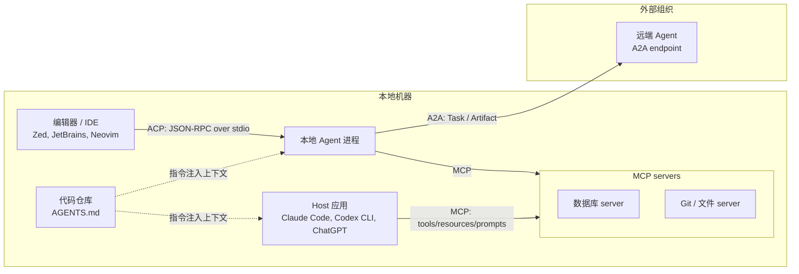

# 协议分层全景：四层定位与未收敛的空白

## 一句话结论

到 2026-11，Agent 互操作协议已经在四个不同层面上各自站住位置，但真正"收敛"的只有工具接入层（MCP）与编辑器-Agent 层（ACP）；Agent 之间的身份互认、计费结算、审计留痕三块仍是空白，跨层协作靠工程胶水补。

## 先看一次跨四层的请求

你在 Zed 里打开的 Claude Code 会话中敲下一句：**"查一下 #412 这个 issue，再让供应商确认下个版本的排期。"** 回车后你只看到一段回答，但这句话在四个信任边界上各走了一趟：

| 步 | 谁发起 | 干了什么 | 走的协议 | 你看到的界面变化 |
|---|---|---|---|---|
| 1 | 编辑器 | 拉起 agent 子进程，传入 `cwd` 与可用 MCP 列表 | ACP | 侧边栏多出一个会话 |
| 2 | 无发起方，agent 主动读 | 读仓库根目录的约定，拿到测试命令与"别动 migrations/" | AGENTS.md | 计划第一步变成跑 `pnpm test` |
| 3 | host（Claude Code） | `tools/call` 取 #412 的正文与评论 | MCP | "正在读取 issue…" |
| 4 | 你的 agent | 把"请周五前确认"整理成一次委托，发给供应商 agent | A2A | 任务卡显示 submitted |
| 5 | 供应商 agent | 三天后进入 completed，回传排期确认件 | A2A | 回答末尾附上排期表 |

一次请求，四个协议，没有一个是多余的抽象：第 1 步解决"谁把 agent 拉起来"，第 2 步解决"它该守什么规矩"，第 3 步解决"它怎么拿数据"，第 4、5 步解决"它怎么把活交给不受它控制的人"。

**信任边界**：人话是"这条线上谁可以骗谁、谁不必向谁自证"。类比：内部报销只要主管签字，跨公司付款要合同加对公账户。例子：第 3 步的 MCP server 看不到你的完整对话，第 4 步的供应商 agent 看不到你的仓库——因此两者的鉴权强度、失败处理、留痕要求都不同。四层是按这条线切的，不是按功能切的。

**binding**：人话是"同一套语义的几种上网方式"。类比：同一份合同可以快递、可以传真、可以电子签，效力一样，走哪条看两边各有什么。例子：第 4 步用 JSON-RPC 还是 gRPC 由供应商网关决定，任务状态机不变。

下面把这条链路拆成层与发起方，再看四层为什么只在两个方向上收敛。

## 问题与边界

- **解决什么**：把"谁和谁说话、说什么、怎么证明对方是谁"从每家自研适配里抽出来，避免 N 个客户端 × M 个能力的组合爆炸。协议是接口契约，不是实现。
- **不解决什么**：不保证语义正确（工具描述写得烂，协议救不了）；不做能力路由与编排（那是框架与 runtime 的事）；不替代鉴权系统（协议只规定令牌怎么带，不规定谁能拿）；不承诺服务质量（SLA 是合同，不是规范条款）。
- **与相邻概念的分界**：
  - 协议 ≠ API：API 定义"资源与操作"，协议定义"agent 场景下的会话语义"——谁发起、如何中途要输入、长任务怎么表示、失败怎么归因。
  - 协议 ≠ 框架：LangGraph、ADK 这类框架可以同时说 MCP 和 A2A，但框架不定义线格式；换框架不该换协议。
  - 协议 ≠ runtime：沙箱、密钥托管、配额在 runtime 层，协议只负责把请求送达。
- **本篇的口径**：只做定位与取舍，不展开各协议的字段级细节；四篇专文见 [MCP](./01-mcp.md)、[A2A](./02-a2a.md)、[ACP](./03-acp.md)、[AGENTS.md](./04-agents-md.md)。

## 核心概念与架构

四层按"信任边界"而不是按"功能"划分，这是最容易判错的地方：

| 层 | 谁和谁说话 | 代表规范 | 信任边界 | 失败粒度 |
|---|---|---|---|---|
| 工具/上下文 | agent 进程 ↔ 工具服务 | MCP | 进程内或跨网络，server 看不到完整对话 | 单次调用 |
| Agent 间 | agent ↔ 另一个组织的 agent | A2A | 跨组织，双方互不透明 | 整个任务 |
| 编辑器-Agent | 编辑器 UI ↔ 本地 agent 子进程 | ACP | 同机同用户 | 一个 prompt turn |
| 仓库级约定 | 仓库 ↔ 任意编码 agent | AGENTS.md | 无运行时，纯文本 | 无（读失败不报错） |

四条线各有明确的发起方，这一点决定了实现形态：

- **MCP 由 client 发起**。2026-07-28 之后服务端不再能主动开请求，sampling / elicitation 改走 MRTR——服务端返回 `resultType: "input_required"`，客户端补齐后重发原请求。这一改动让 MCP server 变成普通的无状态 HTTP 服务，能直接放在轮询负载均衡后面。
- **A2A 由调用方 agent 发起**。被调用方的内部状态、记忆、工具对调用方不可见，可见的只有 Agent Card（能力名片）、Task 状态迁移与最终 Artifact。
- **ACP 由编辑器发起**。编辑器把 agent 拉起为子进程，通过 stdin/stdout 交换 JSON-RPC；会话建立时把 `cwd` 和要用的 MCP server 列表一起传下去。
- **AGENTS.md 没有发起方**。它靠 agent 主动读取，读不到也不报错——这是它最大的优点，也是它无法承担强制策略的原因。

把四层串起来看一次真实的跨组织委托，数据流是这样的：

1. 本地编辑器通过 ACP 拉起 agent 子进程，传入 `cwd` 与可用的 MCP server 列表。
2. agent 读仓库里的 AGENTS.md，得到构建命令与代码风格约束。
3. agent 通过 MCP 调用内部工具（查工单、读数据库、跑测试）。
4. 发现需要外部供应商的能力，agent 拉取对方的 Agent Card，验证签名，选一个 binding。
5. 发出 A2A `SendMessage`，得到一个 Task；长任务期间用 `SubscribeToTask` 或推送通知跟进。
6. 对方 agent 用它自己的 MCP server 干活，本地 agent 只看到状态迁移与 Artifact。
7. 任务进入终态，Artifact 回到本地，本地 agent 继续用 MCP 工具做验证。
8. 全过程只有第 6 步对本地不可见——这正是协议设计的意图。

## 关键机制

### 协议不是替代 API，而是给 API 加语义

用 MCP 包一个已有 REST 服务，并没有换掉 HTTP，只是把 OpenAPI 的 operation 投影成"模型能选的工具"，并补上三件 REST 表达不了的东西：

1. **能力协商**：server 在 `server/discover` 里声明支持 tools / resources / prompts 与哪些扩展，client 在每个请求的 `_meta` 里带上自己的能力。
2. **中途要输入**：MRTR 用一次额外的往返代替长连接，服务端不需要保存会话状态，把需要的上下文编码进 `requestState` 让客户端回传。
3. **可缓存的清单**：`tools/list`、`prompts/list`、`resources/list`、`resources/read` 返回 `ttlMs` 与 `cacheScope`，客户端可以缓存工具目录并保持上游 prompt 缓存稳定。

A2A 更直接：它规定 JSON-RPC 2.0、gRPC、HTTP+JSON 三种 binding 在语义上等价，HTTP 与 gRPC 的既有基础设施（负载均衡、API 网关、mTLS、可观测）可以原样复用。换句话说，协议是给已有传输层"加一层 agent 语义"，不是另造一套网络栈。

> 判断：判断一个"协议"是否真有价值，看它是否定义了 REST 无法表达的状态机。MCP 定义了 `input_required` 与 task 句柄，A2A 定义了 8 个任务状态，ACP 定义了 prompt turn 与 `stopReason`——所以三者成立；只做 URL 与字段规范的"协议"最后都会退化成某个 SDK 的序列化格式。

### 分层判据：三个问题定层

1. **谁发起**：客户端发起 → 工具层或 Agent 间层；编辑器发起 → ACP。
2. **谁是信任边界**：跨组织 → A2A（必须能验证对方身份，所以有 JWS 签名的 Agent Card）；同机同用户 → ACP（信任模型直接写明"agent 拿到进程权限，协议不做沙箱"）。
3. **失败由谁负责**：MCP 的失败是单次调用失败，重试即可；A2A 的失败是任务级失败，需要状态机、取消语义与幂等约定；ACP 的失败是回合失败，需要 `stopReason` 让 UI 决定下一步。

### 四个规范，四种治理节奏

协议能不能长期用，取决于治理而不是技术。四层的治理形态差别很大：

| 规范 | 治理 | 变更流程 | 兼容承诺 |
|---|---|---|---|
| MCP | AAIF（Linux 基金会）下的 MCP 项目 | SEP 提案 + Core Maintainer 评审 | 正式弃用政策，最短 12 个月窗口 |
| A2A | AAIF Growth Stage 项目 | 技术指导委员会（8 家公司） | 1.0 起承诺稳定，Agent Card 向后兼容 |
| ACP | Zed 发起并主导 | 规范与 registry 都在 GitHub 组织下，RFD 机制 | v1 稳定，v2 明确标注 draft |
| AGENTS.md | AAIF（Linux 基金会），2025-12 由 OpenAI 捐赠 | 无正式流程，事实标准 | 无版本概念 |

> 判断：治理差异比技术差异更影响选型。MCP 有弃用窗口和 SEP 编号，意味着可以排期升级；AGENTS.md 没有版本，意味着跨工具行为漂移是常态，只能靠测试兜。

### 四层各自的关键时间点

| 时间 | 事件 | 影响 |
|---|---|---|
| 2024-11 | Anthropic 开源 MCP | 工具接入层出现事实标准 |
| 2025-04 | Google 发起 A2A | Agent 间层开始有跨厂商方案 |
| 2025-08 | Zed 发布 ACP；OpenAI 发布 AGENTS.md | 编辑器侧与仓库侧同时补齐 |
| 2025-12 | AAIF 成立，MCP / AGENTS.md / goose 首批捐赠 | 治理从中立基金会接管 |
| 2026-01 | ACP Registry 上线 | 分发环节补齐，agent 一次注册全客户端可用 |
| 2026-03 | A2A 1.0.0 发布 | Agent 间层进入稳定版本 |
| 2026-07 | MCP 2026-07-28 发布 | 工具层去掉会话，变成纯 HTTP 工作负载 |
| 2026-08 | A2A 加入 AAIF | 四层中三层归入同一基金会 |

四层里唯一没有进基金会的是 ACP，它由 Zed 主导、JetBrains 参与推进。这不必然是缺点——单一主导方迭代更快——但意味着路线图取决于一家公司的优先级。完整的技术演进（含框架与模型侧）见 [从 Prompt 到协议](../00-overview/02-evolution.md)，本节只保留与协议分层直接相关的节点。

### 什么时候不需要协议

协议不是默认选项。以下情况用更轻的方案更划算：

- **只有一个 agent、只调自家 API**：直接写函数调用，比引入 MCP server 少一层网络与生命周期管理。
- **单进程内的工具**：宿主语言里的普通函数 + JSON Schema 就够，MCP 的收益来自"跨 host 复用"，单 host 拿不到。
- **点对点、一次性集成**：两个团队一次性对接，写一份 HTTP 契约比实现 A2A 的卡片签名与任务状态机便宜。
- **只需要共享指令**：一个 Markdown 文件能解决的事，不必上 ACP 或自定义协议。
- **需要强一致事务**：跨 agent 的分布式事务没有任何 agent 协议在管，老老实实用数据库与消息队列。

反过来，当出现"第二个 host 要接同一批工具""第二个编辑器要跑同一个 agent""对方是另一家公司"这三个信号之一时，协议的收益才开始为正。

### 邻近规范速览（只做定位，不展开）

- **agents.json**：社区提案，在站点 `/.well-known/agents.json` 声明"本站哪些入口可被 agent 调用、支持什么协议"。定位接近 `robots.txt` 的语义版。截至 2026-11，未见基金会治理或主流客户端内置的公开证据，不建议作为架构依赖。
- **OpenAI Apps SDK**：不是新协议，是 MCP 之上的应用层封装——用 MCP 把 ChatGPT 应用接到后端，官方定位是"扩展 MCP，使应用能在任何支持该标准的运行环境里跑"。选它等于选 MCP + OpenAI 的分发渠道。
- **AGNTCY**：Linux 基金会项目（2025-07 加入，Cisco 发起），做的是"Internet of Agents"的底座：目录（OASF）、可验证身份（VC）、消息传输（SLIM）、可观测。它想解决的是 A2A 之上的发现与身份，二者是叠加而非竞争。
- **ANP（Agent Network Protocol）**：以 `did:wba` 为身份根、走去中心化发现路线的社区规范，有开源 SDK（AgentConnect），在 W3C Agent Protocol CG 内有讨论。与 A2A 的差别在信任根：A2A 用"名片 + JWS 签名"，ANP 用 DID 文档。
- **llms.txt**：Jeremy Howard 的提案（2024-09 首版，2026-08 修订 v2），在站点根放一个 Markdown 索引给模型读，正文留在链接后面按需取。它解决"文档站对 agent 不友好"，与 agent 间通信无关；OpenAI、Anthropic、Gemini 的开发者文档站都发布了自己的 `llms.txt`。

## 对比

| 维度 | MCP | A2A | ACP | AGENTS.md |
|---|---|---|---|---|
| 适用条件 | 要把工具/数据接进任意 host，且希望一次实现多处复用 | 要把任务委托给另一个组织或另一套技术栈的 agent | 要让同一个 agent 在多个编辑器里可用，且 agent 是本地进程 | 要让多个编码 agent 在同一仓库里行为一致 |
| 传输 | stdio、Streamable HTTP（HTTP+SSE 已弃用） | JSON-RPC 2.0、gRPC、HTTP+JSON | stdio（JSON-RPC 2.0，远程传输仍在 RFD） | 无，文件读取 |
| 治理方 | AAIF 下的 MCP 项目，SEP 流程 | AAIF Growth Stage 项目（2026-08 加入） | Zed 主导，`agentclientprotocol` 组织 | AAIF，2025-12 由 OpenAI 捐赠 |
| 成熟度 | 规范 2026-07-28，四个 Tier 1 SDK | 规范 1.0.0（2026-03），五语言生产级 SDK | 规范 v1 稳定，v2 仍标 draft | 事实标准，60k+ 开源项目 |
| 引入时机 | 有第二个 host 要接同一批工具时 | 有跨团队/跨厂商委托，且要写进合同或 SLA 时 | 你的 agent 要被非自家编辑器调用时 | 仓库里出现第二个编码 agent 时 |
| 代价 | 无状态化后旧实现要重写会话逻辑 | 卡片、签名、任务状态机都要自己落地 | 只覆盖编辑器侧，工具侧仍需 MCP | 无强制力，冲突时靠人 |

如果只关心"接入成本"，可以按最小可用实现估一遍工：

| 层 | 最小可用实现 | 容易被漏掉的工程 |
|---|---|---|
| MCP | 一个 stdio server，暴露 3–5 个工具 | 工具描述质量、错误信息可读性、清单缓存与变更通知 |
| A2A | 发布 Agent Card + 实现 `SendMessage` / `GetTask` | 签名与密钥轮换、任务超时与取消、推送回调的 SSRF 防护 |
| ACP | 实现 `initialize` / `session/new` / `session/prompt` / `session/cancel` | 权限请求的 UX、stdout 不得被日志污染、绝对路径约定 |
| AGENTS.md | 仓库根放一个 Markdown | 分层与就近覆盖、与 CLAUDE.md 的优先级、内容审查 |

## 实践建议与常见坑

- **坑 1：把内部 API 全量暴露成 MCP 工具**。触发条件：一次性把 200 个 REST 端点包成工具。后果：工具清单本身吃掉上下文预算，模型选错率上升，每次 `tools/list` 都变大。规避：按任务而不是按资源切工具，一次给模型的工具控制在 20–30 个，其余走工具检索或分层命名空间。参见 [工具调用与沙箱](../01-foundations/04-tool-use-and-sandbox.md)。
- **坑 2：以为接了 A2A 就能跨组织协作**。触发条件：只实现了 `SendMessage` 和 Agent Card 拉取。后果：验收标准、超时、谁承担失败成本全靠私下约定，出事时没有依据。规避：把 SLA 与验收写进对接文档而不是指望协议；协议只保证"消息能送到、状态可查询"。参见 [多智能体](../01-foundations/05-multi-agent.md)。
- **坑 3：四层混用导致信任边界错位**。触发条件：编辑器通过 ACP 拉起 agent，agent 又被传入 MCP server 的长期凭据。后果：用户批准的是"这一次操作"，agent 实际持有的是"永久访问权"。规避：凭据按会话下发、按工具 scope 收窄；ACP 的权限请求是建议性的，不能当授权凭据用。参见 [安全与权限](../04-engineering/03-security.md)。
- **坑 4：把 AGENTS.md 当配置中心**。触发条件：在 AGENTS.md 里写构建参数、环境变量、内网地址。后果：内容进模型上下文，可能被外发；且各工具对同一段文本的解释不一致。规避：只写"怎么做"的指令，不写密钥与内部拓扑。参见 [AGENTS.md 与上下文约定](./04-agents-md.md)。
- **坑 5：把"协议已收敛"当成"生态已就绪"**。触发条件：按规范文档排期，没算网关、注册中心、审计的工程量。后果：接入期比预期长一倍。规避：把协议实现和治理设施（网关、注册、观测）分成两个里程碑，后者通常更贵，成本结构见 [成本与延迟](../04-engineering/05-cost-latency.md)。
- **坑 6：用 A2A 传大文件**。触发条件：把几百 MB 的模型或数据集塞进 Artifact。后果：任务超时、内存打爆、重试风暴。规避：Artifact 只放引用（URL + 校验和），大对象走对象存储；协议本身不优化批量传输。
- **坑 7：在 MCP server 里做鉴权决定**。触发条件：server 自己判断"这个用户能不能删库"。后果：同一 server 被多个 host 复用时权限模型互相冲突，且 server 看不到完整会话上下文，判断依据不足。规避：授权在 host 与授权服务器侧做，server 只校验令牌与 scope。参见 [安全与权限](../04-engineering/03-security.md)。

## 开放问题

- **身份**：MCP 把授权交给 OAuth 授权服务器，A2A 用 Agent Card 的 JWS 证明"这张名片没被改"，但"这个 agent 代表谁、权限从哪来"没有跨协议答案。OAuth 令牌交换、on-behalf-of 都还没成为规范的一部分。
- **计费**：A2A 生态里的 Agent Payments Protocol（AP2）已获 60+ 组织支持，但它定义的是支付凭据与授权证据，不是"按 token / 按任务计价"的通用计量层。
- **审计**：没有跨协议的审计事件 schema。当前事实标准是把 agent 轨迹塞进 OpenTelemetry 的 GenAI 语义约定，见 [可观测性](../04-engineering/01-observability.md)。
- **信任与声誉**：签名的 Agent Card 只证明来源，不证明质量。谁给 agent 打信誉分、争议怎么仲裁，截至 2026-11 没有权威方案。
- **发现层**：MCP 有官方 Registry（preview 阶段），A2A 的 registry 仍在路线图上，跨协议的统一发现尚不存在。整体判断见 [开放问题](../06-outlook/01-open-problems.md)。
- **授权传播**：用户授权一次之后，这个授权能不能沿着 A2A 的任务链继续传给下游 agent？MCP 的 Enterprise-Managed Authorization 扩展解决的是企业内部集中管控，不是跨组织传播。
- **协议的测试一致性**：MCP 有 Inspector 与 SEP 的一致性测试要求，ACP 有 Test Compatibility Kit，A2A 有多语言 SDK 但没有公开的统一 conformance 套件；跨实现互通目前主要靠双方联调。

## 参考来源

- The 2026-07-28 Specification · Model Context Protocol · 2026-07 · https://blog.modelcontextprotocol.io/posts/2026-07-28/
- Architecture · Model Context Protocol · 2026-07 · https://modelcontextprotocol.io/specification/2026-07-28/architecture
- Extensions Overview · Model Context Protocol · 2026-07 · https://modelcontextprotocol.io/extensions/overview
- A2A Protocol Ships v1.0 · A2A Protocol Community · 2026-03 · https://a2a-protocol.org/latest/blog/2026/03/12/a2a-protocol-ships-v10-production-ready-standard-for-agent-to-agent-communication/
- A New Chapter for A2A: Joining the Agentic AI Foundation · A2A Protocol · 2026-08 · https://a2a-protocol.org/latest/blog/2026/08/27/a-new-chapter-for-a2a-joining-the-agentic-ai-foundation/
- Linux Foundation Announces the Formation of the Agentic AI Foundation · AAIF · 2025-12 · https://aaif.io/news/linux-foundation-announces-formation-of-aaif
- The ACP Registry is Live · Zed · 2026-01 · https://zed.dev/blog/acp-registry
- ACP Architecture · Agent Client Protocol · 2026-11 · https://agentclientprotocol.com/get-started/architecture
- AGENTS.md · AGENTS.md / AAIF · 2026-11 · https://agents.md/
- A2A Protocol Surpasses 150 Organizations · The Linux Foundation · 2026-04 · https://www.linuxfoundation.org/press/a2a-protocol-surpasses-150-organizations-lands-in-major-cloud-platforms-and-sees-enterprise-production-use-in-first-year
- Building with the Apps SDK · OpenAI Help Center · 2026-11 · https://help.openai.com/en/articles/12515353-building-with-the-apps-sdk
- Linux Foundation Welcomes the AGNTCY Project · The Linux Foundation · 2025-07 · https://www.linuxfoundation.org/press/linux-foundation-welcomes-the-agntcy-project-to-standardize-open-multi-agent-system-infrastructure-and-break-down-ai-agent-silos
- The /llms.txt file, v2 · Jeremy Howard · 2026-08 · https://pypi.org/project/llms-txt/
- Caching · Model Context Protocol · 2026-07 · https://modelcontextprotocol.io/specification/2026-07-28/server/utilities/caching
