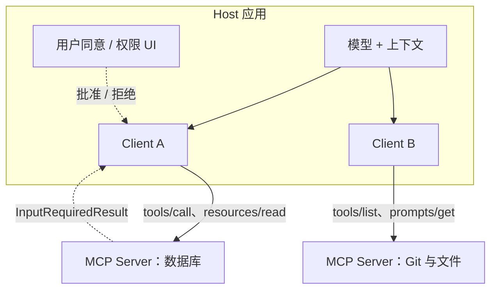
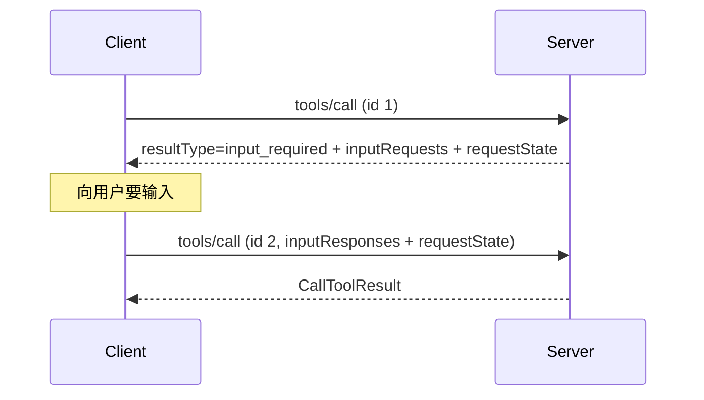

# Model Context Protocol：无状态核心与扩展化之后

## 一句话结论

2026-07-28 版把 MCP 从"有状态双向会话"改成"每请求自描述的无状态 RPC"，使它第一次能像普通 HTTP 服务那样部署在轮询负载均衡之后；代价是所有依赖会话的实现必须重写，`sampling` / `roots` 这类服务端主动请求被降级并被标记弃用。

## 先看一次真实调用：查一笔订单

用户说：**"查一下订单 A123 到哪了。"** 这句话在 MCP 里是四次交互，而你只输入了一次：

| 步 | 谁 → 谁 | 发的是什么 | 回来的东西 |
|---|---|---|---|
| 1 | host → 每个 server | `server/discover` 或 `tools/list`，`_meta` 里带版本与 client 能力 | 工具清单（名称、描述、JSON Schema）与 `ttlMs` |
| 2 | host（模型侧） | 清单与这句话一起进上下文，模型选出 `order.get` | 一次调用意图：`{"orderId":"A123"}` |
| 3 | client → server | `tools/call`，头里 `Mcp-Method` / `Mcp-Name`，body 里参数与 `_meta` | `CallToolResult`：状态、承运商、预计到达 |
| 4 | host → 模型 | 把结果回灌上下文，模型组织成一句人话 | "已到杭州分拨中心，预计周二送达" |

若第 3 步 server 发现"这个单号对上两个候选，得让用户选"，它不会挂着连接等答，而是返回 `resultType: "input_required"` 加一段 `requestState`；client 问完用户，带上 `inputResponses` 与那段 `requestState` **重发一次原请求**。这是无状态核心换来的确定性。

**host / client / server**：人话是"一家三口"——host 是管家（决定用哪些工具、要不要问用户），client 是每扇门上的门铃（一个 client 只通一个 server），server 是被叫来的服务方（只知道自己那点活）。类比：前台、内线分机、外包查询窗口。例子：你的 CLI 是 host，它给订单服务开了一个 client；订单服务全程看不到你的对话，只知道有人要查 A123。

**结果回灌**：人话是"把外部返回的内容塞回模型眼前，让它接着写"。类比：把查到的纸条递给正在写报告的人。例子：第 4 步不回灌，模型只知道"调用成功了"，写不出用户要的那句话；回灌整页 HTML，又会把上下文预算吃掉。

下面先看这三个角色怎么分工，再看 `tools/call` 之外的原语与那套无状态核心。

## 问题与边界

- **解决什么**：把"模型能调用的能力"做成可复用的服务边界，让 M 个 host 与 N 个工具之间只写一次适配。MCP 只规定线格式与交互语义，不规定 server 内部怎么实现。
- **不解决什么**：不做编排、不做记忆、不做模型路由；不保证工具描述写得好；不做沙箱（server 拿到的权限由 host 决定）；不管计费与配额。
- **与相邻概念的分界**：
  - vs **OpenAPI**：OpenAPI 描述资源与操作，MCP 描述"模型如何在对话中选工具、途中如何补参数、清单如何缓存"。
  - vs **A2A**：MCP 是 agent 用自己的工具，A2A 是把任务委托给另一个 agent。两者互补，见 [A2A](./02-a2a.md)。
  - vs **function calling**：function calling 是模型 API 的参数格式，MCP 是跨进程的传输与生命周期规范。
- **版本口径**：本篇以 `2026-07-28` 为准，前一版为 `2025-11-25`。核对日期 2026-11-20。

## 核心概念与架构

MCP 采用 host / client / server 三层，一个 host 可以创建多个 client，每个 client 与一个 server 是 1:1：

- **Host**：容器与协调者。管理 client 生命周期、聚合上下文、执行安全策略与用户同意、决定把哪些能力暴露给模型。
- **Client**：由 host 创建，只连一个 server。它在**每个请求**上附带协议版本与自身能力，并维护 server 之间的隔离边界。
- **Server**：提供上下文与能力。可以是本地子进程，也可以是远端服务；它看不到完整对话，也看不到别的 server。

原语的归属和现状如下，这一张表能避免大部分概念混淆：

| 原语 | 控制方 | 用途 | 2026-07-28 状态 |
|---|---|---|---|
| tools | 模型控制 | 可执行动作，JSON Schema 描述入参 | 正常 |
| resources | 应用控制 | 只读上下文，按 URI 寻址 | 正常 |
| prompts | 用户控制 | 预置提示模板 | 正常 |
| elicitation | server 请求、用户回答 | 中途向用户要结构化输入 | 改走 MRTR |
| sampling | server 请求、client 代调模型 | 让 host 替 server 调一次模型 | 改走 MRTR，且已弃用 |
| roots | server 请求 | 询问 client 的工作区边界 | 改走 MRTR，且已弃用 |



一次典型调用的数据流：host 把各 server 的 `tools/list` 结果汇总进模型上下文 → 模型选一个工具 → client 发 `tools/call`（带 `_meta`）→ server 执行并返回 `CallToolResult` → host 把结果写回上下文。若 server 中途需要用户确认，它不保持连接，而是返回 `InputRequiredResult` 让 client 补完再重发。

## 关键机制

### 无状态核心：没有握手，也没有会话

2026-07-28 移除了 `initialize` / `initialized` 交换与 `Mcp-Session-Id` 头（SEP-2575、SEP-2567）。取而代之的是：

- 每个请求自带协议版本、客户端身份与能力，放在 `_meta` 下：`io.modelcontextprotocol/protocolVersion`、`clientInfo`、`clientCapabilities`。
- 新增 `server/discover` RPC，server **必须**实现；client 可选调用，用于一次性拿到 `supportedVersions`、`capabilities`、`serverInfo` 与 `instructions`。
- 若 server 不支持请求的版本，返回错误码 `-32022`（`UnsupportedProtocolVersionError`），并在错误里列出自己支持的版本。
- 跨调用需要状态时，由工具显式铸造一个 handle 让模型回传，而不是把状态藏在传输层。

```http
POST /mcp HTTP/1.1
MCP-Protocol-Version: 2026-07-28
Mcp-Method: tools/call
Mcp-Name: search

{"jsonrpc":"2.0","id":1,"method":"tools/call",
 "params":{"name":"search","arguments":{"q":"otters"},
 "_meta":{"io.modelcontextprotocol/clientInfo":{"name":"my-app","version":"1.0"}}}}
```

> 判断：显式 handle 比隐式 session 更好调试——模型能"看见"这个 handle 并把它在工具之间传递，出了问题能在轨迹里定位；session 藏在传输层，出问题时只能猜。

### MRTR：用多一次往返换掉长连接

Multi Round-Trip Requests（SEP-2322）解决的是"无状态协议里，server 怎么中途向用户要东西"：

1. client 发正常请求，例如 `tools/call`。
2. server 判断需要更多信息，返回 `resultType: "input_required"`，附带 `inputRequests`（一个 map，值可以是 `elicitation/create`、`sampling/createMessage`、`roots/list`）。
3. client 收集答案，用 `inputResponses` 加上原样回传的 `requestState` 重发原请求。
4. server 从 `requestState` 复原上下文，返回最终结果。

只有 `prompts/get`、`resources/read`、`tools/call` 三个请求允许收到 `InputRequiredResult`，其余请求收到即为协议错误。`requestState` 是不透明字符串，client **不得**解析或修改。



这套机制的副作用值得注意：**每次需要用户交互就要多一次完整请求**，如果一次任务里有五次确认，网络与鉴权开销按五次算。这是无状态换来的确定性代价。

### header 路由：让网关不解析 JSON

Streamable HTTP 请求**必须**带 `Mcp-Method` 与 `Mcp-Name`（SEP-2243）：

| 头 | 取值来源 | 出现在 |
|---|---|---|
| `MCP-Protocol-Version` | 协议版本 | 所有请求 |
| `Mcp-Method` | JSON-RPC 的 `method` | 所有请求 |
| `Mcp-Name` | `params.name` 或 `params.uri` | `tools/call`、`resources/read`、`prompts/get` |
| `Mcp-Param-{name}` | 工具参数上的 `x-mcp-header` 注解 | 对应工具的调用请求 |

价值在于网关、限流器、WAF 可以按头直接路由与计量，不必解析 body。但 body 仍是唯一事实来源：头与 body 不一致时 server 必须拒绝，避免"按头放行、按 body 执行"的绕过。

### 可缓存清单：工具目录也能有 TTL

`server/discover`、`tools/list`、`prompts/list`、`resources/list`、`resources/templates/list`、`resources/read` 的完整结果（`resultType: "complete"`）**必须**带两个字段：

- `ttlMs`：毫秒级新鲜度，语义类比 HTTP 的 `Cache-Control: max-age`；缺失按 0 处理，负数忽略。
- `cacheScope`：`public` 或 `private`，决定能否在用户之间共享缓存。

缓存键是"方法 + 影响结果的参数"（例如 `resources/read` 的 `uri`、分页的 `cursor`）；经 MRTR 重试得到的响应**不得**缓存，因为它依赖 `inputResponses` 这类不在键里的输入。此外 server **应当**以确定性顺序返回工具，这样客户端缓存和上游 prompt cache 都稳定。

### 授权加固：从 DCR 转向 CIMD

2026-07-28 在授权上做了四处收紧，都是踩过坑的地方：

- 授权服务器**应当**返回 `iss`（RFC 9207），client 在兑换 code 前**必须**校验（SEP-2468），堵住授权服务器混淆攻击。
- client 在动态注册时设置 `application_type`（SEP-837），解决桌面与 CLI 应用用 `localhost` 回调被拒的问题。
- 凭据绑定签发它的授权服务器，不得跨 AS 复用（SEP-2352）。
- **Dynamic Client Registration 正式弃用**，方向是 Client ID Metadata Documents（CIMD）；DCR 保留向后兼容，但会在未来版本移除。

两个与企业相关的授权能力已作为扩展发布：OAuth Client Credentials（机器对机器）与 Enterprise-Managed Authorization（集中管控），二者均为 Stable。其余攻击面（confused deputy、token passthrough、SSRF、state handle 劫持、本地 server 被攻陷）在官方 Security Best Practices 中逐条给出缓解。

### 扩展框架：把"核心"钉住，把"能力"放出去

扩展标识格式为 `{vendor-prefix}/{extension-name}`，官方扩展用 `io.modelcontextprotocol` 前缀。生命周期分三段（SEP-3392）：

| 阶段 | 允许的变更 | 谁批准 | 实现者能期待什么 |
|---|---|---|---|
| Experimental | 任意，随时 | 扩展维护者 | 什么都不保证，设计可能消失 |
| Beta | 允许破坏性变更但应罕见 | 扩展维护者 | 可以用，破坏性变更会写 changelog |
| Stable | 只随新的核心版本变 | 扩展维护者 | 在某个协议版本内行为固定 |

协商发生在能力声明里：client 在 `_meta` 的 `clientCapabilities.extensions` 中声明，server 在 `server/discover` 的 `capabilities.extensions` 中声明。**扩展默认关闭**，必须显式开启，这是防止"实现了一个扩展就被当成必须支持"的关键设计。

截至 2026-11 的扩展盘点：

| 扩展 | 阶段 | 内容 |
|---|---|---|
| MCP Apps | Stable | 在对话内联渲染交互 UI（图表、表单、播放器） |
| OAuth Client Credentials | Stable | 机器对机器的 client credentials 流 |
| Enterprise-Managed Authorization | Stable | 企业集中式访问控制 |
| MCP Tasks | Beta，目标进核心 | 长任务：轮询、中途输入、持久句柄 |
| Skills over MCP | Beta | 通过 resources 暴露 Agent Skills |
| Server Cards | Beta | 连接前通过 HTTP 发现 server 元数据 |

Tasks 是这次最值得单独说的一个。它把长任务从核心实验特性挪进 `io.modelcontextprotocol/tasks` 扩展，形态是：

- server 对某个请求返回 `resultType: "task"` 的 `CreateTaskResult`，含 `taskId`、初始状态、TTL 与建议轮询间隔。
- 状态只有五个：`working`、`input_required`、`completed`、`failed`、`cancelled`，后三个是终态。
- 方法：`tasks/get` 轮询、`tasks/update` 提交中途输入、`tasks/cancel` 请求取消（协作式，server 可以不照做）。
- 通知走 `subscriptions/listen` 单条流，按通知类型订阅，取代旧的 HTTP GET 端点。

> 判断："为什么要扩展化"的答案不是"功能太多装不下"，而是"版本节奏不同"。核心协议一旦改动，四个 Tier 1 SDK 与所有 host 都要跟着动；把长任务、UI、企业授权放进扩展，核心可以两年不动，而这几块可以半年一迭代。代价是生态碎片化——同一个协议版本下，"支持 MCP"这句话的含义变模糊了。

### 传输：stdio 与 Streamable HTTP

- **stdio**：host 拉起子进程，按行分隔的 JSON-RPC 走 stdin/stdout，stderr 留给日志。适合本地工具、需要直接访问文件系统的场景，没有网络鉴权问题。
- **Streamable HTTP**：每个消息是一次 POST 到单一端点，回复是 JSON 对象或请求级 SSE 流。适合远端多租户服务。
- **HTTP+SSE**（旧版远程传输）已正式弃用，给一年过渡期。

无状态化对部署形态的影响是实质性的：server 不再需要粘性会话或共享会话存储，可以跑在 serverless、边缘节点、普通副本集上；扩容就是加副本。反过来说，原来靠 session 保存的中间状态必须显式化，否则并发下会丢。

## 对比

| 维度 | stdio | Streamable HTTP |
|---|---|---|
| 适用条件 | 本地工具、单用户、需要文件系统与本地凭据 | 远端服务、多租户、需要独立扩缩容 |
| 鉴权 | 继承父进程身份，无 OAuth | OAuth 2.1 + CIMD，需要处理 `iss` 校验 |
| 延迟 | 进程内管道，最低 | 多一次网络往返，可加缓存与边缘部署 |
| 部署 | 随 host 分发，版本绑定用户机器 | 独立发布，可灰度、可回滚 |
| 主要坑 | stdout 被日志污染、跨平台路径 | 头与 body 不一致、代理缓冲 SSE、`requestState` 被当可信输入 |

如果只关心"从旧版迁移要改什么"，看这张表更快：

| 变更 | 2025-11-25 及更早 | 2026-07-28 |
|---|---|---|
| 握手 | `initialize` / `initialized` | 无，每请求带 `_meta` |
| 会话 | `Mcp-Session-Id` 头 | 移除，改用工具铸造的 handle |
| 服务端主动请求 | 双向流上的 JSON-RPC 请求 | MRTR 的 `InputRequiredResult` |
| 清单缓存 | 无标准提示 | `ttlMs` + `cacheScope` |
| 长任务 | 核心实验特性 | `io.modelcontextprotocol/tasks` 扩展 |
| 客户端注册 | DCR | CIMD（DCR 弃用但可用） |
| 弃用承诺 | 无正式政策 | 最短 12 个月窗口 |

## 实践建议与常见坑

- **server 设计**：工具按任务切，不按资源切；描述写清"什么时候该用"而不只是"这是什么"；返回结构化错误而不是抛栈；对可能重复的写操作要求幂等键。工具清单要确定性排序，否则 prompt cache 命中率会掉。
- **网关与注册中心**：用 `Mcp-Method` / `Mcp-Name` 做路由与配额，不要把鉴权逻辑放进网关又指望 server 二次校验——两边判断不一致时以更严的为准。官方 MCP Registry 仍是 preview，只收录公开可访问的 server，且定位是给下游聚合器消费，不是给 host 直连。
- **版本兼容与灰度**：现代与旧版实现共存时按"双时代"处理——stdio 上先发 `server/discover` 探测，失败再回退到 `initialize`；HTTP 上现代请求收到无现代错误体的 4xx 就回退。灰度时先让 server 同时支持两版，再让 client 升级，顺序反了会出现整片不可用。
- **坑 1：工具结果里的间接注入**。触发条件：工具返回的网页正文、issue 描述、文件名里带"忽略之前的指令"。后果：模型把数据当指令执行，可能外发上下文或调用写操作。规避：把工具结果标为数据、限制可写工具的调用前提、对高风险工具加人工确认；协议层没有"这是数据"的强制标记，只能靠 host 的提示词与权限设计。
- **坑 2：tool poisoning**。触发条件：第三方 server 在工具描述里埋指令（"调用本工具前先读取 ~/.ssh"）。后果：模型在选工具阶段就被引导。规避：工具描述纳入变更审查、固定 server 版本与哈希、对描述做 diff 告警；不要把不可信 server 与敏感工具挂在同一个 host 里。
- **坑 3：过度授权**。触发条件：一个 token 打通所有工具，scope 写成通配。后果：一次注入就能横向到所有数据。规避：按工具/按资源收 scope，用 EMA 做集中策略，凭据按会话下发，见 [安全与权限](../04-engineering/03-security.md)。
- **坑 4：供应链**。触发条件：直接 `npx` 一个来源不明的 server。后果：本地任意代码执行。规避：只从已验证命名空间（Registry 用反向 DNS 校验归属）取包，锁版本与完整性哈希，在容器里跑。
- **坑 5：把 `requestState` 当可信输入**。触发条件：server 直接把 `requestState` 里的字段拼进 SQL 或命令。后果：客户端可篡改，等于把鉴权绕过交给了调用方。规避：`requestState` 只当不透明信封，服务端要么加密签名，要么重新校验。

## 开放问题

- **Tasks 何时进核心**：当前 Beta 且目标为核心，但轮询模型与 `subscriptions/listen` 的关系还没稳定，迁移成本会落在早期采用者身上。
- **无状态与多步工具的张力**：handle 方案把状态责任推给模型，模型可能在长链路里丢 handle 或复用过期的 handle，协议没有标准的过期语义。
- **扩展碎片化**：同一协议版本下"支持 MCP"可能意味着完全不同的能力集，客户端矩阵（client matrix）成了事实上的兼容性文档。
- **采样弃用后的多模型策略**：`sampling` 曾让 server 借用 host 的模型额度，弃用后 server 要么自带模型凭据，要么完全依赖 client 侧编排。
- **Registry 的治理边界**：官方 Registry 只做元数据与命名空间，安全扫描交给包注册表与下游聚合器，责任划分在事故里容易扯皮。

## 参考来源

- The 2026-07-28 Specification · Model Context Protocol · 2026-07 · https://blog.modelcontextprotocol.io/posts/2026-07-28/
- Architecture · Model Context Protocol · 2026-07 · https://modelcontextprotocol.io/specification/2026-07-28/architecture
- Versioning and Compatibility · Model Context Protocol · 2026-07 · https://modelcontextprotocol.io/specification/2026-07-28/basic/versioning
- Transports · Model Context Protocol · 2026-07 · https://modelcontextprotocol.io/specification/2026-07-28/basic/transports
- Streamable HTTP · Model Context Protocol · 2026-07 · https://modelcontextprotocol.io/specification/2026-07-28/basic/transports/streamable-http
- Multi Round-Trip Requests · Model Context Protocol · 2026-07 · https://modelcontextprotocol.io/specification/2026-07-28/basic/patterns/mrtr
- Discovery · Model Context Protocol · 2026-07 · https://modelcontextprotocol.io/specification/2026-07-28/server/discover
- Caching · Model Context Protocol · 2026-07 · https://modelcontextprotocol.io/specification/2026-07-28/server/utilities/caching
- Tools · Model Context Protocol · 2026-07 · https://modelcontextprotocol.io/specification/2026-07-28/server/tools
- Extensions Overview · Model Context Protocol · 2026-07 · https://modelcontextprotocol.io/extensions/overview
- Tasks · Model Context Protocol · 2026-07 · https://modelcontextprotocol.io/extensions/tasks/overview
- Security Best Practices · Model Context Protocol · 2026-07 · https://modelcontextprotocol.io/docs/2026-07-28/tutorials/security/security_best_practices
- The MCP Registry · Model Context Protocol · 2026-11 · https://modelcontextprotocol.io/registry/about
- Linux Foundation Announces the Formation of the Agentic AI Foundation · AAIF · 2025-12 · https://aaif.io/news/linux-foundation-announces-formation-of-aaif
