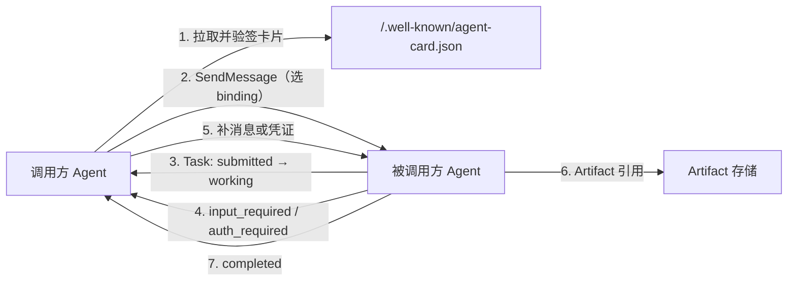

# Agent2Agent：跨组织委托的线格式

## 一句话结论

A2A 1.0 把"把活交给另一个 agent"标准化成三件事——一份可签名验证的能力名片、一个 8 状态的任务状态机、三种语义等价的 binding；它解决的是跨组织派活与验收，不解决对方内部怎么干，也不解决工具怎么接。

## 先看一次跨组织委托

采购同事对你说：**"把这家新供应商的资质审核交给他们自己的 agent，三天后把结论拿回来。"** 接下来的三天里，你这边只做了三件事：拉名片、发任务、取结果。

| 时间 | 谁 → 谁 | 动作 | 对方能看到什么 |
|---|---|---|---|
| T+0 | 你的 agent → `/.well-known/agent-card.json` | 拉取并验签 Agent Card，按 `supportedInterfaces` 选一个 binding | 一次 GET，不需要身份 |
| T+0 | 你的 agent → 供应商 agent | `SendMessage` 提交任务，拿到 `taskId` 与 `contextId` | 你提供的资质清单 |
| T+2h | 供应商 agent → 你的 agent | 状态 `working`；随后 `input_required`，问"营业执照要不要彩色扫描件" | 一条追问，不含内部步骤 |
| T+3d | 供应商 agent → 你的 agent | 状态 `completed`，回传 `Artifact`：结论与证据链接 | 结论与引用 |
| T+3d | 你的 agent | 用 MCP 工具把结论写进采购系统，并把 `taskId` 记进审计 | — |

三天里你看不到对方的模型、提示词与数据库，也不需要看到——这正是 A2A 要买的东西：**用一份名片、一个状态机和一个产出物，替掉一整套联调。**

**Agent Card**：人话是"对方挂在外网的能力名片"。类比：名片上印职位与电话，不印身份证号，所以它证明不了对方靠谱，只说明它自称是谁、能接什么活、在哪个地址接。例子：第 1 步的卡片里 `skills` 声明"供应商资质审核"，`supportedInterfaces` 说明它支持哪几种 binding，`signatures` 让你能验证这份名片没被中间人改过。

**Artifact**：人话是"任务的交付物，不是聊天记录"。类比：外包验收时收的是图纸与检测报告，不是双方来回的邮件。例子：第 4 步的 Message 里只写了"已完成"，真正的结论、评分表与证据链接都在 `Artifact` 的 `parts` 里。

下面把这三天里的对象与状态逐个定义，再看跨组织场景下它们为什么必须可验证。

## 问题与边界

- **解决什么**：让不同框架、不同厂商、不同组织构建的 agent 能互相发现、协商交互模态、委托任务并取回结果，而不需要暴露各自的内部记忆、工具与实现。
- **不解决什么**：不做工具接入（那是 [MCP](./01-mcp.md) 的事）；不做编排（谁是 supervisor、任务怎么拆，是调用方的设计）；不做计价（支付由 AP2 这类协议另立）；不保证质量（SLA 是合同条款，不是规范内容）。
- **与相邻概念的分界**：
  - vs **MCP**：MCP 是 agent 用自己的工具（垂直集成），A2A 是 agent 找另一个 agent（水平协作）。一个系统通常两者都用：内部用 MCP，跨边界用 A2A。
  - vs **普通 RPC**：A2A 的调用对象是"不透明的智能体"，任务可能跑几十分钟、需要多轮补充信息、可能被拒绝；这些语义普通 RPC 表达不了。
  - vs **A2A 就是远程调函数**：错。任务有独立生命周期与状态机，`SendMessage` 只负责提交，结果要另取。
- **版本口径**：规范 1.0.0（2026-03），上一版 0.3.0。核对日期 2026-11-20。

出现下面任一信号时，A2A 才开始划算：

- 对方的 agent 不属于你，且技术栈不可控（另一家公司、另一套云）。
- 任务耗时以分钟或小时计，需要"提交—跟进—取回"而不是一次请求。
- 协作过程中需要人工补充信息或授权，而这些动作发生在**对方**的用户侧。
- 你需要在不暴露内部数据的前提下证明"这件事是谁做的"（名片签名 + 任务记录）。
- 双方的对接关系会长期存在，值得为它实现一次规范而不是写一次性胶水。

## 核心概念与架构

五个核心对象构成整个模型：

| 对象 | 作用 | 关键字段 |
|---|---|---|
| Agent Card | 自描述名片，声明身份、能力、端点、认证方式 | `name`、`supportedInterfaces`、`capabilities`、`skills`、`securitySchemes`、`signatures` |
| Task | 一次委托的载体与状态机 | `id`、`contextId`、`status`（含 `state`）、`artifacts`、`history` |
| Message | 一次交互的单位，可挂在 context 或 task 上 | `messageId`、`role`、`parts`、`contextId`、`taskId` |
| Part | 内容片段，文本/文件/结构化数据 | 按成员存在与否判别类型，`mediaType`、`filename` |
| Artifact | 任务产出物 | `artifactId`、`name`、`parts` |

一次委托的数据流：调用方先取卡片、验签、按 `supportedInterfaces` 顺序选一个 binding；然后 `SendMessage` 提交任务，拿到 `Task`；长任务期间用 `SubscribeToTask` 或推送通知跟进；需要补充信息时任务进入 `input_required`；结束时拿 `Artifact`。被调用方的内部状态、记忆、工具对调用方全程不可见。

几个容易混淆的边界：

- **Task 与 context 不是一回事**。`contextId` 标识一段多轮对话（可跨多个 task），`taskId` 标识一次具体委托。多轮追问用同一个 `contextId` 发新消息，不要新建 context。
- **Message 不等于结果**。结果在 `Artifact` 里，Message 只承载交互过程；把大对象塞进 Message 会让 history 膨胀。
- **Agent Card 不是契约**。它是自述能力清单，调用方不能据此假设行为；真正的约束在双方的商业合同与 SLA 里。
- **Task 状态不是幂等信号**。同一个 `taskId` 的重复 `GetTask` 是只读的，但重复 `SendMessage` 会创建新任务。

## 关键机制

### 发现与签名：名片可以被伪造，所以必须能验

名片发布在 `/.well-known/agent-card.json`，内容全是自述——所以签名不是可选项而是必需项（跨组织场景）：

1. 先按 Protobuf 的字段存在性语义处理：未显式设置的可选字段从 JSON 中省略，显式设成默认值的要保留。
2. 用 JSON Canonicalization Scheme（RFC 8785）做规范化，保证不同语言实现得到同一段字节。
3. **排除 `signatures` 字段本身**，否则会形成循环依赖。
4. 用 JWS（RFC 7515）签名，`AgentCardSignature` 由 `protected`（base64url 的受保护头）、`signature`、可选 `header` 组成；受保护头必须含 `alg`、`kid`，`typ` 建议为 `JOSE`，可选 `jku` 指向公钥集。

企业场景还有一个变体：`extendedAgentCard` 能力。基础卡片只给公开信息，认证后通过 `GetExtendedAgentCard` 拿带敏感技能与内部端点的完整版本。

> 判断：名片签名解决的是"你是你"，不是"你靠谱"。验签通过只说明元数据未被篡改，不代表这个 agent 的行为符合预期；把信誉、SLA、历史质量塞进卡片的做法目前没有标准位置，只能放在 `metadata` 里自定义。

### 任务状态机：8 个状态，两类中断

`TaskState` 定义了 8 个可用状态（另有 `TASK_STATE_UNSPECIFIED` 作为未知值）：

| 状态 | 含义 | 类别 |
|---|---|---|
| `TASK_STATE_SUBMITTED` | 已受理，尚未开始处理 | 进行中 |
| `TASK_STATE_WORKING` | 正在处理 | 进行中 |
| `TASK_STATE_INPUT_REQUIRED` | 需要用户补充信息 | 中断 |
| `TASK_STATE_AUTH_REQUIRED` | 需要认证才能继续 | 中断 |
| `TASK_STATE_COMPLETED` | 成功结束 | 终态 |
| `TASK_STATE_FAILED` | 出错结束 | 终态 |
| `TASK_STATE_CANCELED` | 被取消 | 终态 |
| `TASK_STATE_REJECTED` | agent 决定不执行（可在创建时或之后） | 终态 |

两个中断态值得单独设计：`INPUT_REQUIRED` 是跨组织的"人在环"标准表示——调用方可以把补充信息以新 `Message` 发回同一个 `contextId`；`AUTH_REQUIRED` 表示需要凭证，规范允许 server 在拿到带外凭证后继续处理，**不要求**客户端再发一条消息，这让"用户去浏览器授权再回来"的流程不用重放任务。

终态不可逆，取消是协作式的：`CancelTask` 表达意图，server 可以不照做，所以调用方必须有超时兜底。

### 三种 binding：语义等价，工程取舍不同

`supportedInterfaces` 是一个有序数组，第一项是首选；每项声明 `url`、`protocolBinding`、`protocolVersion`，以及可选的 `tenant`（多租户路由用，格式由 server 自定，client 必须原样回传）。

| binding | 形态 | 适合 | 代价 |
|---|---|---|---|
| `JSONRPC` | JSON-RPC 2.0，方法名与操作一一对应 | 默认选择，网关与调试工具最成熟 | 流式要额外的 SSE 通道 |
| `GRPC` | proto service，双向流 | 内网高吞吐、强类型、低延迟 | 需要 proto 分发与 HTTP/2 栈，浏览器侧不友好 |
| `HTTP+JSON` | REST 风格 URL + 标准 HTTP 方法，媒体类型 `application/a2a+json` | 已有 API 网关、需要按路径做策略 | 长任务与流式表达最啰嗦 |

三者必须满足功能等价：同一组核心操作（`SendMessage`、`SendStreamingMessage`、`GetTask`、`ListTasks`、`CancelTask`、`SubscribeToTask`、推送配置的增删查、`GetExtendedAgentCard`）在每种 binding 上都能完成。协议级头有两个：`A2A-Version` 与 `A2A-Extensions`。

结果获取有三种模式，按场景选：短任务直接等响应；长任务用 SSE / gRPC 流；离线场景用 webhook 推送（`TaskPushNotificationConfig`）。

### 从 0.3 迁移：卡片兼容，线格式不兼容

1.0 是收紧而不是重写，但**交互格式有破坏性变更**：

- Agent Card 向后兼容，可以同时声明支持 0.3 与 1.0，客户端能渐进迁移。
- 判别方式从 `kind` 字段改为"看哪个成员存在"；`mediaType` 取代 `mimeType`，`filename` 对所有 Part 类型可用。
- 流式事件不再靠 `kind` 区分 `TaskStatusUpdateEvent` 与 `TaskArtifactUpdateEvent`，而由外层 JSON 成员名决定；`final` 字段移除，流关闭即结束。
- extended Agent Card 的字段位置变了（Appendix A.2 有专门的迁移指引）。

### 流式、推送与版本协商

结果返回有三条路，选错会让实现复杂度翻倍：

- **等同步响应**：适合几秒内完成的短任务。缺点是被网络超时卡死，十分钟的任务基本不可用。
- **流式**：`SendStreamingMessage` 或在 JSON-RPC 上开 SSE，事件分两类——状态更新与产出物更新，各自带 `taskId` 与 `contextId`。适合需要实时展示进度的场景。
- **推送**：配置 `TaskPushNotificationConfig`，server 在状态变化时回调对方 URL。适合"任务跑很久、调用方可能下线"的场景，但把安全责任推给了回调接收方（见坑 1）。

版本协商很轻：client 在 `supportedInterfaces` 里挑一项，`A2A-Version` 头声明所用版本；server 若不支持必须返回结构化的版本协商错误，附上自己支持的版本。规范没有定义"自动降级"，选哪个版本是 client 的责任。

> 判断：三种 binding 的存在不是为了让你"都实现"，而是为了让接入方用自己熟悉的基础设施。实际项目中先做 JSON-RPC，等真的出现吞吐或强类型需求再补 gRPC；HTTP+JSON 只有在对方是纯 REST 团队时才值得。

采用现状可以按三组规模数字与三条治理事实来看：

| 维度 | 数据 | 来源与时间 |
|---|---|---|
| 支持组织 | 150+（2025-04 时为 50+） | Linux 基金会新闻稿，2026-04 |
| 代码热度 | 核心仓库 22,000+ stars | 同上 |
| SDK 语言 | 5 种生产级（Python、JS、Java、Go、.NET） | 同上 |
| 治理 | 技术指导委员会 8 家：AWS、Cisco、Google、IBM Research、Microsoft、Salesforce、SAP、ServiceNow | v1.0 公告，2026-03 |
| 云平台 | Azure AI Foundry、Copilot Studio、Amazon Bedrock AgentCore Runtime | 同上新闻稿 |
| 框架 | LangGraph、CrewAI、Pydantic AI、AG2、IBM BeeAI | A2A 加入 AAIF 公告，2026-08 |

值得注意的是 2026-08 A2A 以 Growth Stage 项目身份加入 Agentic AI Foundation，与 MCP、AGENTS.md 同处一个基金会——这让"四层协议里三层同源治理"成为事实。

## 对比

| 维度 | MCP | A2A | 自建 REST 委托 |
|---|---|---|---|
| 适用条件 | 工具与上下文接入，一次实现多处复用 | 跨组织/跨框架委托，需要身份验证与任务状态 | 双方团队固定、一次对接、任务简单 |
| 抽象对象 | 工具、资源、提示 | 任务、消息、产出物 | 自定义 |
| 谁发起 | client（host 内） | 调用方 agent | 调用方服务 |
| 长任务 | Tasks 扩展（Beta） | 一等公民，8 状态机 | 自己造轮子 |
| 身份 | OAuth 授权服务器 | Agent Card JWS + `securitySchemes` | 自定义 |
| 失败粒度 | 单次调用 | 整个任务 | 单次请求 |
| 引入时机 | 有第二个 host 要接同一批工具 | 对方是另一家公司或另一套技术栈 | 一次性、内部、可人工兜底 |

## 实践建议与常见坑

落地顺序建议按"能被验证的最小闭环"推进，不要一次做完：

1. 先发布签名卡片，只声明一个 skill，验证对方能拉取并验签。
2. 实现 `SendMessage` + `GetTask`，跑通同步短任务。
3. 加 `CancelTask` 与超时，确认取消是协作式的并写进对接文档。
4. 再补流式或推送，二选一，不要同时上。
5. 最后接 `input_required` 与 `auth_required`，这两条路径最容易在联调时被漏测。

- **企业治理四件事**：发现用 well-known 路径加内部 registry；认证按 `securitySchemes` 协商（OAuth2、mTLS、API Key 都在规范里）；审计没有标准事件格式，要自己把任务状态迁移与消息落进 OpenTelemetry，见 [可观测性](../04-engineering/01-observability.md)；SLA 写进合同而不是协议。
- **坑 1：推送回调的 SSRF**。触发条件：`TaskPushNotificationConfig` 的 URL 由对方提供且不做校验。后果：server 被诱导请求内网地址。规避：回调域名 allowlist、拒绝私有网段与 loopback、限制重定向。
- **坑 2：把 Agent Card 当可信配置**。触发条件：直接拿卡片里的 `url` 与 `skills` 驱动路由与权限。后果：卡片是自述内容，可指向任意地址、可夸大能力。规避：按 schema 校验、把卡片字段当不可信输入、每次都验签、不缓存未签名卡片。
- **坑 3：重试导致重复任务**。触发条件：`SendMessage` 超时后无条件重发。后果：对方创建两个任务、产出两份 Artifact。规避：用 `messageId` 做幂等、重试前先 `ListTasks` 按 `contextId` 查、给任务设 TTL。
- **坑 4：以为取消会立刻生效**。触发条件：UI 上点了取消就当资源已释放。后果：对方继续跑完并计费。规避：把取消当"请求"，按终态轮询确认，超时后走人工。
- **坑 5：多租户下漏传 `tenant`**。触发条件：单一端点承载多个 agent，client 只在首次请求带 `tenant`。后果：路由到错误的 agent 或直接 4xx。规避：把 `tenant` 当接口级必填项，在客户端封装层统一注入。
- **坑 6：把 `history` 当审计日志**。触发条件：直接依赖任务的 `history` 字段做合规留痕。后果：`history` 长度受实现控制，可能被截断或按 `historyLength` 裁剪，留痕不完整。规避：审计单独落库，`history` 只用于调试与续接对话。
- **坑 7：一张卡片描述多个环境**。触发条件：staging 与 prod 共用同一份卡片的 `url`。后果：联调流量打到生产，或被生产校验拒掉。规避：按环境发布不同卡片，用 `supportedInterfaces` 的 `tenant` 或路径区分。
- **坑 8：缓存了未签名的卡片**。触发条件：为了省一次请求，把首次拉到的卡片缓存很久。后果：对方换了密钥或端点，调用方仍按旧卡片发请求，且无法察觉卡片曾被篡改。规避：缓存遵守 `Cache-Control`，每次使用前验签，签名校验失败就重新拉取而不是继续用。
- **坑 9：把 `REJECTED` 当失败重试**。触发条件：收到 `TASK_STATE_REJECTED` 就换参数重发。后果：对方明确表示不接，重试只会得到更多拒绝，还可能触发风控。规避：`REJECTED` 是终态，应走人工沟通而不是自动重试。

## 开放问题

- **注册中心的归属**：官方路线图提到 registry 的整合，但截至 2026-11 没有一个和 MCP Registry 对等的公共目录，"怎么找到对方 agent"仍靠人工交换名片。
- **计费与结算**：AP2 已被 60+ 组织支持，但它管支付凭据与用户授权证据，不管"按任务计价、按 token 计量"的通用模型。
- **验收标准**：任务 `COMPLETED` 只表示对方认为完成，不代表调用方认可；质量争议没有协议层仲裁机制。
- **1.0 的稳定性承诺边界**：卡片向后兼容，但线格式在 0.3→1.0 已经破坏过一次，后续大版本如何承诺仍待观察。
- **身份联邦**：JWS 验签需要预先信任签发方；跨多个组织的信任根怎么建立，没有规范答案。
- **合规留痕**：金融、医疗场景需要"谁在什么时候批准了什么"，当前只能把任务状态迁移映射到自有审计表，映射规则各家不同。
- **与 MCP 的边界在实践中仍被混淆**：不少团队把内部服务同时包成 MCP server 与 A2A agent，结果是两套权限模型并存，需要额外治理。
- **错误语义的统一**：三种 binding 各有自己的错误码空间（JSON-RPC 错误、gRPC status、HTTP 状态码），规范给了映射表，但跨 binding 的重试判定仍要自己写。

## 参考来源

- A2A Protocol Ships v1.0 · A2A Protocol Community · 2026-03 · https://a2a-protocol.org/latest/blog/2026/03/12/a2a-protocol-ships-v10-production-ready-standard-for-agent-to-agent-communication/
- Agent2Agent (A2A) Protocol Specification · A2A Protocol · 2026-11 · https://a2a-protocol.org/latest/specification/
- What's New in A2A Protocol v1.0 · A2A Protocol · 2026-03 · https://a2a-protocol.org/latest/whats-new-v1/
- A New Chapter for A2A: Joining the Agentic AI Foundation · A2A Protocol · 2026-08 · https://a2a-protocol.org/latest/blog/2026/08/27/a-new-chapter-for-a2a-joining-the-agentic-ai-foundation/
- A2A Protocol Surpasses 150 Organizations · The Linux Foundation · 2026-04 · https://www.linuxfoundation.org/press/a2a-protocol-surpasses-150-organizations-lands-in-major-cloud-platforms-and-sees-enterprise-production-use-in-first-year
- A2A and MCP · A2A Protocol · 2026-11 · https://a2a-protocol.org/latest/topics/a2a-and-mcp/
- Streaming & Asynchronous Operations · A2A Protocol · 2026-11 · https://a2a-protocol.org/latest/topics/streaming-and-async/
- Multi-Tenancy · A2A Protocol · 2026-11 · https://a2a-protocol.org/latest/topics/multi-tenancy/
- Linux Foundation Announces the Formation of the Agentic AI Foundation · AAIF · 2025-12 · https://aaif.io/news/linux-foundation-announces-formation-of-aaif
