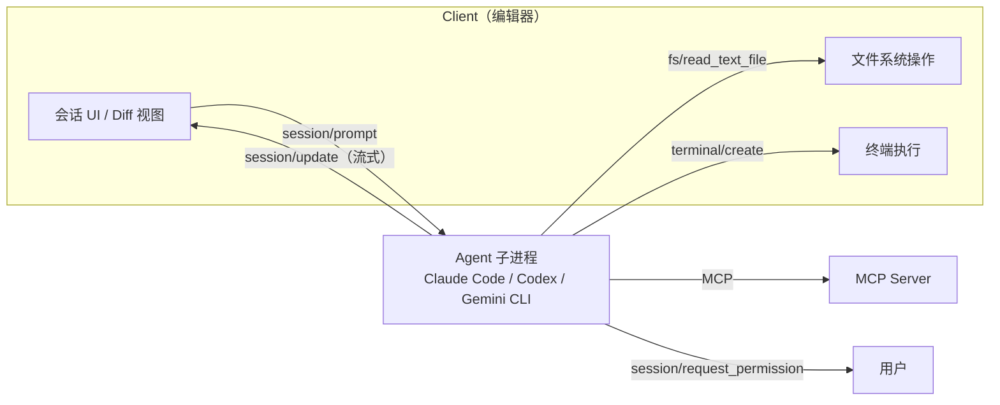

# Agent Client Protocol：编辑器与 Agent 进程的解耦

## 一句话结论

ACP 把"编辑器 UI"和"agent 进程"拆成 JSON-RPC over stdio 的两端，让 agent 一次实现、所有客户端可用；2026-01 上线的 Registry 补上了分发这一环，这才是它从"Zed 的功能"变成"生态位"的转折点。

## 先看一次会话：从打开到批准一次写入

你在 Zed 里打开一个 Claude Code 会话，输入：**"把请求超时改成 30 秒，顺手补个测试。"** 这句话在 ACP 里是这样跑完的：

| 步 | 方向 | 方法 | 发生了什么 |
|---|---|---|---|
| 1 | client → agent | `initialize` | 拉起 agent 子进程，协商版本并交换双方能力 |
| 2 | client → agent | `session/new` | 传 `cwd` 与 `mcpServers`，拿到 `sessionId` |
| 3 | client → agent | `session/prompt` | 你这句话进入 agent，回合开始 |
| 4 | agent → client | `session/update` | 流式推消息分片、工具调用与计划，UI 边跑边显示 |
| 5 | agent → client | `session/request_permission` → `fs/write_text_file` | 弹 diff 等你批准；批准后**由编辑器**写文件 |
| 6 | agent → client | `terminal/create` → 回合结束 | 由编辑器跑测试，回合以 `stopReason` 收尾 |

有两处细节值得先记住：**文件与终端是 client 提供的服务**，agent 只是请求方；权限请求则是建议性的——用户点拒绝之后是否真的停下，取决于 agent 的实现，编辑器并不替它做沙箱。

**session**：人话是"一段带工作区边界的对话"。类比：同一栋楼里借会议室，会议号是连接，房间与门禁卡是 `cwd` 与 `mcpServers`。例子：第 2 步之后你在同一条连接上再开一个会话，两者 `sessionId` 不同、工作目录可以不同，互不串味。

**permission request**：人话是"agent 说'我要动手了，你点头吗'"。类比：装修师傅进门先问"这面墙能砸吗"，砸墙的动作仍由他做，你只能事前表态。例子：第 5 步弹出的那个 diff 就是点头点；它拦住的是"用户不知情"，拦不住"agent 绕过编辑器直接调系统 API"。

下面把这条链路上的对象、方法与信任模型拆开看。

## 问题与边界

- **解决什么**：消除"每个编辑器 × 每个 agent"的定制集成。agent 只需实现一次协议，就能被任何 ACP 客户端（IDE、终端、笔记本）拉起；编辑器只需实现一次客户端，就获得整个 agent 生态。思路与 Language Server Protocol 同源。
- **不解决什么**：不管 agent 内部怎么接工具（那是 [MCP](./01-mcp.md)）；不做沙箱（agent 拿到的是进程权限）；不做模型调用计费；不规定 UI 长什么样。
- **与相邻概念的分界**：
  - vs **MCP**：ACP 管"编辑器 ↔ agent"，MCP 管"agent ↔ 工具"。会话建立时编辑器会把可用的 MCP server 配置传给 agent，两者在同一条链路上串联。
  - vs **LSP**：同为 JSON-RPC、同为本机子进程、同为"解耦编辑器与能力提供方"，但 LSP 传的是语言语义（诊断、补全），ACP 传的是对话回合、工具调用与权限请求。
  - **命名歧义**：ACP 这个缩写同时被 OpenAI 的"Agentic Commerce Protocol"（支付与结账方向）使用。本文只讲 Agent Client Protocol；讨论时建议写全称。
- **版本口径**：协议 v1 为稳定版，v2 在 2026-11 仍标注 draft。核对日期 2026-11-20。

出现下面情况时 ACP 才值得接：

- 你的 agent 已经有 CLI 形态，希望被第三方编辑器直接调用，而不是让用户复制粘贴。
- 你要做编辑器/IDE，不想为每个 agent 写适配层。
- 你需要在同一台机器上并行跑多个 agent 会话，并让用户在 UI 里统一审批工具调用。

## 核心概念与架构

两端角色很清晰：

- **Client**：编辑器或任何面向用户的 UI。它负责启动 agent 子进程、渲染会话、弹权限确认，并在 agent 请求时**自己执行**文件读写与终端操作。
- **Agent**：使用生成式模型自主改代码的程序，通常作为 client 的子进程运行。它拥有自己的工具循环，可以再通过 MCP 连外部工具。

| 对象 | 含义 | 关键点 |
|---|---|---|
| Connection | 一条 stdio 连接，`initialize` 协商版本与能力 | 一条连接可承载多个并发会话 |
| Session | 一段对话及其工作区上下文 | `cwd` 决定主工作目录，`mcpServers` 决定可用工具 |
| Prompt turn | 一次 `session/prompt` 引发的处理回合 | 以 `stopReason` 结束 |
| Tool call | agent 请求执行的单个动作 | 通过 `session/update` 上报，可请求权限 |
| Permission request | agent 向用户申请授权 | **建议性**，不是强制门 |

一次会话的数据流：编辑器按需启动 agent 子进程 → `initialize` 协商版本与双方能力 → `session/new` 传入 `cwd` 与 `mcpServers` 拿到 `sessionId` → 用户输入触发 `session/prompt` → agent 边跑边用 `session/update` 推送消息分片、工具调用与计划 → 需要授权时发 `session/request_permission` → 回合以 `stopReason` 结束。

## 关键机制

### 传输与进程模型

协议目前只定义一种传输：**stdio**。

- client 启动 agent 子进程，消息按行分隔（`\n`）的 JSON-RPC，UTF-8 编码，单条消息内不得含换行。
- agent 可以把日志写到 stderr，client 可以采集、转发或忽略。
- **agent 不得向 stdout 写任何非 ACP 消息**；反过来 client 也不得向 stdin 写非 ACP 内容。这条约束是排障时的第一检查项。
- 远程传输（基于 Streamable HTTP）仍在 RFD 阶段，尚未进入规范。

进程模型的直接后果：agent 与编辑器同机、同用户、同一文件系统。这带来最低的接入成本，也带来最弱的隔离。

### 方法面：谁调谁，一目了然

方法的方向决定了能力边界，这张表比读规范更快：

| 方向 | 方法 | 作用 | 能力门槛 |
|---|---|---|---|
| Client → Agent | `initialize` | 协商版本、交换能力与 agent 信息 | 必须 |
| Client → Agent | `authenticate` | 走 agent 声明的认证方式 | 视 `authMethods` |
| Client → Agent | `session/new` | 新建会话，传 `cwd` 与 `mcpServers` | 必须 |
| Client → Agent | `session/load` | 载入历史会话 | 视能力 |
| Client → Agent | `session/prompt` | 发送用户消息，推进回合 | 必须 |
| Client → Agent | `session/cancel`（通知） | 取消当前回合 | 必须 |
| Agent → Client | `session/update`（通知） | 流式推送消息、工具调用、计划、通知 | 必须 |
| Agent → Client | `session/request_permission` | 请求用户授权某个操作 | 必须 |
| Agent → Client | `fs/read_text_file` / `fs/write_text_file` | 读写文件 | `fs.readTextFile` / `fs.writeTextFile` |
| Agent → Client | `terminal/create` / `output` / `wait_for_exit` / `kill` / `release` | 执行并管理命令 | `terminal` |
| Agent → Client | `elicitation/create` | 向用户要结构化信息 | 对应 elicitation 模式 |

注意方向：**文件系统与终端是 client 提供的服务**，agent 只是请求方。这跟你可能习惯的"agent 自己 open() 文件"不同——ACP 的设计意图是让编辑器掌握真实副作用，从而能在 UI 上展示与审批。

### 会话与工作区边界

`session/new` 的两个参数决定了 agent 能看到什么：

- `cwd`：主工作目录，也是相对路径的基准。它构成会话的**根集合**，理想情况下应作为文件操作的边界。
- `mcpServers`：编辑器把自己配置的 MCP server 传下去，agent 不需要自己再配一遍。这也是 ACP 与 MCP 的接缝——凭据由 client 持有并注入。

会话可以并发：一条连接上多个会话同时推进，各自有独立的 `sessionId`。这对"并行开几个思路"的编辑器很重要，但也意味着 agent 实现必须把状态按 session 隔离，不能用一个全局变量存当前对话。

### 权限与信任：协议不做沙箱

规范把信任模型写得很直白，三条值得抄进设计文档：

1. **agent 拿到进程的什么权限，就有什么权限**，ACP 本身不做沙箱。
2. **权限请求是建议性的**：agent 自己执行操作，是否遵守用户的拒绝取决于 agent 的实现；client 只是把决定告诉它。
3. **文件与终端操作由 client 执行**，所以这两类副作用天然可拦截——但只要 agent 直接调系统 API，就绕过了这层。

安全建议里还有几条实践性很强的：不要执行 agent 内容里的脚本、渲染 Markdown 时禁用原始 HTML、不要自动打开 agent 给的链接、`clientInfo` / `agentInfo` 是自述不能用于安全决策、不要把凭据放进 `_meta`。

> 判断：ACP 的信任模型是"你信任你装的这个 agent"。它适合"用户主动选择并安装 agent"的场景，不适合"平台替用户决定跑哪个 agent"的场景——后者需要的是容器级隔离，而不是协议层的权限请求。

### Registry：一次注册，全客户端可用

2026-01-28 上线的 ACP Registry 解决的是分发，而不是协议本身：

- agent 开发者提交一次，合并后立刻出现在所有支持 Registry 的客户端里；版本更新不必等编辑器发版。
- Zed 与 JetBrains IDE 已内置 Registry 支持，用户可在编辑器内搜索安装。
- 收录是**策展式**的，只接受支持认证的 agent；截至 2026-11，官方文档列出的可用 agent 约 46 个，包括 Claude Agent、Codex、Gemini CLI、GitHub Copilot、Cursor、Devin、Cline、OpenCode 等。
- 它取代了早期的"agent 扩展"机制；两者暂时并存，同时安装时 Registry 版本优先。

这一步的意义被低估了：协议只解决"能连"，Registry 解决"能被找到"。没有分发层时，每个 agent 仍要分别为每个编辑器打包扩展，协议带来的复用收益会被分发成本吃掉。

### v1 稳定、v2 仍是 draft

v2 已在文档中公开，但规范自己标注为 draft，且要求实现者"把 v2 支持放在显式版本协商与 feature flag 之后"。主要变化：

- `session/prompt` 的响应不再代表回合结束，只表示"已受理"；进度与结束改由 `state_update` 通知，`stopReason` 也移了过去。
- 消息与工具调用改为按 ID 的 **upsert** 语义：字段省略表示不变，`null` 表示清空，值表示替换。
- 移除 client 侧的文件系统与终端 API、移除 session modes，改用 client 提供的 MCP server 与 `session/set_config_option`。
- 能力声明重组，`session/*` 方法成为必选基线；未知枚举值默认可接受，`_` 前缀保留给实现私有扩展。

迁移建议很明确：**v1 与 v2 按连接协商、并行支持**，不要一次性切换。

| 主题 | v1 | v2（draft） |
|---|---|---|
| 回合结束的表示 | `session/prompt` 响应即结果 | 响应只表示受理，结束靠 `state_update` + `stopReason` |
| 更新语义 | 追加分片为主 | 按 ID upsert，`null` 清空 |
| 文件与终端 | client 提供 `fs/*`、`terminal/*` | 移除，改用 client 提供的 MCP server |
| 会话模式 | `session/set_mode` | `session/set_config_option` |
| 版本协商失败 | 无专用错误码 | `-32022`，附 `requested` / `supported` |
| 兼容策略 | — | 同一连接协商单一版本，v1 与 v2 并行服务 |

## 对比

| 维度 | ACP | MCP | LSP |
|---|---|---|---|
| 解决哪一层 | 编辑器 ↔ agent 进程 | agent ↔ 工具/数据 | 编辑器 ↔ 语言服务器 |
| 传输 | stdio（远程传输在 RFD） | stdio、Streamable HTTP | stdio、socket |
| 谁启动谁 | client 启动 agent 子进程 | host 启动或连接 server | 编辑器启动 server |
| 信任边界 | 同机同用户，协议不做沙箱 | server 只看到必要上下文 | 同机，读取项目文件 |
| 核心语义 | 会话、回合、工具调用、权限请求 | 工具、资源、提示、能力协商 | 诊断、补全、跳转、重构 |
| 成熟度 | v1 稳定，v2 draft | 2026-07-28 规范 | 长期稳定的事实标准 |
| 选它的条件 | 你的 agent 要被非自家编辑器调用 | 你的工具要被多个 host 复用 | 你要给编辑器加语言能力 |

## 实践建议与常见坑

如果你要写一个 ACP agent，最小可用集的边界很清楚——不做下面五件事，客户端就装不起来：

1. 实现 `initialize`，在 `agentCapabilities` 里如实声明你支持什么，不要谎报。
2. 实现 `session/new`，把 `cwd` 当工作区根，按 `mcpServers` 建 MCP 连接。
3. 实现 `session/prompt`，把回合中的所有进展用 `session/update` 推出去。
4. 实现 `session/cancel`，并在收到后尽快停下来，返回 `cancelled` 的 `stopReason`。
5. 在所有可能产生副作用的工具调用前发 `session/request_permission`，即使你知道用户大概率同意。

- **坑 1：stdout 被日志污染**。触发条件：agent 内部用了会往 stdout 打的日志库或 `print`。后果：client 解析到非 JSON 行，整条连接报错断开，且报错位置与真实原因无关。规避：进程启动时把 stdout 重定向到协议通道、日志一律走 stderr、在 CI 里加一条"stdout 只能有合法 JSON-RPC"的测试。
- **坑 2：把权限请求当强制门**。触发条件：以为用户点了拒绝，agent 就一定不会执行。后果：不合规的 agent 照做，审计上出现"用户已拒绝但操作发生"。规避：高风险操作放在 client 侧执行（`fs/*`、`terminal/*`），不要给 agent 直接的系统权限；把权限结果写进日志。
- **坑 3：路径不是绝对路径**。触发条件：agent 传相对路径，或把 `file://` URI 当路径。后果：client 解析到错误位置，或跨平台直接失败。规范要求所有路径必须是绝对路径且用本机原生语法，行号从 1 开始。
- **坑 4：以为 VS Code 原生支持**。触发条件：按"主流编辑器都支持"做规划。后果：VS Code 侧目前主要靠社区扩展提供 ACP 客户端，其 agent 模式走的是 MCP 路线。规避：按客户端逐个核实，见 [编码 Agent](../05-products/01-coding-agents.md)。
- **坑 5：只实现 stdio 就想支持云端 agent**。触发条件：agent 跑在远端容器里。后果：没有远程传输可用，只能自己写隧道，等于绕开协议。规避：等 RFD 落地，或明确把远端场景排除在 ACP 之外。
- **坑 6：把凭据放进 `_meta`**。触发条件：为了省事把 API key 塞进扩展字段。后果：会被日志、trace、中间层采集。规避：凭据走 `mcpServers` 的注入通道或系统密钥库，`_meta` 只放非敏感元数据。
- **坑 7：并发会话共享全局状态**。触发条件：agent 用单例存"当前会话"。后果：用户在两个会话里并行提问时，回答串台、工具结果写进错误的目录。规避：所有状态挂在 `sessionId` 上，把并发会话当成两个独立进程来写。
- **坑 8：忘记回 `stopReason`**。触发条件：回合被工具异常中断时直接返回错误。后果：编辑器停在"生成中"，用户无法继续输入。规避：无论成功、取消还是失败，都用 `session/update` 给出终态与 `stopReason`。

## 开放问题

- **远程传输**：Streamable HTTP 传输仍在 RFD，云端 agent 与"编辑器在本地、agent 在远端"的场景缺少标准答案。
- **权限的强制力**：协议层只能"请求"，无法"强制"。真正的强制需要操作系统级沙箱或容器，这超出了 ACP 的范畴。
- **v2 的稳定时间**：v2 改动了回合语义与能力模型，属于破坏性变更；生态里大量实现仍以 v1 为基线，迁移窗口有多长没有官方时间表。
- **治理归属**：ACP 由 Zed 主导、JetBrains 参与推进，没有进入基金会。路线图依赖单一公司的优先级，这是与 MCP、A2A 的显著差异。
- **与 MCP 的职责边界**：当 agent 通过 client 提供的 MCP server 访问文件时，"文件写入到底该由 ACP 的 `fs/*` 还是 MCP 工具完成"没有统一答案，两套路径会产生不同的审计口径。
- **多客户端的一致性**：同一 agent 在 Zed、JetBrains、Neovim 里的行为取决于各客户端实现了哪些可选方法，缺少一份公开的客户端能力对照表。
- **会话持久化**：`session/load` 让 agent 恢复历史会话，但恢复哪些内容（消息、工具结果、计划）没有规定，跨客户端迁移会话可能丢上下文。

## 参考来源

- Bring Your Own Agent to Zed — Featuring Gemini CLI · Zed · 2025-08 · https://zed.dev/blog/bring-your-own-agent-to-zed
- Introduction · Agent Client Protocol · 2026-11 · https://agentclientprotocol.com/get-started/introduction
- Architecture · Agent Client Protocol · 2026-11 · https://agentclientprotocol.com/get-started/architecture
- Overview (v1) · Agent Client Protocol · 2026-11 · https://agentclientprotocol.com/protocol/v1/overview
- Transports (v1) · Agent Client Protocol · 2026-11 · https://agentclientprotocol.com/protocol/v1/transports
- Session Setup (v1) · Agent Client Protocol · 2026-11 · https://agentclientprotocol.com/protocol/v1/session-setup
- Security Considerations (v1) · Agent Client Protocol · 2026-11 · https://agentclientprotocol.com/protocol/v1/security
- Migrating from v1 · Agent Client Protocol · 2026-11 · https://agentclientprotocol.com/protocol/v2/migration
- ACP Registry · Agent Client Protocol · 2026-11 · https://agentclientprotocol.com/get-started/registry
- The ACP Registry is Live · Zed · 2026-01 · https://zed.dev/blog/acp-registry
- Clients · Agent Client Protocol · 2026-11 · https://agentclientprotocol.com/get-started/clients
