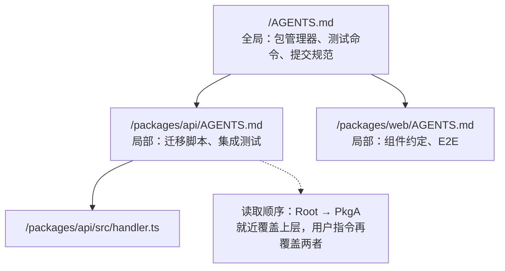

# AGENTS.md：仓库级上下文的约定

## 一句话结论

AGENTS.md 赢在"它不是协议"——一个 Markdown 文件加一条"就近文件优先"的覆盖规则，没有 SDK、没有 schema、没有版本号，所以所有编码 agent 都能用最低成本接纳；真正的风险不在格式，而在把它当成强制策略。

## 先看新同学的第一天

新同学 clone 仓库，在 `packages/api` 下对 agent 说：**"跑一下测试。"** agent 抬手就是 `npm test`——这个命令在 pnpm workspace 里根本不存在。半小时后他学会了一件事：不写下来，每个新来的 agent 都会重犯同一个错。

| 步 | 发生了什么 | 结果 |
|---|---|---|
| 1 | agent 在工作目录及上层找约定文件，一个也没有 | 只能按训练里的惯例猜命令 |
| 2 | 猜出 `npm test`，实际仓库用 `pnpm -r test` | 报错 "missing script"，它又换着写法试了三次 |
| 3 | 团队在仓库根加 `AGENTS.md`，写清包管理器、测试命令、提交规范 | 新会话第一次就跑对命令 |
| 4 | 但 `packages/api` 的集成测试要先起 docker compose，根文件没写 | agent 跑完单测就宣布"测试通过"，掩盖了集成失败 |
| 5 | 在 `packages/api/AGENTS.md` 补三行局部约定 | 就近覆盖生效，进这个目录的 agent 自动改用集成测试命令 |

同样的机制还解释了两个反直觉现象：文件写得越长，被真正读到并照做的比例越低；而读不到文件时 agent 不报错，错误就静默地留在那里。

**AGENTS.md**：人话是"放在仓库里、给 agent 看的那份 README"。类比：贴在机房门口的运维须知，进门的人都会扫一眼，但没有门禁强制他照做。例子：第 3 步那份根文件只写"怎么构建、怎么测、哪些目录别动"，不写项目介绍——那是 README 的活。

**就近覆盖**：人话是"越靠近现场的规定越优先"。类比：公司总则要求穿正装，实验室门口写着"进洁净区先换无尘服"，后者赢。例子：第 5 步之后，`packages/api` 下的 agent 用集成测试命令，`packages/web` 下的仍用根文件里的命令。

下面看这套约定靠什么机制生效，以及它在哪些位置注定无效。

## 问题与边界

- **解决什么**：给编码 agent 一个稳定、可预测的位置，存放"这个仓库怎么构建、怎么测、有什么禁忌"这类项目专属上下文，避免每个工具各自发明配置文件。
- **不解决什么**：不保证 agent 遵守（纯文本，无强制力）；不做工具编排；不做权限控制；不解决跨仓库的规范同步。
- **与相邻概念的分界**：
  - vs **README**：README 面向人（项目介绍、贡献指南），AGENTS.md 面向 agent（命令、约定、边界），故意分开以免 README 膨胀。
  - vs **prompt / system prompt**：AGENTS.md 是仓库资产、进版本控制、团队共享；system prompt 是产品配置、用户不可见。
  - vs **协议**：它没有线格式、没有握手、没有错误码，所以不该出现在"协议分层"的同一层级里讨论——它是**约定**，靠工具自觉读取。
- **版本口径**：无版本概念。治理方为 Agentic AI Foundation（Linux 基金会）。核对日期 2026-11-20。

值得用的信号：

- 仓库里已经出现第二个编码 agent（或计划引入），你不想维护两份重复的指令。
- 新人（人或 agent）反复问同样的问题：怎么起服务、测试跑哪个命令、哪些目录别动。
- monorepo 里各子包约定不同，需要一个能分层的机制。

反过来，这些情况不必写：

- 只有一个开发者、一个 agent，约定在你脑子里——写了也没人读。
- 你需要的是**强制**（比如禁止改某目录），应该用 CI、hook 或 CODEOWNERS。
- 你需要的是**可复用能力**（脚本、模板、领域知识），那是 skill 或插件的事。

## 核心概念与架构

三句话概括它的模型：

1. **仓库是上下文源**。指令跟代码放在一起，跟着分支走，review 时能被审。
2. **就近优先**。agent 读工作目录及以上的所有 AGENTS.md；文件所在子目录有更近的，就近的覆盖上层。
3. **用户显式指令最高**。聊天里用户说的话覆盖文件里的任何约定。

| 载体 | 谁写 | 作用域 | 是否强制 |
|---|---|---|---|
| 根 `AGENTS.md` | 团队 | 整仓 | 否，靠 agent 自觉 |
| 子目录 `AGENTS.md` | 子团队 | 该子目录及以下 | 否，就近覆盖 |
| `.claude/rules/` | 团队 | 可按路径匹配 | 否，但可按 glob 精确到文件类型 |
| skills | 团队/个人 | 按需加载的能力包 | 否，靠触发条件 |
| hooks | 团队 | 工具调用前后 | **是**，能被工具强制执行 |



一次"改一个文件"的加载过程：agent 启动时读工作目录及以上的所有 AGENTS.md → 当它用 Read 打开某个子目录文件时，再读该子目录的 AGENTS.md（如果存在）→ 冲突时就近的赢 → 用户在对话里的要求覆盖全部。

## 关键机制

### 起源与治理：一场命名之争的收敛

时间线能解释为什么它是现在这个形状：

| 时间 | 事件 |
|---|---|
| 2025-05 | Amp（Sourcegraph）支持 `AGENT.md`（单数） |
| 2025-08 | OpenAI 选择 `AGENTS.md`（复数）并取得 `agents.md` 域名 |
| 2025-08-19 | Amp 宣布切换到 `AGENTS.md`，同时保留对旧文件名的向后兼容 |
| 2025-08 | OpenAI 正式发布 AGENTS.md，Cursor、Jules、Factory 等参与共建 |
| 2025-12-09 | OpenAI 将其捐赠给 Linux 基金会旗下的 Agentic AI Foundation |
| 2026-11 | 官网标注 60k+ 开源项目使用；AAIF 托管 |

收敛的关键不是技术优势，而是 Amp 主动让步——它的原话是"我们更希望只有一个标准"，条件是 OpenAI 拿到 `agents.md` 域名。这个决定让生态少分裂了一次。

> 判断：AGENTS.md 的生命力来自"零成本采纳"。任何要求改构建、装插件、注册账号的标准都推不动；一个 `mv` 就能迁移的约定，才有机会在两年内铺到六万个仓库。

### 格式：没有必填字段，只有惯例

规范层面几乎没有规定，全部是惯例：

- 标准 Markdown，标题随意，agent 只解析文本。
- 常见段落：项目概览、构建与测试命令、代码风格、测试说明、安全注意事项、PR 规范。
- 命令要**可直接执行**且带上下文（在哪个目录跑、需要什么前置），因为 agent 会真的去执行它们并在失败后修。
- 边界要写清楚：哪些目录只读、哪些操作要先问、哪些命令禁止在本地跑。
- monorepo 用嵌套文件；官方举例里 OpenAI 主仓有数十个 AGENTS.md（写作时为 88 个）。

迁移的官方建议很简单：把旧文件改名，再建符号链接保持兼容。

```bash
mv AGENT.md AGENTS.md && ln -s AGENTS.md AGENT.md
```

### 就近覆盖：一条规则解决 80% 的冲突

规则只有一句：**离被编辑文件最近的 AGENTS.md 优先**，而用户在对话里的显式要求覆盖一切。

这条规则的好处是不需要继承语法、不需要 include、不需要命名空间。代价是：

- 距离是唯一的优先级信号，表达不了"这个子包想继承上层但改一条"这种需求，只能在子文件里重复写。
- 上层文件里的"全局禁令"可能被下层无意覆盖——比如根目录写"禁止直接改 lockfile"，某个子包写"本包允许更新 lockfile"，后者生效。
- agent 是否真的读了某个子目录的文件，取决于它的实现（什么时候触发读取），不同工具行为不同。

### 工具支持矩阵

| 工具 | 支持方式 | 注意 |
|---|---|---|
| Codex | 原生读取 | 官方示例仓库即用此格式 |
| GitHub Copilot（编码 agent） | 官方列为兼容工具 | 与 `.github/copilot-instructions.md` 并存时需明确优先级 |
| Gemini CLI | 需在 `.gemini/settings.json` 配置 `context.fileName` 为 `AGENTS.md` | 不配置则读默认文件名 |
| Cursor | 支持 | 与 `.cursor/rules/` 并存 |
| Aider | 在 `.aider.conf.yml` 写 `read: AGENTS.md` | 需显式配置 |
| Zed | 支持 | 同时有自己的 rules 机制 |
| Devin / Factory / Jules / Amp / Warp / opencode 等 | 原生或可配置 | 逐个核实，不要假设 |
| Claude Code | v2.1.277 起默认回退读取 | 见下一节，规则最复杂 |

### Claude Code 的兼容策略（最容易被写错的地方）

Claude Code 的主指令文件仍是 `CLAUDE.md`，AGENTS.md 是**回退**而非替代。以下行为以官方 memory 文档 2026-11 版为准；这一块迭代很快，落地前先用 `claude --version` 与官方文档核对。准确行为：

- 自 v2.1.277 起，若工作目录及其上层**没有** `CLAUDE.md`、`.claude/CLAUDE.md` 或 `CLAUDE.local.md`，则读取 `AGENTS.md`。
- 有上述任一文件时，默认只读 CLAUDE.md 系文件；想让两者都读，需要把 `/config` 里的 **Project instructions** 设为 `claude-md-and-agents-md`。
- 可选值共四个：`claude-md-or-agents-md`（默认，二选一）、`claude-md-and-agents-md`（都读，同目录下先 CLAUDE.md 后 AGENTS.md）、`claude-md`（只读 CLAUDE.md）、`managed-only`（启动时只读组织托管 CLAUDE.md 与 auto memory）。
- `~/.claude/CLAUDE.md`、组织托管配置、`.claude/rules/` **不**参与"是否存在 CLAUDE.md"的判断，它们会与 AGENTS.md 一起加载。
- 注意 `CLAUDE.local.md` 也算数：加了个人本地文件，反而会让 AGENTS.md 不再被读。
- 也可以保留 `CLAUDE.md` 并在其中写 `@AGENTS.md` 导入；导入最大四层跳转。
- 直接读到的 AGENTS.md 与 CLAUDE.md 有两个行为差异：`InstructionsLoaded` hook **不会**触发；用 `--add-dir` 加进来的目录里的 AGENTS.md **不会**加载。
- v2.1.281 之前，跑在 Amazon Bedrock 上或关闭了遥测的会话只读 CLAUDE.md，这些环境要靠 `@AGENTS.md` 导入。
- 用符号链接把 `CLAUDE.md` 指向 `AGENTS.md` 可行，但 Edit/Write 工具拒绝穿过符号链接写，且 Windows 上需要额外权限、Git 可能检出为普通文件。
- 顺带一提：Claude Code 自身也可以作为 ACP agent 被编辑器（如 Zed）调用，那时仓库约定的加载由 agent 进程负责，见 [Agent Client Protocol](./03-acp.md)。

### 与 rules、skills、hooks 的关系

这四者是不同层，混用会导致"写了没生效"：

| 机制 | 层级 | 加载时机 | 能否强制 |
|---|---|---|---|
| AGENTS.md | 指令/上下文 | 会话开始 + 打开子目录文件时 | 否 |
| CLAUDE.md | 指令/上下文 | 会话开始 | 否 |
| rules | 指令/上下文，可按路径匹配 | 会话开始或按 glob 触发 | 否 |
| skills | 能力包 | 按触发条件按需加载 | 否 |
| hooks | 执行拦截 | 工具调用前后 | 是 |

结论很直接：**要"建议"用 AGENTS.md，要"强制"用 hook**。规范文档里也这么写：想无条件阻止某个动作，用 PreToolUse hook，而不是把话写得更重。

## 对比

| 维度 | AGENTS.md | CLAUDE.md | 子目录 AGENTS.md | skill / hook |
|---|---|---|---|---|
| 适用条件 | 多工具共用一个仓库约定 | 只用 Claude Code，且需要 Claude 特有指令 | monorepo 子包有独立约定 | 需要按需加载能力 / 需要强制拦截 |
| 加载方式 | 就近覆盖 | 全量加载，层级固定 | 就近覆盖 | 触发式 / 拦截式 |
| 强制力 | 无 | 无 | 无 | hook 有，skill 无 |
| 迁移成本 | 最低（改名即可） | 低 | 低 | 中（要写代码） |
| 主要风险 | 跨工具行为不一致 | 与 AGENTS.md 并存时互相遮蔽 | 覆盖上层禁令 | 过度拦截影响正常操作 |

## 实践建议与常见坑

一个能用的最小骨架大致是这样，控制在 40 行以内：

```markdown
# 构建与测试
- 装依赖：`pnpm install`（仓库根）
- 跑单测：`pnpm test --filter <pkg>`，改完必须绿
- 类型检查：`pnpm lint`，不要用 `--no-verify` 跳过

# 边界
- `legacy/` 只读，不改
- 迁移脚本先本地库跑通，再提交
- 任何部署命令都要先确认环境名

# 约定
- 错误信息给用户看，日志给运维看，别混
```

- **坑 1：加了 `CLAUDE.local.md`，AGENTS.md 突然失效**。触发条件：开发者为了放个人偏好新建了 `CLAUDE.local.md`。后果：Claude Code 判定"存在 CLAUDE.md 系文件"，不再读 AGENTS.md，团队约定对这个人全部失效。规避：要么约定"本项目不用 CLAUDE.local.md"，要么把 Project instructions 设为 `claude-md-and-agents-md`。
- **坑 2：双份加载导致重复与冲突**。触发条件：`CLAUDE.md` 里既有 `@AGENTS.md` 导入，又设了 `claude-md-and-agents-md`。后果：多数情况下不会重复读（Claude 会跳过已加载的 AGENTS.md），但一旦两处内容不一致，模型看到的是两份互相矛盾的规则。规避：只保留一种机制。
- **坑 3：把 secret 写进 AGENTS.md**。触发条件：为了"让 agent 知道怎么连测试库"，把连接串与 token 写进文件。后果：内容进模型上下文、进日志、进第三方服务；且文件在版本控制里。规避：只写变量名与获取方式，值放本地密钥库；提交前加 secret 扫描。
- **坑 4：过度约束导致 agent 摆烂**。触发条件：几百行"必须/禁止"，包括风格偏好与历史包袱。后果：模型注意力被稀释，真正的关键约束被淹没；文件越长，遵守率越差。规避：控制在几十行，只写"不写就会做错"的内容，其余交给 lint 与 CI。
- **坑 5：以为命令会自动执行**。触发条件：在文件里写了测试命令，以为所有工具都会跑。后果：有的工具会执行并修复，有的只当文本参考，验收标准不一致。规避：把"必须跑的命令"写进 CI 与 hook，而不是指望 agent 自觉。
- **坑 6：上下文膨胀**。触发条件：monorepo 里每个包都写一份长文件，且 tool 全量加载。后果：每次会话固定开销上升，长任务更容易触发压缩。规避：根文件写共性，子文件只写差异；用 path-scoped rules 替代大段条件描述。预算计算见 [上下文工程](../01-foundations/02-context-engineering.md)。
- **坑 7：符号链接在 Windows 上断裂**。触发条件：用 `ln -s AGENTS.md CLAUDE.md` 做兼容。后果：Windows 克隆后链接变成普通文本文件，指令丢失。规避：跨平台团队用 `@AGENTS.md` 导入而不是符号链接。
- **坑 8：把历史决策写成现行规则**。触发条件：文件里堆着"2024 年为了兼容 X 所以不要用 Y"。后果：约束的前提早已消失，agent 仍在遵守过时限制，新人不敢删。规避：每条约束标注原因与日期，定期清理；无法说明"为什么"的条目直接删。
- **坑 9：文件里写相对路径**。触发条件：子目录 AGENTS.md 写 `运行 ./scripts/test.sh`。后果：agent 在仓库根执行，路径不存在；或在错误目录产生副作用。规避：命令写清工作目录，或统一用从仓库根可执行的写法。

## 开放问题

- **没有 schema 也没有 linter**：无法校验结构，也无法在 CI 里检查"命令是否还能跑"。社区有零散工具，没有事实标准。
- **跨工具语义不一致**：同一条命令，有的工具会执行，有的只读；同一段"禁止"，有的工具会遵守，有的不会。缺少一致性测试套件。
- **优先级规则太简单**：就近覆盖无法表达"继承并覆盖一条"，实际项目里只能复制粘贴，长期 drift。
- **与 skills 的边界**：skills 也在解决"给 agent 领域知识"，二者的分工（仓库约定 vs 可复用能力）在实践中经常混。
- **治理透明度**：AAIF 托管后没有公开的版本化流程，变更如何评审、如何通知生态，截至 2026-11 未见明确文档。
- **格式演进的动力**：既然没有版本号，任何"增强"都只能靠惯例扩散；谁来定义下一个惯例、怎么避免十年后变成又一份 `.cursorrules`，没有答案。
- **度量缺失**：60k+ 仓库这个数字来自 GitHub 代码搜索（按路径匹配、排除 fork 与归档），只能说明"存在"，说明不了"写得对"或"被遵守"。

## 参考来源

- AGENTS.md · AGENTS.md / AAIF · 2026-11 · https://agents.md/
- From AGENT.md to AGENTS.md · Amp · 2025-08 · https://ampcode.com/news/AGENTS.md
- Linux Foundation Announces the Formation of the Agentic AI Foundation · AAIF · 2025-12 · https://aaif.io/news/linux-foundation-announces-formation-of-aaif
- OpenAI 联合创办 Agentic AI Foundation 并捐赠 AGENTS.md · OpenAI · 2025-12 · https://openai.com/index/agentic-ai-foundation/
- How Claude remembers your project · Claude Code Docs · 2026-11 · https://code.claude.com/docs/en/memory
- Gemini CLI 配置说明 · Google · 2026-11 · https://github.com/google-gemini/gemini-cli/blob/main/docs/get-started/configuration.md
- Aider conventions · Aider · 2026-11 · https://aider.chat/docs/usage/conventions.html
- GitHub Copilot coding agent 文档 · GitHub · 2026-11 · https://gh.io/coding-agent-docs
- Zed AI rules · Zed · 2026-11 · https://zed.dev/docs/ai/rules
- Hooks guide · Claude Code Docs · 2026-11 · https://code.claude.com/docs/en/hooks-guide
