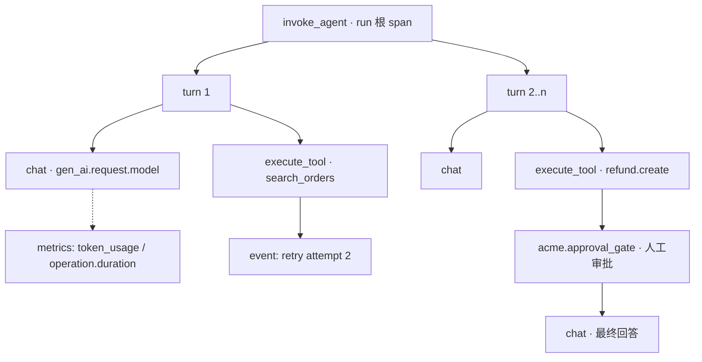

# 可观测性与 trace

## 一句话结论

Agent 的 trace 不是"日志加一层模型调用记录"，而是把一次请求的**决策序列**变成可重放的数据结构——它是评测、回归、成本归因、故障复盘的共同底座；没有它，后面五篇的工程手段全部无从落地。

## 问题与边界

- **解决什么**：把"多轮 LLM + 多次工具调用 + 分支/重试"的执行过程变成可查询、可对比、可回放的结构，回答两个具体问题：这次为什么失败？改完之后哪些 run 的行为变了？
- **不解决什么**：不判断对错（那是[评测体系](02-evaluation.md)的职责）；不做安全审计（trace 可采样、可删改，审计日志需要独立不可变存储，见[安全与权限](03-security.md)）；不替代指标与告警（trace 是样本，指标是总体）。
- **与相邻概念的分界**：
  - 传统 distributed tracing 的 span 树由**代码结构**决定，静态可预期；agent trace 的 span 树由**模型决策**决定，深度与扇出在运行时才确定，同一入口的两次请求可能相差 20 倍体积。
  - 传统 APM 关注"延迟与错误率"；agent trace 还必须携带语义载荷（prompt、工具参数、工具返回），否则定位不到"第 4 轮选错了工具"这类问题。
  - 与日志的分界：日志按行追加、面向搜索；trace 按父子关系组织、面向因果。把 agent 执行塞进行式日志，等于放弃因果链。
  - 与评测的分界：trace 回答"发生了什么"，评测回答"这是好还是坏"。两者之间靠"数据集沉淀"这一动作连接。
- **什么时候可以先不做**：单轮问答、无工具、日请求量低于几百的 demo，接入 SDK 的收益低于维护成本。一旦出现"多轮 + 工具 + 分支"三者之一，缺 trace 的代价会立刻超过接入成本。
- **怎么算做成了**：一个没参与开发的值班工程师，拿到一条用户报障（只有会话 ID），能在 5 分钟内指出失败发生在第几轮、哪个工具、参数错在哪。做不到就是没做成，工具买多贵都一样。

## 核心概念与架构

一次 agent 请求在观测模型里是四层对象：

| 对象 | 生命周期 | 承载什么 | 典型数量级 |
|---|---|---|---|
| **Run** | 一次任务，可跨小时与进程 | 任务目标、最终状态、总成本 | 1 |
| **Turn** | 一轮"推理 + 工具" | 本轮决策、上下文大小 | 3–30 |
| **Step** | 一次 LLM 调用或一次工具调用 | 模型、token、工具名与参数 | 10–200 |
| **Attempt** | 单次重试 | 失败原因、退避时长 | 0–5 |

四个对象里，Run 与 Turn 是业务语义层，Step 是 OTel GenAI 语义约定层，Attempt 通常是 event 而非独立 span——语义约定明确要求"逻辑操作的一次 span 覆盖其全部自动重试"。

关键的架构选择是：**把语义约定当传输层，不要当数据模型**。`gen_ai.*` 负责让不同厂商的后端读懂"这是一次推理、这是它的 token 数"，业务字段（租户、任务类型、审批结果、成本中心）放在自己的命名空间（`acme.tenant_id`、`acme.approval_state`），否则语义约定一改版就要重写查询。



两个容易忽略的细节：`execute_tool` 的子节点应覆盖审批、限流、沙箱启动与回收，而不是只在 HTTP 客户端打点——否则"工具慢"到底是网络慢还是沙箱冷启动慢无法区分；流式输出应该在 span 上以 event 记录首 chunk 时间，而不是等流结束才写一条时长。

最小可用的手工埋点大致长这样（用 SDK 自动插桩时，等价语义应保持一致）：

```python
with tracer.start_as_current_span("invoke_agent") as run:
    run.set_attribute("gen_ai.operation.name", "invoke_agent")
    run.set_attribute("acme.prompt_version", PROMPT_VERSION)
    run.set_attribute("acme.toolset_hash", TOOLSET_HASH)
    for turn in range(max_turns):
        with tracer.start_as_current_span("chat") as sp:
            sp.set_attribute("gen_ai.operation.name", "chat")
            sp.set_attribute("gen_ai.request.model", model_id)
            resp = call_model(ctx)                      # 副作用：真实 API 调用
            sp.set_attribute("gen_ai.usage.input_tokens", resp.usage.input)
            sp.set_attribute("gen_ai.usage.output_tokens", resp.usage.output)
        for call in resp.tool_calls:
            with tracer.start_as_current_span("execute_tool") as ts:
                ts.set_attribute("gen_ai.tool.name", call.name)
                ts.set_attribute("gen_ai.tool.call.id", call.id)
                res = run_tool(call)                    # 沙箱/审批/限流都应在此 span 内
```

## 关键机制

### 语义约定的现状：全量 Development，不能当稳定契约

截至 2026-11，OpenTelemetry 的 GenAI 语义约定**没有任何一项进入 Stable**：所有 `gen_ai.*` 属性、span、metric 的稳定性徽章都是 `Development`。GenAI 相关内容已从核心 `semantic-conventions` 仓库拆分到独立的 `semantic-conventions-genai` 仓库（该仓库依赖核心规范，当前引用 v1.45.0 的通用文档），目的是让 GenAI 部分能比核心规范更快迭代。

已经收敛、可以放心依赖的部分（仍是 Development，但改名概率低）：

| 类别 | 字段/取值 | 现状 |
|---|---|---|
| 操作类型 | `gen_ai.operation.name`：`chat`、`generate_content`、`embeddings`、`execute_tool`、`invoke_agent`、`create_agent`、`text_completion`、`fetch_response` | 取值表已成型，新增按需扩展 |
| 供应商标识 | `gen_ai.provider.name`（替代已弃用的 `gen_ai.system`） | 改过一次，现已稳定使用 |
| 模型与用量 | `gen_ai.request.model`、`gen_ai.response.model`、`gen_ai.usage.input_tokens`、`gen_ai.usage.output_tokens` | 事实标准 |
| 工具 | `gen_ai.tool.name`、`gen_ai.tool.call.id`、`gen_ai.tool.type` | 已成型 |
| 内容载荷 | `gen_ai.input.messages`、`gen_ai.output.messages`、`gen_ai.system_instructions`、`gen_ai.tool.definitions` | 全部 **Opt-In**，默认不采集 |
| 错误 | `error.type`（核心规范里是 Stable） | 可依赖 |

还在动的部分：agent 与团队层级（`invoke_workflow`、agent 间关系）、内存与检索类操作、MCP 命名空间、流式 chunk 的采集方式、provider 专属扩展（`aws.bedrock.*`、`openai.*`）。工程含义很直接：**不要把 `gen_ai.*` 直接映射成数据库列**，中间加一层自己的规范化层，改版时只改映射。

### 记录 prompt/response 与工具参数：价值极高，代价是隐私与体积

价值：没有内容载荷的 trace 只能回答"慢不慢、错没错"，回答不了"为什么"。工具参数尤其关键——大量 agent 故障是参数错（日期格式、ID 幻觉、枚举越界），而不是工具本身抛错。

代价有三块，必须分开算：

1. **PII 与合规**。语义约定在 `gen_ai.output.messages` 上明确警告该属性"likely to contain sensitive information including user/PII data"，并规定 instrumentation SHOULD NOT 默认采集，需显式 opt-in。工具参数里出现的手机号、地址、病历号往往比 prompt 更敏感，因为它们是**结构化字段**，一旦泄露可直接关联到人。
2. **存储体积**。一次 LLM 调用携带的 messages 通常 3–10 KB 文本；10 万次/天、平均 8 轮的任务量对应每天数 GB 原始文本，压缩后仍在 GB 量级，且后端按 span 计费时会被进一步放大。
3. **访问控制**。内容载荷与运维元数据的读者不是同一批人，混在同一个索引里等于把 prompt 里的客户数据开放给值班工程师。

可落地的分级采集策略：

| 级别 | 内容 | 采集率 | 用途 |
|---|---|---|---|
| L0 元数据 | span 名、模型、token、延迟、工具名、错误类型、业务标签 | 100% | 指标、告警、成本归因 |
| L1 结构 | 工具参数与返回的字段名/类型/长度/是否被 schema 拒绝 | 100% | 定位参数错，不含值 |
| L2 内容 | prompt、response、工具参数值与返回体 | 出错 run + canary + 抽检 1–5% | 复盘、造评测样本 |
| L3 外置 | 内容落对象存储，trace 只存 URI + 内容哈希 + 分类标签 | 同 L2 | 合规隔离、按需取用 |

> 判断：采样应该用 tail-based 而不是 head-based。agent 的失败与慢请求是长尾，head-based 1% 采样恰好会把你想看的那批丢掉；先在全量 span 上做决策，再决定是否保留内容载荷。

### Collector 侧：把成本与脱敏挡在存储之前

OTel Collector 的位置决定了它适合承担三件事，且都应该在**上报到任何后端之前**完成：

- **尾部采样（tail sampling）**：按"出错、超时、成本超阈、指定租户"保留，其余丢弃；`tail_sampling` processor 需要全量 span 先进入同一实例，因此按 trace id 做负载均衡。
- **脱敏（redaction/transform）**：正则与字段白名单两把刀。字段白名单比黑名单可靠——新增字段默认不采集。
- **扇出（fan-out）**：同一份数据同时送自建存储与厂商后端，这是降低锁定度最便宜的手段，代价是双份网络与配额。

### 分支、并行与子 agent 的表示

三种结构最容易在 trace 里被压平，压平之后就再也还原不出因果：

- **并行工具调用**：同一轮里 3 个 `execute_tool` 是兄弟 span，不是链式父子。用开始时间与结束时间重叠判断并行度，这是"并行化有没有真的生效"的唯一证据。
- **分支与回退**：模型先走 A 方案失败再走 B 方案，两者应是同一 turn 下的兄弟 span，并用 `acme.branch_id` 关联；否则回退会被误读成"重试"。
- **子 agent**：子 agent 有自己的 run 根 span，通过 span link 指回派发点，而不是把子 agent 的 200 个 span 塞进父 trace。原因是子 agent 常常独立重跑、独立计费、独立过期，混在一起会让保留策略失效。

> 判断：trace 的父子关系只应表达"谁触发了谁"，不应表达"谁在等谁"。等待、并行、取消这些时序语义交给时间戳与 event，父子关系一旦被用来编码时序，任何并发都会让树失真。

### 从 trace 到数据集：回放是评测的原料

trace 是唯一能自动产出高质量评测样本的地方。标准三步：

1. **挑选**：按"失败 + 高成本 + 低置信"筛，而不是随机抽。随机抽出来的样本大部分是模型已经能做对的简单 case，对回归没有鉴别力。
2. **脱敏并冻结输入**：把当时的 system prompt、工具定义、检索结果一起冻结。只冻结输入文本而不冻结工具 schema，是回放失败最常见的原因——工具改了字段名，老 trace 就跑不起来。
3. **固化判定**：把当时的最终状态（数据库写入、工单状态、文件哈希）或人工结论写成断言，形成轨迹快照（trajectory snapshot），供 CI 做 diff。

回放不是"重跑一遍 prompt"。三条硬约束：模型版本必须可固定（否则无法区分是 prompt 改动还是模型改动）；外部副作用必须打桩（否则回放会真的退款）；非确定性来源（搜索、当前时间、随机 ID）必须可注入。

### 在线评估闭环

在线闭环的最小形态是：trace 上挂两类评估器——**规则类**（schema 校验失败率、工具调用次数、循环检测、成本超阈）与**模型类**（LLM-as-judge 打分，可靠性问题见[评测体系](02-evaluation.md)）。指标按 `prompt_version`、`tool_version`、`model` 三个维度切分，这是唯一能在灰度期看出"是哪一层改动导致质量下降"的切法。

闭环的判定标准不是"有看板"，而是：一个线上 bad case 从被发现到进入回归集，是否需要人工搬运。需要，就说明闭环没建成。

### 从 trace 派生哪六个指标

不要把 trace 后端当成唯一查询入口。以下六个指标应该落成时序数据，因为它们需要告警、需要与发布事件对齐、需要在没有内容载荷的采样下仍然稳定：

- **每 run 轮数分布（P50/P95/max）**：轮数突增是循环或工具失效的第一信号，比成功率更早出现。
- **每 run 工具调用数**：与轮数一起看，能区分"多想了几轮"和"多试了几次工具"。
- **工具错误率与重试率，按工具名分组**：某个工具错误率上升通常先于任务成功率下降。
- **每 run token 与成本（按 `model` × `prompt_version` 切分）**：成本回归往往由一次 prompt 膨胀引入，且不会体现在成功率上。
- **上下文占用峰值（context utilization）**：接近窗口上限的 run 会开始丢历史，这是"静默质量下降"的根源。
- **首 chunk 延迟（TTFT）与整轮延迟的 P95**：用户的体感由前者决定，工程预算由后者决定。

## 对比

四家工具的定位差异（只描述能力，不评优劣）：

| 维度 | LangSmith | Langfuse | Phoenix（Arize） | Braintrust |
|---|---|---|---|---|
| 主要定位 | LangChain/LangGraph 生态的观测 + 评测 + 部署一体 | 开源自托管优先的观测 + prompt 管理 | 开源优先的 trace 调试 + 评估实验 | 评测驱动（eval-first）的实验与数据集管理 |
| 接入方式 | SDK + OTLP（`/otel/v1/traces`） | SDK + OTLP（`/api/public/otel/v1/traces`） | SDK + OTLP，把 GenAI span 映射到自有 AGENT/LLM/TOOL 类型 | SDK + OTLP |
| 自托管 | 闭源，自托管为 Enterprise 附加项 | MIT 核心，docker/Helm 可自托管 | ELv2，自托管免费且无功能门 | 闭源 SaaS 为主 |
| 计费敏感点 | 按 base trace 计费，多 span 的 agent run 消耗更多单位 | 按 unit 计费，同样被 span 数量放大 | 自托管时成本即基础设施成本 | 按实验与数据量计费 |
| 强项 | 与 LangGraph 的一等公民集成、数据集与标注队列 | 数据可控、可完全离线 | 单条 trace 的阅读体验、零门槛自托管 | 实验对比与 CI 集成的工作流 |
| 适合选的场景 | 团队已在 LangGraph 上，要开箱即用的 trace + 数据集 + 灰度 | 有数据出境或成本约束，需要自己掌控存储 | 只想先看清楚单条 trace，不想先买平台 | 评测流程是重心，trace 只是 eval 的输入 |

选型的真实约束通常不是功能，而是三件事：**内容载荷能否出境**、**多 span 的计费模型在你们量级下是否可承受**、**能否导出原始数据**（锁定度）。一个中性方案是：所有 SDK 统一发 OTLP 到自建 Collector，再由 Collector 扇出——业务代码不依赖任何一家 SDK，换后端只改 Collector 配置。

这里有一个隐含的取舍：**SDK 优先**接入快、语义更贴近框架（能自动识别 chain/agent/tool），但把可观测性绑在框架版本上；**OTel 优先**解除绑定，代价是要自己维护 `gen_ai.*` 的映射与新增字段。对预期生命周期超过一年的项目，OTel 优先的维护成本更低——因为框架换掉时，trace 不用重做。

## 实践建议与常见坑

- **只在外层打点**。触发条件：SDK 只在 `agent.run()` 包一层。后果：trace 里只有一次 run 的总时长，定位不到第 4 轮工具参数错。规避：至少三层 span——run / turn / (chat|execute_tool)。
- **高基数进 span 名**。把订单号、用户 ID 拼进 span 名。语义约定自己就规定高基数 ID 不进 span 名（`fetch_response` 的 span 名只取 operation，不含 response id）。后果：后端索引膨胀、聚合查询不可用、按名告警失效。规避：ID 进属性，不进名字。
- **没记工具定义版本**。只记了 prompt 版本。后果：回放时工具 schema 已变，样本全部失效且看不出原因。规避：把 `gen_ai.tool.definitions` 的哈希作为 run 属性。
- **跨队列丢上下文**。异步任务、HITL 等待、子 agent 派发时没传 trace context。后果：一条业务请求在系统里碎成 5 个孤立 trace。规避：消息体显式携带 `traceparent`，长时任务用 span link 而非 parent。
- **trace 当审计用**。把 trace 存储当作"谁批准了这笔退款"的证据。后果：采样、TTL、可删除性让它在合规审查中站不住。规避：审批记录写独立不可变审计流。
- **本地开发把内容全量上报生产后端**。后果：测试数据污染指标，且开发环境的假 PII 进了生产库。规避：按环境切后端，`dev` 强制 L0/L1。
- **用 trace 数量当覆盖率**。span 变多不代表观测变好，只代表打点变密。规避：用"任意失败 run 能否在 5 分钟内定位到具体 step"作为唯一验收标准。
- **把 judge 分数当标签直接写进 trace**。触发条件：在线评估器把分数写成 span 属性，后续又用它训练或筛样本。后果：judge 的系统偏差被固化进数据。规避：分数写独立评测表，保留 judge 模型名与版本，可重算。
- **内容载荷与元数据同索引**。触发条件：图省事把 messages 存进同一个可搜索后端。后果：任何有只读权限的人都可检索客户原始对话。规避：L2/L3 分级 + 独立权限域，trace 里只留引用。

**上线前观测检查清单**（10 条，逐条可验）：

1. 每条 run 有唯一 `run_id`，可从业务单号反查。
2. span 层级至少三层，`execute_tool` 是独立 span 且含工具名与耗时。
3. 每次 LLM 调用记录模型名与 input/output token（含 cache read/write 若有）。
4. 重试用 event 记录、不新增 span，且能算出重试率。
5. 内容载荷默认关闭，按 L2 策略采样，采样规则有代码可查。
6. PII 脱敏在**上报前**执行，不依赖后端清洗。
7. `prompt_version`、`tool_version`、`model` 三者作为可切分维度存在。
8. 有至少一条"从 trace 一键生成评测样本"的通路。
9. 错误 span 有 `error.type`，且取值低基数（枚举而非自由文本）。
10. 值班手册写明：拿到一个失败 run，5 分钟内能定位到具体哪一轮、哪一次工具调用。

## 开放问题

- GenAI 语义约定全量处于 Development，跨版本迁移成本由谁承担？目前事实上的做法是各厂商 SDK 各自映射，互操作性靠 OTLP 而非字段。
- 多 agent 的 trace 如何合并？A2A 场景下父子关系跨组织边界，span link 能表达"相关"但表达不了"因果"。
- 长时任务（小时/天级）的 trace 体积与保留策略：全量保留不现实，只保留"决策点"又难以复盘。
- 内容载荷的合规冲突：可解释性要求留存，数据最小化要求删除，两者落在同一份数据上。
- 采样之后指标是否仍可推断总体？trace 采样率与成功率指标的可信区间如何给出，目前没有公认做法。
- 当模型厂商自己提供托管的 agent runtime 与内置 trace（见[部署形态](06-deployment.md)），自建 trace 的边界在哪里？目前只能确定：跨厂商、跨模型的那一段必须自己留。

## 参考来源

- OpenTelemetry GenAI Semantic Conventions 仓库（GenAI 语义约定独立仓库）· OpenTelemetry · 2026-11 · https://github.com/open-telemetry/semantic-conventions-genai
- Semantic conventions for generative client AI spans（Status: Development，含 execute_tool 与内容采集条款）· OpenTelemetry · 2026-11 · https://github.com/open-telemetry/semantic-conventions-genai/blob/main/docs/gen-ai/gen-ai-spans.md
- Semantic Conventions v1.45.0 · Recording Errors · OpenTelemetry · 2026 · https://github.com/open-telemetry/semantic-conventions/blob/v1.45.0/docs/general/recording-errors.md
- Arize Phoenix 自托管许可说明（Elastic License 2.0，自托管免费）· Arize · 2026 · https://arize.com/docs/phoenix/self-hosting/license
- LangSmith Plans and Pricing（含 trace 额度与席位）· LangChain · 2026 · https://www.langchain.com/pricing
- Best AI Agent Observability Tools (2026)（各平台 OTLP 端点与接入方式对照）· Promptise · 2026-10 · https://www.promptise.com/guides/view/best-ai-agent-observability-tools
- Langfuse vs LangSmith (2026)：许可、自托管与计费口径对比 · Morph LLM · 2026-06 · https://www.morphllm.com/comparisons/langfuse-vs-langsmith
