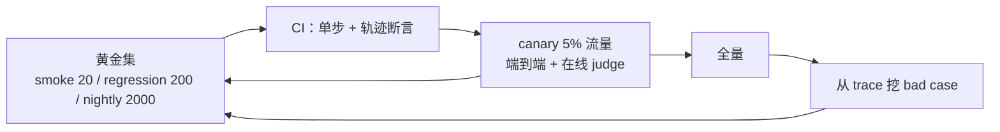

# 评测体系与 benchmark 边界

## 一句话结论

三层评测各有不可替代的**否决权**：单步评测否决"工具用错"，轨迹评测否决"过程不可接受"，端到端评测否决"任务没完成"；而公开 benchmark 的分数不能用于选型，因为它测的是"模型在别人的脚手架上"，不是"你的系统在你的任务上"。

## 问题与边界

- **解决什么**：回答三个决策问题——能不能上线、这次改动有没有变好、变好了多少（以及值不值这个成本）。
- **不解决什么**：不解释失败原因（那是[可观测性](01-observability.md)的职责）；不保证评测分布等于线上分布（只能逼近）；不替代人工抽检（judge 与规则都会系统性漏判同一类问题）。
- **与相邻概念的分界**：
  - **评测 vs 监控**：评测是"给定输入集，算一个可比的数"，监控是"对线上流量算连续指标"。前者可复现、可回溯，后者覆盖真实分布但不可复现。
  - **评测 vs guardrail**：guardrail 在请求路径上拦截（毫秒级、必须低误杀），评测在旁路判定（秒级、允许高成本）。把 judge 放进请求路径是常见的架构错误。
  - **评测 vs benchmark**：benchmark 是别人定义的任务集与判定器，评测是你自己定义的任务集与判定器。前者用于对外沟通与粗筛，后者用于发布决策。

## 核心概念与架构

三层评测的划分依据不是"粒度细不细"，而是**判定器能不能看见最终状态**：

| 层 | 判定对象 | 判定器 | 单次成本 | 方差 | 能否决什么 |
|---|---|---|---|---|---|
| 单步 | 一次工具选择 / 一组参数 | 确定性断言（schema、枚举、白名单、精确匹配） | 极低 | 极低 | 工具用错、参数错、检索没命中 |
| 轨迹 | 整条 trajectory（步数、顺序、重复、越权） | 规则 + judge 混合 | 中 | 中 | 过程不可接受（绕路、越权、死循环） |
| 端到端 | 任务完成后的世界状态 | 状态断言 > rubric judge > 人工 | 高 | 高 | 任务没完成、结果错、成本超预算 |

三层的关系是**漏斗而非替代**：单步失败率高时，端到端成功率一定低，此时先修单步更便宜；端到端失败但单步都"正确"时，问题在规划与状态管理，加单步测试没有意义。

三层共用同一套 task 定义，但**成功判据不同**。同一条 task 在单步层只需断言"调用了 `refund.create` 且金额等于订单金额"；在轨迹层还要断言"退款前调用过 `order.get`"；在端到端层则要检查"退款单在数据库中确实存在且状态为 pending"。判据不一致是评测分数互相矛盾的常见原因——不是数据有问题，是三层在回答不同的问题。



关键对象：**task**（输入 + 初始状态 + 成功判据）、**trial**（一次执行）、**verdict**（判定结果，含判定器版本）、**dataset version**（黄金集的不可变快照）。没有 dataset version，两周后的分数变化就无法归因。

## 关键机制

### 单步评测：便宜、确定、但不构成发布依据

三类断言最有效：工具选择（期望工具集合 vs 实际调用，算 precision/recall）、参数正确性（schema 校验 + 业务约束，如日期不早于今天、金额不超余额）、检索命中（期望文档是否在 top-k）。

单步评测的价值在于**乘法效应**：单步 95% 正确的 8 步任务，全对概率只有 0.95^8 ≈ 66%。这解释了为什么"工具调用准确率 95%"的模型在生产上表现平庸——不是模型不行，是任务太长。

单步评测的失效边界：它无法发现"工具选对了但顺序错了""参数对但时机错了"。这类问题只有轨迹层能看见。

### 轨迹评测：判过程，不判结果

可自动化的轨迹断言（按性价比排序）：

- **步数上限**：超过 N 步未收敛直接判失败。N 取黄金集 P95 的 1.5 倍。
- **无效调用率**：同一工具同一参数重复调用、调用不存在的工具、被 schema 拒绝后原样重试，各算一类。
- **越权调用**：出现不在该任务允许集合里的工具（与[安全与权限](03-security.md)的权限矩阵同源）。
- **不可逆动作前是否有审批**。
- **judge 评分**：对"计划合理性"打 1–5 分，仅作为趋势指标，不作为门禁。

一个反直觉的结论：**更短的轨迹不一定更好**。强制压缩步数会让 agent 跳过验证步骤，端到端成功率反而下降。轨迹指标必须与端到端指标联合观察。

### 端到端评测：判定器的质量决定一切

判定器优先级：**状态断言 > 规则化 rubric > LLM judge > 人工**。能用状态断言就别用 judge——检查数据库里的退款记录是否存在，比让 judge 读对话可靠一个数量级。

有一个必须知道的实证结论：在 τ²-bench 的 airline 与 retail 域上，研究者跑了 2,160 个 episode，用四种方式打分（原生 gold-state 比对、LLM judge、给 judge 提供策略文档、以及规则化的写入边界检查），发现这些判定方式**并不等价**，实践中却常被当成可互换。

### 评测集从哪里来：四种来源，四种偏差

| 来源 | 建造成本 | 覆盖的真实分布 | 自带偏差 | 适合的层 |
|---|---|---|---|---|
| 线上 trace 回流 | 低（挑 + 脱敏） | 高 | 只覆盖"已发生过"的路径 | 端到端、轨迹 |
| 人工构造 | 高 | 低（写题人想象） | 偏向边界与恶意输入 | 单步、轨迹 |
| 合成变体（同模板换参数） | 极低 | 中 | 难度集中在模板附近 | 单步 |
| 事故复盘 | 中 | 极低但极关键 | 过拟合到单次事故 | 端到端 |

健康的配比大致是：50% 线上回流、20% 人工构造、20% 事故复盘、10% 合成变体。全部用合成数据的团队，会在上线后遇到"评测全绿但用户全在骂"的经典场景。

### 公开 benchmark：逐项看它测什么、不测什么

| Benchmark | 规模与形态 | 测什么 | 不测什么 | 常见误用 |
|---|---|---|---|---|
| **τ-bench** | retail / airline 两个域，工具 + 用户模拟器 | 多轮对话中的策略遵循与工具使用，用 `pass^k` 衡量一致性 | 开放域任务、长时任务、GUI | 只报 `pass^1`，掩盖一致性崩塌 |
| **τ²-bench** | 增加 telecom 双控（dual-control）域，Dec-POMDP 建模，用户也会调工具 | agent 与用户协同改变共享世界状态 | 单控场景的复现性、成本 | 当成 τ-bench 的"加大版"，忽略双控改变了任务性质 |
| **SWE-bench Verified** | 500 道人工校验的 GitHub issue | 仓库内定位 + 打补丁 + 过测试 | 多文件重构、需求不清、review 成本 | 2026 年后仍用它判断前沿编码能力 |
| **SWE-bench Pro** | 1,865 题 / 41 仓库（731 公开、858 保留、276 商业） | 长时程、企业级、抗污染 | 小团队真实仓库的分布 | 把 731 公开集的分数当"通用编码能力" |
| **GAIA** | 466 题、三级难度 | 需要浏览、多模态、工具组合的真实问答 | 写代码、改系统状态 | 忽略 scaffold 差异直接比模型 |
| **WebArena** | 812 个任务（241 模板实例化），4 类自建站点 | 长程 Web 任务的功能正确性 | 真实站点的反自动化、登录态、页面漂移 | 把自建站点成绩外推到生产站点 |
| **WebVoyager** | 643 任务 / 15 个真实站点 | 真实网站上的端到端操作 | 可复现性（站点会变）、判定稳定性 | 跨时间比较历史分数 |
| **OSWorld** | 369 个桌面任务，执行式奖励 | 真实 OS 环境里的多步操作 | 企业 SSO、权限边界、审计 | 把 OS 操作能力当成"能替代人" |
| **Terminal-Bench 2.0** | 89 个容器化终端任务，verifier 判定 | 命令行下的真实工程任务（编译、恢复、配置） | 交互式 GUI、多人协作 | 与 SWE-bench 混为一谈（一个偏终端运维，一个偏仓库改码） |

### pass@k 与 pass^k：两个方向相反的指标

- `pass@k`：k 次独立尝试中**至少一次**成功。衡量"能否解出"，随 k 单调上升，适合有验证器、允许多次采样的场景（代码生成 + 单测）。
- `pass^k`：k 次独立尝试**全部**成功。衡量"是否稳定可靠"，随 k 单调下降，适合面向客户的服务型任务。

τ-bench 论文给出的原始数据很能说明问题：GPT-4o 在 retail 域 `pass^1` 为 61.2%，到 `pass^8` 跌到 25% 以下。也就是说，"能解决"和"每次都能解决"是两种能力，而生产只关心后者。

误用方式：用 `pass@8` 报成绩却按 `pass^1` 做容量规划；或反过来，用 `pass^1` 证明可靠性。

### LLM-as-judge：能用，但必须校准

已知的系统偏差：**位置偏差**（成对比较时偏好先出现的一方）、**长度/格式偏差**（偏好更长、更结构化）、**自我偏好**（偏好同家族模型输出）、**rubric 惰性**（对模糊条目一律给中间分）。校准手段按性价比排序：

1. 成对比较时**随机交换位置**，两次结果不一致即记为 tie，不进统计。
2. rubric 拆成**可判定的二值条目**（"是否调用了退款前查询订单的工具：是/否"），避免 1–5 分的主观刻度。
3. judge 与被测模型**不同家族**，且固定 judge 版本（换 judge 等于换尺子）。
4. 用 200 条人工标注算一次与 judge 的一致率（Cohen's κ），κ < 0.6 就不要把 judge 当门禁。
5. 给 judge 提供**证据片段**（工具返回原文），而不是让它从长对话里自己找。

成本口径：judge 的 token 消耗常常超过被测任务本身，尤其在长轨迹上。做预算时按"被测任务成本的 0.3–1.0 倍"估。

### 回归体系：把评测变成发布流程的一部分

- **黄金集分层**：smoke 20 条（每个 PR，< 2 分钟）、regression 200 条（合并前，< 20 分钟）、nightly 2000 条（每晚 + 全量 judge）。
- **轨迹快照**：不只存最终答案，存"调用了哪些工具、按什么顺序、每步参数的结构"。prompt 微调导致的路径变化，往往在答案不变时就已经发生。
- **A/B**：同一批 task，两个配置各跑 n 次，比较成功率差异的置信区间；n 太小会把噪声当收益。
- **CI 集成**：评测失败要能定位到具体 task id 与具体断言，而不是只报一个总分。

```yaml
# 一个够用的 CI 评测门禁
eval:
  on: [pull_request]
  steps:
    - run: evalctl run --set smoke --trials 1 --fail-under 0.90
    - run: evalctl run --set regression --trials 3 --fail-under 0.80
    - run: evalctl compare --base main --metric cost_per_success --max-regress 10%
```

**成本-方差权衡**：端到端评测的方差随任务难度上升，n=1 时分数波动可达 ±10 个百分点。工程做法是"贵指标少跑、便宜指标多跑"：单步评测每次全跑，端到端只在合并前跑 3 trials，nightly 跑 5 trials 并记录置信区间。

### 样本量：先算置信区间，再谈"提升"

端到端评测算的是比例，比例的不确定性可以用正态近似估：`±1.96 × sqrt(p(1-p)/n)`。代入常见值：

| 样本量 n | p=0.8 时的 95% 半宽 | 能分辨的最小差异 |
|---|---|---|
| 50 | ±11 个百分点 | ≈ 15pp |
| 100 | ±8 个百分点 | ≈ 11pp |
| 400 | ±4 个百分点 | ≈ 6pp |
| 1000 | ±2.5 个百分点 | ≈ 3pp |

结论很硬：**用 200 条黄金集做单次评测，只能分辨 8 个百分点以上的差异**。所以"A 配置 81%、B 配置 83%"这种结论在 200 条样本上不成立。要么加样本，要么用配对的单步指标（同一批任务逐条比较，方差更小），要么承认"无结论"。

### 三道门禁：绝对阈值 + 相对阈值

只用绝对阈值会让团队在"本就低于阈值"时失去改进动力，只用相对阈值会让持续的小幅退化累积成事故。可复制的组合：

| 闸口 | 跑什么 | trials | 绝对门禁 | 相对门禁 |
|---|---|---|---|---|
| PR | 单步全集 + smoke 20 条 | 1 | 单步 ≥ 95%，smoke ≥ 90% | 与 main 比不得下降 > 2pp |
| 合并前 | regression 200 条 | 3 | 端到端 ≥ 80% | cost per success 上升 ≤ 10% |
| 发布 | canary 5% 流量 + 人工抽检 20 条 | 在线 | 在线成功率 ≥ 灰度前 | 严重故障（越权/外发）0 例 |

注意第三道闸的"0 例"是硬门禁：任何一次越权调用或对外误发，都不该用成功率去换。

## 对比

三种评测来源的定位差异：

| 维度 | 公开 benchmark | 私有黄金集 | 线上 A/B |
|---|---|---|---|
| 回答什么问题 | 这个模型/脚手架在公认难题上大概什么水平 | 这次改动在我的任务上有没有变差 | 这次改动在真实流量上有没有变好 |
| 分布匹配 | 低（别人的任务、别人的工具） | 高（自己的任务） | 最高（真实流量） |
| 可复现性 | 中（harness 会变、数据会污染） | 高（自己冻结） | 低（流量在变） |
| 成本 | 低（多数可公开跑） | 中（要维护标注） | 高（要分流、要等样本量） |
| 主要风险 | 污染、外推、harness 差异 | 过拟合到自己的历史 case | 统计功效不足、互相干扰 |
| 正确用法 | 粗筛候选模型、对外沟通 | 发布门禁 | 灰度期决策 |

一句话概括三者的分工：**公开 benchmark 决定"要不要试"，黄金集决定"能不能发"，线上 A/B 决定"要不要全量"**。把任何一环的结论挪到另一环使用，都会得出错误决策——最常见的错误是用公开榜第一名直接跳过黄金集。

## 实践建议与常见坑

- **用同一模型当 judge 和被测**。触发条件：为了省钱用同一个模型自评。后果：自我偏好让分数虚高 5–15 个百分点，且改动越多分数越"好"。规避：judge 换家族，或至少换版本并做人工对齐。
- **黄金集泄漏进 prompt**。触发条件：把线上 bad case 直接贴进 few-shot 示例。后果：回归分数好看，线上不变。规避：黄金集与 prompt 示例做交叉去重，示例来自另一个池子。
- **只测成功率不测成本**。后果：一次"提升 3 个百分点"的改动把每任务成本翻倍，上线后被迫回滚。规避：成功率与 cost per success 同时作为门禁（见[成本与延迟](05-cost-latency.md)）。
- **n=1 就下结论**。后果：把噪声当收益，团队在 A/B 之间反复横跳。规避：固定 trials 数，报置信区间；差异小于区间宽度就判"无结论"。
- **跨 harness 比较分数**。同一个模型换 scaffold，SWE-bench 类任务的分差可达数十个百分点。后果：拿别家的 scaffold 分数给自家选型。规避：只比自己跑出来的数，或只比同 scaffold 下的模型。
- **judge 版本没锁**。触发条件：CI 里直接调用 `gpt-latest` 之类的别名。后果：某天 judge 升级，全体分数平移，历史对比失效且无从解释。规避：judge 模型名写死到具体版本，变更时重算历史基线。
- **单步评测只覆盖"见过的工具"**。触发条件：黄金集里只有当前 12 个工具的用例，后来新增工具。后果：新工具的选择准确率无人度量，直到线上出错。规避：新增工具必须同时提交至少 5 条单步用例，作为该工具的上线条件。
- **把"更短的轨迹"当优化目标**。触发条件：轨迹评测只看步数。后果：agent 跳过验证步骤，端到端成功率下降而轨迹指标变好。规避：轨迹指标必须与端到端指标成对设门禁。
**benchmark 分数当采购依据**——这是本篇要给出的明确判断，单独列出：

> 判断：公开 benchmark 分数不能直接用于选型。四个理由互相独立：①数据污染（OpenAI 2026-02 指出 SWE-bench Verified 中约 27.6% 的未解题里至少 59.4% 存在测试设计缺陷，且模型对题解的记忆率随代际上升）；②基准自身会被证伪（OpenAI 2026-07 审计 SWE-bench Pro 的 731 道公开题，估计约 30% 有缺陷，随后撤回了三个月前对它的推荐）；③harness 差异大于模型差异；④分数不含成本、延迟、权限与失败模式。选型要看的是"在你的黄金集上、用你的工具、在你的预算内的 cost per success"。

## 开放问题

- 长时任务（小时/天级）如何评测？现有 benchmark 的 episode 大多在分钟级，无法覆盖"中途环境变化"与"跨天状态"。
- 成本归一化缺少公认口径：同一分数下 token 成本差 10 倍的系统，benchmark 表上看不出区别。
- 轨迹的可复现性：真实站点、真实 API 都在变，benchmark 分数的半衰期越来越短。
- judge 的校准没有标准流程，"与人工一致率多少可以当门禁"仍是经验值。
- 多 agent 系统如何归因失败？是哪个 agent 的错，目前只能靠 trace 人工看。
- 判定器的"可证伪性"没有标准：judge 给出的分数，什么情况下应该被推翻，缺少像统计检验那样的程序。
- 评测集的维护成本被系统性低估：一个 200 条的黄金集，每季度约有 10–20% 的样本因工具/环境变更而失效，需要专门的维护排期。
- 隐私约束下的评测：真实 trace 不能出域，脱敏又会改变任务难度，跨组织的评测基准因此几乎无法共享。
- 评测结果的可比性依赖 harness 版本，而多数团队并不对自己使用的 harness 做版本固定与归档。

## 参考来源

- τ-bench: A Benchmark for Tool-Agent-User Interaction in Real-World Domains（含 pass^k 定义与 GPT-4o 数据）· Sierra · 2024-06 · https://arxiv.org/abs/2406.12045
- $τ^2$-Bench: Evaluating Conversational Agents in a Dual-Control Environment · ICML 2026 / PMLR 306 · 2026-09 · https://proceedings.mlr.press/v306/barres26a.html
- Why we no longer evaluate SWE-bench Verified（污染与测试缺陷分析，建议转向 SWE-bench Pro）· OpenAI · 2026-02-23 · https://openai.com/index/why-we-no-longer-evaluate-swe-bench-verified/
- OpenAI retracts SWE-bench Pro recommendation after finding 30 percent of tasks broken · 4sysops · 2026-07 · https://4sysops.com/archives/openai-retracts-swe-bench-pro-recommendation-after-finding-30-percent-of-tasks-broken/
- SWE-Bench Pro: Raising the Bar for Agentic Coding（1,865 题 / 41 仓库）· Scale AI · 2025-09 · https://scale.com/blog/swe-bench-pro
- GAIA: a benchmark for General AI Assistants · Meta AI 等 · 2023-11 · https://arxiv.org/abs/2311.12983
- WebArena: A Realistic Web Environment for Building Autonomous Agents · CMU 等 · 2023-07 · https://arxiv.org/abs/2307.13854
- WebVoyager: Building an End-to-End Web Agent with Large Multimodal Models · arXiv 论文 · 2024-01 · https://arxiv.org/abs/2401.13919
- OSWorld: Benchmarking Multimodal Agents for Open-Ended Tasks in Real Computer Environments · arXiv 论文 · 2024-04 · https://arxiv.org/abs/2404.07972
- terminal-bench@2.0 Leaderboard（89 任务、verifier 判定）· Terminal-Bench / Laude Institute · 2026-11 · https://www.tbench.ai/leaderboard/terminal-bench/2.0
- When Evaluators of AI Agents Disagree: Native Scoring, LLM Judges, and Commit-Boundary Checks on tau2-bench · arXiv · 2026-11 · https://arxiv.org/abs/2611.14581
