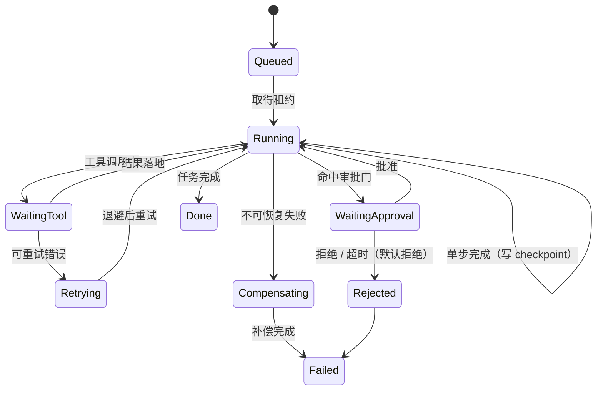

# 可靠性与 HITL

## 一句话结论

Agent 的可靠性不来自"模型更聪明"，而来自**失败可控**：用持久化执行把"从头再来"换成"从断点继续"，用幂等与补偿把"重试"变成安全操作，用 HITL 把不可逆动作的决策权留在人这边。

## 问题与边界

- **解决什么**：让 agent 在长时、多步、有副作用的执行中，遇到崩溃、超时、工具失败、上下文耗尽时，仍然能收敛到一个**确定的状态**（成功、失败、或待人工），而不是留下半截副作用。
- **不解决什么**：不提升单步正确率（那是模型与[评测](02-evaluation.md)的事）；不能让不可逆动作变得可逆；不能替代业务侧的最终一致性设计。
- **与相邻概念的分界**：
  - **可靠性 vs 可观测**：可观测告诉你"失败了"，可靠性保证"失败后系统仍然一致"。只有 trace 没有 checkpoint，事故依然要人工补数据（见[可观测性](01-observability.md)）。
  - **重试 vs 恢复**：重试是同一进程内再试一次，进程死了就没了；恢复是从持久化状态重建执行。二者不能互相替代。
  - **HITL vs 审批流**：审批流是组织流程（谁有权批），HITL 是执行语义（执行在此暂停、可恢复、有超时）。把 HITL 实现成"发个消息等人回"，通常会在超时与并发上出问题。

## 核心概念与架构

失败必须分类，因为不同类别的处置方式完全不同——把"循环"当"超时"重试，只会加速烧钱。

| 失败类别 | 典型症状 | 检测信号 | 自动处置 | 需要人工 |
|---|---|---|---|---|
| 幻觉动作 | 调用不存在的工具、编造 ID | 工具不存在 / 404 / schema 拒绝 | 把错误信息回灌，限 1–2 次 | 反复发生时 |
| 工具误用 | 参数类型对但语义错（退错订单） | 业务规则校验失败 | 拒绝并回灌约束 | 是（涉及资金） |
| 循环 | 同样的工具同样的参数反复调用 | 动作指纹重复 ≥ 3 | 强制中断 + 换策略提示 | 否 |
| 超时 | 单步或整体超墙钟 | deadline 到期 | 取消 + 降级 | 视动作而定 |
| 部分失败 | 3 个并行工具 1 个失败 | 聚合结果不完整 | 重试失败项；不可重试则补偿已成功项 | 视情况 |
| 状态不一致 | 数据库已改，但 agent 认为没改 | 对账任务发现差异 | 以外部状态为准重建上下文 | 是 |
| 上下文耗尽 | 历史被截断、早期约束丢失 | 上下文占用 > 80% 窗口 | 压缩/卸载到外部存储 + 重述关键约束 | 否 |

执行模型可以抽象成一台显式状态机——所有"暂停"都是持久化状态，不是内存里的等待：



关键对象：**run**（一次任务，有唯一 id 与预算）、**checkpoint**（某一轮结束后的完整可恢复状态）、**effect**（一次有副作用的动作，带幂等键）、**lease**（执行权租约，防双跑）、**compensation**（effect 的逆动作）。

## 关键机制

### checkpoint 里到底存什么

存四类东西，缺一类就无法真正恢复：

1. **消息历史**（裁剪后的，不是原始全量）+ 当前 system prompt 版本 + 工具定义哈希。恢复时必须能重建出"模型当时看到的上下文"。
2. **已执行 effect 清单**：每个 effect 的幂等键、结果、状态（已提交/已补偿）。这是避免重复副作用的核心。
3. **预算余额**：token、金额、墙钟、工具调用次数四个计数器。不存预算，恢复后就会重复消耗。
4. **代码与配置版本**：`workflow_version`。长时任务跨越部署是常态，恢复时必须用**旧版本**的代码路径执行未完成的 run，否则状态机对不上。

不要存：模型内部状态（不可序列化）、大文件（存引用）、可重算的派生数据（会与源数据不一致）。

### 幂等：让"至少一次"变成"有效一次"

所有 effect 都必须带幂等键，形如 `hash(run_id, step_id, canonical_params)`。三种落地方式：

- **下游支持幂等键**（支付、邮件、大部分 SaaS API）：直接透传，最简单。
- **下游不支持**：用 outbox 模式——先在本地事务里写"意图"，再由投递器执行并记录结果；恢复时先查 outbox 而不是直接重发。
- **下游完全不配合**：退化为"读-判-写"（先查该动作是否已生效），代价是有竞态窗口，只能用于可容忍重复的动作用例。

> 判断：在 agent 场景里，"不可幂等"的动作不应该由 agent 直接调用，而应该封装成一个幂等的业务接口。把幂等性推给模型去"注意不要重复"是最常见的架构错误。

### 补偿：不可逆动作只能靠前置约束

Saga 式补偿（逆序执行 compensation）只对**可逆动作**有效：发错了邮件可以再发一封更正，退款可以再扣回（如果业务允许），创建的资源可以删除。真正不可逆的动作——对外发布、法律文件签署、物理发货——只能靠**前置约束**：审批门 + 额度上限 + 灰度范围。

补偿设计的三条规则：每个 effect 注册补偿时就必须写明"补偿失败怎么办"（通常是转人工队列）；补偿本身也要幂等；补偿不应依赖 agent 再次推理，而应是确定性代码。

### 状态一致性：以谁为准

Agent 的上下文里对世界的描述，与外部系统的真实状态，随时可能分叉：别人改了订单、缓存过期、另一个 agent 并发操作同一条记录。可靠的系统必须明确"以谁为准"。

规则：**外部系统是唯一事实来源，上下文只是缓存**。落地方式：

- 每个 effect 执行前**重新读取前置条件**（订单状态、余额、锁），而不是相信上下文里的旧值。
- 对并发敏感的资源用**乐观锁**（版本号）或租约，冲突时让 agent 重新规划而不是覆盖。
- 长时任务定期做**对账**：把上下文里的关键断言与外部状态比对，差异写入事件并中断。
- 恢复时永远先读外部状态，再决定是否重放 effect——这一步能消掉大部分"恢复后重复执行"的问题。

### 一次可恢复的步骤

```python
def step(run, plan_step):
    key = effect_key(run.id, plan_step.id, plan_step.params)   # 业务键，稳定可重算
    done = store.get_effect(key)                                # 恢复时先查，不先执行
    if done:
        return done.result                                      # 已有结果：直接复用
    if not budget.charge(run, plan_step.estimate):              # 预算熔断
        raise BudgetExhausted(run.id)
    store.begin_effect(key, plan_step)                          # 先写意图（outbox）
    result = tool.call(plan_step, idempotency_key=key)          # 至少一次执行
    store.commit_effect(key, result)
    store.checkpoint(run.id, messages=ctx.window,               # 四类状态一起落盘
                     effects=store.done_effects(run.id),
                     budget=budget.snapshot(run),
                     version=WORKFLOW_VERSION)
    return result
```

两个反直觉点：**先写意图再执行**（崩溃后能查出来"可能已执行"），以及**恢复时先读 effect 表**（而不是重放）。两者合起来才让"至少一次"等价于"有效一次"。

### 重试、fallback 与熔断

**错误分类先于重试**：可重试（429、5xx、超时、连接重置）、不可重试（400、schema 校验失败、权限拒绝）、未知（按不可重试处理，或限 1 次）。把 400 当可重试是烧钱最快的方式。

**退避**：指数退避 + 全抖动（full jitter），上限 30–60 秒；重试次数按"预算"而非"次数"控制——同一 run 的重试总耗时计入墙钟预算。

**fallback 链**：模型层（主模型 → 备用模型 → 降级为确定性流程）、工具层（主 API → 缓存/只读副本 → 明确的"暂不可用"）。fallback 必须**降级能力而非静默改变语义**：换到弱模型时要同时降低自主度（例如禁止其执行写操作），否则等于用可靠性换了正确性。

**预算熔断**四维同时生效，任一触顶即停：token 总量、金额、墙钟、工具调用次数。熔断后的行为要明确：是返回部分结果、转人工，还是回滚——三者的业务含义完全不同。

**死循环检测**比轮数上限更有效，因为它能在成本爆炸前触发：

- 动作指纹：`hash(tool_name, normalized_args)`，连续 3 次相同即判定循环。
- 状态指纹：把"当前任务状态摘要"哈希，出现重复状态说明没有进展。
- 进度度量：新增的有效信息（新文件、新记录、新事实）为零连续 N 轮。
- 成本斜率：单位时间成本突然抬升（上下文膨胀导致）。

### HITL：人在环上，不在环中

"人在环中（in the loop）"意味着每一步都要人确认，结果是审批疲劳与形式化点击；"人在环上（on the loop）"意味着人监督整体走向，只在**异常与不可逆节点**介入。生产系统应该按后者设计。

审批点的选择标准只有三条：**不可逆、成本超阈、对外可见**。其余一律自动放行，并把决策记录下来供事后抽样。

| 场景 | 同步/异步 | 超时 | 超时后 |
|---|---|---|---|
| 删除/覆盖数据 | 同步 | 5 分钟 | 拒绝，任务转人工 |
| 金额超阈值 | 同步 | 15 分钟 | 拒绝，保留草稿 |
| 对外发送邮件/发帖 | 异步（可批量） | 4 小时 | 拒绝并丢弃 |
| 权限升级 | 同步 | 5 分钟 | 拒绝 |
| 低置信度（judge 分低） | 异步抽样 | 24 小时 | 放行但标记 |

表里唯一的例外是"低置信度抽样"：它不阻断主流程，超时放行只影响抽样率，不影响动作是否执行。其余四类的超时必须按拒绝处理。

实现要点：审批请求必须携带**最小充分上下文**（要做什么、影响什么、为什么），而不是整段对话——审批人不会读 50 轮历史。批准后的恢复必须幂等（同一审批只能被消费一次）。审批人不在时的兜底是"拒绝"，不是"自动通过"。

### 长时任务（小时/天级）的额外约束

- **状态存储必须是数据库**，不是内存、不是进程内字典；且要支持按 `run_id` 分片与 TTL。
- **租约与心跳**：执行者持租约，心跳超时则租约失效、允许其他 worker 接管；接管前必须先读 checkpoint 而不是重跑。
- **进度可见**：长时任务的用户界面需要"当前在哪一步、预计还需多久"，这要求 checkpoint 里带可展示的进度摘要。
- **部署兼容**：升级期间 in-flight run 必须能继续跑（旧版本代码可用），这意味着 workflow 版本要并行部署一段时间。
- **成本上限**：单 run 的硬上限要写进配置并对外承诺；长时任务最容易在"差一点就成功"时无限追加预算（成本口径见[成本与延迟](05-cost-latency.md)）。
- **通知不能只在结束时发**：长时任务需要"阶段完成""需要审批""失败已补偿"三类通知，且通知要幂等（重复通知比漏通知好，但要有去重键）。

## 对比

持久化执行的四种选择：

| 维度 | Temporal | Restate | 框架内 checkpoint（如 LangGraph） | 自建队列 + outbox |
|---|---|---|---|---|
| 抽象层次 | Workflow / Activity，代码即状态机 | Service / Virtual Object，状态与调用绑定 | 图节点 + checkpointer | 自己定义 |
| 状态存储 | Temporal Server（自托管或云） | 内置状态存储（K/V per object） | 你选的 DB/Redis | 你的 DB |
| HITL 等待成本 | 等待期不占计算资源，可等数天 | 等待期不占计算资源 | 取决于实现，通常占进程或需外部唤醒 | 需自己实现 |
| 幂等支持 | Activity 重试 + 工作流幂等 | 调用去重 + 对象串行化 | 需自己在节点内保证 | 全靠自己 |
| 运维复杂度 | 高（集群、持久化、版本兼容） | 中（单二进制，但生态较新） | 低（库） | 中（但长期维护成本高） |
| 适合选它的条件 | 已有 Temporal 或多语言、需要成熟运维、任务需等数天 | 想要轻量自托管、以会话/对象为中心建模 | 已在 LangGraph 上、任务时长分钟级、失败可接受重跑 | 任务短、副作用少、团队不愿引入新基础设施 |

一个必须提前知道的细节：LangGraph 的 `interrupt` 在恢复时会**从节点开头重新执行**，而不是从中断的那一行继续。这意味着节点内的副作用必须幂等，或必须放在独立 task 里。这类语义差异是选型时最该读文档的地方——它决定了你要写多少幂等代码。

同样值得对比的是"等待"的实现方式：Temporal 与 Restate 的等待是**持久化的暂停**（不占计算资源，可以等几天），而框架内的 checkpointer 往往只解决"状态不丢"，不解决"谁来唤醒"。如果任务里有人工审批且可能等上小时级，这一条差异会直接决定架构：你需要一个外部的唤醒机制（定时扫描 + 事件驱动），否则任务会安静地卡住。

## 实践建议与常见坑

- **checkpoint 只存消息历史**。触发条件：把"恢复"理解成"把对话再接上"。后果：恢复后重复执行副作用（二次退款），或被工具状态卡住。规避：effect 清单 + 预算余额 + 版本号一起存。
- **用内存队列做长时任务**。触发条件：原型期用进程内 asyncio 队列。后果：一次发布重启丢掉全部 in-flight 任务，且无法解释给用户。规避：入队即落库，队列只是通知机制。
- **审批门超时设成自动通过**。触发条件：为了不阻塞流程。后果：最危险的动作在最没人看的时候被执行。规避：超时 = 拒绝。
- **fallback 换模型不换权限**。触发条件：主模型限流，切到小模型继续跑。后果：弱模型在高权限工具上更容易被误导。规避：fallback 时同步降级能力集。
- **重试不区分错误类型**。触发条件：统一 `try/except` 加重试装饰器。后果：schema 错误重试 5 次，成本 ×5 且必然失败。规避：错误分类器先行。
- **补偿动作依赖模型推理**。触发条件：让 agent"自己想办法撤销"。后果：补偿路径本身不可测、不可复现。规避：补偿是确定性代码，由 effect 类型注册。
- **长时任务不设成本上限**。触发条件：只在入口校验预算。后果：单任务烧掉月度预算。规避：每轮检查剩余预算，硬上限触发即停并转人工。
- **恢复时重放整段对话**。触发条件：把 checkpoint 当"消息备份"，恢复时让模型重新决策一遍。后果：同一个副作用被执行两次，或模型这次选了不同路径导致状态错乱。规避：恢复的是"状态 + 待办步骤"，不是"让模型重新想"。
- **审批请求里塞整段对话**。触发条件：直接把 trace 链接丢给审批人。后果：审批人读不完，凭标题判断，审批质量归零。规避：审批卡片只给"动作、影响、原因、风险"四项，附 trace 链接供深挖。
- **分布式锁当租约用**。触发条件：用 Redis 锁做执行权，却没设过期与续约。后果：worker 崩溃后任务永久卡死，或锁过期后双跑。规避：租约 + 心跳 + 过期接管，接管前先读 checkpoint。

## 开放问题

- 跨部署版本的 workflow 兼容性没有通用方案：状态机结构一改，旧 run 就无法恢复。目前只能靠"版本并行 + 排空"。
- 补偿的完备性无法证明：只能靠用例覆盖，缺少形式化方法验证"任意失败点都能补偿"。
- HITL 的吞吐上限：当 agent 并发量远超人工处理能力时，审批门会变成瓶颈，目前缺少"按风险动态调节自动/人工比例"的成熟做法。
- 部分失败的可接受性缺少业务语言：3 个工具失败 1 个，算成功还是失败，取决于业务而非技术，但现有框架不提供表达方式。
- 死循环检测对"有进展但极慢"的任务无效——这类任务既不该停也不该无限跑。

## 参考来源

- Durable agent with tools using the OpenAI Agents SDK · Temporal 文档 · 2026-11 · https://docs.temporal.io/ai/cookbook/openai-agents-sdk-python
- LangGraph in production: Temporal's LangGraph Plugin adds Durable Execution（HITL 等待数天不占计算资源）· Temporal · 2026-07 · https://temporal.click/blog/temporal-langgraph-plugin-durable-execution
- Durable Sessions（Virtual Object + K/V 状态实现会话恢复）· Restate 文档 · 2026-11 · https://docs.restate.dev/ai/patterns/sessions
- Interrupts（恢复时从节点开头重新执行的行为说明）· LangChain 文档 · 2026-10 · https://docs.langchain.com/oss/python/langgraph/interrupts
- Durable execution（非确定性操作与副作用必须包在 task/节点内的约束）· LangChain 文档 · 2026 · https://github.com/langchain-ai/docs/blob/main/src/oss/langgraph/durable-execution.mdx
- Interruption & Regenerate（持久化取消与清理）· Restate 文档 · 2026-11 · https://docs.restate.dev/ai/patterns/interrupt-regenerate
- Amazon Bedrock AgentCore 概览（Runtime 支持最长 8 小时的长时工作负载与会话隔离）· AWS 文档 · 2026-11 · https://docs.aws.amazon.com/bedrock-agentcore/latest/devguide/what-is-bedrock-agentcore.html
