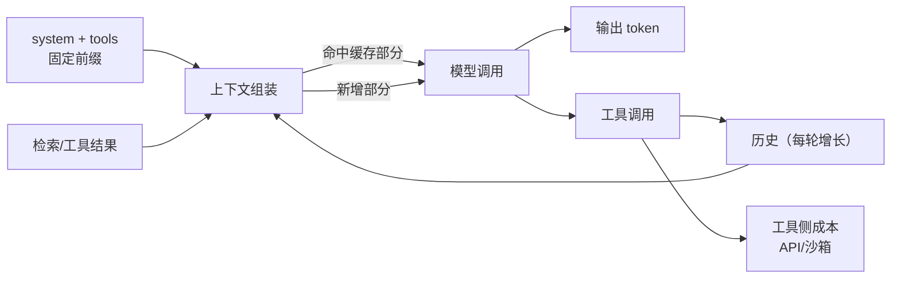

# 成本与延迟

## 一句话结论

Agent 的成本几乎从不由 token 单价决定，而由**每任务的总输入 token（含工具定义与历史重放）× 轮数**决定；真正的指标是 `cost per success`（每次成功任务的成本）与 P95 端到端延迟，而不是每百万 token 的价格。

## 问题与边界

- **解决什么**：给出可算的成本结构与可拆的延迟构成，让"优化"变成有靶子的工程动作，而不是换更便宜的模型。
- **不解决什么**：不解决模型能力问题（便宜模型做不了的事，优化也做不了）；不解决定价策略（那是商业问题）；不保证优化后不损失质量——每次优化都必须回到[评测](02-evaluation.md)验证。
- **与相邻概念的分界**：
  - **成本优化 vs 容量规划**：前者降单任务成本，后者决定配额与并发。两者共用指标但决策不同。
  - **延迟 vs 吞吐**：流式与并行改善延迟，批处理改善吞吐，二者常常互相牺牲。
  - **成本 vs 可靠性**：重试、双模型审查、fallback 都在增加成本换可靠性；把它们当"纯开销"砍掉是最常见的错误优化。
- **计价单位的分界**：厂商按 token 计价，基础设施按秒计价，业务按任务计价。三者不能直接相加，必须换算到"每任务"这个共同单位上再比较。

## 核心概念与架构

成本的最小模型是四个可测量的量：

```
cost_task = Σ_turns [ input_tokens(t) × p_in × cache_factor(t)
                    + output_tokens(t) × p_out ]
          + Σ_tool_calls tool_cost
          + 固定开销（沙箱启动、检索、judge）
```

其中 `input_tokens(t)` 不是常数——它等于 `系统提示 + 工具定义 + 全部历史 + 本轮检索结果`，随轮数近似线性增长，这才是 agent 成本的主项。`cache_factor(t)` 在命中缓存时为缓存读折扣，未命中时为 1 或含写入溢价。



延迟的对应拆解是：`TTFT（排队 + 首 token）+ 解码时间（输出 token / 生成速率）+ 工具 RTT × 串行次数`。四段里只有第二段能靠"更快的模型"改善，第三段靠并行与缓存，第一段靠容量与路由。

## 关键机制

### 一个可复用的算例

假设某退款 agent：8 轮、系统提示 + 工具定义 4,000 tokens、每轮历史净增 1,200 tokens、每轮输出 350 tokens、每任务 3 次工具调用（每次返回 800 tokens 并进入历史）。

输入 token 总量 ≈ 8 × 4,000（固定前缀重放）+ 历史累计（0+1,200+…+8,400 的均值 4,200 × 8 ≈ 33,600）+ 工具结果 3 × 800 = 2,400，合计约 **68,000 输入 token**；输出 8 × 350 = **2,800 输出 token**。

| 项 | 数量 | 单价假设 | 成本 |
|---|---|---|---|
| 输入（未缓存） | 68,000 | $3 / 百万 | $0.204 |
| 输出 | 2,800 | $15 / 百万 | $0.042 |
| 工具调用（API/沙箱） | 3 次 | $0.01 / 次 | $0.030 |
| **合计** | | | **≈ $0.28** |

若成功率 72%，则 `cost per success = 0.28 / 0.72 ≈ $0.39`。注意这个数字比"每任务成本"高 38%——失败的尝试照样付费，这正是不能用每任务成本做预算的原因。

缓存的影响：固定前缀 4,000 × 8 = 32,000 tokens 可命中，若缓存读为基准价的 0.1 倍，这部分从 $0.096 降到 $0.0096，**总成本降约 31%**；但首次写入通常有 1.25 倍溢价，且 5 分钟 TTL 意味着低频任务享受不到。缓存对高频、长前缀、短间隔的场景收益最大，对"一天跑几次"的场景可能为负。

> 说明：上表单价是**算例假设值**，用于演示结构，不代表任何厂商报价。2026-10 各厂商公开页面上，旗舰模型的输入价大致落在每百万 token 数美元到数十美元、输出价为数倍到十倍于输入价的区间，且随型号与上下文长度分档；做预算时请以当时官方页面为准。

### 优化手段：收益、风险与适用条件

| 手段 | 典型收益 | 风险 | 适用条件 |
|---|---|---|---|
| prompt caching | 固定前缀成本降一个数量级（读价通常为基准的 0.1–0.5 倍） | 前缀必须稳定；TTL 过期后失效；写入有溢价 | 系统提示 + 工具定义长、调用密集 |
| 上下文压缩 / 卸载 | 输入 token 降 30–70% | 丢失早期约束，长任务质量下降 | 轮数多、历史长、有外部存储可卸载 |
| 模型路由（小模型做分类/抽取） | 该子任务成本降 5–20 倍 | 路由错判会把难任务交给弱模型 | 子任务边界清晰、可离线验证 |
| 并行工具调用 | 延迟降（不降成本） | 副作用并发、错误放大 | 工具之间无依赖 |
| 投机执行 | 延迟降 20–40% | 猜错时白付成本 | 下一步高度可预测（如固定校验） |
| 批处理 API | 单价约五折 | 延迟到小时级 | 离线评测、夜间任务、回填 |
| early exit | 成本降、延迟降 | 过早停止导致任务未完成 | 有可靠的完成判据 |
| 减少轮数（结构化输出一次多步） | 成本降最显著（线性） | 单步承载过多，错误率上升 | 步骤间无强依赖 |

按"性价比"排序的经验值：**减少轮数 > 稳定前缀以命中缓存 > 压缩历史 > 路由到小模型 > 并行 > 批处理**。很多团队从"换便宜模型"开始，结果是质量下降后再加人工兜底，总成本反而更高。

两条容易被忽略的约束：

- **缓存不是免费的**。写入溢价（常见为基准价的 1.25–2 倍）加上 TTL 过期后的重新写入，意味着"调用间隔长于 TTL"的工作负载可能因为开缓存而变贵。判断标准很简单：`调用次数 × 读折扣节省` 是否大于 `写入次数 × 溢价`。
- **路由需要可验证的边界**。把"意图分类"交给小模型只有在分类错误可被下游发现时才是安全的；如果错分会直接导致错误的工具调用，路由就是在用成本换事故。

### 成本回归的告警设计

成本问题几乎都是"悄悄变贵"，而不是突然翻倍，所以告警要抓**斜率**而不是绝对值：

- **每任务成本的 7 日均值环比上升 > 15%**：抓 prompt 膨胀、历史变长。
- **输入/输出 token 比上升 > 20%**：抓历史重放与工具返回膨胀（比总成本更早暴露）。
- **缓存命中率下降 > 10 个百分点**：抓前缀被动态内容打断。
- **工具调用次数 P95 上升**：抓循环与重试增多。
- **单 run 成本 > 阈值的事件**：抓失控任务，逐条看而不是看均值。

阈值要按业务定，但四类告警缺一不可——它们分别对应"上下文变胖""缓存失效""行为退化""任务失控"。

### 延迟拆解与预算

以算例中的任务为例：TTFT 0.6s、解码 350 token @ 80 token/s ≈ 4.4s、工具 RTT 1.2s × 3、8 轮串行。端到端 ≈ 8 ×（0.6 + 4.4）+ 3.6 ≈ **43.6 秒**。这个拆解立刻指出三个可动的杠杆：

- 把 3 次工具调用中的 2 次并行 → 省 1.2s（收益小，因为工具不是主项）。
- 把 8 轮压到 4 轮（结构化输出一次给出多步计划）→ 省约 20s（收益最大）。
- 流式输出让用户在第 0.6s 就看到第一个字，感知延迟从 43.6s 降到"可接受"，但总时长不变。

**延迟预算表**（上线前就该定，而不是上线后救火）：

| 环节 | 目标 P50 | 目标 P95 | 超标时的动作 |
|---|---|---|---|
| 首 token（TTFT） | < 1s | < 2s | 检查排队、路由到低负载区域 |
| 单轮解码 | < 5s | < 8s | 限制输出长度、流式 |
| 单次工具 RTT | < 1s | < 3s | 加缓存/超时/降级 |
| 轮数 | < 6 | < 12 | 合并步骤、early exit |
| 端到端 | < 30s | < 60s | 异步化 + 通知 |

同步交互的产品，端到端超过 60 秒就应该改为"提交任务 + 通知"模型，而不是继续优化首 token。

**流式与乐观 UI 的正确用法**：流式解决的是"感知等待"，乐观 UI 解决的是"操作反馈"，两者都不改变实际完成时间。可以做的：先把计划文本流式输出，再执行工具（用户看到进度）；先显示"正在核对订单"这类确定性中间态，而不是虚构百分比。不能做的：在结果未确定时展示"已完成"，这会在失败时把技术问题升级为信任问题。

### 度量口径：为什么 token 单价不是有效指标

四个理由：单价不含轮数（长任务被低估）、不含缓存命中率（高频任务被高估）、不含失败重试（不稳定系统被低估）、不含工具与基础设施成本（沙箱、检索、judge 往往占到不可忽略的一截，按经验在 10–40% 之间，随架构差异很大）。

应该报的三个数：

- **cost per task**：`总成本 / 任务数`，用于容量与预算。
- **cost per success**：`总成本 / 成功任务数`，用于选型与优化决策，等价于 `cost per task / 成功率`。
- **P95 端到端延迟 + P95 单任务成本**：均值会掩盖长尾，而长尾决定用户投诉与预算超支。

再补一个诊断指标：**每任务输入 token 与输出 token 的比值**。健康值通常在 10:1 到 40:1；比值持续升高说明历史重放或工具返回在膨胀。

一个够用的记账实现（关键是"每次调用都记，且带上可聚合的维度"）：

```python
def record_call(run, resp, tool_cost=0.0):
    usage = resp.usage
    cost = (usage.input_tokens      * PRICE[resp.model].inp
            + usage.cached_tokens   * PRICE[resp.model].cached
            + usage.output_tokens   * PRICE[resp.model].out
            + tool_cost)
    metrics.add(
        "llm.cost", cost,
        tags={"model": resp.model, "prompt_version": run.prompt_ver,
              "tool_version": run.toolset_ver, "tenant": run.tenant,
              "turn": run.turn, "outcome": "unknown"},   # 结束时回填 outcome
    )
```

`outcome` 必须在任务结束时回填为 success/failed，否则算不出 `cost per success`——这是最常见的记账缺陷：成本记了，成败没关联。

### 工具侧成本：最容易被忽略的一截

工具不是免费的：外部 API 按次计费、沙箱按秒计费、检索按查询计费、judge 按 token 计费。四类都该进 `cost_task`：

- **外部 API**：按调用次数或数据量计费，重试也算钱。
- **沙箱**：容器/microVM 的启动与存活时间计费，长时任务里沙箱常驻可能比模型贵。
- **检索**：向量库查询与 rerank 按 QPS 或 token 计费。
- **评估器**：在线 judge 的 token 消耗常达被测任务的 0.3–1.0 倍。

把工具成本单列还有一个诊断价值：当 `cost_task` 上升但模型 token 没变时，问题通常在工具侧（重试变多、沙箱存活变长）。

## 对比

三种成本优化路线的取舍：

| 维度 | 换模型（单价路线） | 改上下文（结构路线） | 改流程（编排路线） |
|---|---|---|---|
| 主要杠杆 | 每百万 token 价格 | 前缀稳定性、压缩、卸载 | 轮数、并行、early exit |
| 成本降幅量级 | 2–10 倍 | 1.3–3 倍 | 1.5–5 倍 |
| 质量风险 | 高（能力下降不可控） | 中（丢信息） | 中（步骤合并导致单步过载） |
| 可逆性 | 高（改配置即可回滚） | 中 | 低（改流程要重跑评测） |
| 适合先做 | 子任务明确、可离线验证 | 前缀长、调用密集 | 轮数多、步骤可合并 |
| 不适合 | 复杂推理主路径 | 一次性任务（缓存无收益） | 步骤强依赖、顺序不可变 |

三条路线可以叠加，但**叠加顺序**会影响结论。正确顺序是先用结构路线（压缩、稳定前缀）把"输入 token × 轮数"的基数压下来，再用编排路线减轮数，最后才考虑换模型——因为换模型会改变质量基线，之前的评测结果全部作废。反过来做（先换模型再优化上下文）会让两次改动的影响互相掩盖，无法归因。

## 实践建议与常见坑

- **把工具定义算进"固定成本"就完事**。触发条件：工具 40 个、定义 12,000 tokens，每轮重放。后果：光工具定义就占掉一半输入成本。规避：工具分层（按任务注入子集）、定义精简（描述短、示例少）、必要时做工具检索。
- **缓存前缀被动态内容打断**。触发条件：把时间戳、用户 ID 放在 system prompt 开头。后果：缓存永不命中，折扣拿不到却以为已优化。规避：可变内容一律后置，前缀保持字节级稳定。
- **只看均值不看长尾**。触发条件：成本看板只有日均值。后果：1% 的任务消耗 30% 预算，月底才发现。规避：按 run 记录成本，出 P95/P99 与 top-N 消耗者。
- **压缩历史压掉约束**。触发条件：为了省 token，把早期 system 约束也压进摘要。后果：agent 在第 10 轮开始违反早期规则（例如又开始承诺退款）。规避：约束类内容不参与压缩，或压缩后重述关键约束。
- **并行工具制造副作用竞争**。触发条件：把"查订单"和"改订单"并行。后果：读到旧值写回，覆盖别人的修改。规避：只有无依赖的读操作才并行，写操作串行并带版本校验。
- **用批处理省钱却放进同步链路**。触发条件：为了五折把在线请求丢进 batch。后果：延迟从秒级变小时级，用户流失成本远超省下的钱。规避：批处理只用于离线评测与回填。
- **降级不降级能力**。触发条件：主模型超时后切到小模型继续跑同样权限的工具。后果：错误率上升且更危险。规避：降级时同步缩小工具集（见[可靠性与 HITL](04-reliability-and-hitl.md)）。
- **只优化 token 不优化轮数**。触发条件：团队盯着单价与缓存，没人看轮数分布。后果：单价降一半，但轮数从 6 涨到 9，总成本反而升 50%。规避：把"每任务轮数 P95"作为一等指标。
- **乐观 UI 承诺了无法保证的时长**。触发条件：界面显示"预计 30 秒完成"。后果：P95 是 90 秒，用户在第 40 秒开始重复提交，成本翻倍。规避：给区间不给点值，超过阈值自动转异步。

## 开放问题

- 缓存的计价与失效策略在各厂商差异很大（TTL、最小前缀长度、写入溢价、读折扣），跨厂商的"有效单价"缺少可比口径。
- 上下文压缩的质量损失无法量化：省下的 token 与丢失的信息之间没有统一单位。
- 延迟与成本的联合优化缺少标准前沿（Pareto frontier）报告方式，团队各自定义"够快"。
- 推理型模型的"思考 token"计价规则与可见性在不同厂商不一致，导致成本预测困难。
- 缓存命中率在跨区域、跨账号部署时是否共享，各厂商口径不同，容量规划容易失真。
- 多 agent 的成本归因：子 agent 的成本应该记到哪个业务维度，缺少通用做法。
- 长上下文模型的定价随长度分档，"同一任务在不同长度区间"的单价可能跳变，预算模型难以线性外推。
- 延迟的"用户可接受阈值"高度依赖场景（客服对话 vs 代码生成），缺少可复用的测量方法。

## 参考来源

- Prompt Caching: Claude vs GPT vs Gemini Cost Playbook 2026（写入 1.25x / 读 0.1x、OpenAI 50%、Gemini 75% 与 32K 门槛）· Eden AI · 2026-10 · https://www.edenai.co/post/prompt-caching-claude-vs-gpt-vs-gemini-cost-playbook
- Prompt Caching: How It Works, Provider Pricing, Cache-Aware Routing (2026)（各厂商缓存倍率与最小前缀）· Morph LLM · 2026-09 · https://www.morphllm.com/prompt-caching
- What a million tokens costs across frontier models, 18 Oct 2026（厂商页面抓取的单价区间）· Safeguard · 2026-10 · https://safeguard.sh/resources/blog/what-a-million-tokens-costs-across-frontier-models
- What prompt caching saves, using the vendors' own cache prices（缓存节省的算例方法）· Safeguard · 2026-10 · https://safeguard.sh/resources/blog/prompt-caching-savings-published-cache-prices
- LLM Pricing 2026: Every Model, $0.11–$50 per 1M Tokens（2026-11 价格区间概览）· BenchLM · 2026-11 · https://benchlm.ai/blog/posts/llm-pricing-2026
- How to Reduce LLM API Costs in 2026（批处理五折与各厂商限制）· Taskade · 2026-07 · https://www.taskade.com/blog/reduce-llm-costs
- LLM API Pricing 2026（2026-10 各厂商标准费率整理）· IntuitionLabs · 2026-10 · https://intuitionlabs.ai/pdfs/llm-api-pricing-comparison-2025-d210380f9686afd9.pdf
- AI Token Cost Calculator November 2026（agentic tool-use loop 场景的成本对比口径）· SWFTE · 2026-10 · https://www.swfte.com/ru/ai/token-cost-calculator
