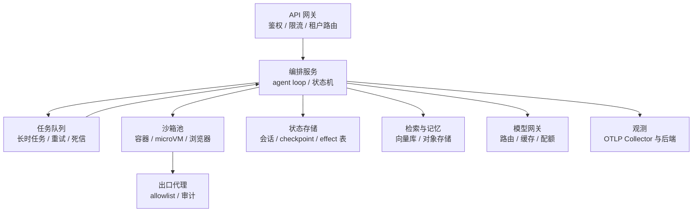

# 部署形态与托管 runtime

## 一句话结论

部署形态的分水岭不是"功能多少"，而是**谁承担沙箱、身份、长时状态这三件重活**；托管 agent runtime 把这三件事商品化，代价是网络边界、数据驻留与迁移成本，所以选型要从"这三件事我能不能自己扛"开始。

## 问题与边界

- **解决什么**：把 agent 从"本机跑得通"变成"多租户、可扩缩、可审计、可回滚"的线上服务，并给出形态选择的判据。
- **不解决什么**：不解决 agent 逻辑本身的质量（那是编排与[评测](02-evaluation.md)的事）；不解决模型选型；不保证托管的 SLA 覆盖你的业务链路（runtime 的 SLA 只覆盖它自己）。
- **与相邻概念的分界**：
  - **runtime vs 框架**：框架定义"agent 怎么想"（LangGraph、Agents SDK），runtime 定义"agent 在哪跑、状态存哪、谁能调它"。同一个框架可以跑在任何 runtime 上，反之亦然。
  - **runtime vs 平台**：平台（低代码）把编排、连接器、发布都包进去，runtime 只提供执行环境与基础设施能力。托管 runtime 通常不限制你的编排代码。
  - **部署形态 vs 交付形态**：前者是"跑在哪"，后者是"以什么方式给用户"（API、嵌入、独立应用）。两者正交。
- **一句话选型法则**：先看沙箱与身份能不能自建，再看状态能否自己持有，最后才比功能表。功能表上的差异在三个月内会被追平，沙箱与身份的能力差距不会。

## 核心概念与架构

形态谱系按"你负责的部分"递减排列：

| 形态 | 你负责 | 提供方负责 | 典型代表 |
|---|---|---|---|
| SDK 嵌入 | 全部（进程、状态、扩缩） | 只提供模型与 SDK | 各类 agent SDK |
| 自建服务 | 编排、状态、沙箱、队列、观测 | 模型 API、基础设施 | 自研 + K8s + 对象存储 |
| 托管 agent runtime | agent 代码与工具实现 | 会话状态、沙箱、身份、扩缩、观测接入 | Bedrock AgentCore、Microsoft Foundry、Gemini Enterprise Agent Platform |
| 低代码平台 | 只写配置与提示 | 上述全部 + 编排 UI + 连接器 | Copilot Studio、Dify 等（见[企业平台](../05-products/04-enterprise-platforms.md)） |

自建参考架构（托管 runtime 只是把中间几层替换掉，两端不变）：

五个边界要显式定义，缺一个就会在上线后补：**谁能调**（网关鉴权与租户识别）、**能跑多久**（队列与租约，不是 HTTP 超时）、**能碰什么**（沙箱与出口）、**状态存哪**（决定能否恢复）、**怎么看见**（trace 与成本归因）。

沙箱形态的选择直接决定架构与成本，四种方案的取舍：

| 沙箱形态 | 隔离强度 | 冷启动 | 成本 | 适用条件 |
|---|---|---|---|---|
| 进程 + 权限降级 | 最弱 | 毫秒级 | 最低 | 只跑可信代码、单租户 |
| 容器（共享内核） | 弱（非安全边界） | 秒级 | 低 | 内部工具、代码可信 |
| microVM（如 Firecracker 类） | 强 | 亚秒到秒级 | 中 | 执行不可信代码、多租户 |
| 托管沙箱服务（浏览器/代码解释器） | 强 | 由厂商优化 | 按用量计费 | 不想自建隔离、接受网络约束 |

关键判据是"代码是否可信"而不是"是否多租户"：只要 agent 会执行模型生成的代码，就应当按不可信处理，容器不够。

## 关键机制

### 托管 runtime：核实过的能力边界

截至 2026-11，四家主流托管形态的实际构成（只列官方文档可查的部分）：

| 平台 | 当前名称与状态 | 执行环境 | 会话状态 | 身份 | 观测 |
|---|---|---|---|---|---|
| **Amazon Bedrock AgentCore** | 模块化服务集：Harness、Runtime、Memory、Gateway、Identity、Code Interpreter、Browser、Observability、Evaluations、Optimization、Policy、Registry、Payments | Runtime 为 serverless，会话在隔离 microVM 中；支持最长 8 小时的长时负载 | Memory 分短期与长期，可跨 agent 共享 | 与 Cognito、Okta、Entra ID、Auth0 等 IdP 集成 | 原生 OTel 格式，接入 CloudWatch 与第三方 |
| **Microsoft Foundry**（原 Azure AI Foundry） | 代理分两类：提示代理（声明式）与托管代理（自带容器/框架） | 托管代理由 Foundry 运行容器，提供终结点、缩放与身份 | 会话（conversation）+ 代理版本 | Microsoft Entra ID + RBAC + 网络隔离 + Azure Policy | 内置跟踪与评估（部分预览） |
| **Gemini Enterprise Agent Platform**（原 Vertex AI，Agent Engine 更名 Agent Runtime） | Vertex AI 整体更名，Agent Engine → Agent Runtime | 托管运行时，配套 Code Execution 沙箱 | Sessions + Memory Bank | Google Cloud IAM | 与 Cloud Logging/Monitoring 集成 |
| **Cloudflare Agents / Sandbox SDK** | Agents SDK + Sandbox SDK 1.0（2026-09-30） | Durable Object 直接控制沙箱容器：镜像、实例规格、网络、生命周期，支持快照（公测） | Durable Object 存储承载会话状态 | Cloudflare Access / 自有鉴权 | Workers 观测 + 自有 OTLP 上报 |

四家在"抽象高度"上并不相同：AgentCore 提供的是**可组合的服务集**（你可以只取 Memory 或 Gateway），Foundry 与 Gemini 更像**一体化平台**（代理、模型、工具在同一资源模型下管理），Cloudflare 则是**边缘原语**（Durable Object + 容器），自由度最大、要自己搭的也最多。抽象越高，上手越快、迁移越难。

三个必须自己确认的细节，官方文档往往不直接回答：

1. **状态归谁所有**：会话状态能否导出？能否在迁移后重建？如果只能通过厂商 API 读写，迁移成本等于重写。
2. **沙箱的网络策略**：默认是否允许出站？能否按域名 allowlist？这一条直接决定[安全](03-security.md)的可实现性。
3. **长时任务的上限与计费**：8 小时是执行上限还是会话上限？等待人工审批的时间算不算计费时长？

> 判断：托管 runtime 的真正卖点不是"省运维"，而是"**默认给你一个隔离的执行环境 + 一个能自证的身份**"。这两件事自建的门槛远高于"部署一个服务"——自建一个能抗逃逸的沙箱、一套能审计的 agent 身份，通常需要专门的安全团队。

### 冷启动、扩缩容与"热池"

Agent 服务的扩容信号与普通 Web 服务不同：不是 QPS，而是**并发会话数 × 平均会话时长**。一个用户占着一个会话 3 分钟，100 QPS 可能对应上万个活跃会话。

三条工程结论：

- **沙箱要池化**。冷启动（拉镜像、装依赖、启动浏览器）通常在数秒到数十秒，必须预热。池的最小尺寸按"P95 并发 × 冷启动时间 / 目标等待时间"估。
- **模型调用是外部依赖，扩缩容要限流**。自建服务在扩容时会同时放大对模型 API 的并发，触发 429；必须在模型网关层做令牌桶与排队，而不是让扩容把上游打崩。
- **长时任务与会话要分离调度**。长时任务占着沙箱但不占 CPU，按"活跃计算"扩容会严重高估成本，按"会话数"扩容又会浪费。可行做法是两层队列：会话层（低延迟、保热池）与任务层（吞吐优先、可排队）。

### 模型网关：自建架构里最该独立的一层

即使其他都自建，模型网关也值得单独做一层，因为它承担五件事：**密钥托管**（业务代码不接触厂商密钥）、**路由与 fallback**（主备模型、区域切换）、**配额与预算**（按租户/任务限额，见[成本与延迟](05-cost-latency.md)）、**缓存与去重**（相同前缀命中缓存，相同请求幂等返回）、**审计**（谁在什么时候用了哪个模型）。

网关的失败模式很集中：它一旦成为单点，延迟与可用性都会拖累全部 agent。因此网关必须是"可旁路"的——紧急情况下允许直连，代价是临时失去配额与审计。

### 三层版本化：模型 / prompt / 工具

Agent 的"版本"不是代码版本。三层必须独立可回滚：

| 层 | 版本载体 | 变更影响 | 回滚粒度 | 灰度方式 |
|---|---|---|---|---|
| 模型 | 模型 id + 参数（温度、最大 token） | 全量行为变化，最难归因 | 整体 | 按流量比例 |
| prompt | prompt 模板 + 版本号（含 system 与 few-shot） | 行为与成本同时变化 | 单模板 | 按租户/任务类型 |
| 工具 | 工具定义集合 + schema + 实现版本 | 参数与可用动作变化 | 单工具 | 按工具开关 |

三条实践规则：**任何一层变更都必须单独灰度**（同时改 prompt 和模型，出了问题无法归因）；**三层版本号要写进每一条 trace**（见[可观测性](01-observability.md)）；**工具版本要包含 schema 哈希**，因为"描述改了"和"实现改了"是两类故障。

不可变的部署单元应该是"三层版本的组合"（一个 release manifest），而不是代码 commit。这样回滚时三层一致回到已知良好组合，而不是"代码回滚了但 prompt 还是新的"。

manifest 至少要记录：模型 id 与参数、prompt 模板哈希、工具集清单与各工具 schema 哈希、runtime 镜像 digest、以及依赖的 MCP server 版本。少了任何一项，事故复盘时都会出现"配置和线上不一致"。

### 发布流水线：agent 的"上线"是四件事

与普通服务不同，agent 的一次发布包含四个动作，缺一不可：

1. **代码镜像发布**（可容器化时）或配置发布（托管 runtime 的声明式代理）。
2. **prompt 与工具定义发布**（独立版本、独立回滚点）。
3. **评测门禁通过**（回归集 + 成本门禁，见[评测](02-evaluation.md)）。
4. **观察窗**：灰度期内比对成功率、成本、延迟三项，任一项退化超阈值自动回滚。

第 4 步最常被省略。它需要"三层版本号进 trace"作为前置条件——没有版本号，你无法在灰度期把指标变化归因到具体改动。

上线顺序的建议：**先跑通单租户 + 沙箱 + 排队，再补观测，最后做多租户**。反过来做（先多租户再补隔离）几乎一定会返工，因为多租户会把"状态归属"与"密钥派生"这两个最难改的决定提前固化。

### 观测接入：托管形态下最容易漏的一步

托管 runtime 通常默认把 trace 送到自家控制台，这对上线第一天够用，对长期运维不够。要补三件事：

- **双写**：通过 OTLP 同时送平台控制台与自建后端，避免换平台后历史数据丢失。
- **字段对齐**：平台自定义字段（如平台侧的 session id、tool call id）要映射到 OTel GenAI 语义约定，否则跨平台的看板与查询无法复用（见[可观测性](01-observability.md)）。
- **成本归属**：平台的计费口径（vCPU-小时/会话时长）与业务口径（每任务成本）不同，需要在网关层按 `tenant_id` 打标，否则账单无法分摊到业务。

### 多租户与隔离

四个隔离层次，成本递增：

- **逻辑隔离**：共享进程，靠 `tenant_id` 过滤。只适合"数据本身不敏感 + 有严格行级校验"的场景。
- **会话隔离**：每个会话一个沙箱/容器（AgentCore 的 microVM 会话隔离属此类）。防的是跨会话数据串扰与工具状态污染。
- **租户隔离**：每租户独立的沙箱池 + 独立密钥 + 独立存储前缀。适合 B2B。
- **部署隔离**：每租户独立部署（单租户实例）。用于强合规（数据驻留、专属密钥）。

选哪层取决于三个问题：数据能否跨租户共进程、密钥能否共用、出事时能否只冻结一个租户。第三问最容易被忽略——共享进程架构下"冻结一个租户"往往要靠应用层实现。

还有一个常被问到的维度：**数据驻留**。如果业务要求数据不出境或不出区域，托管 runtime 的可选区域列表就是硬约束，且要确认三件事——模型推理在哪个区域、会话状态存在哪个区域、日志与 trace 落在哪个区域。三者常常不一致：推理在区域 A、观测后端在区域 B，这类组合在合规审查时会被单独质询。

### 托管 vs 自建：决策清单

按顺序回答，第一个"是"就应停下：

1. 能否接受 agent 执行环境与数据在厂商 VPC 内？不能 → 自建或私有化部署。
2. 是否有团队能维护沙箱隔离（microVM/gVisor）、密钥交换、长时任务队列？没有 → 托管。
3. 是否需要跨云、跨模型自由切换且不愿重写状态层？需要 → 自建状态层（至少把会话状态放在自己可控的存储里），执行用托管。
4. 长时任务是否超过 runtime 上限（如 8 小时）或需要等人工数天？需要 → 自建队列 + 托管执行，或选支持持久化暂停的方案（见[可靠性与 HITL](04-reliability-and-hitl.md)）。
5. 是否已有成熟的 K8s 平台、观测栈与安全基线？有 → 自建的边际成本低，托管收益小。
6. 上线时间是否小于 8 周？是 → 托管，把时间留给 agent 逻辑而不是基础设施。

## 对比

四种形态的横向对比：

| 维度 | SDK 嵌入 | 自建服务 | 托管 runtime | 低代码平台 |
|---|---|---|---|---|
| 执行环境 | 调用方机器/进程 | 自建容器编排 | 平台托管（microVM/容器/浏览器） | 平台托管，配置受限 |
| 冷启动 | 无 | 秒级（可预热池） | 由平台优化，仍需预热 | 通常最快 |
| 会话状态 | 调用方自己存 | 自选存储，完全可控 | 平台提供，导出能力需确认 | 平台提供，通常不可导出 |
| 沙箱 | 无（或本机） | 自建容器/microVM 池 | 内置（microVM/容器/浏览器） | 内置，能力受限 |
| 身份 | 调用方身份 | 自建 OAuth/OBO | 与 IdP 集成（Entra/Okta/Cognito） | 平台账号体系 |
| 网络 | 调用方网络 | 完全可控（VPC/出口代理） | 受平台网络模型约束 | 最受限 |
| 扩缩容 | 调用方负责 | 自建（HPA/队列驱动） | 平台负责（含冷启动优化） | 平台负责 |
| 观测接入 | 自己埋点 | 完全自由 | OTel 为主，字段受平台约束 | 平台看板为主 |
| 锁定度 | 低 | 最低 | 中（状态与身份最难迁） | 高 |
| 适合条件 | 嵌入现有产品、任务短、单租户 | 强合规、需跨云、已有平台团队 | 快速上线、要多租户与沙箱但不想自建 | 业务流程为主、定制少 |

一个混合形态值得单独提：**状态自建 + 执行托管**。把会话状态、effect 表、审计流放在自己可控的存储里，把无状态的执行（agent 循环的每一步）交给托管 runtime。它牺牲一点延迟（每次调用要读写自己的状态），换来迁移自由与合规可控。这也是目前"既不想被锁死、又不想自建沙箱"的团队最常见的折中。

## 实践建议与常见坑

- **把 HTTP 超时当任务超时**。触发条件：同步接口跑 10 分钟的 agent。后果：网关先断，agent 继续跑，用户重试导致重复执行。规避：提交-轮询/回调模型 + 任务队列。
- **会话状态存在进程内存**。触发条件：原型期用字典存会话。后果：扩容或重启后会话丢失，用户"失忆"。规避：状态第一天就外置。
- **托管 runtime 里假设"内网可达"**。触发条件：把自建的内部服务地址直接写进工具。后果：runtime 网络策略不允许，工具全挂。规避：上线前确认出站策略，必要时用网关暴露。
- **三层版本混在一个 release 里**。触发条件：prompt 写在代码常量里。后果：改一句话要发版，回滚粒度是整包。规避：prompt 与工具定义独立版本化并进 manifest。
- **多租户只做逻辑隔离却共享密钥**。触发条件：一个服务账号服务所有租户。后果：一次注入或一次 bug 跨租户泄露。规避：按租户派生密钥，至少做到"出事能只冻结一个租户"。
- **忽略冷启动**。触发条件：serverless 沙箱 + 首 token 敏感场景。后果：P95 延迟被冷启动主导。规避：预热池、按租户保留最小热实例、把冷启动计入延迟预算（见[成本与延迟](05-cost-latency.md)）。
- **迁移成本估算只看代码量**。触发条件：评估"换 runtime 很容易"。后果：状态层与身份层重写，工期翻倍。规避：把"状态能否导出""身份能否复用"作为一票否决项。
- **把托管的观测当唯一观测**。触发条件：只用平台看板，不落自己的 trace 存储。后果：换平台后历史数据全丢，且跨平台对比不可能。规避：自建 OTLP Collector 扇出一份（见[可观测性](01-observability.md)）。
- **忽视区域与模型可用性的耦合**。触发条件：选了某个 runtime 区域，但主模型在该区域不可用。后果：跨区调用带来延迟与合规问题。规避：选型时同时确认"模型可用区域 × 状态存储区域 × 观测后端区域"的三元组。
- **多租户共用一个沙箱池且不做密钥隔离**。触发条件：为省成本共享沙箱。后果：前一个租户留下的文件与凭证被下一个读到。规避：沙箱按会话销毁，凭证按租户注入。
- **托管形态下用"平台已托管"替代安全评审**。触发条件：认为 runtime 提供了沙箱就无需做注入防御。后果：沙箱只隔离执行环境，不阻止 agent 用合法权限做非法组合（见[安全](03-security.md)）。规避：托管只减掉"隔离基础设施"这一项，权限与出口仍要自己设计。

## 开放问题

- 托管 runtime 之间缺少可移植标准：agent 的会话状态、身份、工具授权没有共同的导出格式，迁移实质是重写。
- 沙箱的隔离强度与冷启动速度仍在权衡：microVM 更强但更慢，容器更快但共享内核。
- Agent 身份跨组织互认没有落地标准（A2A 场景下尤其明显）。
- 长时任务与按秒计费的组合让成本预测困难，缺少"任务级预算"的平台级支持。
- 低代码平台与代码框架的边界在移动：平台开始支持自定义代码，框架开始提供托管 runtime。
- 混合形态（状态自建 + 执行托管）缺少标准接口：目前每次都要自己写适配层。
- 托管 runtime 的"会话"语义各不相同：有的是对话历史，有的是执行上下文，跨平台迁移时语义对不齐。
- 计费模型的粒度：按 vCPU-小时、按会话时长、按 token 折算，三种口径在长时任务上的成本差异可达数倍，缺少换算基准。

## 参考来源

- What is Amazon Bedrock AgentCore?（服务清单、microVM 会话隔离、8 小时长时负载、OTel 观测）· AWS 文档 · 2026-11 · https://docs.aws.amazon.com/bedrock-agentcore/latest/devguide/what-is-bedrock-agentcore.html
- 什么是 Microsoft Foundry？（原 Azure AI Foundry；提示代理 vs 托管代理、Responses API、Entra ID 与 RBAC）· Microsoft Learn · 2026-09 · https://learn.microsoft.com/zh-cn/azure/foundry/what-is-foundry
- Gemini Enterprise Agent Platform name changes（Vertex AI 更名；Agent Engine → Agent Runtime）· Google Cloud 文档 · 2026-11 · https://docs.cloud.google.com/gemini-enterprise-agent-platform/vertex-ai-name-changes
- Sandbox SDK 1.0: control every sandbox from your own Durable Object（镜像/规格/网络/生命周期与快照）· Cloudflare Changelog · 2026-09 · https://developers.cloudflare.com/changelog/post/2026-09-30-sandbox-sdk-1-0/
- Amazon Bedrock AgentCore 产品页（会话隔离、长时负载、身份与策略控制）· AWS · 2026 · https://aws.amazon.com/bedrock/agentcore/
- Amazon Bedrock AgentCore Production Guide (2026)（Runtime 选型与计费口径）· FactualMinds · 2026-03 · https://www.factualminds.com/blog/amazon-bedrock-agentcore-production/
- Google Cloud Next 2026: It's All About the Agents（Vertex AI 更名与 Agent Studio/Registry/Identity/Gateway 发布，厂商口径）· InfoTech · 2026-04 · https://www.infotech.com/software-reviews/vendor-technology-notes/google-cloud-next-2026-its-all-about-the-agents
- Building Production-Ready AI Agents with Amazon Bedrock AgentCore（Runtime/Memory/Gateway/Identity/Observability 的工程用法）· AWS Builder Center · 2026-09 · https://builder.aws.com/content/3JgmzQeUxqQaUONp98TjuFhsBk5/building-production-ready-ai-agents-with-amazon-bedrock-agentcore
