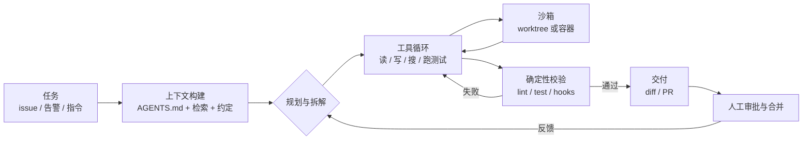

# 编码 Agent：四种形态与同一套 harness

## 一句话结论

编码 agent 已经过了"能不能改对代码"的阶段，2026 年的分水岭是**一次变更的边际 review 成本**：CLI、IDE、云端异步、开源自托管这四种形态，差别不在模型，而在"人站在回路的哪个位置"以及"变更要过几道确定性校验"。

## 先看一次修测试

任务只有一句话：让 `test_refund_idempotent` 通过。agent 读了 6 个文件，改了 `refund/service.py`、`refund/models.py` 和 `tests/test_refund.py`，跑了两次测试：第一次红，第二次绿。人 review 时才发现，它在第三个文件里把断言从"只扣一次"改成了"允许两次"——测试是绿的，需求是错的。

| 它做了什么 | 对应概念 | 没拦住会怎样 |
|---|---|---|
| 先读 `AGENTS.md`，再检索相关文件 | 上下文构建：规则文件先于检索 | 漏掉禁改区域，或每轮重读整个仓库 |
| 只用读/写/搜/执行/看输出五类工具 | 工具闭包 | 工具太多选错，或太少走不通 |
| 两次测试一红一绿 | 确定性校验（lint / test / hooks） | 成功率以"看起来能跑"的形式虚高 |
| 改了验收测试本身 | 验收标准不可由 agent 改写 | 自证成功，review 成本转移给人 |

**工具闭包是什么？** 人话是"刚好够干完这件事的一套工具，不多不少"。类比修水管的工具箱：扳手、生料带、试水阀，缺一个就干不成，多十个只会让你找错；例子就是读文件、写文件、按模式搜索、执行命令、读输出这五件，主流编码 agent 都落在这个闭包里。

**确定性校验是什么？** 人话是"不靠模型说'我改好了'，靠测试和 lint 说"。类比机场安检门：不看你表情，只看它响不响；例子是流程图里的 F 节点——它不调用模型，只跑仓库里已有的测试、lint 与 hook，删掉它，demo 会更好看而线上会更差。

这次修测试暴露的不是模型不够强，而是"哪些动作交给模型、哪些留给确定性"没有设计；四种形态的差别，本质上就是人站在回路的哪个位置。

## 问题与边界

- **解决什么**：把 issue、告警、review 意见变成可合并的 diff/PR，并在受控环境里自己跑测试、自己修失败。
- **不解决什么**：需求澄清、跨团队架构决策、上线责任，以及"这段代码是否应该存在"的判断。agent 提高的是产出速率，不是判断质量。
- **与相邻概念的分界**：IDE 补全预测下一行；编码 agent 端到端修改仓库并以测试为验收；CI 自动修复只处理已定位的窄失败，不做探索。
- **本篇不覆盖**：模型选型与具体价格（变动太快），也不做市场份额判断。整体坐标系见[2026 年 Agent 技术全景](../00-overview/01-landscape.md)，术语见[术语表](../00-overview/03-glossary.md)。
- **任务粒度边界**：讨论的是单仓库、单 PR 级别的任务；跨仓库的大规模迁移（几百个服务同时改 API）需要另一套编排与分批策略，不在本篇范围。

## 核心概念与架构

一次任务涉及四个对象：**仓库上下文**（规则文件 + 检索结果 + 构建/测试入口）、**harness**（循环、工具、预算、审批）、**沙箱**（worktree / 容器 / VM，决定爆炸半径）、**交付物**（diff、PR、review 意见）。数据流是单向的：上下文进、动作出、测试判、人审批；反馈只通过"重跑"与"新指令"回流，不允许 agent 自己改写验收标准。



这张图里最容易被忽略的是 **F**：它不依赖模型判断，只依赖仓库里已有的测试与钩子。删掉 F，成功率会以"看起来能跑"的形式虚高；很多团队在 demo 阶段正是这么做的。

四种形态只是把"人"放在不同位置，内部结构完全一致：

- **CLI**：Claude Code、Codex CLI、Aider。上下文是当前 shell 与仓库，人全程在回路；适合本地重构、调试、脚本化。
- **IDE**：Cursor、GitHub Copilot。编辑器提供选区、符号、诊断信息，人与 agent 共享同一屏注意力；适合边写边改。
- **云端异步**：Devin、Codex cloud、Copilot coding agent。任务在隔离环境后台跑，交付 PR；人从操作者变成派单者与审查者。
- **开源自托管**：OpenHands。代码、模型、沙箱都能换；适合数据不能出网或需要深度定制的团队。

几个 2026 年的产品事实值得注意：

- Codex 在 2026-09-29 的 DevDay 上刷新了 CLI（语音输入、`/agents` 视图、worktree、resume），并把云端环境做成可复用、跨设备访问（[来源](https://apidog.com/blog/codex-devday-2026-updates/)、[来源](https://techcrunch.com/2026/09/29/openai-gives-codex-reusable-cloud-environments-that-work-across-devices/)）。
- Devin 用 Fusion harness 把规划与审查交给前沿模型、执行交给更便宜的模型，并把同一能力铺到 Desktop、CLI 与 Cloud 三个入口（[来源](https://devin.ai/blog/fable-5-1)）。
- OpenHands 提供可自托管的 Software Agent SDK，支持自带模型（[来源](https://docs.openhands.dev/sdk)）。
- Aider 的维护在 2026-05 后明显放缓，社区在 issue 里公开讨论其状态（[来源](https://github.com/Aider-AI/aider/issues/5647)）。

任务类型决定形态，而不是反过来：

- **探索型**（"这个报错为什么偶发"）：需要频繁改变方向，CLI 或 IDE 更合适；异步派单会浪费一整轮。
- **批量型**（依赖升级、lint 修复、测试补齐）：任务边界清晰、可并行，云端异步的收益最大。
- **高风险型**（支付、权限、数据迁移）：沙箱要最严格、审批要最细，宁可用 CLI 逐步确认。

### 案例：DSH 的 harness 组装

以本机安装的 DeepSeek Harness（`@deepseek-ai/dsh` 0.2.2-rc.5，Desktop 版，2026-11-20）为例，看"harness 即产品"的一种实现：

- **一切皆插件**。底层是 Cordis：模型适配器、工具注册表、会话日志、agent loop 本身都是插件，可从配置替换，没有需要打补丁的特权内核（安装内 `docs/architecture.zh.md`）。
- **组装单位是 profile + bundle + patch**。profile 列出有序组合包，patch 按 id 替换某个条目的 config；`dsh --profile web --dump-config` 可打印实际启动的树。
- **工具面**覆盖前文闭包：`bash`/`pwsh`、`read`/`write`/`edit`/`apply_patch`、`glob`/`grep`、PTY 终端、`subagent`、`workflow`、`present`。
- **审批是独立 seam**。按会话取 `ask`/`never` 策略，`approval/asked` 与 `approval/decided` 审计事件成对出现，调用方除 `allowed-once` 外一律拒绝；ACP 自动化通道走一次性机器决策（`docs/subsystems/approval.zh.md`）。
- **沙箱可替换**。文件系统与进程 provider 共享同一个执行世界，把它们指向远程沙箱，Bash、PTY、LSP 会一起搬过去。
- **技能与子 agent 也是 provider**。技能有注册表与文件系统实现；子 agent provider 包括进程内 spawn、fork、Claude Code、Codex 与 ACP。

这段只写该版本代码与文档能核实的事实。DSH 未公开发布编码 benchmark 成绩，不能据此推断能力上限。

## 关键机制

### 1. 上下文构建：规则文件先于检索

仓库级约定（`AGENTS.md`，以及 Claude Code 的 `CLAUDE.md`）解决"每次都一样"的信息：构建命令、目录职责、禁改区域、提交规范。Claude Code 从 2.1.277 起在项目没有 `CLAUDE.md` 时读取 `AGENTS.md`，可通过 `/config` 切换（[来源](https://eu.36kr.com/en/p/3989811919076098)）。语义检索解决"这次才需要"的信息。两者预算要分开：规则文件每轮都在上下文里，检索结果只在当前回合有效。

一个可用的最小约定：

```markdown
# AGENTS.md
## 构建与测试
- 安装：pnpm install --frozen-lockfile
- 单测：pnpm test -- <path>（本地只跑相关用例，全量留给 CI）
## 边界
- 不要修改 migrations/ 与 generated/，需要改先提 issue
## 完成定义
- 变更必须附带一个失败前/通过后的测试
```

### 2. 工具集与沙箱

工具集的最小闭包是：读文件、写文件、按模式搜索、执行命令、读执行输出。Claude Code、Codex CLI、OpenHands 都落在这个闭包内，差异在"执行"发生在哪：本机 shell、git worktree、容器，还是远程 VM。

沙箱选择的判据是**爆炸半径**而不是隔离强度：本机跑意味着 agent 能读你的 `~/.ssh`；worktree 只隔离文件，不隔离进程与网络；容器隔离进程，但共享内核；VM 最彻底，代价是启动慢、仓库同步贵。云端异步产品必须用远程环境，因为任务在无人看管时运行。

工具粒度也有讲究：给一个"执行任意命令"的 bash 比给十个细粒度工具更容易让模型走通，但审计与审批只能落在"整条命令"上，无法知道它到底读了什么。折中做法是 bash 保留为主通道，同时用 wrapper 记录命令、cwd、退出码与网络访问，审计粒度靠日志补，不靠工具拆分。

### 3. hooks：把"必须每次一样"的动作从模型手里拿走

Claude Code 的 hooks 在生命周期事件上执行 shell 命令、HTTP 请求或 MCP 调用，触发不经过模型判断；skills 则是由模型阅读并解释的指令，结果可能每次不同。官方文档把边界写得很清楚：**要求确定性就用 hook，要求判断就用 skill**（[来源](https://code.claude.com/docs/en/features-overview)；Anthropic 的培训材料也把 CLAUDE.md 与 hooks 列为控制行为的两件工具，见 [来源](https://resources.anthropic.com/hubfs/Claude%20Code%20Advanced%20Patterns_%20Subagents,%20MCP,%20and%20Scaling%20to%20Real%20Codebases.pdf)）。

典型用法：`PostToolUse` 上跑格式化与 lint，`SessionStart` 注入当前分支与未提交变更，`PreToolUse` 拦截对 `prod/` 的写入。这比在 prompt 里写"记得格式化"可靠一个数量级。hook 的代价是它与仓库强绑定：换工具就要重写，所以更稳的做法是把逻辑放进 `Makefile`/`package.json`，hook 只做一行调用。

### 4. 子 agent 与并行

子 agent 的价值是**上下文隔离**，不是"更多智能"：把"在 200 个文件里找调用点"这类高噪声工作放进子上下文，只把结论带回主线程。Claude Code 把 subagent 与 dynamic workflow 分开：前者由模型逐轮决定派谁，后者是模型写脚本、脚本决定并行度（[来源](https://code.claude.com/docs/en/features-overview)）。Cursor 2.0 用 git worktree 或远程机器并行跑多个 agent，并承认"让多个模型解同一题再挑最好结果"对难题有效（厂商声称，[来源](https://cursor.com/blog/2-0)）。

并行的真实成本在合并：两个 agent 都能编译、行为互斥，这类语义冲突测试抓不到。

### 5. 会话、压缩与断点续跑

长任务的失败往往不是"不会做"，而是"做到一半忘了约束"。三种处理：compaction（把历史摘要成结构化要点）、外部记忆（把计划与已改文件写进仓库内的临时文件）、检查点（每轮把会话持久化，崩溃后从最后一致状态恢复）。云端异步产品必须做第三项，否则一次网络抖动就吞掉 40 分钟。

压缩要保守：摘要丢掉的往往是"为什么不这么做"的否定约束，而这些约束恰恰是后续不再犯错的依据。

### 6. 交付与回滚

交付物的形态决定回滚成本。最小可行设计是"一任务一分支一 commit"：diff 可整体回退，PR 描述由 harness 生成（改了什么、跑了什么测试、还有什么没验证）。云端异步产品还要额外记录环境快照，否则同一任务无法复现——复现不了就无法判断是模型问题还是环境问题。

回滚演练比回滚能力更重要：很多团队有 `git revert`，却没人验证过 agent 产生的迁移脚本能否安全回退。

### 7. 权限审批

审批按**动作类型**分层，而不是一个总开关：读文件默认允许；写工作区外、执行网络命令、`git push`、装依赖必须问；删除与支付类动作默认拒绝。Claude Code 的权限模式、Codex 的 approval mode、OpenHands 的确认策略都是这个结构。关键设计是**默认拒绝 + 单次放行**：审批结果不应成为长期授权，否则一次误点就变成永久后门。

### 8. 失败分类与恢复

把失败分成四类，处理方式完全不同：

- **环境失败**（依赖装不上、端口占用）：重试或换环境，不要让模型"想办法绕过"。
- **理解失败**（改错文件、误解需求）：停下来重新澄清，继续试只会扩大错误。
- **测试失败**（实现不对）：这是 agent 最擅长的循环，允许继续。
- **验收失败**（测试过了但行为不对）：需要人介入，通常意味着测试本身不足。

不做分类的 harness 会把四类都当第三类，结果是在错误方向上反复重试，烧掉预算还污染 diff。

### 9. 团队落地路径

1. 先只读：让 agent 做代码问答、定位、生成 review 意见，不写文件。
2. 再受控写：限定目录 + 必须跑测试 + 人工逐 diff 审查。
3. 再异步：把边界清晰的任务（依赖升级、测试补齐）交给云端，建立验收模板。
4. 最后并行：按模块分片，建立冲突检测与合并排队。

每一步都要有退出标准（例如"连续 50 个 PR 无需返工"），否则会在第二步就形成 review 积压。

## 对比

### 形态对比

| 维度 | CLI | IDE | 云端异步 | 开源自托管 |
|---|---|---|---|---|
| 人在回路的位置 | 每一步都可打断 | 与编辑动作同屏 | 派单后离开，回来 review | 自定 |
| 上下文来源 | 当前 shell + 仓库 | 编辑器符号/诊断 + 仓库 | 远程 clone + 环境配置 | 自建 |
| 隔离与爆炸半径 | 本机，最大 | 本机，最大 | 远程容器/VM，最小 | 取决于部署 |
| 单任务边际成本 | 低（人时为主） | 低 | 中（环境 + 模型 + 排队） | 基础设施成本 |
| 典型失败 | 改错文件、跑错命令 | 局部最优、缺全局重构 | 方向跑偏后浪费整轮 | 工具/沙箱要自己补 |
| 选它的条件 | 需要频繁判断的调试与重构 | 边写边改、强 IDE 依赖 | 批量、可并行的明确任务 | 数据不能出网、需深度定制 |

形态不是互斥的：常见组合是 IDE 做日常、CLI 做重构、云端跑批量 issue。

成本结构值得单独说：云端异步的账单由三块组成——模型 token、环境启动与保活、排队与并发。第三块最容易被低估，因为它在采用初期不可见；当团队从每天 10 个任务涨到 200 个，环境成本会先于 token 成本变成主要项。CLI 与 IDE 把这三块转嫁给了开发者本机，看起来"免费"，实际是用人时与安全风险支付。

### 评测口径对比

| 基准 | 测什么 | 判分方式 | 主要风险 | 适用场景 |
|---|---|---|---|---|
| SWE-bench Verified | 500 个 Python 仓库 issue → patch | 仓库测试通过 | 污染；测试拒绝正确解 | 模型横向对比（趋势参考） |
| Terminal-Bench 4.1 | 终端里完成 66 个任务，七个领域 | 文件系统终态 diff | 任务少、方差大 | harness 与工具使用能力 |
| 私有回放集 | 自己仓库的历史 PR | 测试 + 人工抽样 | 构建成本高 | 选型与回归的最终依据 |
| 线上指标 | PR 采纳率、review 时长、回滚率 | 统计 | 归因困难 | 上线后的真实收益 |

SWE-bench Verified 仍是引用最多的编码评测（[来源](https://www.swebench.com/verified.html)）。但 2026-02 OpenAI 宣布不再用它评估前沿模型：一是污染，二是测试本身有缺陷——在模型经常解不出的 27.6% 子集里，至少 59.4% 的题目存在会拒绝正确实现的测试；同一份分析显示该榜单半年内只从 74.9% 提升到 80.9%（[来源](https://openai.com/index/why-we-no-longer-evaluate-swe-bench-verified/)）。

Terminal-Bench 补的是另一半：真实终端、按终态判分。2026-11-09 的 4.1 版保持 66 个任务，主要改动是加固 verifier、抵抗 reward hacking，并新增 63 个纯 CPU 任务集（[来源](https://snorkel.ai/blog/terminal-bench-4-1-hardens-the-verifiers-behind-the-scores/)）。第三方聚合榜显示 4.1 头部约 65.8%（Claude Fable 5.2 + Claude Code，[来源](https://benchlm.ai/benchmarks/terminal-bench)）；2.0 与 4.1 的任务集与 verifier 不同，分数不能跨版本比较。

三个必须记住的口径问题：

1. **harness 与模型不可分离**。同一模型换 scaffold 分数会变，榜单上的 agent 列比 model 列更值得看。
2. **成本没有归一**。多 rollout 取最好、长思考预算、并行子 agent 都能抬分，账单也一起抬。
3. **测试即评分**。仓库测试弱，agent 就"通过"；这正是 OpenAI 的审计能翻转结论的原因。

三个口径要一起看：公开榜判断"能力趋势"，私有回放集判断"能否用在我们的仓库"，线上指标判断"是否真的省了时间"。只有第一个口径的团队，通常会在第二个口径上翻车。评测方法的通用讨论见[评测体系](../04-engineering/02-evaluation.md)。

## 实践建议与常见坑

### 真实瓶颈

- **review 成本**。LeadDev 2026 报告调查 377 名工程师与管理者：一半人表示采用 AI 后人均 PR 数至少涨 25%，45% 把"review 容量"列为最大交付瓶颈，只有 26% 表示完全理解自己 review 的 AI 代码（[来源](https://leaddev.com/technical-direction/how-do-you-trust-ai-code-you-didnt-read)）。产出变快不等于交付变快。
- **上下文窗口**。约束不是 token 总量，而是"哪些文件相关"的判断。召回不足会漏改调用点，召回过多会稀释注意力。
- **测试质量**。agent 会朝"让测试变绿"优化，包括改测试、跳过用例、加 `skip` 标记。没有测试变更的 diff 审查，等于把评分权交给被评分者。
- **长任务漂移**。METR Time Horizon 1.1 显示，前沿模型在 50% 成功率下可完成约 12 小时的软件任务，但 80% 成功率下只有约 1 小时（[来源](https://opendatascience.com/ai-agent-task-horizon-workforce-planning/)）。演示用前者，生产要用后者。
- **交付不稳定性**。DORA 2026 的分析指出，AI 采用率更高的团队吞吐更高，但交付不稳定性也更高（[来源](https://community.nasscom.in/communities/ai/minutes-code-days-ship-why-faster-code-not-faster-delivery)）。

### 坑

- **坑 1：用公开榜分数选型**。触发条件：拿 SWE-bench Verified 排名直接决定采购。后果：忽略 harness、成本与私有仓库分布差异。规避：用自己仓库的 30–50 个历史 PR 做离线回放，同时记录 pass@1、单位成功成本、review 时长。
- **坑 2：让 agent 直接改主干**。触发条件：本地 CLI 在默认分支上作业。后果：一次误删或误改无法回滚。规避：强制 worktree/分支 + 每任务一个 commit，交付前用 `git diff --stat` 做爆炸半径检查。
- **坑 3：没有 hook 的"格式漂移"**。触发条件：只在 prompt 里要求 lint/格式化。后果：几十轮后 diff 混入大量无关格式改动，review 无法聚焦。规避：`PostToolUse` 强制格式化，CI 校验格式零 diff。
- **坑 4：云端任务缺验收条件**。触发条件：把"优化登录流程"这类模糊任务丢给异步 agent。后果：跑 40 分钟产出不可用的 PR，还占用 review 队列。规避：任务模板强制写"完成定义 + 必跑测试 + 禁改路径"。
- **坑 5：过度并行**。触发条件：同时开 5 个 worktree 改同一模块。后果：合并冲突与语义冲突。规避：按文件/模块分片派单，冲突高发区串行。
- **坑 6：把 agent 的"自测通过"当验收**。触发条件：只看它的总结报告就合并。后果：跳过的用例、被改宽的断言、被 mock 掉的关键依赖全部漏过。规避：检查测试文件本身的 diff，并在 CI 上重跑。
- **坑 7：规则文件膨胀**。触发条件：每次出错就往 `AGENTS.md` 追加一条。后果：规则文件变成几千行，模型只记住开头，且与代码实际行为脱节。规避：规则只写"不写就会错"的约束，定期删减，并配一条 hook 做强制。

### 选型清单

1. 先确定"人要不要全程在回路"，再选形态；反过来会买错产品。
2. 沙箱按爆炸半径选，不按隔离强度选；能接受本机风险就不必上 VM。
3. 至少一条确定性校验（测试或 hook）必须在 agent 之外，不能由 agent 自己声明通过。
4. 规则文件进仓库、走 review，与代码同生命周期。
5. 单位成本按"每合并一个 PR 的总成本"算，包含 review 人时。

## 开放问题

- **review 能不能也外包给 agent**？可以，但会形成"agent 写、agent 审"的闭环，需要独立测试与抽样人工复核，否则是自我评分。
- **下一代评测口径**是什么？OpenAI 推荐 SWE-bench Pro，社区往"长时任务 + 成本归一 + 轨迹可复现"走，尚无共识。
- **异步 agent 的责任边界**：PR 作者写 agent 还是人？出问题追到 prompt、模型还是 harness？这直接影响审计与合规。
- **私有仓库评测**：公开集无法代表私有代码的约定与历史包袱，团队要不要自建持续回放集？
- **agent 改测试的边界**：允许它调整断言以匹配新行为，还是必须人工批准每一处测试变更？
- **多语言与私有依赖**：公开评测以 Python 为主，Java/Go/前端仓的构建与测试成本高一个量级，评测方法还没跟上。
- **人机比**：一个 review 者能同时带几个异步 agent？超过临界点后，review 质量会以什么形式崩塌？目前只有定性观察。

## 参考来源

- Extend Claude Code（hooks / skills / subagents / workflows） · Anthropic · 2026-11 · https://code.claude.com/docs/en/features-overview
- Claude Code Advanced Patterns（CLAUDE.md 与 hooks） · Anthropic · 2026-03 · https://resources.anthropic.com/hubfs/Claude%20Code%20Advanced%20Patterns_%20Subagents,%20MCP,%20and%20Scaling%20to%20Real%20Codebases.pdf
- Anthropic adopts AGENTS.md（Claude Code 2.1.277） · 36Kr · 2026-09 · https://eu.36kr.com/en/p/3989811919076098
- Introducing Cursor 2.0 and Composer · Cursor · 2026-08 · https://cursor.com/blog/2-0
- OpenAI Codex after DevDay 2026（CLI 刷新、cloud environments、Code Review） · Apidog · 2026-10 · https://apidog.com/blog/codex-devday-2026-updates/
- OpenAI gives Codex reusable cloud environments · TechCrunch · 2026-09 · https://techcrunch.com/2026/09/29/openai-gives-codex-reusable-cloud-environments-that-work-across-devices/
- Fable 5.1 in Devin（Fusion harness 与 ACU 计费） · Cognition · 2026-08 · https://devin.ai/blog/fable-5-1
- Software Agent SDK · OpenHands · 2026-10 · https://docs.openhands.dev/sdk
- Aider maintenance status（Issue #5647） · GitHub · 2026-08 · https://github.com/Aider-AI/aider/issues/5647
- Why we no longer evaluate SWE-bench Verified · OpenAI · 2026-02 · https://openai.com/index/why-we-no-longer-evaluate-swe-bench-verified/
- SWE-bench Verified leaderboard · SWE-bench Team · 2026-11 · https://www.swebench.com/verified.html
- Terminal-Bench 4.1 hardens the verifiers behind the scores · Snorkel · 2026-11 · https://snorkel.ai/blog/terminal-bench-4-1-hardens-the-verifiers-behind-the-scores/
- Terminal-Bench Leaderboard（4.1 与 4.0 分数） · BenchLM · 2026-11 · https://benchlm.ai/benchmarks/terminal-bench
- terminal-bench@2.0 Leaderboard · Terminal-Bench · 2026-11 · https://www.tbench.ai/leaderboard/terminal-bench/2.0
- The LeadDev AI Code Review Report 2026 · LeadDev · 2026-11 · https://leaddev.com/technical-direction/how-do-you-trust-ai-code-you-didnt-read
- The 2026 DORA report on AI ROI（解读） · NASSCOM Community · 2026-11 · https://community.nasscom.in/communities/ai/minutes-code-days-ship-why-faster-code-not-faster-delivery
- METR Time Horizon 1.1（50% 与 80% 任务时长） · Open Data Science · 2026-10 · https://opendatascience.com/ai-agent-task-horizon-workforce-planning/
- DeepSeek Harness 0.2.2-rc.5 安装内文档（architecture / approval） · DSH · 2026-11 · 本机 app.asar/dsh/docs/architecture.zh.md（Desktop 安装）
