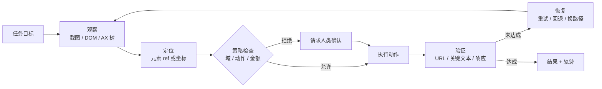

# 浏览器与 GUI Agent：在不可信页面上做有副作用的操作

## 一句话结论

computer use 的难点不在"看懂屏幕"，而在"在不可信的页面内容和已登录的会话里，替用户做有副作用的操作"；DOM/无障碍树与纯视觉之争，本质是"用结构换稳定"还是"用像素换覆盖"，2026 年的工程答案普遍是混合路线加严格的动作分级。

## 先看一次续签

用户让 agent 去政务网站续签通行证。前 8 屏都很顺：读表单、填姓名、选日期、上传照片。第 9 屏弹出一个没见过的图形验证码，agent 读不到 iframe 里的内容，先点"刷新"，再点"重新获取"，第三次触发了风控，会话被锁；它没有停下来交还控制权，而是继续找了 20 分钟"下一步"按钮。最后用户自己去了线下大厅。

| 现场 | 对应概念 | 教训 |
|---|---|---|
| 前 8 屏靠元素引用点中 | 观察与定位：AX 树 / DOM / 截图 | 结构路线便宜，但覆盖不了自定义控件 |
| 验证码在 iframe 里，读不到 | 观察层没有一种表示是完整的 | 混合路线：结构为主、截图为辅 |
| 点完"下一步"页面没变，它以为成功了 | 验证器：URL、关键文本、回执号 | `click()` 成功不等于业务成功 |
| 连续重试直到会话被锁 | 人工接管点与检查点 | 未知页面应暂停，而不是硬试 |

**观察层是什么？** 人话是"agent 的眼睛"。类比看房：中介给的户型图（AX 树/DOM）信息准但可能过期，现场照片（截图）永远真实但看不清小字；例子是同一个按钮，结构路线拿到的是角色与名称，视觉路线拿到的是一块 120×32 的像素。

**验证器是什么？** 人话是"动作之后确认真的生效，而不是相信调用没报错"。类比按电梯：按了按钮要看灯亮没亮，不能因为手指没疼就认为电梯来了；例子是提交后必须看到回执号或"已受理"文本，而不是模型自己回答"提交成功"。

**检查点是什么？** 人话是"记住已经办完哪几步"。类比填长表时拍照留存：第 22 步失败了，能从那一步重来，而不是从第 1 步重填；例子是记录"已填字段 + 已提交阶段"，恢复时先查业务状态再决定是否重提。

这次续签卡住的不是"看不看得懂屏幕"，而是"看不全、验不准、退不回"；三条技术路线之争只是第一环。

## 问题与边界

- **解决什么**：没有 API、只有 UI 的流程——内部老系统、跨 SaaS 审批、批量录入、定期巡检、需要登录态才能看到的页面。
- **不解决什么**：绕过验证码与反自动化（合规风险，且技术上不可持续）；无人类确认的高价值支付；需要像素级精度的设计工作；毫秒级延迟的交易。
- **与 RPA 的分界**：RPA 是编译期固定的脚本，选择器一变就断；agent 在运行时重新决策，代价是每步都要花 token 且结果不确定。两者可以组合：agent 负责探索并产出脚本，脚本负责稳定复跑。
- **与浏览器扩展 agent 的分界**：扩展运行在用户已登录的浏览器里，权限等于用户本人；云端浏览器是隔离环境，需要自己注入凭据。前者的风险是"读到你所有标签页"，后者的风险是"凭据泄露"，缓解手段完全不同。
- **成本结构**：视觉路线每步一次图像推理，成本通常按"每任务 N 步 × 图像 token"计；结构路线是文本 token，便宜一个量级但需要站点有可用语义。这个差异直接决定产品定价——按任务收费的 GUI agent，视觉路线的毛利最薄。
- **读者对象**：面向要落地一个 GUI agent 的工程师与产品负责人，不涉及爬虫合规的完整法律分析。权限与注入的通用讨论见[安全与权限](../04-engineering/03-security.md)，认证与会话模型可参考[编码 Agent](01-coding-agents.md) 的沙箱与审批部分。

## 核心概念与架构

六个对象：**观察**（截图、DOM、无障碍树，或三者的组合）、**定位器**（元素引用或坐标）、**动作空间**（点击、输入、滚动、按键、导航）、**验证器**（动作之后如何确认真的生效）、**会话与凭据**（登录态、Cookie、支付方式）、**策略**（域白名单、动作分级、金额阈值）。数据流是"观察→定位→策略检查→执行→验证"，验证失败才进入恢复分支；策略检查必须在执行之前，不能事后审计。

两条路线只在"观察 + 定位"不同，验证、恢复、审计是共用工程。很多团队在选路上争论很久，最后卡住的地方却在验证器——动作发出去了，页面没变，agent 却以为成功了。

把策略层画进架构不是为了合规好看，而是因为它是唯一能在"动作发生前"拦住副作用的层。观察和定位都可能被页面内容欺骗，验证只能事后发现问题；只有策略检查知道"这个按钮点下去会转账"。

会话模型也需要显式建模：一个任务一个浏览器上下文，上下文里包含 cookie、localStorage、下载目录与代理设置。任务结束就销毁，不复用到下一个任务。复用会话能省登录步骤，但会把"上一个任务留下的状态"变成不可解释的变量。

## 关键机制

### 1. 观察层：没有一种表示是完整的

- **无障碍树**：语义清晰、元素带角色与名称，适合表单与按钮；缺点是自定义控件常常缺失，且不同浏览器/框架的树差异大。
- **DOM**：信息最全，但噪声也最大；React 等框架的动态 class 名会让选择器每次不同，需要按文本、ARIA 属性或稳定属性降级匹配。
- **截图**：与站点实现解耦，任何渲染出来的界面都能用；代价是每步一次视觉推理，慢且贵，对细小文字的识别不稳。

工程上的常见做法是"AX 树为主、截图为辅"：用 AX 树给出候选元素并编号，截图只用于消歧和兜底。Browser Use 同时给模型结构化 DOM 表示与截图（[来源](https://github.com/feder-cr/jobs_applier_ai_agent_aihawk/blob/83b15708e463f614bda6c0838d86fcb399dc93d5/docs/ai-browser-agent-open-source.md)）；纯视觉方案则在截图里画编号框（set-of-marks）再让模型选编号，减少坐标回归误差。

### 2. 定位：元素引用会过期，坐标会漂移

元素引用的生命周期通常只有一次快照：页面重渲染后 ref 失效，必须重新观察。坐标点击则受视口、缩放、DPI、滚动位置影响。可靠做法是两者都保留：优先元素引用，失败后回退到"文本锚点 + 相对位置"或"最近的可点击祖先"，最后才是原始坐标。

每次动作后重新观察是成本，但不重新观察的代价更大——基于过期 ref 的连续动作会产生"看起来在执行、实际点空"的静默失败。

### 3. 验证：不要相信动作的返回值

`click()` 成功不等于业务成功。验证要落在可观测的状态上：URL 变化、标题变化、页面出现预期文本、网络请求返回 2xx、购物车数量 +1。验证器应该是确定性的断言，而不是再问一次模型"成功了吗"——后者会把失败解释成成功。

对多步骤流程，验证要分层：单步验证（这一屏对不对）+ 阶段验证（订单是否创建）+ 终态验证（数据库/邮件/回执）。只有终态验证能证明任务完成。

### 4. 长流程恢复：检查点比重试更重要

一个 30 步的流程在第 22 步失败，重跑全部既慢又可能重复副作用。三个机制：**检查点**（记录已完成的业务步骤，而不是 UI 步骤）、**幂等键**（提交类动作带唯一键，重复提交被服务端拒绝）、**人类接管点**（连续失败 N 次或遇到未知页面时暂停并交还控制权）。

恢复策略要区分"可重试"与"不可重试"：网络超时、加载慢可重试；提交成功但回执未拿到，必须先去查状态再决定，不能直接重试。

### 5. 凭据与支付：模型永远不该看到密码

正确做法是凭据注入：agent 只拿到一个已登录的会话或一次性令牌，密码、卡号、CVV 不进入模型上下文。支付类动作设金额阈值与白名单收款方，超过阈值强制人类确认；授权按次而非按会话，避免一次确认变成长期免密。

2026 年的支付侧开始出现协议层方案：Mastercard 的 Agent Pay for Machines 基于 x402，在额度内签发数字签名付款凭证，供应商验证后交付、事后结算（[来源](https://www.mastercard.com/mea/en/news-and-trends/press/2026/october/Mastercard-Agent-Pay-for-Machines-in-action.html)）。它解决的是"授权一次、多次交易"的凭证问题，不解决"这个 agent 是否该买这个东西"的判断问题。

### 6. 审计：轨迹要能回答"它到底做了什么"

一条可用的轨迹至少包含：每步的截图、动作（含目标元素与坐标）、观察到的页面摘要、网络请求（域名 + 方法 + 状态码）、策略判定结果、模型输入输出的脱敏副本。审计的关键不是"存了多少"，而是能否按业务动作检索——"过去 30 天所有修改过收款账户的操作"这类查询，决定了出事时能不能定位。

### 7. 并发与多标签

真实任务经常要跨标签（在 A 站查价、B 站下单）。多标签会把"当前页面"从一个隐式状态变成显式对象：每个标签有独立的观察与历史，动作必须带标签 ID，否则会出现"在错误的标签上输入"的事故。并发执行多个任务时，还要隔离代理与出口 IP，否则一个任务触发风控会连带其他任务。

### 8. 成本与延迟预算

按步计费的 agent 要把预算写进循环：总步数上限、单任务金额上限、视觉调用次数上限。超过预算不是"再试一次"，而是带着当前状态交还人类。延迟同理——用户能接受 2 分钟的"填表"，不能接受 20 分钟的"思考"，所以慢任务要异步化并给出进度。

一个经验值：纯视觉路线单步 2–5 秒、结构路线单步不到 1 秒；30 步流程的差异是分钟级的，这决定了产品能不能做成交互式。

### 9. 页面漂移的工程应对

页面漂移不是"偶发 bug"，而是常态。三类应对：

- **锚点降级**：元素 ref → 文本 + 角色 → 相对位置 → 坐标，逐级回退，每级都记录命中率。
- **指纹检测**：把页面标题、关键区块的文本哈希做成指纹，变化超过阈值时先暂停并重新规划，而不是硬点。
- **流程级兜底**：关键流程保留"人工可完成"的入口，agent 失败时把当前状态（截图 + 已填字段）交给人工，避免从零开始。

### 10. 反自动化与合规边界

站点有权拒绝自动化访问。合规的做法是走官方 API、合作接口、或明确允许的自动化通道；不合规的做法是伪造指纹、绕过验证码。后者不只是法律风险，也是工程风险：对抗会持续升级，维护成本没有上限。

产品设计上要提前承认这条边界：把"支持站点清单"作为显式能力，而不是宣称"任何网站都能操作"。

## 对比

### 三条技术路线

| 维度 | DOM / 无障碍树驱动 | 纯视觉坐标点击 | 混合（结构 + 视觉） |
|---|---|---|---|
| 覆盖范围 | 语义化站点好，Canvas/自定义控件差 | 任何渲染界面 | 大多数场景 |
| 稳定性 | 中（选择器随重构失效） | 低（布局变化即漂移） | 高（互为兜底） |
| 注入面 | 大（DOM 文本、隐藏指令） | 大（截图里的诱导文案） | 大，且更难归一化过滤 |
| 单步成本 | 低（文本 token） | 高（图像 token + 推理） | 中 |
| 可调试性 | 好（能看到元素与属性） | 差（只能看截图） | 中 |
| 选它的条件 | 内部系统、表单为主、可改前端 | 第三方站点、无结构信息 | 通用产品默认 |

混合路线成为默认，不是因为它在任何单点上最优，而是因为**失败可以降级**：元素定位失败还能退到视觉，视觉选错还能用文本锚点纠正。代价是两套观察都要维护，且策略层必须同时理解"元素"与"坐标"两种动作语义。

一个反直觉的结论：在语义化良好的站点上，纯视觉反而更贵、更慢、更不稳，因为模型在做本可以查表完成的事。选视觉的理由应该是"结构拿不到"，而不是"视觉更先进"。

### 评测基准

| 基准 | 测什么 | 判分方式 | 局限 |
|---|---|---|---|
| WebArena / WebArena-Verified | 自托管站点上的多步任务（购物、论坛、GitLab 等） | 后端状态校验（REST/DB），Verified 版去掉 LLM judge | 站点固定，迁移到真实站点会掉分 |
| WebVoyager | 真实公开网站上的端到端任务 | 多为 LLM/多模态 judge | 站点会变，结果不可复现 |
| OSWorld / OSWorld-Verified | 真实操作系统里的桌面任务 | 执行式评估器检查终态 | 环境重，任务偏短 |
| 私有回放 | 自己业务的关键流程 | 业务终态 + 人工抽样 | 构建与维护成本高 |

WebArena-Verified 是 2026 年值得注意的修订：审计了全部 812 个任务，修正 257 个（46 个参考答案对齐、211 个任务定义澄清），把脆弱的字符串匹配换成后端状态校验与 schema 校验，并给出可复现的 Docker 镜像（[来源](https://openreview.net/pdf?id=94tlGxmqkN)、[来源](https://pypi.org/project/webarena-verified/1.1.2/)）。这类"先把尺子修好"的工作，比再刷一个榜更有价值。

WebVoyager 的数字要谨慎看：它是 live web + judge，站点改版就会漂。一个公开的复现记录显示，browser-use 驱动多模态模型在 643 个 WebVoyager 任务上成功率 71.1%，但这是自报口径且取两次运行中较好的一次（[来源](https://huggingface.co/datasets/shiqihe/WebVoyager-Trajectories-Qwen3.5-Omni)）。

OSWorld 的公开聚合榜显示头部 79.6%、中位数 53.4%（12 个模型，2026-11 快照），且 OSWorld-Verified 与 OSWorld 2.0 是不同协议，分数不可直接比较（[来源](https://benchgecko.ai/benchmark/osworld)、[来源](https://benchlm.ai/benchmarks/osworld-verified)）。桌面任务的真实难度被中位数而不是头部更能说明。

### 评测方法

- **跑三遍**：同一任务至少三次，报告成功率与方差；单次结果没有信息量。
- **记录副作用**：除成功与否，统计非预期写操作（多提交、多发信、误删）。
- **分阶段看**：定位准确率、单步动作正确率、阶段完成率、终态成功率分开报，才知道卡在哪。
- **固定环境**：能冻结就冻结（镜像、数据快照），live 站点只用于"泛化"评测。
- **人工抽检**：judge 会系统性偏宽松，抽 10% 人工核对。

### 怎么选

- 站点由自己控制、且有前端改造权：优先 DOM/无障碍树，甚至直接暴露 WebMCP 工具，把"操作 UI"降级为"调用工具"。
- 第三方站点、结构不可控：混合路线，元素优先、坐标兜底。
- 需要跨任意站点的通用产品：视觉必须是第一公民，但要接受更高成本与更低单步成功率。
- 只跑固定几个流程：先用 agent 探索一次，产出确定性脚本或 RPA，再长期复跑——把概率性留给探索，把确定性留给生产。

### 产品现状（2026-11）

- **OpenAI**：Operator 于 2025-08-31 下线，能力并入 ChatGPT agent；独立浏览器 Atlas 于 2026-08-09 停用，浏览器能力收进 ChatGPT 桌面端、Chrome 扩展与开发者 computer-use API（[Atlas 停用说明](https://help.openai.com/en/articles/20001371-evolving-atlas-into-chatgpt-for-browser-based-agentic-work)）；据第三方产品追踪，ChatGPT agent 的独立入口也在 2026-08 前后撤销，面向长任务的产品改为 ChatGPT Work（[第三方追踪](https://github.com/feder-cr/invisible_playwright_mcp/blob/v0.68.10/docs/is-openai-operator-still-available.md)、[Dataconomy](https://dataconomy.com/2026/11/09/chatgpt-work-agent-alternative-multi-step-tasks/)）。产品形态从"独立入口"退回"功能"。
- **Anthropic**：computer use 以工具形式提供，工具版本已到 `computer-use-2025-11-24`；Bedrock 侧提供 GA 的 `computer_toolset_20260801` 与 `browser_toolset_20260801`，由客户端执行动作（[来源](https://docs.aws.amazon.com/bedrock/latest/userguide/computer-use.html)）。
- **Google**：Project Mariner 于 2026-05-04 关停，能力进入 Gemini Agent、Chrome 的自动浏览与 Gemini API 的 Computer Use 工具（[The Verge](https://www.theverge.com/tech/925559/google-project-mariner-shut-down)）；后者于 2026-10-30 在 Interactions 与 GenerateContent 两套 API 上 GA，模型只返回操作建议，执行由客户端完成（[来源](https://tech.yahoo.com/ai/gemini/articles/google-computer-goes-ga-client-155736236.html)）。
- **Browser Use**：MIT 许可的开源库，Playwright 驱动，DOM 与截图同时给模型，仓库规模在该品类最大（第三方统计 112.1k stars，2026-09）；另有 Browser Harness 走原生 CDP，厂商声称比 DevTools MCP 少用最多 3 倍 token（厂商声称，[来源](https://browser-use.com/browser-harness.md)）。

一个共同趋势：**执行侧留在客户端**。模型厂商提供"看屏幕、给动作"，沙箱、凭据、策略由应用负责，这既是责任划分，也是安全边界。

## 实践建议与常见坑

### 真实瓶颈

- **页面漂移**。改版、A/B 实验、地区差异都会让昨天可用的流程今天失败。缓解：文本锚点优先于 CSS 选择器；把"页面指纹"纳入检查点；失败即停而不是盲重试。
- **反自动化**。验证码、行为检测、设备指纹让纯脚本路线不可持续。合规边界要先划清：绕过检测做规模化抓取，风险不在技术而在法律与账号封禁。
- **长流程恢复**。30 步流程的累计成功率是每步成功率的乘积；单步 95% 在 30 步后只剩约 21%。这是"demo 很惊艳、上线不可用"的算术原因。
- **凭据与支付**。凭据进入模型上下文就等于泄露；支付没有阈值就等于把公司账户交给一个概率系统。
- **审计**。没有业务动作级轨迹，出事时只能看到"agent 点了很多下"。
- **成本**。视觉路线单任务成本可能是结构路线的 5–10 倍；当产品按任务定价时，路线选择直接决定毛利。
- **可观测性**。GUI 任务的失败现场在页面上，而页面会变；不保存快照就无法复盘。

### 坑

- **坑 1：坐标硬编码**。触发条件：把某次成功的点击坐标写进脚本。后果：换分辨率或滚动位置后点到别的按钮，可能造成真实副作用。规避：坐标只做最后兜底，且执行前用元素文本二次确认。
- **坑 2：共享登录态**。触发条件：把用户 Cookie 复制到云端浏览器。后果：会话可被复用、无法归因到具体人。规避：按任务签发短期会话，绑定用户与任务 ID，用完即焚。
- **坑 3：只测成功率不测副作用**。触发条件：评测只看任务是否完成。后果：重复下单、多发邮件、误删数据不被计入。规避：评测同时统计"非预期写操作"次数。
- **坑 4：缺幂等**。触发条件：提交超时后自动重试。后果：重复创建工单/订单。规避：提交动作带幂等键，重试前先查状态。
- **坑 5：把页面文本当指令**。触发条件：把整页内容拼进 prompt。后果：间接提示注入，页面里的"忽略之前的指令"会生效。规避：页面内容标记为数据，工具调用与指令分离，敏感动作走策略层。
- **坑 6：验证只看"页面变了"**。触发条件：用"DOM 有变化"作为成功信号。后果：弹窗、广告、加载动画都会让页面变化，任务被误判完成。规避：验证必须绑定业务断言（订单号出现、金额匹配），而不是任意 DOM 差异。
- **坑 7：无限重试**。触发条件：失败后固定重试 3 次。后果：在风控场景下把账号打到封禁。规避：失败分类，风控类失败直接停并转人工，技术类失败才重试。

### 安全设计原则

把"能点任何地方"当成**最高权限**来设计，而不是当成一个 UI 功能：

1. 网络出口默认拒绝，按域白名单放行；下载的文件不自动执行。
2. 动作分级：读、写、提交、支付、删除，逐级增加确认与复核。
3. 浏览器 profile 隔离，不混用个人账号；能只读就只读。
4. 高风险动作（改收款账户、授权、删除）要求双人复核或离线确认。
5. 轨迹不可篡改，至少做到 append-only 与外部存储。

Chrome 的 WebMCP 文档把攻击面写得很直接：恶意站点可以在工具定义里藏指令，agent 又在用户的已登录会话中运行，所以"工具描述"本身必须当作不可信输入（[来源](https://developer.chrome.com/docs/agents/security)）。

### 落地检查清单

- [ ] 每个任务一个隔离浏览器上下文，结束即销毁。
- [ ] 域白名单与网络出口限制已生效，下载目录不自动执行。
- [ ] 动作分级表已定义，支付/删除/授权类动作有人类确认。
- [ ] 每个关键步骤有业务断言，而不是只看页面变化。
- [ ] 提交类动作有幂等键，重试前先查状态。
- [ ] 轨迹含截图、动作、网络请求与策略判定，可按业务动作检索。

## 开放问题

- **评测口径**：live web 真实但不可复现，冻结快照可复现但会过时。两者要不要成对报告？
- **可访问性与反自动化的冲突**：站点为了挡 agent 也在挡辅助技术，行业缺少区分"人类辅助"与"机器批量"的标准。
- **agent 身份**：浏览器里的 agent 代表谁？OAuth 授权给 agent 还是给用户？出问题谁负责？
- **WebMCP 能否减少视觉依赖**：如果站点主动暴露结构化工具，纯视觉路线会不会退化为兜底？
- **长流程的成功率工程**：除了 checkpoint 与幂等，是否需要对"每步成功率"做预算式规划（步数越多，单步要求越高）？
- **跨应用任务**：桌面 agent 经常要在浏览器、Excel、邮件之间切换，状态如何跨应用对齐？目前没有通用抽象。
- **评测的副作用口径**：如何把"非预期写操作"纳入基准？现有 benchmark 基本只判任务是否完成。
- **人类注意力的定价**：把确认请求推给人是有成本的，什么时候值得打断，缺少可计算的准则。
- **浏览器之外的 GUI**：桌面软件、移动端、终端 TUI 的观察接口各不相同，是否会出现统一抽象仍未知。

## 参考来源

- Evolving Atlas into ChatGPT for browser-based agentic work（Atlas 于 2026-08-09 停用） · OpenAI Help Center · 2026-11 · https://help.openai.com/en/articles/20001371-evolving-atlas-into-chatgpt-for-browser-based-agentic-work
- Is OpenAI Operator still available（Operator / ChatGPT agent / Atlas 时间线） · 第三方追踪文档 · 2026-09 · https://github.com/feder-cr/invisible_playwright_mcp/blob/v0.68.10/docs/is-openai-operator-still-available.md
- Google shuts down Project Mariner（2026-05-04 关停） · The Verge · 2026-05 · https://www.theverge.com/tech/925559/google-project-mariner-shut-down
- How to use ChatGPT Work now that ChatGPT agent is unavailable · Dataconomy · 2026-11 · https://dataconomy.com/2026/11/09/chatgpt-work-agent-alternative-multi-step-tasks/
- Use computer use tools to automate GUI tasks with Amazon Bedrock models · AWS · 2026-11 · https://docs.aws.amazon.com/bedrock/latest/userguide/computer-use.html
- Google's Computer Use Goes GA; Client Apps Still Execute the Actions · Yahoo Tech · 2026-10 · https://tech.yahoo.com/ai/gemini/articles/google-computer-goes-ga-client-155736236.html
- Project Mariner is gone: what replaced it · 第三方追踪文档 · 2026-09 · https://github.com/feder-cr/jobs_applier_ai_agent_aihawk/blob/94c9736610b6ca54ed115e6241d8637f4d25a4c3/docs/project-mariner-is-gone.md
- Browser Harness: give your agent a browser · Browser Use · 2026-11 · https://browser-use.com/browser-harness.md
- Open-source AI browser agents（browser-use 规模与许可） · 第三方调研 · 2026-09 · https://github.com/feder-cr/jobs_applier_ai_agent_aihawk/blob/83b15708e463f614bda6c0838d86fcb399dc93d5/docs/ai-browser-agent-open-source.md
- WebArena Verified（ICLR 2026） · ServiceNow · 2026 · https://openreview.net/pdf?id=94tlGxmqkN
- WebArena-Verified 发布说明（Docker 镜像与 deterministic evaluators） · PyPI · 2026-02 · https://pypi.org/project/webarena-verified/1.1.2/
- WebVoyager + GAIA Agent Trajectories（browser-use 自报 71.1%） · Hugging Face · 2026-06 · https://huggingface.co/datasets/shiqihe/WebVoyager-Trajectories-Qwen3.5-Omni
- OSWorld Benchmark Leaderboard（头部 79.6 / 中位 53.4） · BenchGecko · 2026-11 · https://benchgecko.ai/benchmark/osworld
- OSWorld-Verified 与 OSWorld 2.0 的口径差异 · BenchLM · 2026-11 · https://benchlm.ai/benchmarks/osworld-verified
- Agent security considerations for WebMCP · Chrome for Developers · 2026-06 · https://developer.chrome.com/docs/agents/security
- Agent Pay for Machines（x402 付款凭证） · Mastercard · 2026-10 · https://www.mastercard.com/mea/en/news-and-trends/press/2026/october/Mastercard-Agent-Pay-for-Machines-in-action.html
- Indirect Prompt Injection in Browser-Using Agents · Zenodo · 2026-07 · https://zenodo.org/records/21216301
