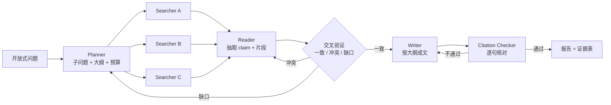

# 深度研究 Agent：把开放式问题变成可核对的证据链

## 一句话结论

深度研究的价值不在"写得更长"，而在"把开放式问题拆成可验证的子问题，并为每句结论保留可回溯的证据"；它本质是一个**带预算约束的检索—验证系统**，不是更强的 RAG。

## 先看一份 20 页的报告

老板要一份 20 页竞品报告，要求"每个结论都有出处"。第一版交上去，18 页、42 条引用，问题很集中：3 条链接打不开，5 条引用与句子对不上，同一个"市场增速"在第 4 页写 30%、第 11 页写 18%，还有 4 页是把官网简介复述了一遍。返工的不是文笔，是证据。

| 报告里的问题 | 出在哪一环 | 对应概念 |
|---|---|---|
| 第 4 页"增速 30%"没有出处 | 计划与写作之间缺证据 | 证据表：claim → 来源片段 → 日期 → 置信度 |
| 同一指标 30% 与 18% 并存 | 两个来源口径不同 | 冲突集：保留双方并标注统计范围 |
| 引用链接指向首页而非原文 | 抽取时没保留片段与位置 | reader 的 span 与引用映射 |
| 第 12 页的结论在来源里找不到 | 成文后没做逐句核对 | Citation Checker：蕴含判断而非主题相关 |

**证据表是什么？** 人话是"每句话都配一张能查回去的发票"。类比报销：光说"我花了钱"不行，要贴发票、写用途、对得上金额；例子是一行证据至少含 claim、URL、原文片段、发布日期、是否多源支持，缺一项，后面就无法核对。

**计划（planner）是什么？** 人话是"把大问题拆成搜得到、也判得了对错的小问题"。类比写论文先列提纲：先有章节，再有每章要回答的问题；例子是"分析一下这个行业"不可判定，改成"2026 年中国 X 市场出货量及同比"才可检索、可验证。

**引用核对是什么？** 人话是"这句话能不能从引用的那段话里推出来"，而不是"主题相关"。类比引注：要引到具体页码的那一句，不能引整本书；例子是用蕴含（entailment）判断句子的每个事实是否落在片段里，不通过就改写或补检索。

20 页不是"写"出来的，是"计划—检索—抽取—核对"四段流水线压出来的；下面拆这条流水线。

## 问题与边界

- **解决什么**：开放式、多跳、需要跨源交叉验证的问题——市场扫描、竞品对比、技术选型调研、尽职调查初稿。产出是带引用的结构化报告，而不是一段答案。
- **不解决什么**：付费墙与未授权内部数据；需要一手访谈或实验才能得到的结论；实时性要求秒级的事实查询；以及"该不该做这个决策"的判断。
- **与 RAG 问答的分界**：RAG 是"一次检索 + 一次生成"，问题是确定的、答案通常在一两个片段里；深度研究的检索路径本身要被规划，答案分布在几十个来源里，还要处理冲突与时间。
- **与搜索的分界**：搜索返回链接，深度研究返回的是"已经读过并组织过的论证"，代价是分钟级延迟与数量级更高的成本。
- **读者对象**：要自建或采购深度研究能力的工程与业务团队。
- **不承诺**：报告不构成投资、法律或医疗建议；领域判断仍需专家复核。评测方法的通用讨论见[评测体系](../04-engineering/02-evaluation.md)，"harness 决定质量"的同类证据可对照[编码 Agent](01-coding-agents.md)。

## 核心概念与架构

五个对象：**计划**（子问题与报告大纲）、**证据**（claim → 来源片段 → 时间 → 置信度）、**覆盖度**（计划中的每个子问题是否有证据支撑）、**冲突集**（不同来源互相矛盾之处）、**引用映射**（报告中的每句话对应哪个片段）。数据流是"计划驱动检索、检索产出证据、证据反过来修正计划"。

关键点：**计划不是一次性的**。缺口与冲突会回流到 Planner，触发补充检索；没有这个回流的系统，只是"并行搜索 + 拼接"。

四种角色可以配不同模型：planner 用强推理模型、searcher 用便宜模型做查询改写、reader 用长上下文模型做抽取、writer 用擅长写作的模型。按角色分配预算，比全程用同一个旗舰模型便宜得多，也更可控。

## 关键机制

### 1. 计划：子问题要可检索、可判定

好的子问题满足两个条件：能用查询表达，且答案能被证据判定为"有/没有"。反例是"分析一下这个行业"——它无法判定完成。工程做法是先出大纲（章节 → 子问题），每个子问题挂检索预算（最多 N 次查询、M 个来源），再进入执行。

计划阶段最常见的失败是**范围过宽**：子问题太多导致每个都浅尝辄止。约束预算比约束数量更有效——"最多 8 个子问题、每个最多 6 次检索"通常比"尽量全面"产出更好。

### 2. 并行检索与去重

并行 searcher 的价值是覆盖不同来源类型：官方文档、行业媒体、学术论文、社区讨论、监管文件。每个 searcher 有独立查询式与时间窗，结果汇总后要做三层去重：URL 归一化（去掉 utm 与锚点）、内容指纹（同一篇稿件被多家转载）、观点去重（不同来源说同一件事）。

时间处理要显式：给每个查询加时间窗（如"2026 年内"），并在证据里记录发布日期。对快速变化的主题，没有时间过滤的报告会把三年前的结论当现状。

### 3. 证据表：让每句话有出处

证据表是这类系统的核心数据结构，一行至少包含：claim、来源 URL、片段原文（span）、发布日期、抽取置信度、是否被多源支持。写入时要求模型**逐字引用片段**，而不是转述——转述会让后续的引用核对失去锚点。

没有证据表的系统，写作阶段只能"凭记忆引用"，最终报告里的链接与论点对不上，这是深度研究产品最常见的质量问题。

### 4. 交叉验证：一致、冲突、缺口

三种结果对应三种动作：

- **一致**：多个独立来源支持同一 claim，提升置信度，但仍要检查是否同源转载。
- **冲突**：保留双方，在报告中显式标注分歧与各自口径（统计范围、时间、样本），不要"取平均"。
- **缺口**：计划中的子问题找不到证据，回到 Planner 换查询式，或明确写"未找到公开数据"。

冲突处理是深度研究区别于摘要的地方。把冲突藏起来，报告读起来更顺，但结论更不可靠。

### 5. 写作与引用核对

写作按大纲组织，禁用"据报道"这类无指向的表述，每个论断绑定证据 ID。成文后做引用核对：逐句检查"这句话的每个事实是否能在所引片段中找到"，不通过就改写或补检索。

核对要机器可做：把句子与片段做蕴含判断（entailment），而不是判断"主题相关"。相关但不对应，是引用幻觉的主要形态。

### 6. 预算：为什么一次深度研究很贵

成本由四块构成：检索 API 调用、抓取与解析、长上下文重读、写作与核对。以公开价格为例，Gemini 的 Deep Research 模型输入 $2/百万 token、输出 $12/百万 token，Google 搜索接地每月含 5000 次查询、超出按 $14/1000 次计（[来源](https://cloud.google.com/model-garden/pricing?hl=zh-cn)）。一次报告若做 150 次检索、读 80 个页面、上下文反复重读，检索费就是 2 美元量级，加上 token 与重试，单份报告成本通常在数美元。

这也是产品分层的原因：标准版少检索、少重读；"Max"版增加检索轮次与上下文，价格与延迟一起上去。

### 7. 查询生成与改写

子问题不等于查询式。一个子问题通常要生成 3–6 个查询：同义词、限定站点、限定时间、英文/中文双语、以及"反面证据"查询（"X 失败的案例"）。检索结果差时，改写比换模型有效：加入领域术语、去掉口语词、把疑问句改成名词短语。

"反面证据"查询最容易被忽略，也最能提升报告质量——只找支持性证据的系统，会把任何假设都写成结论。

### 8. 长文阅读与压缩

抓到的页面动辄上万字，不能整篇进上下文。做法是先分段抽取"与当前子问题相关的 claim + 片段"，再对片段做去重与排序。压缩的损失要可追溯：保留片段原文与位置，摘要只用于排序，不用于最终引用。

对 PDF 与图表，解析质量决定上限；扫描件没有 OCR 就等于没有来源。

## 对比

### 代表产品

| 产品 | 当前形态 | 关键能力 | 约束 |
|---|---|---|---|
| ChatGPT 深度研究 | ChatGPT 内的研究模式 | 可接 MCP/应用、限定可信站点、可中断调整 | 按套餐限额；连接应用只读 |
| Gemini Deep Research | Gemini API / Gemini Enterprise | 双版本（标准 / Max）、100 万输入 token、协作规划、MCP 与 File Search | 按 token 与检索计费 |
| Perplexity Advanced Deep Research | Perplexity 订阅 | 更多来源、交叉引用、代码沙箱、边研究边追问 | 模型随套餐变化 |
| 开源自建 | LangChain open_deep_research、DeerFlow、GPT Researcher | 可换模型、搜索源、报告结构与深度 | 检索质量与成本要自己兜 |

ChatGPT 的深度研究在 2026-02-10 的更新里加入了两项关键能力：连接 MCP 或应用，以及把检索限制在可信站点（[来源](https://openai.com/ka-GE/index/introducing-deep-research/)）。这说明产品竞争点从"读得多"转向"读得可控"。

Gemini 的 `deep-research-preview-04-2026` 提供标准与 Max 两个版本，输入上下文 1,048,576 token、输出 65,536 token，支持协作规划、可视化、MCP server 与 File Search（[来源](https://ai.google.dev/gemini-api/docs/models/deep-research-preview-04-2026)）。

开源侧，LangChain 的 open_deep_research 把计划、搜索 API、每个章节的迭代深度、写作模型都做成可配置项（[来源](https://pypi.org/project/open-deep-research/0.0.2/)）；DeerFlow 在 2026-02-28 发布 2.0 后重写为"super agent harness"，把子 agent、记忆与沙箱作为一等对象（[来源](https://github.com/bytedance/deer-flow/blob/c18df580f61aa104d823ecbd0e7b362576eb7395/README.md)）；GPT Researcher 在 2026-09 的 v3.7 里把上下文选择从"向量相似"改成"对回答是否有用"的打分，并保留 BM25 兜底（[来源](https://newreleases.io/project/github/assafelovic/gpt-researcher/release/v3.7.0)）。

### 评测

| 基准 | 任务规模 | 评什么 | 口径问题 |
|---|---|---|---|
| Deep Research Bench（FutureSearch） | 89 个多步任务、8 类 | 答案正确性 + 轨迹中的幻觉、工具使用、遗忘 | 冻结网页快照（RetroSearch） |
| DeepResearch Bench（ICLR 2026） | 100 个博士级任务、22 领域 | RACE 报告质量 + FACT 引用可信度 | 依赖 LLM judge 与参考报告 |
| DeepResearch Bench II（Mercor） | 132 个任务、9430 条 rubric | 细粒度 rubric 覆盖 | 榜单分数不可跨版本比较 |
| 自建评测 | 20–50 个真实问题 | 事实性、覆盖度、引用准确率 | 需要人工标注，成本高 |

两个同名基准要分清：FutureSearch 的版本用 89 个任务与冻结网页做可复现评测，并分析轨迹里的幻觉与遗忘（[来源](https://arxiv.org/abs/2506.06287)）；ICLR 2026 的版本用 100 个博士级任务，提出 RACE（全面性、深度、指令遵循、可读性）与 FACT（引用准确性）两组指标（[来源](https://mlanthology.org/iclr/2026/du2026iclr-deepresearch/)）。

分数绝对值要谨慎：DRB II 的公开均值在 2026-11 约 56.10%（[来源](https://benchlm.ai/benchmarks/mercordeepresearchbench2)），头部方案在 6 月自报 64.38（口径为 TotalScore，厂商声称，[来源](https://www.ai21.com/blog/merging-weak-agents-into-a-state-of-the-art-deep-researcher/)）。这说明"及格线"仍在上移，且不同版本的分数不可直接对比。

一个被低估的结论来自 ACL 2026 的一篇分析：同一个 Gemini-2.5-Pro，裸模型只给搜索工具，与放进官方 deep-research harness 相比，RACE 差 17.81 分（[来源](https://aclanthology.org/2026.acl-long.288.pdf)）。**harness 的贡献大于换模型**，这与编码 agent 的结论一致。

### 与普通 RAG 问答的边界

| 维度 | 普通 RAG 问答 | 深度研究 |
|---|---|---|
| 检索次数 | 1 次（可能带改写） | 数十到数百次，路径由计划决定 |
| 来源数量 | 3–10 个片段 | 几十到几百个页面 |
| 输出 | 短答案 + 引用 | 结构化报告 + 证据表 |
| 延迟 | 秒级 | 分钟级 |
| 单次成本 | 美分级 | 美元级 |
| 主要失败 | 检索不到、答非所问 | 计划跑偏、引用错位、覆盖不全 |
| 何时用 | 事实查询、客服知识库 | 调研、对比、决策支持 |

分界线不是"问题难不难"，而是"答案是否分布在多个互相独立的来源里，且需要显式处理冲突"。单源能答的问题用 RAG 更便宜也更快。

### 自建还是采购

- **采购**：上线快、检索与解析已调好；代价是报告结构不可控、数据要出网、按份计费在量大时昂贵。
- **自建**：可接内部知识库与私有检索、可换模型、成本可控；代价是抓取/解析/去重/引用核对都要自己做。
- **混合**：用产品做探索与初稿，用自建流水线做关键结论的复核与内部数据补齐。
- 判断线：报告是否进入正式决策流程。进入的话，来源可审计与数据边界比"写得漂亮"重要。

### 与工作流的关系

深度研究很少是终点，通常嵌在流程里：

- **定时监测**：每周对固定主题生成更新，重点是"与上期的差异"，不是重写全文。
- **决策前置**：为评审会准备材料，需要可追溯引用，便于会上被质疑时回查。
- **写作前置**：把证据表交给人类作者，报告只是中间产物。
- **agent 可读**：把结论结构化为 claim + 证据，供后续 agent 复用，比自然语言报告更有价值。

这也解释了为什么"报告导出为 PDF"不是核心能力——真正被复用的是证据结构。

## 实践建议与常见坑

### 质量评估的三个维度

- **事实性**：报告中的每个事实能否在所引来源中找到。用逐句蕴含判断，不用"主题相关"。
- **覆盖度**：计划中的子问题是否都有答案；缺口要显式写出，而不是用泛泛而谈填满。
- **引用准确率**：随机抽 30 条引用，人工核对"链接是否支持该句"。这是最便宜、最能暴露问题的指标。

三个维度要一起报告，单独看会误导：只测事实性，系统会写得又短又保守；只测覆盖度，系统会堆砌无关来源。

### 上线前检查清单

- [ ] 计划有明确的子问题与预算，不是一次性长 prompt。
- [ ] 证据表保留片段原文、位置与日期。
- [ ] 冲突有显式记录，报告标注分歧。
- [ ] 引用核对是逐句的，且能定位到片段。
- [ ] 时间敏感主题带时间窗与"截至"日期。
- [ ] 失败可复现：保存查询、抓取结果与模型输入。

### 任务谱系与预算档位

同样是"深度研究"，不同任务的预算差一个数量级：

- **事实核查**（某政策何时生效）：10 次检索、3 个权威源，分钟级。
- **竞品对比**（功能/价格/路线）：50 次检索、20 个来源，十分钟级。
- **市场扫描**（玩家、融资、份额）：150 次检索、覆盖多语言，半小时级。
- **尽职调查初稿**：数百次检索 + 内部资料，小时级，必须人工复核。
- **学术综述**：以论文库为主，重引用与时间线，检索次数不一定多但精度要求最高。

预算档位要在产品层暴露给用户，否则用户会用"事实核查"的预期去等"尽调"的结果。

### 坑

- **坑 1：引用与句子错位**。触发条件：写作时让模型"参考证据表自由发挥"。后果：链接指向相关文章，但文中数字与文章不符。规避：写作时绑定证据 ID，成文后逐句核对。
- **坑 2：把搜索摘要当证据**。触发条件：只读搜索结果页的 snippet。后果：snippet 断章取义，结论与原文相反。规避：必须抓取正文并保存片段。
- **坑 3：计划过宽**。触发条件：一次生成 20 个子问题。后果：每个子问题只搜一两次，报告又长又浅。规避：限制子问题数量与每项检索预算，先保证深。
- **坑 4：忽略时间**。触发条件：查询不带时间窗。后果：把旧结论当现状，尤其在政策与价格类主题。规避：查询与证据都带日期，报告标注"截至"。
- **坑 5：用 LLM judge 自评**。触发条件：用同一个模型给自己的报告打分。后果：分数虚高且不可复现。规避：人工抽样 + 规则化指标（引用可解析率、来源多样性、断言-片段蕴含率）。

### 成本控制

1. 先跑"浅版"（每子问题 2 次检索）判断方向，再决定是否加深。
2. 缓存抓取结果与解析文本，跨报告复用。
3. 对长文档先做结构化抽取，再进上下文，避免整篇重读。
4. 把"未找到"作为合法结果，减少无效重试。

## 开放问题

- **引用准确率能否自动达到可用**？逐句蕴含判断本身会错，人工抽检仍是必需。
- **冲突如何呈现**？把分歧写进报告会降低"可读性"评分，但不写就失真；评测口径需要承认这一点。
- **付费与私有数据**：企业场景的核心来源在内部知识库与付费数据库，公开网研究的方法能否迁移？
- **长时任务的成本上限**：一份报告花 50 美元是否可接受？不同场景的答案完全不同，缺少统一的经济学。
- **报告之后**：产出文档只是开始，如何让结论可被后续 agent 复用（结构化证据表 vs 自然语言报告）？
- **多语言来源**：非英语来源的抽取质量明显更低，跨语言交叉验证是否会引入系统性偏差？
- **评测的可复现性**：live web 每天都在变，冻结快照又落后于现实，是否需要对评测环境做"时间旅行"式版本管理？

## 参考来源

- Introducing deep research（2026-02-10 更新：MCP/应用与可信站点） · OpenAI · 2026-02 · https://openai.com/ka-GE/index/introducing-deep-research/
- Deep research in ChatGPT（用量、来源与连接应用） · OpenAI Help Center · 2026-10 · https://help.openai.com/zh-hant/articles/10500283-deep-research-in-chatgpt
- Deep Research preview（deep-research-preview-04-2026） · Google AI for Developers · 2026-10 · https://ai.google.dev/gemini-api/docs/models/deep-research-preview-04-2026
- Agent Platform 价格（Deep Research token 与 grounding 计费） · Google Cloud · 2026-11 · https://cloud.google.com/model-garden/pricing?hl=zh-cn
- Advanced Deep Research 有什么新功能 · Perplexity · 2026-09 · https://www.perplexity.ai/help-center/zh-CN/articles/13600190-advanced-deep-research-youshenme-xin-gongneng
- Deep Research, now in Computer · Perplexity · 2026-06 · https://www.perplexity.ai/hub/blog/deep-research-now-in-computer
- Open Deep Research（可配置 planner / search / depth） · LangChain · 2026-08 · https://pypi.org/project/open-deep-research/0.0.2/
- DeerFlow 2.0 README（super agent harness 重写） · ByteDance · 2026-11 · https://github.com/bytedance/deer-flow/blob/c18df580f61aa104d823ecbd0e7b362576eb7395/README.md
- GPT Researcher v3.7/3.8（上下文过滤与无 embedding 路线） · GitHub · 2026-09 · https://newreleases.io/project/github/assafelovic/gpt-researcher/release/v3.7.0
- Deep Research Bench: Evaluating AI Web Research Agents · FutureSearch · 2025-05 · https://arxiv.org/abs/2506.06287
- DeepResearch Bench（ICLR 2026，RACE 与 FACT） · Du et al. · 2026 · https://mlanthology.org/iclr/2026/du2026iclr-deepresearch/
- Merging weak agents into a state-of-the-art deep researcher（DRB II 64.38） · AI21 · 2026-06 · https://www.ai21.com/blog/merging-weak-agents-into-a-state-of-the-art-deep-researcher/
- DeepResearch Bench II (Mercor) Leaderboard · BenchLM · 2026-11 · https://benchlm.ai/benchmarks/mercordeepresearchbench2
- 深度研究 harness 的贡献（+17.81 RACE） · ACL 2026 · 2026 · https://aclanthology.org/2026.acl-long.288.pdf
