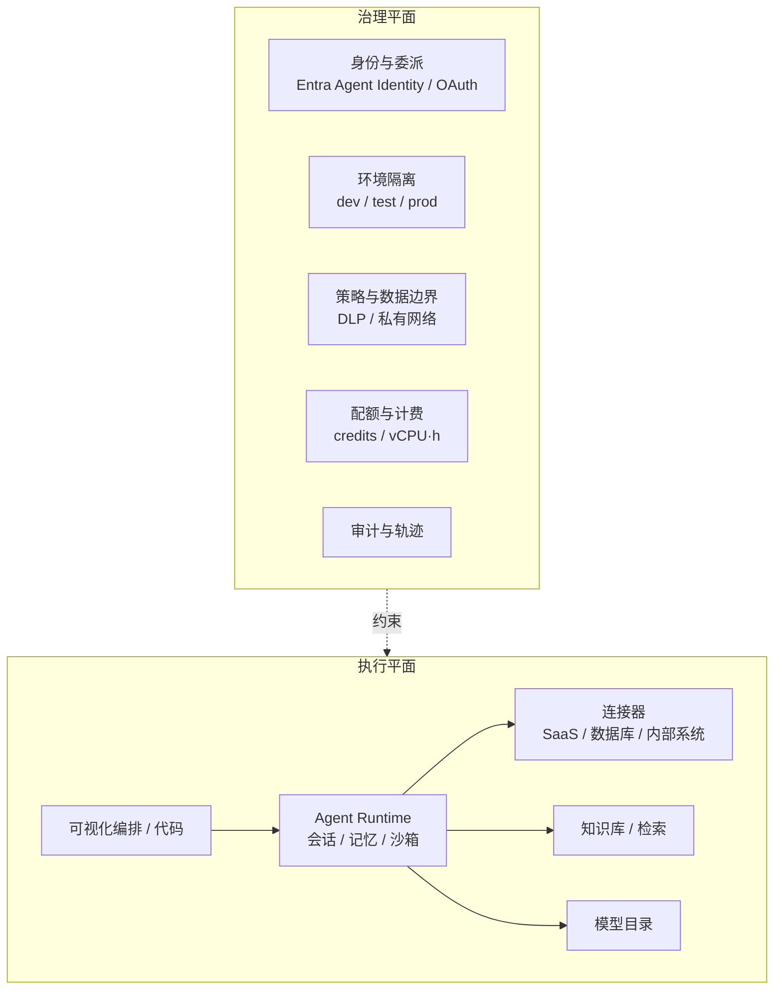

# 企业 Agent 平台：卖的不是编排，是"IT 能签字的那一层"

## 一句话结论

企业 agent 平台的真正产品不是可视化编排，而是把**身份、数据边界、审批、配额**打包成 IT 可以签字的一层；平台与代码框架的分界应按"变更频率 × 爆炸半径"划，而不是按"是否低代码"划。

## 先看一场立项会

业务部门想自己搭一个采购审批 agent：填单、查预算、走三级审批、回写 ERP，目标"两周上线"。IT 只问了三个问题——agent 调 ERP 时用谁的账号？审批记录能不能还原到具体的人？采购数据能不能出 VNet？业务答不上来，项目从两周变成两个季度，最后落成了"平台配置 + 少量代码"。

| 会上的一句话 | 落在哪个平面 | 对应概念 |
|---|---|---|
| "业务自己拖拽就能搭" | 执行平面 | 可视化编排、连接器、知识库 |
| "用管理员账号调 ERP 就行" | 治理平面：身份 | 服务主体、项目托管标识、用户委派 |
| "平台日志里有记录" | 治理平面：审计 | 委派链、读写类型、计价单位 |
| "数据不出内网" | 治理平面：数据边界 | 入站私有端点、出站 VNet 隔离 |

**治理平面是什么？** 人话是"不负责能不能跑，负责谁敢批、能碰什么、出事了查得到"。类比公司财务：业务部门负责把事做成，财务负责每笔钱有单据、有审批、能对账；例子是身份、环境、策略、配额、审计这五件，缺一件 IT 就不签字。

**服务主体与用户委派是什么？** 人话是"agent 自己有个账号，还是借你的账号干活"。类比代办：拿授权书是服务主体，拿你的身份证是直通；例子是定时批处理用服务主体加审批，改自己的日历用委派，改全公司配置则两者都不够，还要加人工闸门。

立项会卡住的三个问题，没有一个是"编排好不好用"；平台卖的正是这一层，而它与代码框架的分界也在这里。

## 问题与边界

- **解决什么**：让业务人员在受治理的环境里组装 agent——接知识库、接企业系统、配权限、发到 Teams/网页/API，并让 IT 能看到谁在用、用了多少、能访问什么。
- **不解决什么**：复杂状态机、高性能定制逻辑、跨系统的事务一致性。这些仍然要写代码。
- **与代码框架的分界**：框架给你 loop 与抽象，平台给你运行环境、身份、连接器、配额与审计。二者可以叠：平台里跑一段自定义代码，代码里调平台的连接器。
- **与 iPaaS 的分界**：Zapier/n8n 起于"应用间自动化"，agent 是新增的一等节点；Copilot Studio/Foundry 起于"agent 优先"，连接器是配套。起点不同，治理模型也不同。
- **一个前置判断**：如果需求能用固定 workflow 表达，别上 agent 平台；确定性流程用确定性工具，成本与可预测性都更好。
- **相关篇目**：连接层标准见 [Model Context Protocol](../03-protocols/01-mcp.md)，平台在整体栈中的位置见 [2026 Agent 技术全景](../00-overview/01-landscape.md)。

## 核心概念与架构

企业平台可以拆成两个平面：**执行平面**（编排、运行时、连接器、模型、知识库）与**治理平面**（身份、环境、策略、配额、审计、发布）。多数平台的差异不在执行平面——大家都能画流程图——而在治理平面是否完整，以及它是否与企业的 IdP、数据目录、工单系统打通。

治理平面不是"附加功能"，它决定了平台能不能进生产：没有环境隔离，测试 agent 会写生产数据；没有身份委派，所有操作都以"管理员"身份执行；没有配额，一个循环会把当月预算烧完。

对象定义：

- **环境**：数据位置、可建者、可用连接器、dev/test/prod 的边界。Copilot Studio 把 agent 放在 Power Platform 环境里，环境本身就是治理容器（[来源](https://learn.microsoft.com/en-us/training/modules/design-governance-security-strategy-copilot-studio/2-governance-model)）。
- **agent 身份**：agent 以自己身份运行（服务主体），或以用户身份委派运行（OAuth passthrough）。前者适合后台任务，后者适合"代表我看我的数据"。
- **连接器**：预建的 SaaS/数据库动作，通常带 schema 与鉴权；它是平台锁定最强的地方。
- **配额**：按消息、动作、credit、vCPU·h 或 token 计，单位不同意味着成本不可直接比较。

## 关键机制

### 1. 身份：三种模式，选错就出事故

- **服务主体**：agent 有自己的身份与权限，适合定时任务、后台批处理；风险是权限过大且难归因到人。Foundry 对应 Entra Agent Identity。
- **项目级托管标识**：以项目为单位隔离权限，省去凭据管理；风险是项目内所有 agent 共享同一身份。Foundry 对应 Foundry Project Managed Identity。
- **用户委派/直通**：以发起人身份调用下游，或由用户向 MCP 服务授权、agent 持有其凭据；权限天然收敛，风险是长任务中令牌过期。Foundry 对应 OAuth Identity Passthrough（[来源](https://devblogs.microsoft.com/foundry/foundry-agent-service-ga/)）。

选择判据：**动作的后果由谁承担**。改自己的日历用委派；改全公司的配置用服务主体加审批；读第三方数据用直通。

### 2. 网络与数据边界

企业最常问的不是"能不能做"，而是"数据出不出网"。平台通常提供两档：入站私有端点（只在私网访问控制台/API）与出站私有隔离（agent 运行时流量走 VNet）。Foundry 的文档明确：出站隔离需要 Standard Setup + 私有网络，且部分功能（如 Workflow Agents 的出站 VNet 注入、AI Gateway）尚不支持（[来源](https://learn.microsoft.com/en-in/azure/foundry/how-to/configure-private-link)）。

这意味着"私有化"不是一个布尔值，而是一张功能支持矩阵。采购前要按自己的必须项逐条核对，而不是看宣传页的"支持私有部署"。

### 3. 配额与计费：单位不同，不能直接比价

- **Copilot Studio** 用 Copilot Credits：传统答案 1 点、生成式答案 2 点、agent 动作 5 点、租户图谱接地 10 点、agent flow 每 100 次动作 13 点（2026-08 费率，[来源](https://learn.microsoft.com/en-us/microsoft-copilot-studio/requirements-messages-management)）。
- **Gemini Enterprise Agent Platform** 把 Runtime、Code Execution、Sessions、Memory Bank 合并为三个 SKU：计算 $0.085/vCPU·hr、内存 $0.009/GiB·hr、存储 $0.30/GiB·月（2026-06-17 生效，[来源](https://services.google.com/fh/files/emails/b_502770571_gemini_enterprise_agent_platform_pricing.pdf)）。
- **Dify / n8n** 以订阅 + 自托管许可为主，成本主要是基础设施与人力；n8n 的社区版走 fair-code 的 Sustainable Use License，企业版另用商业许可（[来源](https://docs.n8n.io/n8n-community-license)）。

credits 与 vCPU·h 之间没有换算关系，跨平台比价只能落到"同一业务量的月账单"。

### 4. 版本与发布

企业平台要管三层版本：prompt、工具/连接器、模型。三层任意一层变更都可能改变行为，所以发布要能"钉住组合"并灰度。最低要求：每次发布有不可变版本号、可回滚、可对比（同一批测试用例在新旧版本上的差异）。

### 5. 多租户

多租户不只是"支持多个 workspace"，还涉及数据隔离、配额隔离、身份隔离与计费隔离。开源自建时这一层最容易踩许可：Dify 的修改版 Apache 2.0 明确要求，未经书面授权不得用其源码运营多租户服务（[来源](https://scancode-licensedb.aboutcode.org/dify-exception-apache-2.0.html)）。把它当"免费的多租户 SaaS 底座"之前，先看许可。

### 6. 观测：平台最容易糊弄的一层

企业要的不是 trace 瀑布图，而是三个能回答的问题：谁发起的、动了哪些数据、花了多少钱。映射到数据模型就是：每次运行带发起人身份与委派链；每个工具调用记录目标系统与读写类型；每次模型调用记录 token 与计价单位。三者缺一，审计就要靠人拼日志。

平台通常提供运行历史与用量报表，但细粒度往往不足。预留一个自建的事件出口（webhook / OTel exporter），比事后要求平台加字段现实。

## 对比

### 谱系

| 平台 | 起点 | 编排方式 | 部署形态 | 典型买家 |
|---|---|---|---|---|
| Copilot Studio | 对话式助手 + Power Platform | 图形化 + 主题/动作 | SaaS（微软云） | 业务部门 + IT |
| Microsoft Foundry Agent Service | 开发者平台 | 代码优先（SDK）+ 门户 | Azure，支持私有网络 | 平台工程团队 |
| Gemini Enterprise Agent Platform | Vertex AI 演进 | ADK 代码 + 控制台 | Google Cloud | 数据/ML 团队 |
| Dify | LLM 应用开发 | 可视化 workflow + API | 自托管 / 云 | 产品与中小团队 |
| n8n | 应用自动化 | 节点图 + AI 节点 | 自托管 / 云 | 自动化与集成团队 |
| Zapier | SaaS 连接器 | 触发器 + AI 步骤 | SaaS | 业务运营 |

两处 2026 年的重要变化：Vertex AI 在 Cloud Next 2026 被整合为 Gemini Enterprise Agent Platform（[来源](https://cloud.google.com/blog/products/ai-machine-learning/introducing-gemini-enterprise-agent-platform)）；Zapier 正把 Agents 迁移为 "AI by Zapier"，迁移后 agent 变成 Zap 里的一个 AI 步骤，知识源并非全部兼容（[来源](https://help.zapier.com/hc/en-us/articles/47402591569805-Migrating-from-Agents-to-AI-by-Zapier)）。平台的产品边界在动，选型时要把"迁移路径"当成一项能力。开源侧的节奏同样要跟：Dify 在 2026-09 发布 v3.13.0 LTS，支持窗口到 2028-03（[来源](https://ee.dify.ai/releases/v3.13.0/)）。

### 能力对比

| 维度 | Copilot Studio | Foundry | Gemini Enterprise | Dify | n8n | Zapier |
|---|---|---|---|---|---|---|
| 可视化编排 | 强 | 中 | 中 | 强 | 强 | 中 |
| 连接器广度 | 中（Power Platform） | 中（Azure/OpenAPI/MCP） | 中（Google 生态） | 中 | 强（大量 SaaS/API 节点） | 极强（数千应用，厂商声称） |
| 治理 | 强（环境/租户/agent 三级） | 强（RBAC/私有网络/策略） | 强（IAM/Org Policy） | 中（RBAC/SSO，企业版） | 中（SSO/RBAC，企业版） | 中（Admin Control Center） |
| 多租户 | 平台侧 | 平台侧 | 平台侧 | 需商业许可 | 需商业许可 | 平台侧 |
| 计费单位 | Copilot Credits | Azure 资源 + token | vCPU·h / GiB·h / token | 订阅 | 订阅 | 任务/订阅 |
| 私有化 | 否（SaaS） | 是（私有网络） | 部分（VPC-SC） | 是（自托管） | 是（自托管） | 否 |

### "平台 vs 代码"的决策矩阵

| | 低爆炸半径 | 高爆炸半径 |
|---|---|---|
| **低变更频率** | 平台：表单、通知、知识问答 | 平台 + 强审批：审批流、报表分发 |
| **高变更频率** | 代码：实验性功能、内部工具 | 代码：核心交易、权限、计费 |

判断规则：

1. 变更频率高 → 代码。图形化编排在频繁变更下会成为版本管理噩梦。
2. 爆炸半径大 → 代码 + 平台只做入口。平台的价值在治理，不在承载核心逻辑。
3. 长尾需求多、单点价值低 → 平台。为 50 个部门各写一个服务不现实。
4. 数据不能出网且平台不支持私有化 → 只能自托管开源或自建。

五个采购前必须问清的问题：

1. agent 以谁的身份调用下游？委派链能否在日志里还原到人？
2. 出站流量能否只走私网？哪些功能在私有网络下不可用？
3. 计费单位是什么？跑一轮典型任务的账单能否在上线前压测出来？
4. 配置能否完整导出？换平台时哪些资产带得走？
5. 平台升级导致行为变化时，通知周期与回滚机制是什么？

### 选型评分卡

| 维度 | 权重 | 怎么验 | 红旗 |
|---|---|---|---|
| 身份与委派 | 高 | 要求演示"以用户身份调下游"并给出日志 | 只能用一个全局服务账号 |
| 数据边界 | 高 | 要功能支持矩阵，逐项对照必须项 | 只说"支持私有部署"不给矩阵 |
| 计费可预测 | 高 | 用真实流量压测一轮，拿到账单 | 只给单价，不给典型任务估算 |
| 可迁移 | 中 | 要求导出编排、提示、工具配置 | 配置只能在线编辑 |
| 运维负担 | 中 | 问升级频率、破坏性变更历史 | 无版本化、无灰度 |
| 生态与连接器 | 中 | 列出必须接的系统是否已支持 | 关键系统要"定制开发" |

## 实践建议与常见坑

### 企业落地的真实约束

- **IT 审批**：安全问卷会问数据驻留、子处理者、日志保留、渗透测试报告。SaaS 平台的优势是这些材料齐全，自建要自己产出。
- **数据边界**：连接器能访问的范围往往大于业务需要。最小权限要落到"每个 agent 一个专用凭据"，而不是复用管理员账号。
- **身份集成**：SSO/SCIM 只是起点，agent 身份、委派链、令牌生命周期才是难点。没有 agent 身份，审计日志里只有"某服务账号"。
- **SLA**：平台 SLA 不覆盖模型供应商的可用性，二者叠加后的实际可用性低于任一单方承诺；关键流程要设计降级路径。
- **供应商锁定**：锁定不在模型，而在上下文、记忆、身份、连接器与评测数据（[来源](https://www.techtarget.com/news/AI-vendor-lock-in-moves-beyond-the-model/846367/)）。可迁移性要在架构里预留，而不是等换供应商时再想。
- **影子 IT**：业务部门自带工具接入企业数据，是平台治理最常见的漏洞。平台要提供"低成本合规路径"，否则禁令只会把使用推到看不见的地方。
- **成本可预测性**：按动作/消息计费意味着成本随用户行为波动，财务需要上限与告警，而不只是月账单。

### 坑

- **坑 1：用平台承载核心流程**。触发条件：把订单履约做成图形化 workflow。后果：平台升级改行为、版本无法 code review、性能上限被平台限制。规避：核心逻辑写代码，平台只做触发与人工审批入口。
- **坑 2：把连接器当 API 网关**。触发条件：所有系统调用都走平台连接器。后果：连接器不支持的分页/重试/事务语义缺失，且成为单点。规避：核心集成走自有网关，平台连接器只做长尾。
- **坑 3：忽略 per-action 计费**。触发条件：agent 循环里每步都算一次动作。后果：高峰月账单是预估的数倍。规避：上线前用真实流量压测计费单位，设配额与熔断。
- **坑 4：多租户许可违规**。触发条件：用 Dify 社区版给客户开 workspace。后果：许可风险，且企业版功能缺失。规避：读许可，必要时买商业授权。
- **坑 5：迁移时才发现知识源不兼容**。触发条件：Zapier Agents 迁到 AI by Zapier。后果：部分知识源不支持，行为变化。规避：迁移前逐项核对知识源与工具调用行为，保留回退。

### 混合模式

推荐的落地形态是"平台做长尾、代码做核心"：

- 平台负责：部门级问答、审批入口、通知与轻量数据同步。
- 代码负责：核心交易、权限判定、计费、跨系统一致性。
- 两者通过 API/MCP 连接，身份统一到同一个 IdP，审计汇到同一个日志平面。

这样既拿到平台的治理能力，又不把核心资产放进一个无法 code review 的图形里。Gartner 社区的讨论也印证了这一点：多数企业优先用已有平台内嵌的 agent 能力，而不是另起一个"agent 平台宗教"（[来源](https://www.gartner.com/peer-community/post/agentic-capabilities-emerge-across-sap-servicenow-oracle-salesforce-microsoft-enterprise-platforms-i-m-curious-how-organizations-78x9)）。

### 什么时候不该上平台

- 只有一个团队、一个场景：平台的治理与连接器收益抵不过学习与迁移成本。
- 核心差异在算法或数据：平台不提供这部分，反而限制调优空间。
- 延迟敏感：多一层编排与网关，端到端延迟会多出可感知的一段。
- 强合规且平台不满足：与其在平台上做例外审批，不如自托管。

## 开放问题

- **agent 身份标准**：Entra Agent Identity 是厂商方案，跨云、跨组织的 agent 身份还没有事实标准。
- **配额的可比性**：credits、vCPU·h、token 三种单位之间没有公开换算，采购比价缺少共同语言。
- **平台的可迁移性**：能否把"编排 + 提示 + 工具配置"导出为可移植格式？目前各家都不提供完整导出。
- **私有化的边界**：出站隔离的功能矩阵差异很大，"支持私有部署"需要更细的分级。
- **责任划分**：平台升级导致 agent 行为变化，责任在平台还是配置者？合同与 SLA 通常没写。
- **评测归属**：平台自带的评估集是否代表企业真实流量？不代表真实流量的评估会给出虚假的安全感。

## 参考来源

- Copilot Studio 治理模型（环境/租户/agent 三级） · Microsoft Learn · 2026-09 · https://learn.microsoft.com/en-us/training/modules/design-governance-security-strategy-copilot-studio/2-governance-model
- Copilot Studio 计费费率（Copilot Credits） · Microsoft Learn · 2026-08 · https://learn.microsoft.com/en-us/microsoft-copilot-studio/requirements-messages-management
- Foundry Agent Service is GA（Entra Agent Identity / 私有网络 / evaluations） · Microsoft Foundry Blog · 2026-03 · https://devblogs.microsoft.com/foundry/foundry-agent-service-ga/
- Configure network isolation for Microsoft Foundry（限制矩阵） · Microsoft Learn · 2026-09 · https://learn.microsoft.com/en-in/azure/foundry/how-to/configure-private-link
- Introducing Gemini Enterprise Agent Platform · Google Cloud Blog · 2026-04 · https://cloud.google.com/blog/products/ai-machine-learning/introducing-gemini-enterprise-agent-platform
- Gemini Enterprise Agent Platform Pricing（2026 SKU 合并） · Google · 2026-06 · https://services.google.com/fh/files/emails/b_502770571_gemini_enterprise_agent_platform_pricing.pdf
- Dify License（修改版 Apache 2.0 与多租户条款） · ScanCode LicenseDB · 2026-11 · https://scancode-licensedb.aboutcode.org/dify-exception-apache-2.0.html
- Dify v3.13.0 LTS 发布说明 · Dify · 2026-09 · https://ee.dify.ai/releases/v3.13.0/
- n8n Community license（Sustainable Use License / fair-code） · n8n Docs · 2026-09 · https://docs.n8n.io/n8n-community-license
- Migrating from Agents to AI by Zapier · Zapier Help · 2026-09 · https://help.zapier.com/hc/en-us/articles/47402591569805-Migrating-from-Agents-to-AI-by-Zapier
- AI vendor lock-in moves beyond the model · TechTarget · 2026-10 · https://www.techtarget.com/news/AI-vendor-lock-in-moves-beyond-the-model/846367/
- Gartner Peer Community：agentic AI 平台策略讨论 · Gartner · 2026-08 · https://www.gartner.com/peer-community/post/agentic-capabilities-emerge-across-sap-servicenow-oracle-salesforce-microsoft-enterprise-platforms-i-m-curious-how-organizations-78x9
