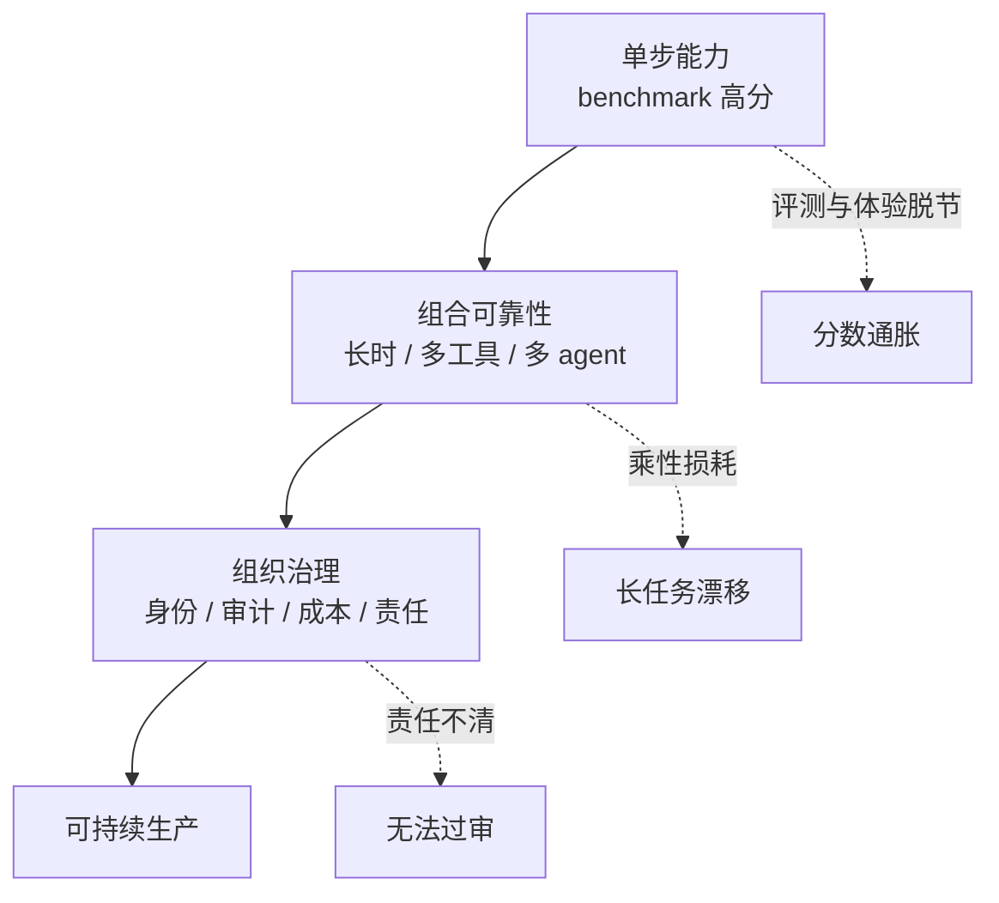

# 开放问题：能力之外，可靠性与治理才是约束

## 一句话结论

2026 年的瓶颈已经从"模型能不能做"移到"组合起来能不能稳定交付、能不能被审计、能不能算清单位成本"：单步能力曲线还在涨，但长时可靠性、评测口径与治理基础设施三条曲线明显没跟上。

## 问题与边界

- **解决什么**：把"agent 落地难"从模糊感受拆成可验证的缺口——评测、记忆、治理、标准化，每条给出当前证据与缺口形态。
- **不解决什么**：不预测具体产品生死，不做市场规模的猜测；趋势部分明确标注为主观判断。
- **与相邻篇目的分界**：模型能力与范式见[Agent 的本质](../01-foundations/01-agent-loop.md)，评测方法见[评测体系](../04-engineering/02-evaluation.md)，协议细节见[Model Context Protocol](../03-protocols/01-mcp.md)；整体分层见[2026 年 Agent 技术全景](../00-overview/01-landscape.md)。本篇只讨论"跨篇的组合问题"。
- **证据标准**：每条判断至少挂一个 2026 年的公开来源；厂商自述标注"厂商声称"。

## 核心概念与架构

把 agent 从"能演示"到"能生产"要穿过三层漏斗，每层都有独立的损耗：

- **单步能力**：给定明确任务与干净工具，模型能否做对。benchmark 主要测这一层。
- **组合可靠性**：几十步、多个工具、多个 agent、真实网络条件下，能否保持成功率。这一层的损耗是乘性的。
- **组织治理**：谁授权、谁负责、花了多少、出事怎么查。这一层不通过，前两层再好也不能上线。

三层的关系不是"做完一层再做下一层"，而是**下一层的失败会反过来否定上一层的分数**。这就是为什么 2026 年会出现"benchmark 接近饱和，生产仍然谨慎"的撕裂。

三个概念要先定义清楚，否则讨论会滑向各说各话：

- **组合可靠性**：不是单步成功率的平均值，而是整条轨迹的联合成功率。30 步、每步 95%，联合成功率约 21%。
- **单位成本**：完成一个业务上可接受的结果所花的全部成本，包含模型、工具、环境、重试与人工接管。
- **可审计性**：能从结果回溯到"谁授权、读了什么、改了什么、花了多少"，且证据不可篡改。

一篇 2026 年的评测研究把这种损耗形式化了：总有效性不超过各阶段有效性的乘积（V_total ≤ V1 × V2 × V3），任务生成、评分、部署决策任一层失真，都会乘性放大（[来源](https://arxiv.org/abs/2608.00794v5)）。这比"benchmark 不完美"的说法更有操作性——它告诉你该在哪一层做校准。

## 关键机制

### 1. 评测缺口：长时、成本、可复现

**长时任务没有公认口径。** METR 的 Time Horizon 1.1 显示，前沿模型在 50% 成功率下可完成约 12 小时的软件任务，但 80% 成功率下只有约 1 小时（[来源](https://opendatascience.com/ai-agent-task-horizon-workforce-planning/)）。对外宣传多用 50% 口径，而生产要求的是 80% 甚至 95%。

**成本没有归一。** 同一个分数可以靠多 rollout、长思考、并行子 agent 换出来，账单差几倍。SWE-bench 时代大家比 pass@1，现在必须比"每次成功交付的成本"，否则分数不可比。

**轨迹不可复现。** live web 每天在变，冻结快照又会过时。WebArena-Verified 的做法是把判分从字符串匹配改成后端状态校验，并修掉 257 个有问题的任务（[来源](https://openreview.net/pdf?id=94tlGxmqkN)）；这类"修尺子"的工作正在成为评测基础设施的一部分。

长时任务难测有三个具体原因：

- **判定成本随长度上升**：短任务看终态，长任务要定义"哪一步算完成"，还要区分"失败"与"尚未完成"。
- **环境不可重置**：真实系统有外部副作用，跑两次的初始条件不同，不能简单重跑。
- **失败是稀疏的**：100 次里错 5 次，要跑上千次才能给出有统计意义的区间，成本高到多数团队不做。

三个可用的替代做法：分段评测（把长任务切成可判定的阶段）、回放评测（固定输入与工具响应，只测决策）、线上影子评测（真实流量只观察不执行）。三者都不完美，但比"只看 demo"强。

OpenAI 在 2026-02 停止用 SWE-bench Verified 评估前沿模型，理由是污染与测试缺陷：在模型经常解不出的 27.6% 子集里，至少 59.4% 的题目存在会拒绝正确实现的测试（[来源](https://openai.com/index/why-we-no-longer-evaluate-swe-bench-verified/)）。这不是单个基准的问题，而是"用测试当评分"的结构性问题；编码侧的同类证据（同模型换 harness 差距、review 成本）见[编码 Agent](../05-products/01-coding-agents.md)。

### 2. 记忆与持续学习：跨会话稳定改进仍未解决

三类记忆被混为一谈，导致评估失真：

- **会话内工作记忆**：靠上下文与压缩，工程上已相对成熟。
- **跨会话事实记忆**：靠检索与写入策略，能"记住"，但常记错、记重、记过期。
- **程序性记忆**：把"这类任务该怎么做"沉淀为技能或提示，目前主要靠人工编写，自动演化仍不可靠。

公开数据也不乐观：LongMemEval 的跨会话聚合类问题，严格匹配口径只有 32.5%，LLM judge 口径 71.0%，行业平均约 27.9%（第三方自测报告，[来源](https://pypi.org/project/memtether/0.1.0a14/)）。口径差异本身说明一件事：**我们连"记住"的判分都还没统一**。

学术侧，TPAMI 2026 的终身学习路线图把记忆、技能获取与跨任务迁移列为三个独立问题（[来源](https://raw.githubusercontent.com/qianlima-lab/awesome-lifelong-llm-agent/main/README.md)）；2026 年的记忆综述则指出，写入触发、遗忘与冲突消解仍缺少统一方法（[来源](https://export.arxiv.org/pdf/2605.06716)）。

工程上的现实是：多数产品的"记忆"是"把历史摘要塞回系统提示"，既不可控也不可审计。真正的持续改进需要三件东西——可回滚的写入、可度量的收益、可删除的合规能力，目前三者都缺。

三种实现路径的取舍：

- **文件式记忆**（`memory.md`、笔记）：可读、可 diff、可删除；容量与检索能力有限，适合小团队与个人。
- **向量/图谱检索**：容量大、召回好；写入与更新语义模糊，容易出现"旧事实压过新事实"。
- **参数化记忆**（微调/持续训练）：跨会话最稳定；不可解释、不可删除，且更新成本高。

现状是三者混用，却没有统一的"记忆质量"指标。一个可操作的替代是：把记忆当数据库治理，定义 schema、写入审批、过期策略与删除审计，而不是把它当模型的附属功能。

### 3. 安全与治理：身份、责任、审计

**身份**。agent 以谁的名义行动，是治理的第一个问题。厂商侧已有方案：Foundry 提供 Entra Agent Identity 与 OAuth 身份直通（[来源](https://devblogs.microsoft.com/foundry/foundry-agent-service-ga/)）；标准化侧仍在一系列草案阶段，例如把 OAuth/OIDC、SPIFFE/WIMSE、DPoP 组合成"可验证授权"的 Agent Trust Profile（[来源](https://www.ietf.org/archive/id/draft-mnki-agent-trust-profile-00.html)）。

**责任**。agent 出错时，责任在模型供应商、平台、配置者还是发起人？合同与 SLA 普遍没写。IEEE 已启动 P1968（自主 agent 系统治理推荐实践）的 PAR，说明业界承认这是标准缺口（[来源](https://standards.ieee.org/ieee/1968/12749/)）。

**审计**。IETF 有 Governance Audit Record 草案，定义内核自审、会话关闭审计、事件触发审计等类型（[来源](https://datatracker.ietf.org/doc/html/draft-sato-soos-gar-00)）。但审计格式不统一，跨平台归集仍靠自建。

安全面的现实威胁是间接提示注入：浏览器 agent 读取不可信页面，页面里的指令会进入推理上下文。对 browser-using agent 的系统分析已经把攻击链从 MCP 层追到宿主接管（[来源](https://zenodo.org/records/21216301)）；WebMCP 的官方文档也明确要求把工具描述本身当作不可信输入（[来源](https://developer.chrome.com/docs/agents/security)）。

审计的最小数据模型，至少要能回答五个问题：

- 谁发起（用户身份 + 委派链 + agent 身份）
- 读了什么（数据源、查询、返回条数）
- 改了什么（目标系统、写操作、前后值）
- 花了多少（模型 token、工具调用、外部费用）
- 依据什么（策略判定、人工审批记录）

这五项缺任何一项，审计都会退化成"看日志猜过程"。

治理层慢半拍有结构性原因：能力由模型厂商单方面推进，治理需要跨厂商、跨行业协商；前者以月为单位，后者以年为单位。这不是谁不努力，而是两种节奏的必然错位。企业能做的不是等标准，而是把治理做成可替换的适配层——身份、审计、配额各自留接口，标准落地时替换实现而不是重写业务。

### 4. 标准化：协议收敛之后的三个空白

MCP 在 2026-07-28 走向无状态核心与扩展框架（[来源](https://blog.modelcontextprotocol.io/posts/2026-07-28/)），A2A 1.0 进入 AAIF（Linux 基金会）治理、150+ 组织支持（[来源](https://www.linuxfoundation.org/press/a2a-protocol-surpasses-150-organizations-lands-in-major-cloud-platforms-and-sees-enterprise-production-use-in-first-year)）。"怎么连"基本收敛，但还有三个空白：

- **计费**：agent 之间按次付费缺少通用语义。x402 用 HTTP 402 承载付款，Mastercard 在其上做 Agent Pay for Machines（[来源](https://www.mastercard.com/mea/en/news-and-trends/press/2026/october/Mastercard-Agent-Pay-for-Machines-in-action.html)），AWS Marketplace 也开始支持 x402 结算（[来源](https://www.constellationr.com/insights/news/aws-marketplace-adds-bevy-agentic-commerce-agents-removes-approval-friction-purchases)）。但企业级的预算、审批、发票与对账还没有标准。
- **发现**：A2A 有 Agent Card，但"去哪里找可信 agent"仍靠目录与私有注册表。IETF 已有多份发现机制草案在讨论 DNS、注册表与信任引导（[来源](https://datatracker.ietf.org/doc/draft-jimenez-dawn-discovery-landscape/)）。
- **信任**：身份能证明"是谁"，不能证明"是否可靠"。信誉、能力声明、历史表现的可验证记录还没有共识格式。

协议收敛的时间线值得记住，它决定了"哪些问题已经不用自己解决"：

- **2024-11**：MCP 发布，工具接入有了通用方式。
- **2025-04**：A2A 发布，agent 间委托有了提案。
- **2026-03**：A2A 1.0 发布；**2026-08** 并入 AAIF。
- **2026-07-28**：MCP 无状态核心 + 扩展框架，部署形态向普通 HTTP 服务靠拢。
- **2026 下半年**：计费（x402）、发现（IETF 草案）、信任（Agent Trust Profile）开始出现，但都未定稿。

规律是：**连接层先收敛，经济层与治理层后收敛**。企业现在能放心用 MCP/A2A 接系统，但不能假设计费与责任已经有标准答案。

## 对比

### 四个缺口的现状

| 缺口 | 2026 年的证据 | 已经有的进展 | 仍然缺什么 |
|---|---|---|---|
| 长时任务评测 | 50% 与 80% horizon 差一个数量级 | METR 任务集扩容到 228 项 | 小时级、可中断、带成本的公开基准 |
| 成本归一 | 同分不同价，rollout 策略不透明 | 部分榜单开始列 cost 列 | cost-per-success 的统一口径 |
| 可复现轨迹 | live web 漂移、判分器脆弱 | WebArena-Verified 后端状态校验 | 轨迹格式与回放标准 |
| 记忆 | 跨会话严格口径 ~30% | LongMemEval 等基准出现 | 写入/遗忘/冲突的统一方法 |

### 三条趋势判断

> 判断：runtime 会商品化。理由是协议已把"连接"标准化（MCP 无状态核心、A2A 1.0），托管 runtime 的计费已经细到 vCPU·hr 与 GiB·hr（[来源](https://services.google.com/fh/files/emails/b_502770571_gemini_enterprise_agent_platform_pricing.pdf)），这类资源型能力很难做出长期溢价。

> 判断：harness 会成为护城河。证据是同一模型换 harness 能带来十几个百分点的差距（ACL 2026 的 deep-research 分析：+17.81 RACE，[来源](https://aclanthology.org/2026.acl-long.288.pdf)），以及编码产品把投入放在 hooks、worktree、云端环境、代码审查这些"循环外围"的能力上，而不是换模型。

> 判断：评测会成为基础设施，而不是发布会的注脚。SWE-bench 被弃用、Terminal-Bench 加固 verifier、WebArena 重新判分、企业自建回放集，都是"评测需要持续维护"的证据；下一步会像 CI 一样，成为每次变更都要跑的一道关卡。

三条判断都有反证条件：如果某个 runtime 通过独占工具生态形成网络效应，商品化会放缓；如果模型能力再出现跨代跃迁，harness 的边际价值会下降；如果评测成本高到只有大厂能维护，它就不会成为普遍基础设施。把这些条件写出来，比只给结论更有用。

### 被高估与被低估

- **被高估**：多 agent 协作。演示里很热闹，生产里多数收益来自上下文隔离与并行，而不是"agent 开会"。
- **被高估**：自动记忆。写入容易，治理难；没有过期与删除的记忆是负债。
- **被低估**：确定性 hook 与测试。它们是让概率系统可用的"锚"，但没有发布会价值。
- **被低估**：成本工程。路由、缓存、压缩带来的毛利改善，往往大于换一个更强的模型。
- **被低估**：人工接管体验。接管点的信息是否完整，决定了人能不能在 30 秒内接手。

### 三个时间尺度

- **3–6 个月**：评测口径会继续分裂，企业自建回放集成常态；不要等标准。
- **12–18 个月**：agent 身份与审计格式可能出现事实标准（厂商方案 + IETF 草案收敛）。
- **3 年以上**：计费、责任与跨组织信任才可能形成可执行的制度，而不是技术约定。

把这三档写进规划，可以避免两类错误：用长期问题否定当下投入，或用短期方案承诺长期能力。

## 实践建议与常见坑

### 给不同角色的建议

- **做产品**：先定义"成功"的业务口径（完成率、人工接管率、单位成本），再选 benchmark；否则会被分数牵着走。
- **做平台**：把身份、审计、配额做成默认能力，而不是高级选项；这三样缺一个就过不了 IT 审批。
- **做采购**：要求供应商提供 cost-per-success 与失败分类，不接受只有平均分的材料。
- **做治理**：先定"哪些动作必须人类确认"，再谈自动化率；顺序反了会出事故。

### 治理的最小可行集

在标准落地之前，这五件事可以先做，且不会因为标准变化而返工：

- 每个 agent 一个独立身份，禁止共用服务账号。
- 每个运行带一个 correlation ID，串起模型、工具与外部调用。
- 动作分四级（读/写/提交/资金），后两级必须有人类确认。
- 配额按业务单元分配，超限熔断而不是只告警。
- 记忆写入走审批，删除要有可验证的回执。

这五件事的共同点是：它们描述的是**责任结构**，不依赖具体协议。

### 常见误判

- **误判 1：把 50% horizon 当生产能力**。触发条件：用"能连续工作 12 小时"做宣传。后果：上线后 20% 的任务莫名失败。规避：按 80% 口径做容量规划。
- **误判 2：把记忆当 RAG**。触发条件：用向量库存对话历史就宣称有记忆。后果：记不住冲突、删不掉、越用越偏。规避：区分事实记忆与程序性记忆，写入要可审计。
- **误判 3：把协议兼容当互操作**。触发条件：双方都支持 MCP/A2A 就认为能直接协作。后果：身份、计费、错误语义对不上。规避：联调时把失败路径与计费路径一起测。
- **误判 4：把 agent 当无状态服务**。触发条件：按 request/response 设计容量与超时。后果：长任务被网关超时切断，恢复后重复副作用。规避：持久化执行 + 幂等键。
- **误判 5：把安全当成过滤器**。触发条件：只在输入输出加内容审核。后果：拦不住"用合法工具做坏事"的轨迹。规避：动作级权限 + 预算 + 人工确认。

### 上线前的自检

- [ ] 用 80% 成功率口径做过容量规划，而不是 50%。
- [ ] 有 cost-per-success 指标，且按业务结果归集。
- [ ] 长任务有检查点与幂等键，崩溃可恢复。
- [ ] 审计能回答"谁、读了什么、改了什么、花了多少、依据什么"。
- [ ] 记忆有写入审批、过期与删除路径。
- [ ] 协议兼容性测试覆盖失败路径与计费路径。
- [ ] 人工接管点有完整上下文，接管时长有度量。

## 开放问题

- **谁来做独立评测**？厂商自评、第三方评测、企业自建三条路各有利益冲突，目前没有可持续的公共基础设施。
- **agent 的法律身份**：能否像公司一样持有账户、签约、被追责？现有法律框架没有对应物。
- **记忆的删除权**：用户要求删除记忆时，散落在摘要、向量、技能里的副本如何证明已删？
- **成本的可解释性**：一次失败任务的账单该由谁承担？按 token 计费的模式把风险转给了使用方。
- **标准化的节奏**：协议层一年一版，治理层还是草案；两者不同步会让"能连"跑在"能管"前面。
- **失败的可比性**：各家对"失败"的定义不同（报错、超时、人工接管、结果不可用），跨系统的可靠性数据无法汇总。
- **评测的激励**：谁来为独立评测付费？厂商、买家、监管三方的激励都不足以支撑一个中立的公共评测机构。

## 参考来源

- Measurement Without Validity: The Compounding Reliability Problem in Agentic AI Evaluation · arXiv · 2026-10 · https://arxiv.org/abs/2608.00794v5
- METR Time Horizon 1.1（50% 与 80% 任务时长） · Open Data Science · 2026-10 · https://opendatascience.com/ai-agent-task-horizon-workforce-planning/
- Why we no longer evaluate SWE-bench Verified · OpenAI · 2026-02 · https://openai.com/index/why-we-no-longer-evaluate-swe-bench-verified/
- WebArena Verified（ICLR 2026） · ServiceNow · 2026 · https://openreview.net/pdf?id=94tlGxmqkN
- LongMemEval 跨会话口径实测（第三方自测） · memtether · 2026-09 · https://pypi.org/project/memtether/0.1.0a14/
- Lifelong Learning of LLM-based Agents: A Roadmap（TPAMI 2026） · IEEE TPAMI · 2026 · https://raw.githubusercontent.com/qianlima-lab/awesome-lifelong-llm-agent/main/README.md
- From Storage to Experience: A Survey on LLM Agent Memory Mechanisms · arXiv · 2026-05 · https://export.arxiv.org/pdf/2605.06716
- Foundry Agent Service is GA（Entra Agent Identity） · Microsoft Foundry Blog · 2026-03 · https://devblogs.microsoft.com/foundry/foundry-agent-service-ga/
- The Agent Trust Profile: Verifiable Authority for Autonomous Agents · IETF · 2026-09 · https://www.ietf.org/archive/id/draft-mnki-agent-trust-profile-00.html
- IEEE P1968（自主 agent 系统治理推荐实践） · IEEE SA · 2026 · https://standards.ieee.org/ieee/1968/12749/
- The Governance Audit Record (GAR) for Agentic AI Systems · IETF · 2026 · https://datatracker.ietf.org/doc/html/draft-sato-soos-gar-00
- Indirect Prompt Injection in Browser-Using Agents · Zenodo · 2026-07 · https://zenodo.org/records/21216301
- Agent security considerations for WebMCP · Chrome for Developers · 2026-06 · https://developer.chrome.com/docs/agents/security
- A2A Protocol Surpasses 150 Organizations（Linux Foundation） · Linux Foundation · 2026-04 · https://www.linuxfoundation.org/press/a2a-protocol-surpasses-150-organizations-lands-in-major-cloud-platforms-and-sees-enterprise-production-use-in-first-year
- Agent Pay for Machines（x402） · Mastercard · 2026-10 · https://www.mastercard.com/mea/en/news-and-trends/press/2026/october/Mastercard-Agent-Pay-for-Machines-in-action.html
- AWS Marketplace adds agentic commerce agents（x402 结算） · Constellation Research · 2026-11 · https://www.constellationr.com/insights/news/aws-marketplace-adds-bevy-agentic-commerce-agents-removes-approval-friction-purchases
- A Survey of AI Agent Discovery Mechanisms · IETF · 2026-07 · https://datatracker.ietf.org/doc/draft-jimenez-dawn-discovery-landscape/
- Gemini Enterprise Agent Platform Pricing（vCPU·hr / GiB·hr SKU） · Google · 2026-06 · https://services.google.com/fh/files/emails/b_502770571_gemini_enterprise_agent_platform_pricing.pdf
- The 2026-07-28 Specification · Model Context Protocol · 2026-07 · https://blog.modelcontextprotocol.io/posts/2026-07-28/
- 深度研究 harness 的贡献（+17.81 RACE） · ACL 2026 · 2026 · https://aclanthology.org/2026.acl-long.288.pdf
