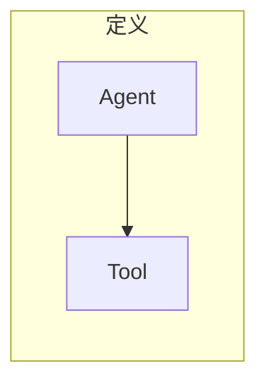

# <框架名>

## 一句话结论

<它是什么抽象层次的框架，最适合谁，什么时候不要用。>

## 定位与谱系

- 出品方 / 首次发布 / 当前版本（注明核实日期与来源）：
- 前身与合并关系：
- 在七层模型中的位置（模型层 / 运行时 / 编排 / 协议 / 工具 / 可观测 / 应用）：

## 核心概念

<3–6 个关键抽象，每个一句话讲清职责与边界。>



| 概念 | 职责 | 容易误解的点 |
|---|---|---|
| | | |

## 执行模型

<一次任务从入口到结束，控制流怎么走；同步/异步、事件驱动、图、对话循环。>

## 十维对比

| 维度 | 说明 |
|---|---|
| 抽象层次 | 代码优先 / 图编排 / 对话式 / 声明式 |
| 执行模型 | |
| 状态与持久化 | |
| 多 agent 支持 | |
| 工具与 MCP | |
| 可观测 | |
| 评测集成 | |
| 部署形态 | |
| 语言与生态 | |
| 许可证与治理 | |

## 最小示例

<≤15 行，只展示最能体现其抽象特点的骨架，不追求可运行。>

```python
# 骨架示意
```

## 适用与不适用

- **适合**：具体场景 + 原因。
- **不适合**：具体场景 + 原因，并给出替代方案。

## 常见坑

- **坑**：触发条件 → 后果 → 规避。

## 开放问题

## 参考来源

- 官方文档 · 版本 · 日期 · https://...
