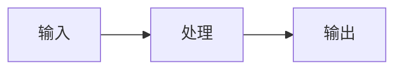

# <篇名>

## 一句话结论

<一句话给出本篇最重要的判断。不要复述标题。>

## 问题与边界

- 解决什么：
- 不解决什么：
- 与相邻概念的分界：

## 核心概念与架构

<关键对象/角色定义，一段话讲清"谁和谁说话、数据怎么流"。>

## 关键机制

### <机制 1>

<拆到能指导实现的粒度。>

### <机制 2>

## 对比

| 维度 | 方案 A | 方案 B |
|---|---|---|
| 适用条件 | | |
| 代价 | | |

## 实践建议与常见坑

- **坑 1**：触发条件 → 后果 → 规避方式。
- **坑 2**：

## 开放问题

- 

## 参考来源

- 标题 · 机构 · YYYY-MM · https://...
